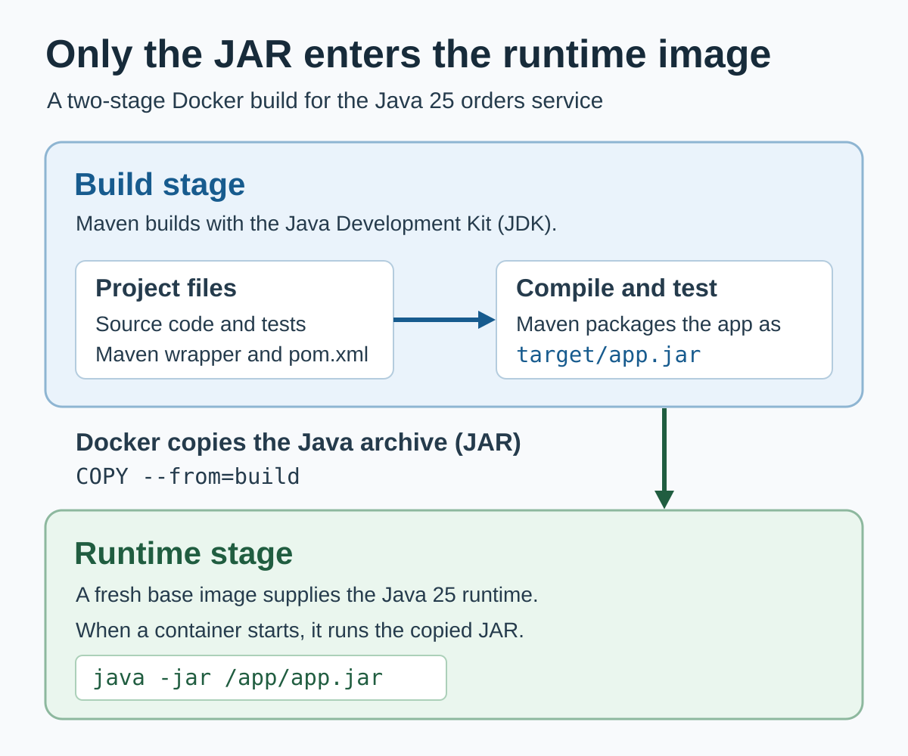
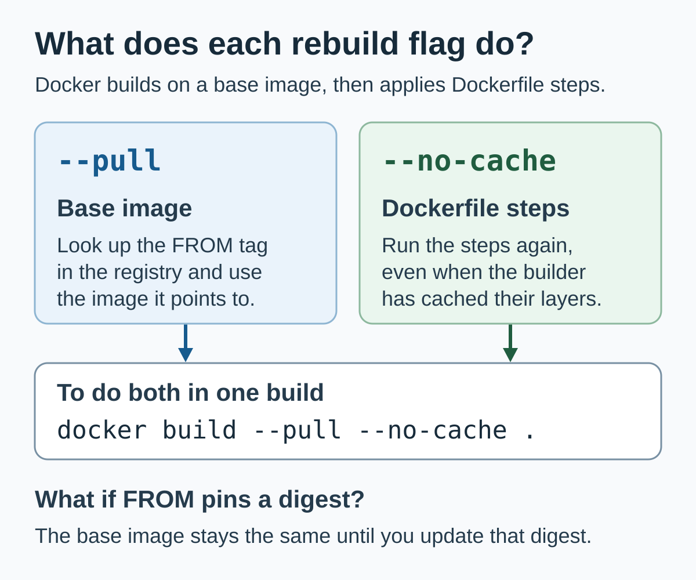
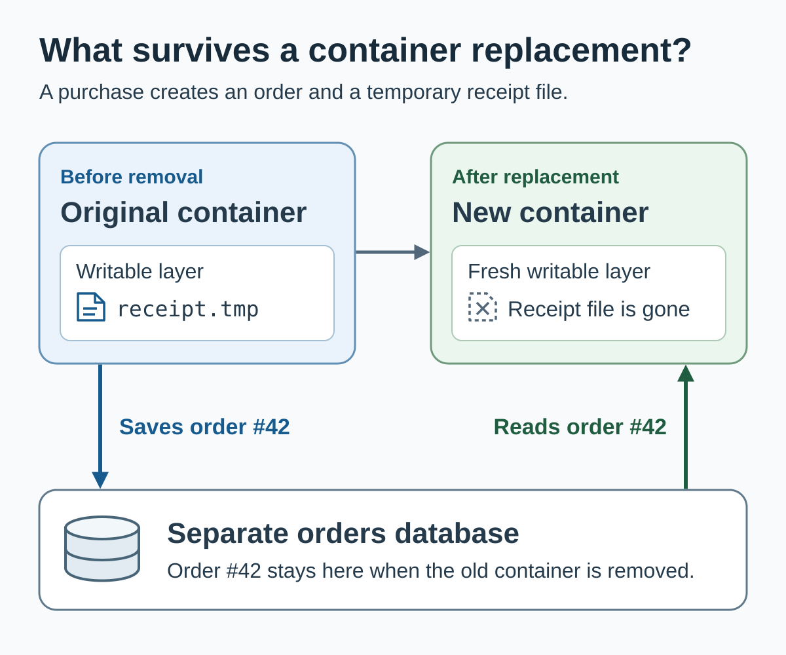

# Docker. Best practices

<sub>[Back to Computer Science](../Readme.md#content)</sub>

A **Docker image** packages an app and its files. A **container** is an instance of an image. The orders service illustrates builds, base images, container behavior, and testing with continuous integration (CI).

1. [Use multi-stage builds](#1-use-multi-stage-builds)
2. [Reuse common stages](#2-reuse-common-stages)
3. [Choose a trusted base](#3-choose-a-trusted-base)
4. [Rebuild regularly](#4-rebuild-regularly)
5. [Filter the build context](#5-filter-the-build-context)
6. [Make containers replaceable](#6-make-containers-replaceable)
7. [Omit unused packages](#7-omit-unused-packages)
8. [Separate services](#8-separate-services)
9. [Sort multi-line arguments](#9-sort-multi-line-arguments)
10. [Reuse the build cache](#10-reuse-the-build-cache)
11. [Pin base images by digest](#11-pin-base-images-by-digest)
12. [Build and test in CI](#12-build-and-test-in-ci)
13. [Pair apt-get update and install](#13-pair-apt-get-update-and-install)
14. [Use an exec-form entry point](#14-use-an-exec-form-entry-point)
15. [Run as a non-root user](#15-run-as-a-non-root-user)

## 1. Use multi-stage builds

This **Dockerfile** has two `FROM` lines. Each starts a stage, so one `docker build` runs a **multi-stage build**. Follow the Java archive (JAR) through both.



`WORKDIR` sets the working directory, `COPY` adds files, and `RUN` executes a command. An image stacks **layers**, each recording file changes.

```dockerfile
# syntax=docker/dockerfile:1
FROM eclipse-temurin:25-jdk-noble AS build
WORKDIR /workspace
COPY --chmod=0755 mvnw ./mvnw
COPY .mvn/ ./.mvn/
COPY pom.xml ./
RUN --mount=type=cache,target=/root/.m2 ./mvnw -B dependency:go-offline
COPY src/ ./src/
RUN --mount=type=cache,target=/root/.m2 ./mvnw -B verify

FROM eclipse-temurin:25-jre-noble
WORKDIR /app
COPY --from=build --chmod=0444 /workspace/target/app.jar ./app.jar
USER 10001:10001
EXPOSE 8080
ENTRYPOINT ["java", "-jar", "/app/app.jar"]
```

1. **Build.** `AS build` names the stage. The Maven wrapper (`mvnw`) compiles and tests with the Java Development Kit (JDK), then packs the app and its libraries in `app.jar`.
2. **Runtime.** The second `FROM` starts with the Java Runtime Environment (JRE). `COPY --from=build` copies only the JAR. Maven and the compiler stay behind.

`EXPOSE 8080` documents the port. Publish it with `docker run -p 8080:8080 orders:demo`.

## 2. Reuse common stages

Two services that need the same tools can share a named build stage.

## 3. Choose a trusted base

A base image supplies a stage's starting files. Pick a small, maintained one that fits the app. Docker Official Images are a trusted source.

## 4. Rebuild regularly

Rebuild and test to pick up fixes. A **registry** stores images. A **tag** is a name that can move to a newer image. A **digest** identifies exact content. Compare the two flags below.



### 4.1. Refresh the base with `--pull`

`--pull` checks which image the tag `25-jre-noble` points to now.

### 4.2. Rerun steps with `--no-cache`

`--no-cache` reruns build steps. Docker can still use the local base. In §1, BuildKit starts with an empty Maven cache mount (the downloads directory), so Maven fetches its libraries again. Add `--pull` to refresh the base too. `-t` names the image.

```bash
docker build --pull --no-cache -t orders:demo .
```

## 5. Filter the build context

In `docker build -f docker/Dockerfile .`, `-f` selects the Dockerfile. The dot makes the current directory the **build context**. A `.dockerignore` at its root sends fewer files to the builder, even with explicit `COPY` paths.

```text
.git
target/
.env
settings.xml
```

Mount private Maven settings as a secret for the step that needs them. A password in `ENV` stays in the image configuration. An `ARG` can expose it in build history.

## 6. Make containers replaceable

An **ephemeral** container is easy to replace. In the diagram the database keeps order #42. Removing the container discards its writable layer, including the receipt. A named volume can keep files across replacements.



## 7. Omit unused packages

Install tools only where needed. An unused editor makes the image larger and adds software to patch.

## 8. Separate services

Run the service and database separately so you can scale each independently. One container can run several workers for the same job.

## 9. Sort multi-line arguments

List packages alphabetically, one per line, so changes and duplicates stand out (§13).

## 10. Reuse the build cache

Docker's **layer cache** reuses build results. In §1, the Maven wrapper and build file (`pom.xml`) come before `src/`. Editing one class reruns `verify`. The earlier dependency step can show `CACHED`.

Maven stores downloads separately in a **cache mount** at `/root/.m2`. GitHub Actions runs CI jobs on machines called **runners**. Its build cache omits mounts by default. A fresh runner can skip `go-offline` yet download libraries during `verify`.

## 11. Pin base images by digest

`image:tag@sha256:…` pins the base to a digest. Even if the tag moves, builds use the same content. Review and update the digest to pick up a fix.

## 12. Build and test in CI

Have CI build the image on each pull request. Start a container, submit an order, and read it back. Release the tested image.

## 13. Pair apt-get update and install

The `noble` base in §1 uses Ubuntu 24.04, a Debian-based system. Refresh the package index and install packages in one `RUN` so changing the package list also refreshes the index.

```dockerfile
RUN apt-get update \
    && apt-get install -y --no-install-recommends \
        git \
        unzip \
    && rm -rf /var/lib/apt/lists/*
```

`&&` stops on failure. Removing the index in the same layer saves space.

## 14. Use an exec-form entry point

The list-form `ENTRYPOINT` in §1 makes Java the main process (PID 1), so `docker stop` sends it `SIGTERM`. A shell at PID 1 can leave Java without the signal. The service or framework must finish active requests. After 10 seconds by default on Linux, Docker sends `SIGKILL` if the process still runs.

## 15. Run as a non-root user

`USER 10001:10001` runs Java as an unprivileged user. It can read the JAR and listen on port 8080. Limiting where it can write also limits the damage if the service is compromised.

## Check your understanding

1. Why is the compiler absent at runtime?

   <details>
   <summary>Answer</summary>

   The JRE stage copies only the JAR.

   </details>

2. Where can two images share tool setup?

   <details>
   <summary>Answer</summary>

   In a shared build stage.

   </details>

3. What should you check in a smaller base?

   <details>
   <summary>Answer</summary>

   Its publisher, maintenance, and fit for the app.

   </details>

4. Which flags refresh a tagged base and rerun the steps?

   <details>
   <summary>Answer</summary>

   `--pull --no-cache`.

   </details>

5. Where does `.dockerignore` go for `docker build -f docker/Dockerfile .`?

   <details>
   <summary>Answer</summary>

   In the current directory, the context root.

   </details>

6. Which survives replacement, order or receipt?

   <details>
   <summary>Answer</summary>

   The order, in the database.

   </details>

7. Where does a test-only tool belong?

   <details>
   <summary>Answer</summary>

   In the build or test stage.

   </details>

8. Must a container have exactly one process?

   <details>
   <summary>Answer</summary>

   No. Several workers can serve one responsibility.

   </details>

9. How should you list packages?

   <details>
   <summary>Answer</summary>

   One name per line in a sorted list.

   </details>

10. Why can Maven download libraries after `go-offline` shows `CACHED`?

    <details>
    <summary>Answer</summary>

    The instruction was skipped. The cache mount can still be empty.

    </details>

11. Will `--pull` update a pinned digest?

    <details>
    <summary>Answer</summary>

    No. Update the digest to select a patched base.

    </details>

12. How can CI test the final orders image?

    <details>
    <summary>Answer</summary>

    Start a container, submit a test order, and read it back.

    </details>

13. Why combine the index refresh and installation?

    <details>
    <summary>Answer</summary>

    Changing the install list also reruns the refresh.

    </details>

14. Who finishes a request after Java receives `SIGTERM`?

    <details>
    <summary>Answer</summary>

    The service or its framework, within the grace period.

    </details>

15. Why avoid running this service as root?

    <details>
    <summary>Answer</summary>

    Limited permissions restrict what compromised code can change.

    </details>

# Sources

- [Docker — Building best practices](https://docs.docker.com/build/building/best-practices/)
- [Image layers](https://docs.docker.com/engine/storage/drivers/#images-and-layers), [BuildKit cache-mount test](https://github.com/moby/buildkit/blob/v0.35.1/client/client_mount_test.go#L150-L186)
- [Dockerfile](https://docs.docker.com/reference/dockerfile/), [build context](https://docs.docker.com/build/concepts/context/#dockerignore-files), [cache mounts](https://docs.docker.com/build/cache/optimize/#use-cache-mounts), [CI cache mounts](https://docs.docker.com/build/ci/github-actions/cache/#cache-mounts)
- [Build secrets](https://docs.docker.com/build/building/secrets/), [volumes](https://docs.docker.com/engine/storage/volumes/), [stop timeout](https://docs.docker.com/reference/cli/docker/container/stop/)
- [Temurin images](https://adoptium.net/installation/containers/), [Maven lifecycle](https://maven.apache.org/guides/introduction/introduction-to-the-lifecycle.html)
