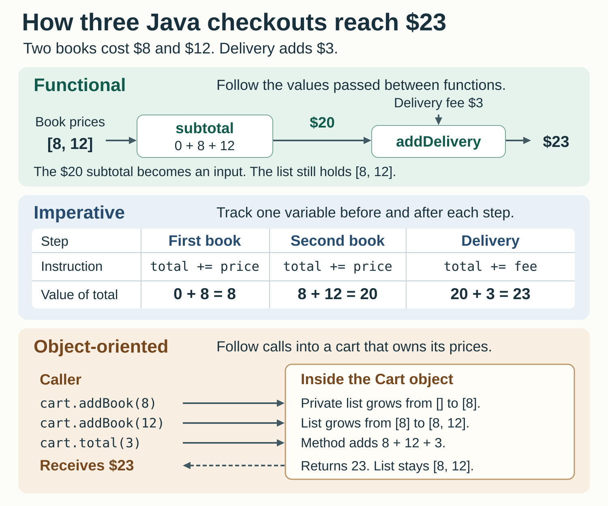

# Functional programming

<sub>[Back to Computer Science](../Readme.md#content)</sub>

**Functional programming** favors functions that compute new values from their inputs and leave existing data unchanged. At checkout, one function adds the book prices and returns a subtotal. A second function takes that subtotal and adds the delivery fee.

## Core ideas

- **Pure functions.** A pure function always gives the same result for the same inputs and has no **side effects** (changes you can observe beyond its return value). Charging a customer's card is a side effect, so it belongs outside `addDelivery`.
- **Immutability.** An immutable value stays as it was created. The loop reassigns `total` three times, from `0` to `8` to `20` to `23`. The functional example computes each successive sum without reassigning a running-total variable. In both examples, `List.of(8, 12)` creates an unmodifiable list. Calling `prices.add(5)` throws `UnsupportedOperationException`.
- **Functions as values.** You can pass a function as an argument. `reduce` is **higher-order** because it takes the addition function as input.
- **Composition.** Feed one function's result into another to build a larger calculation. Here `subtotal` and `addDelivery` can each be tested on their own, then used together to calculate the checkout total.

## One checkout, three styles

Two books cost $8 and $12, and delivery costs $3. In the diagram, follow the $20 subtotal between functions, read the changing value of `total` across the loop, then follow the calls into the cart and the answer back out.



## Three Java examples

Each example runs on its own in JShell, Java's interactive shell.

### Functional

`stream()` supplies the book prices in order. The expression `(sum, price) -> sum + price` is a **lambda**, a short function that adds the next price to the sum so far. Starting at `0`, `reduce` calculates `0 + 8 = 8`, then `8 + 12 = 20`. The loop below makes the same additions. With `reduce`, each sum becomes the input to the next addition.

```java
int subtotal(List<Integer> prices) {
    return prices.stream().reduce(0, (sum, price) -> sum + price);
}

int addDelivery(int amount, int fee) {
    return amount + fee;
}

var prices = List.of(8, 12);
int total = addDelivery(subtotal(prices), 3);  // 23
```

### Imperative

The loop visits each price. `total += price` adds that price to the amount already stored in `total`. After the loop, one more instruction adds delivery.

```java
var prices = List.of(8, 12);
int fee = 3;
int total = 0;
for (int price : prices) {
    total += price;
}
total += fee;  // 23
```

### Object-oriented

A `Cart` holds its own list of prices. Its `total` method uses the same `reduce`, but its answer also depends on that list. This makes the method **impure**. The same call, `cart.total(3)`, returns `3` for an empty cart and `23` after the two books are added.

```java
class Cart {
    private final List<Integer> prices = new ArrayList<>();

    void addBook(int price) {
        prices.add(price);
    }

    int total(int fee) {
        int subtotal = prices.stream().reduce(0, (sum, price) -> sum + price);
        return subtotal + fee;
    }
}

var cart = new Cart();
int emptyTotal = cart.total(3);  // 3
cart.addBook(8);
cart.addBook(12);
int total = cart.total(3);  // 23
```

# Sources

- [Oracle Java API — Stream.reduce](https://docs.oracle.com/en/java/javase/25/docs/api/java.base/java/util/stream/Stream.html#reduce(T,java.util.function.BinaryOperator))
- [Oracle Java Tutorials — Lambda Expressions](https://docs.oracle.com/javase/tutorial/java/javaOO/lambdaexpressions.html)
- [Scala documentation — Higher-Order Functions](https://docs.scala-lang.org/scala3/book/fun-hofs.html)
- [Oracle Java API — Unmodifiable lists](https://docs.oracle.com/en/java/javase/25/docs/api/java.base/java/util/List.html#unmodifiable)
- [Microsoft Learn — Refactor into pure functions](https://learn.microsoft.com/en-us/dotnet/standard/linq/refactor-pure-functions)
- [Scala documentation — Immutable values](https://docs.scala-lang.org/scala3/book/fp-immutable-values.html)
- [Microsoft Learn — Functional and imperative programming](https://learn.microsoft.com/en-us/dotnet/standard/linq/functional-vs-imperative-programming)
- [Oracle Java Tutorials — The for statement](https://docs.oracle.com/javase/tutorial/java/nutsandbolts/for.html)
- [Oracle Java Tutorials — What is an object?](https://docs.oracle.com/javase/tutorial/java/concepts/object.html)
