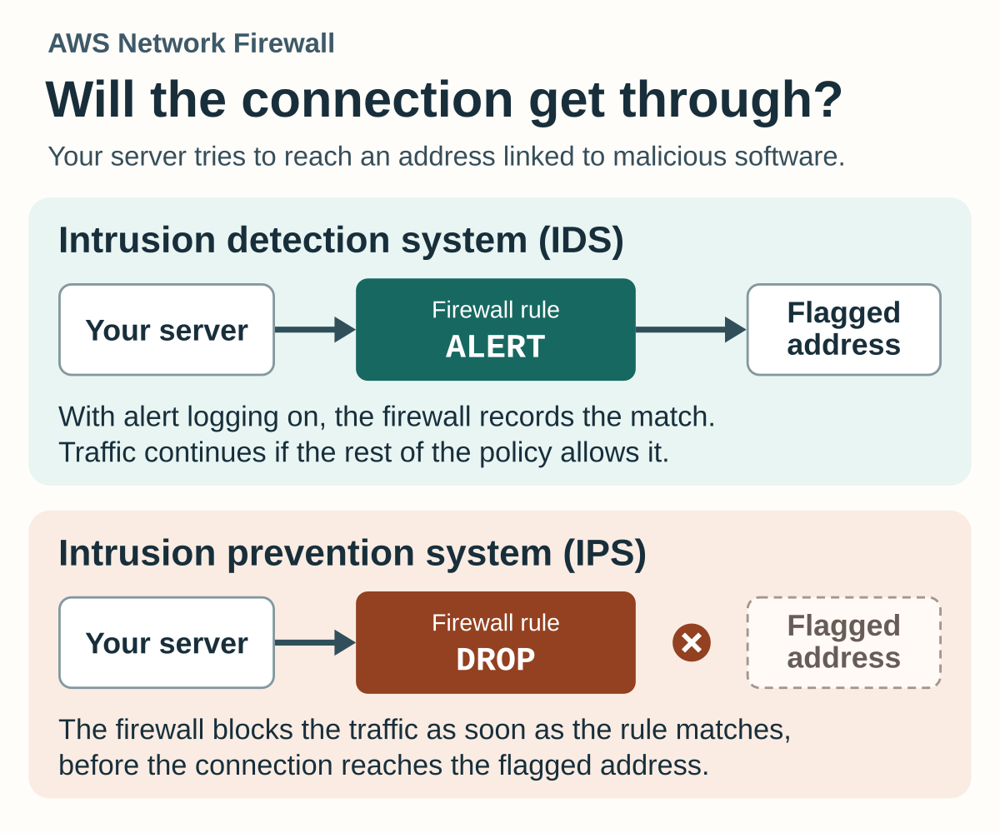

# Intrusion detection (IDS) and intrusion prevention (IPS) on AWS

[Back to Computer Science](../Readme.md#content)

An **intrusion detection system (IDS)** watches for signs of an attack and raises an alert. An **intrusion prevention system (IPS)** can also intervene automatically, for example by blocking a suspicious connection before it reaches its destination.

## What does the system inspect?

Network traffic travels in small pieces called **packets**. A network IDS can examine a copy of the traffic and look for a **signature**, a pattern associated with a known threat. For example, it can compare each packet’s destination address with a list of known malware servers.

An **inline** IPS sits directly in the traffic path. Because the actual packets pass through it, it can discard a matching packet before it reaches the destination.

## What happens to a suspicious connection?

Suppose your server on Amazon Web Services (AWS) tries to contact an address known to host malicious software. You route the server’s traffic through **AWS Network Firewall** and turn on alert logging. Its **stateful inspection** tracks which packets belong to the same connection, so rules can distinguish an outgoing request from the reply coming back.

Follow the same connection twice, changing only what the firewall does when it sees the flagged address.

- **`ALERT` for detection.** The firewall records the match for your team to investigate. The connection can continue if the rest of your firewall policy allows it.
- **`DROP` for prevention.** The firewall blocks the matching traffic. Testing a new rule with `ALERT` first lets you see whether it would block legitimate traffic.

## How does AWS recognize suspicious activity?

AWS runs **MadPot**, a network of decoy systems that helps it identify addresses used by attackers. AWS uses those addresses in **Amazon GuardDuty** and in blocking rules you can enable in Network Firewall.

GuardDuty can also detect an **anomaly** by comparing current activity with a **baseline**, the server’s usual behavior. For example, network logs might show your server sending far more data than usual to a particular computer. GuardDuty can then create a **finding**, a report your team can investigate. Was that transfer a scheduled backup, or did someone take data without permission?

## What else can these systems help with?

- **Spot an exposed service.** GuardDuty can report when a computer known for malicious activity probes a service on your server, such as remote login. That gives you a specific service to check for unintended public access.
- **Enforce a network policy.** Suppose a server only needs web access to download software updates. You can configure Network Firewall to allow web requests to the approved update site and block requests to other sites.
- **Trace an incident.** A Network Firewall alert log can show when traffic matched a rule and the addresses on both ends. Your team can use those details to find which other servers tried to reach the same destination.

# Sources

- [NIST SP 800-94 — Detection methods and network sensor placement, chapters 2 and 4](https://nvlpubs.nist.gov/nistpubs/Legacy/SP/nistspecialpublication800-94.pdf)
- [AWS Network Firewall — How stateful inspection works](https://docs.aws.amazon.com/network-firewall/latest/developerguide/firewall-rules-engines.html)
- [AWS Network Firewall — Routing traffic through the firewall](https://docs.aws.amazon.com/network-firewall/latest/developerguide/vpc-config-route-tables.html)
- [AWS Network Firewall — Alert and drop actions for stateful rules](https://docs.aws.amazon.com/network-firewall/latest/APIReference/API_StatefulRule.html)
- [Amazon GuardDuty — Data sources and security findings](https://docs.aws.amazon.com/guardduty/latest/ug/what-is-guardduty.html)
- [Amazon GuardDuty — Findings for unusual traffic volume and probes of exposed services](https://docs.aws.amazon.com/guardduty/latest/ug/guardduty_finding-types-ec2.html)
- [AWS Network Firewall — Allowing and denying traffic by domain name](https://docs.aws.amazon.com/network-firewall/latest/developerguide/stateful-rule-groups-domain-names.html)
- [AWS Network Firewall — Reading a firewall log](https://docs.aws.amazon.com/network-firewall/latest/developerguide/firewall-logging-contents.html)
- [AWS Security Blog — How MadPot informs GuardDuty and Network Firewall](https://aws.amazon.com/blogs/security/real-time-malware-defense-leveraging-aws-network-firewall-active-threat-defense/)
