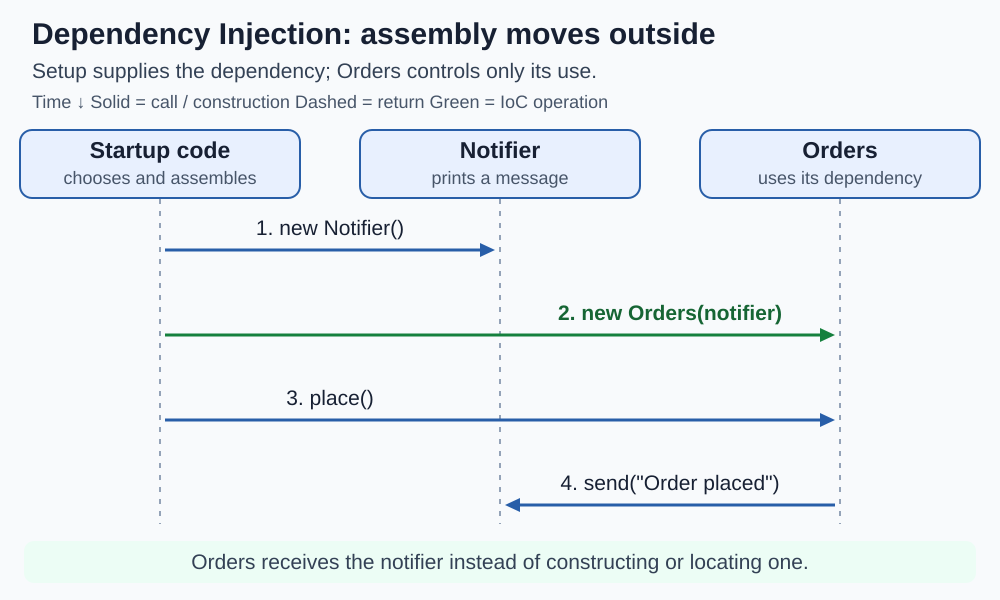
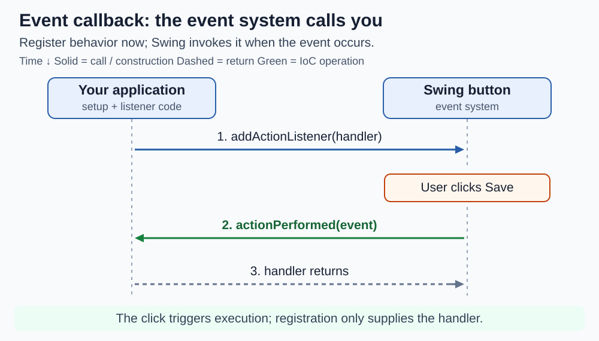
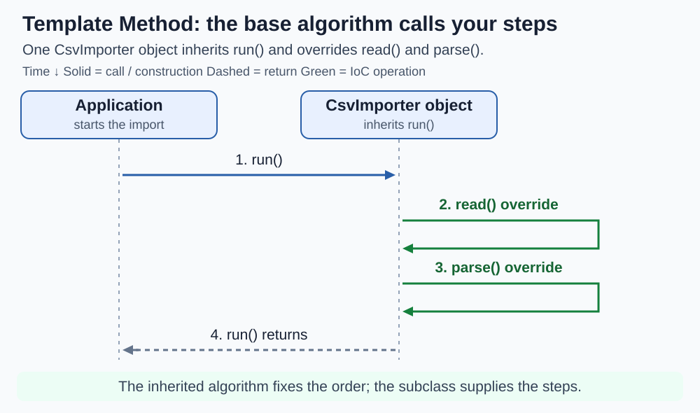
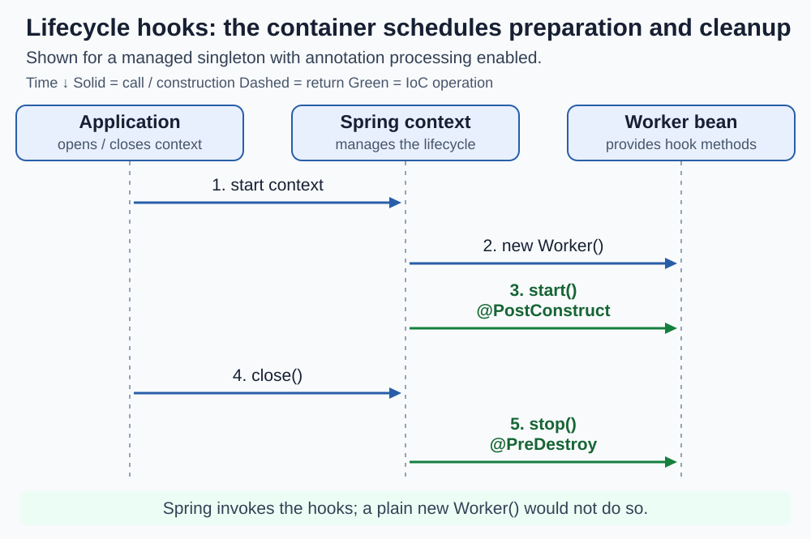
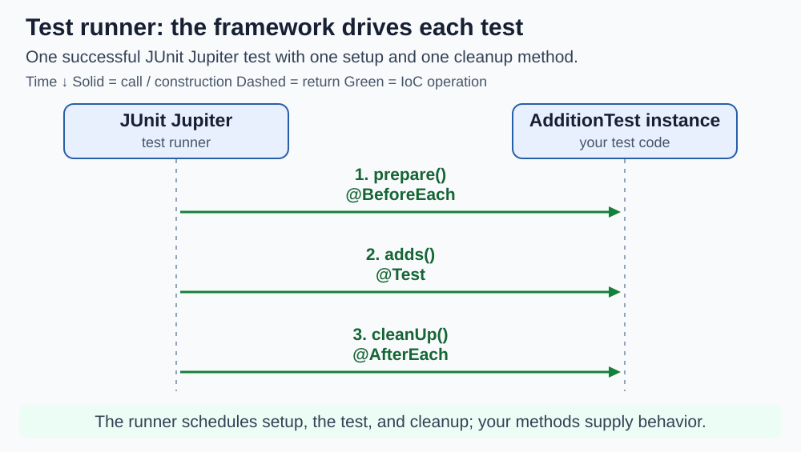

# Inversion of Control

<sub>[Back to Computer Science](../Readme.md#content)</sub>

**Inversion of Control (IoC)** means a framework, base algorithm, or external setup code takes responsibility for part of execution or object assembly. Your code supplies behavior or receives the objects it needs. Always ask: **which responsibility moved, and who now controls it?**

The five forms below overlap: a test runner uses callbacks and lifecycle hooks; a framework may also inject dependencies. They are common ways IoC appears, not an exhaustive classification. The concepts apply across languages; the examples use Java.

Read each sequence diagram **from top to bottom**. Boxes name participants; dotted vertical lines track them over time. Solid arrows show calls or construction, dashed arrows show returns, and green arrows mark the IoC operation. Unneeded returns are omitted.

## Dependency Injection

**Dependency Injection (DI) moves dependency assembly outside the consumer.** A dependency is an object a class needs. Setup code supplies it; the class uses it. Containers and interfaces are optional.

Java class declarations:

```java
class Notifier {
    void send(String text) { System.out.println(text); }
}
class Orders {
    private final Notifier notifier;
    Orders(Notifier n) { notifier = n; }
    void place() { notifier.send("Order placed"); }
}
```

Startup code runs `new Orders(new Notifier()).place()`. The sequence separates construction, injection, and use: `Orders` still calls `send`, but it no longer obtains its own notifier.



## Event callbacks

**The event system decides when your handler runs.** A callback is code registered for another component to invoke. Your application supplies the response instead of repeatedly checking for an event.

Swing setup fragment, inside UI initialization; `button` is later displayed:

```java
javax.swing.JButton button = new javax.swing.JButton("Save");
button.addActionListener(e -> System.out.println("Saved"));
```

The lambda (`e -> ...`) implements the listener's `actionPerformed` method. Registering it does not execute its body. In the sequence, registration happens first; a later click makes Swing call the handler. No dependency needs to be injected into that handler.



## Template Method

**A base class controls an algorithm's order; subclasses supply selected steps.** This keeps the sequence consistent while allowing different implementations.

Java class declarations:

```java
abstract class Importer {
    final void run() { read(); parse(); }
    abstract void read();
    abstract void parse();
}
class CsvImporter extends Importer {
    void read() { System.out.println("Read CSV"); }
    void parse() { System.out.println("Parse CSV"); }
}
```

Calling `new CsvImporter().run()` enters the inherited algorithm, which invokes the overridden steps. The sequence uses **one importer object**: the base and subclass are not separate participants. `run` fixes their order: `read` finishes before `parse` starts.



## Lifecycle hooks

**A container decides when managed components initialize and shut down.** A hook is a method it invokes at a defined lifecycle point, keeping that scheduling out of business code.

Spring-managed singleton bean excerpt; registration and imports for `jakarta.annotation` are omitted:

```java
class Worker {
    @PostConstruct
    void start() { System.out.println("Ready"); }
    @PreDestroy
    void stop() { System.out.println("Stopped"); }
}
```

With annotation processing enabled, Spring calls `start` after dependency injection and `stop` during orderly context shutdown. The sequence shows startup and explicit `close()`. A plain `new Worker()` does not activate these hooks; abrupt process termination may skip cleanup.



## Test runners

**A test framework controls test execution.** You provide test and setup/cleanup methods; the runner discovers and invokes them. This is an application of callback and lifecycle IoC.

JUnit Jupiter class excerpt; `org.junit.jupiter.api` imports omitted:

```java
class AdditionTest {
    @BeforeEach
    void prepare() { System.out.println("Setup"); }
    @Test
    void adds() { Assertions.assertEquals(2, 1 + 1); }
    @AfterEach
    void cleanUp() { System.out.println("Cleanup"); }
}
```

The sequence shows one successful test: `prepare` → `adds` → `cleanUp`. Your application does not call these methods itself. The framework supplies a repeatable lifecycle around each test; this diagram does not imply an execution order between different tests.



## Distinctions to keep

- **IoC is broader than DI.** Execution can be inverted without injecting dependencies, and manual DI needs no framework.
- **Service Locator is different from DI.** A consumer that calls `locator.getNotifier()` actively fetches its dependency; injection supplies it from outside.
- **Dependency Inversion Principle (DIP)**, covered in [SOLID](../SOLID/Readme.md), concerns source-code dependencies pointing toward abstractions. Injecting a concrete type is still DI, but does not by itself establish DIP.

# Sources

- [Martin Fowler — Inversion of Control: callbacks, Template Method, lifecycle methods, and test frameworks](https://martinfowler.com/bliki/InversionOfControl.html)
- [Martin Fowler — Dependency Injection and Service Locator](https://martinfowler.com/articles/injection.html)
- [Spring Framework — Dependency Injection](https://docs.spring.io/spring-framework/reference/core/beans/dependencies/factory-collaborators.html)
- [Oracle Java Tutorials — How to Write an Action Listener](https://docs.oracle.com/javase/tutorial/uiswing/events/actionlistener.html)
- [Spring Framework — Using PostConstruct and PreDestroy](https://docs.spring.io/spring-framework/reference/core/beans/annotation-config/postconstruct-and-predestroy-annotations.html)
- [Spring Framework — Lifecycle Callbacks and context shutdown](https://docs.spring.io/spring-framework/reference/core/beans/factory-nature.html)
- [JUnit Jupiter — BeforeEach](https://docs.junit.org/5.12.2/api/org.junit.jupiter.api/org/junit/jupiter/api/BeforeEach.html)
- [JUnit Jupiter — AfterEach](https://docs.junit.org/5.12.2/api/org.junit.jupiter.api/org/junit/jupiter/api/AfterEach.html)
- [Robert C. Martin — SOLID Relevance: Dependency Inversion Principle](https://blog.cleancoder.com/uncle-bob/2020/10/18/Solid-Relevance.html)
