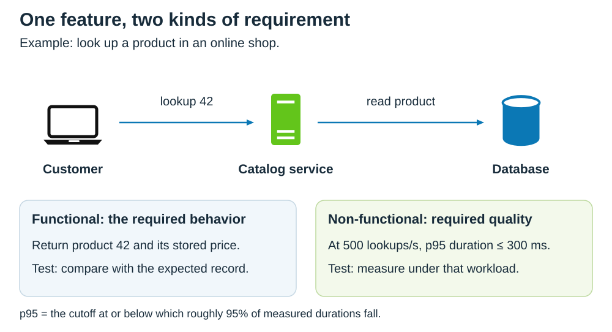
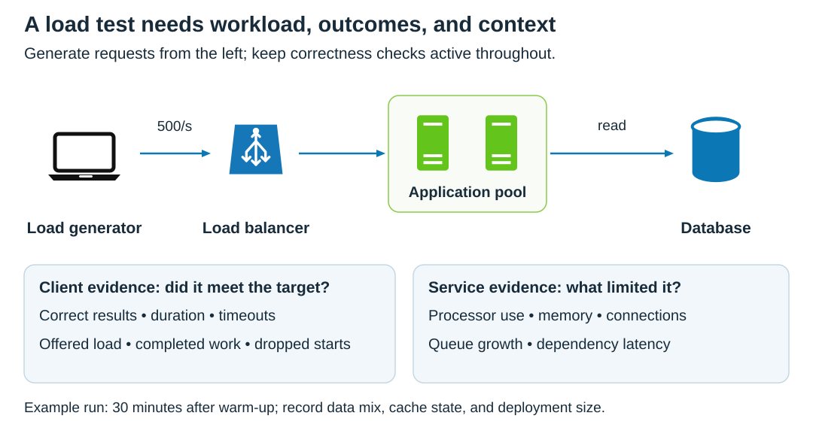
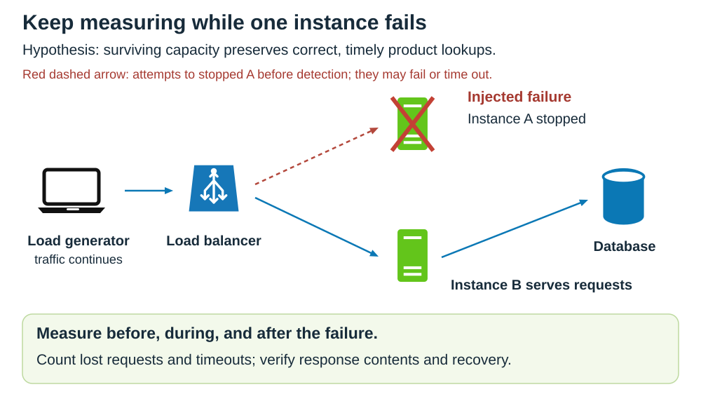
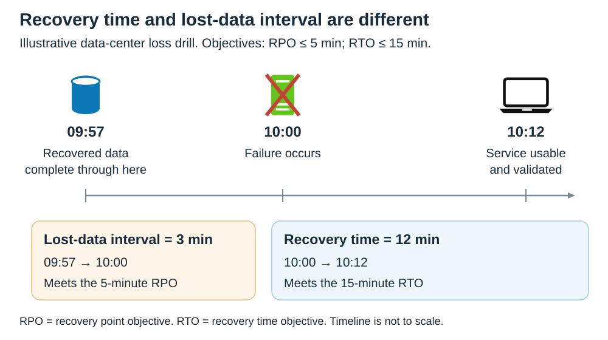

# Non-functional requirements and how to test them

<sub>[Back to Computer Science](../Readme.md#content)</sub>

**Functional requirements say what a system must do. Non-functional requirements say how well it must do it: how fast, how reliably, how securely, and how easily people can use it.** Both are real requirements. A product search that returns the right result after 20 seconds is correct and still useless.

This article first separates the two kinds and shows how to turn a vague quality goal into a measurable requirement, including the service level objectives used in production. It then matches each quality to a way of testing it. **Performance is the worked example**, with a script for the k6 load-testing tool, and resilience and recovery tests get extra explanation. Reports from Netflix, Shopify, and Cloudflare show what real tests and outages revealed, and the last section covers keeping the evidence useful after release.

Every number outside the company examples, such as 500 requests per second, 300 ms, or 99.9%, is **invented for illustration**. None is an industry standard. Real targets come from what your users need and what a failure would cost.

## 1. Functional versus non-functional requirements

A **functional requirement** describes an observable capability or rule: given an input and a situation, what result or state change must occur? For an online shop, examples include finding a product, calculating an order total, and rejecting a purchase when stock is exhausted.

A **non-functional requirement (NFR)** describes a required quality of a system or capability under stated conditions. Examples include responding within a time limit, continuing service during a failure, and making checkout usable with assistive technology. These are often called **quality attributes**. Projects may also group constraints, such as a required deployment environment, under NFRs; classification varies, so write the actual obligation explicitly.

Read the figure’s two boxes as two questions about the same lookup. The left box asks *what* must come back, and its test compares the answer with the expected record. The right box asks *how fast* it must come back under a stated load, and its test measures that.



| Requirement | Example | Evidence that addresses it |
| --- | --- | --- |
| Functional behavior | Looking up product `42` returns product `42` and its stored price. | Submit a known request and compare the response with the expected record. |
| Performance | At 500 lookups per second, the 95th percentile of request duration is at most 300 milliseconds. | Generate that workload and measure the duration distribution. |
| Availability | At least 99.9% of lookups succeed over a rolling 30-day window, not counting requests with invalid input. | Count attempts and successes throughout the window. |
| Recoverability | After the primary data center is lost, restore the agreed customer functions within 15 minutes. | Rehearse that failure and time recovery through successful user operations. |

**The line between the two is blurry.** “A customer cannot open another customer’s order” is a plain functional rule, and an ordinary integration test checks it. Yet the rule exists to serve a quality goal: confidentiality. So much of security testing is ordinary functional testing. The reverse also holds: a requirement does not become non-functional just because its test needs a special tool. The correctness check inside the load test in [§4](#4-performance-testing-choose-the-right-workload) is still a functional check.

A requirement states the outcome, not the solution. “Use a cache” is a design decision, unless the project truly mandates it. “At 500 lookups per second, answer 95% of lookups within 300 ms” is the requirement, and a cache is one way to meet it.

## 2. Make the requirement measurable

“Fast,” “scalable,” and “highly available” cannot pass or fail. To turn “product lookup must be fast” into something a test can check, answer five questions:

- **Which operation?** One product lookup by ID.
- **Under what conditions?** 500 lookups per second against a one-million-product catalog, after a warm-up.
- **Measured how?** Request duration as the client sees it, summarized as the 95th percentile (p95, defined below).
- **What limit?** p95 at most 300 ms, and at least 99.9% of lookups return the right product.
- **Over what window?** 30 minutes.

Also record who owns the requirement and why the number matters. The resulting pass-or-fail condition is an **acceptance criterion**: if the measurement meets it, the requirement counts as met. Written out in full, this invented requirement reads:

> After a separate warm-up, send 500 product lookups per second for 30 minutes to the specified test deployment. Use a representative one-million-product data set and an agreed mix of popular and rarely viewed products. At least 99.9% of attempts must return the expected product. Across all attempts, p95 request duration must be at most 300 ms. The load generator must send every request it schedules.

The last sentence matters because the **load generator**, the tool that sends the test traffic, can itself fall behind. If it cannot send every scheduled request, the test never applied 500 per second.

**Latency** is how long one operation takes; this article also calls it *duration* or *response time*. **p95**, the 95th percentile, is a cutoff: about 95% of requests finish at or below it, and the slowest 1 in 20 take longer. Requirements use a percentile because an average blends fast and slow requests into one number. If 90% of requests take 50 ms and 10% take a full second, the average is about 150 ms, a duration almost no request actually has, while p95 shows the full second. The [p50 vs p95](../p50%20vs%20p95/Readme.md) card explains percentiles in more depth.

The **arrival rate** is how many requests you send per second; **throughput** is how many the system completes per second. The two match only while the system keeps up. Once it falls behind, requests wait in queues, time out, or fail, and throughput drops below the arrival rate. So state both: sending 500 requests per second does not prove that 500 succeed per second.

A freshly started service is slower than it will be a few minutes later: its caches are empty, and it has not yet opened its reusable connections. A **warm-up** is a period of realistic traffic that gets this startup work out of the way. **Steady state** comes after it: latency and resource use stop drifting and stay roughly level from minute to minute. Measure a steady-state requirement after the warm-up, and write down how you decided the warm-up was over, for example “p95 stayed within 10% for five consecutive minutes.” Do not simply discard the slow start, though. Real users also reach freshly started instances, so if that matters, give it its own requirement and test it on purpose.

Say where the stopwatch is. A timer inside the server misses everything outside it, such as the network trip. A browser measurement can include network and rendering delays. The same request can therefore show two different, equally true durations.

Record the test conditions too: deployment size, software revision, data size, request mix, cache state, client location, and timeout policy. Without them, another engineer cannot interpret the result or repeat the test.

### SLI, SLO, and error budget

A **service level indicator (SLI)** is a number that shows how well the service is working for its users, such as the share of requests that succeed. A **service level objective (SLO)** is the target for that number over a time window. The **error budget** is the room the target leaves: the failures you can afford before you miss it. Do not confuse an SLO with a **service level agreement (SLA)**, a business contract that compensates customers when service falls short. For a request-based availability objective, where **eligible** requests are the ones the SLI counts:

```text
success SLI = successful eligible requests / all eligible requests
example SLO = success SLI >= 99.9% over a rolling 30 days
error budget = 0.1% of eligible requests in that window
```

Decide up front which requests are eligible and what counts as success. For example, you might leave out requests rejected because the client sent invalid input, since the service handled them correctly; write that rule down either way. Count timeouts and server errors as failures. Some failures never reach the application, such as requests dropped before they arrive, so also measure at the client or the load balancer. And never let a quick error count as good service: a server that fails in 2 ms looks excellent on a latency chart.

In a window of 1,000,000 eligible requests, a 99.9% objective allows 1,000 failures. Be careful when you convert that into time. 0.1% of 30 days is about 43 minutes, but that figure assumes traffic is spread evenly. Ten minutes of failures at peak can use more of the budget than an hour of failures at 3 a.m.

The budget turns reliability into a decision rule. When it runs out, the team’s error budget policy decides what happens next. Common policies, according to Google’s SRE Workbook, stop feature launches until the service is back within its SLO, or move engineering time to reliability bugs.

A 30-minute load test cannot prove a 30-day SLO, in the same way one good day cannot prove a good month. It shows that the system handled that load for those 30 minutes. Only measurement in production shows whether the service meets the SLO.

## 3. Match the quality to the test

NFR testing is broader than load testing. The following are example acceptance criteria to tailor to a product, with an experiment that can produce relevant evidence.

| Quality and meaning | Example acceptance criterion | How to test it |
| --- | --- | --- |
| **Performance:** response time and work completed | Meet the catalog duration and success limits at 500 requests/second. | Run representative requests; record latency percentiles, successes, timeouts, and completed throughput together. |
| **Scalability:** ability to handle more work as resources grow | Doubling application instances supports at least 1.7× successful throughput with the same duration limit. | Compare deployments with the same data and workload mix. Observe whether the database or another dependency becomes the limit. |
| **Availability:** the service works when users need it | At least 99.9% of eligible lookups succeed over a rolling 30 days, the SLO in [§2](#sli-slo-and-error-budget). | Measure the SLI continuously in production. Before release, the resilience and recovery tests below show only that the design can survive the specific failures they inject. |
| **Resilience:** ability to withstand disruption and recover | Removing one application instance at the agreed load leaves success rate at least 99.9% over the exercise. | Inject the failure while sending traffic; measure customer outcomes during detection, rerouting, and recovery. |
| **Durability:** preservation of accepted data | No acknowledged order is lost after the specified single-node failure. | Keep an independent record of acknowledged writes; recover, read them back, and compare identifiers and contents. |
| **Recoverability:** restoration after disruption | Recovery time at most 15 minutes and lost-data interval at most 5 minutes after the loss of a whole data center. | Restore the workload from the recovery copy, run customer operations, and compare recovered data with the write record. |
| **Security:** protection against unauthorized use | Every operation in the agreed role-and-resource access matrix enforces its policy. | Test allowed and denied combinations, including another customer’s resource identifier; inspect returned data and side effects. |
| **Usability and accessibility:** people can complete the intended tasks | The agreed checkout pages meet Web Content Accessibility Guidelines (WCAG) 2.2 level AA, the middle of its three conformance levels (A, AA, AAA); at least 9 of 10 participants complete the specified task unaided. | Combine accessibility tools, keyboard and screen-reader review, and observed task sessions. Report the sample and remaining barriers. |
| **Maintainability and operability:** ability to change and operate the service | A developer new to the catalog code makes a routine change, such as adding a product field, with tests, within one working day. An on-call engineer using a **runbook** (a written operational procedure) restores the previous release within 10 minutes in the test scenario. | Time a representative change made by someone unfamiliar with the code, and note where they got stuck. Rehearse rollback with the on-call engineer; time restoration and verify data/schema compatibility and customer behavior. |
| **Resource efficiency:** work delivered within a resource budget | The agreed workload uses no more than the allocated infrastructure budget while meeting its quality targets. | Measure resources and calculate cost per successful operation using the same accounting boundary for each comparison. |

The numbers above are test proposals. Select them from user needs and failure consequences. A usability session with ten participants offers evidence about that sample; it does not prove that 90% of all users will succeed.

For security, an access matrix covers only one part of the problem. Threat analysis, code review, dependency analysis, and targeted penetration testing find other kinds of weakness.

For accessibility, an automated scan cannot show conformance on its own. People who know the guidelines must also evaluate the pages.

## 4. Performance testing: choose the right workload

In this test layout, the laptop labeled “Load generator” sends the requests. Its measurements, listed in the “Client evidence” panel, decide whether the run met the target. The service’s own **telemetry** (operational measurements such as processor use, memory, and connection counts), listed in the “Service evidence” panel, explains what limited it. The load balancer spreads traffic across the application instances, and the database stays part of the tested request path.



Different traffic profiles answer different questions. The durations are rough guides from the k6 documentation:

| Test | Workload | Question it answers |
| --- | --- | --- |
| Smoke | A handful of requests; seconds or minutes | Does the test itself work (script, test data, endpoint) before a big run? |
| Expected-load | Normal or agreed peak traffic; 5–60 minutes | Does the system meet its targets at the expected traffic? |
| Stress / breakpoint | Above the expected load, typically 5–60 minutes; for a breakpoint test, keep increasing it until something fails | What fails first, and where is the limit? **Saturation** is a resource reaching its capacity limit. |
| Spike | A sudden, short burst, then back to normal; a few minutes | Does the system survive the burst and return to normal afterward? |
| Soak | Normal load for hours | Does anything slowly get worse, such as memory use or queue length? |

Load generators offer traffic in one of two ways, and the choice decides whether a test can reveal overload.

In a **closed workload model**, a fixed number of **virtual users (VUs)** each repeat a loop: send a request, wait for the response, send the next one. Picture 100 people who each phone a help line, wait until someone answers, and then call again. When the help line slows down, the callers wait longer and call less often, so the load drops exactly when the system struggles. The test looks calm while real traffic would pile up.

In an **open workload model**, new requests start on a schedule, such as 500 per second, whether or not earlier ones have finished. This matches users of a public website, who do not wait for each other. Use it when the requirement is an arrival rate. k6 still uses VUs here, but only as a pool of workers that carry out the scheduled requests. Each run of the test function is an **iteration**; in this article’s script, one iteration is one product lookup. If every VU is busy waiting for slow responses, the next scheduled iteration cannot start, and k6 counts it in `dropped_iterations`. So check that the generator has enough VUs and enough machine capacity.

Realism matters as much as request count. Vary product identifiers, popular versus rare queries, payload sizes, and cache hits. A million requests for one cached product do not represent searching a million-product catalog. Record dependency stubs: replacing a payment provider with a fake response limits what the experiment can establish about checkout.

### A k6 acceptance-test template

**k6** is a load-testing tool. This JavaScript template checks one public catalog endpoint. It assumes `/products/42` returns HTTP `200` with a JSON object containing numeric `id: 42`; replace the endpoint and assertion with the application’s actual contract. The fixed identifier keeps the example small; use representative test data for the full requirement above.

```javascript
import http from 'k6/http';
import { check } from 'k6';

export const options = {
  scenarios: {
    catalog: {
      executor: 'constant-arrival-rate',
      rate: 500,
      timeUnit: '1s',
      duration: '30m',
      preAllocatedVUs: 500,
      maxVUs: 1500,
      gracefulStop: '5s',
    },
  },
  thresholds: {
    http_req_duration: ['p(95)<=300'],
    checks: ['rate>=0.999'],
    dropped_iterations: ['count==0'],
  },
};

export default function () {
  const response = http.get(`${__ENV.BASE_URL}/products/42`, {
    redirects: 0,
    timeout: '2s',
  });

  let correct = false;
  try {
    correct = response.status === 200 && response.json().id === 42;
  } catch {
    // An invalid or absent JSON response is an unsuccessful lookup.
  }
  check(correct, { 'expected product returned': value => value });
}
```

The scenario settings control how work is offered and how the run ends:

- `rate: 500` with `timeUnit: '1s'` schedules 500 iterations per second for `duration: '30m'`. Here, each iteration sends one request.
- `preAllocatedVUs: 500` prepares 500 workers before the run. `maxVUs: 1500` permits k6 to add workers during the run up to a total of 1,500. These are worker counts, not request rates. Allocating workers during a run adds overhead, so preallocate enough for the expected workload when practical.
- `gracefulStop: '5s'` gives in-progress iterations up to five seconds to finish after the 30-minute scheduling period. No new iterations start during that grace period; unfinished ones are then interrupted. It does not add a pause between requests.

How many VUs does a run need? Each VU works on one iteration at a time, so one VU can complete at most 1 ÷ (iteration duration) iterations per second. At 0.2 seconds per iteration, one VU completes 5 per second, so 500 per second needs about 100 VUs. If responses slow to 2 seconds, the same rate needs about 1,000. In short, **VUs ≈ arrival rate × iteration duration**, plus headroom for slow responses. Count the whole iteration, including all its requests and script work. The template’s 500 and 1,500 are illustrative: retune them from measured durations and the generator’s resources, and keep the `dropped_iterations` threshold, which tells you whether the headroom was enough. A larger `maxVUs` alone does not show that the generator sent the requested rate.

After installing k6, save this as `catalog.js`. Send representative traffic until the chosen warm-up conditions are met, then start this measured run against the same deployment. This command uses a local example address:

```bash
k6 run -e BASE_URL=http://127.0.0.1:8080 catalog.js
```

There is one request and one combined correctness check per iteration. The thresholds therefore require p95 duration at most 300 ms, at least 99.9% correct lookups, and no dropped iterations. The duration metric includes sending, waiting, and receiving, but excludes initial name lookup and connection setup; it is not a browser page-load measurement.

This table maps each clause of the requirement to the script, including the two clauses the script leaves to you:

| Requirement clause in [§2](#2-make-the-requirement-measurable) | Where the script handles it |
| --- | --- |
| 500 lookups per second for 30 minutes | `rate: 500`, `timeUnit: '1s'`, `duration: '30m'` |
| At least 99.9% return the expected product | The `check`, plus the `checks: ['rate>=0.999']` threshold |
| p95 request duration at most 300 ms | `http_req_duration: ['p(95)<=300']` |
| The load generator sends every scheduled request | `dropped_iterations: ['count==0']` |
| After a separate warm-up | Not in the script: run the warm-up before it |
| One-million-product data set and agreed product mix | Not in the script: it always requests product `42` |

A failed **check** does not fail the run; k6 only counts it. **Thresholds make the run pass or fail.** When a threshold fails, k6 exits with a nonzero code, which a build pipeline can treat as a failure. That is why the script turns its check into a threshold. It is also why the script combines the status test and the ID test into one check. With two checks per request, 0.2% of requests could each fail one check while the overall check rate still shows 99.9%. If you need several checks, keep a separate per-request success metric.

Look at the results over time, not only at the final summary. At a constant rate, one terrible minute in a 30-minute run holds only about 3% of the requests. That fits inside the slowest 5%, whose durations p95 does not show, so the whole-run p95 can pass while every request in that minute was slow. Also watch the generator’s own resource use, the completed request count, application errors, database connections, and queue growth. If `dropped_iterations` is above zero, the run did not sustain 500 requests per second, so a passing latency result says nothing about 500 per second.

## 5. Resilience testing: verify the customer outcome during failure

A **fault injection** experiment deliberately introduces a specified failure, such as terminating an instance or delaying a dependency. **Failover** means transferring work to a surviving component. Netflix calls the discipline of such controlled failure experiments **chaos engineering** ([§7.1](#71-netflix-dependency-latency-and-customer-engagement--2015)).

This hypothetical experiment stops one of two application instances while traffic keeps flowing. The question is whether users still get correct and fast answers. In the figure, the server labeled “Injected failure / Instance A stopped” has been switched off. The dashed arrow shows requests that the load balancer still sends to A because it has not noticed the failure yet; they may fail or time out. The solid arrows show the path that survives: from the load balancer through “Instance B serves requests” to the database.



How long is “not noticed yet”? A load balancer such as AWS’s Application Load Balancer finds out through **health checks**: small test requests it sends to each instance at a fixed interval. It stops routing to an instance only after a set number of checks in a row fail. With a check every 10 seconds and three failures required (illustrative settings), A can keep receiving traffic for roughly half a minute. Those settings decide how many requests fail, so record them with the result.

Write the hypothesis and failure scope before the run, for example: “With two application instances and 500 lookups per second, stopping one instance preserves the exercise’s success and latency targets.” Notice what this demands: instance B must carry all 500 lookups per second on its own. If one instance can handle only 300 lookups per second, the test fails however fast the failover is. That is the *surviving capacity* in the figure’s subtitle. Define how long to observe, how to stop the injection, and which degradation triggers an immediate stop. Start in a representative test environment. A production experiment must limit how many real users it can affect (its **blast radius**), be watched live, and have a practiced way to undo it.

Measure across the failure transition. Starting measurement only after failover misses the requests lost while the system detected the failure. Keep correctness assertions active under load; an error page served quickly is still an error.

Use distinct experiments for process crashes, dependency timeouts, delayed responses, and the loss of a whole data center. One passing instance-termination test does not establish resilience to all of them. Likewise, adding a second application instance does not prove that the database can survive a failure: the figure has only one database.

## 6. Recovery testing: separate downtime from data loss

Two questions shape a recovery plan. The **recovery point objective (RPO)** answers: how much recent data can you afford to lose, counted back in time from the failure? The **recovery time objective (RTO)** answers: how long can the service be down, counted forward from the failure? RPO is a span of time, not a number of records: losing the last five minutes might mean thousands of orders at peak and none at night.

Read the timeline from the failure in the middle, marked by the crossed-out server. In this invented drill, the failure occurs at 10:00. Look left: the recovered data is complete only through 09:57, so the last 3 minutes of writes are lost, within the 5-minute RPO. Look right: users can work again at 10:12, so recovery took 12 minutes, within the 15-minute RTO.



Test restoration, not merely backup creation. Restore a real recovery copy into an isolated environment, start the required dependencies, and exercise the customer functions in scope. Compare recovered records with an independent write log, including the latest acknowledged writes and their timestamps. Record missing or corrupted data; do not assume a successful restore command proves completeness.

For the agreed scenario, time the full recovery path, including detection, decisions, data restoration, and service validation. An application process becoming healthy is not the endpoint if users still cannot perform the required operation.

A requirement to lose *nothing*, an RPO of zero, is a different promise. A backup taken every 5 minutes can lose up to the last 5 minutes of writes, so no backup schedule can meet it. Zero loss needs each acknowledged write stored somewhere that survives the failure before the customer is told it was saved. That is the durability row in [§3](#3-match-the-quality-to-the-test), and it needs its own failure scenario and test.

## 7. Production examples: what companies actually tested

These are past engineering reports. They show what each team tested at the time, not how its systems work today. The goals below summarize each report; they are not the companies’ official targets.

### 7.1. Netflix: dependency latency and customer engagement — 2015

**Quality targeted:** resilience when a dependency becomes slow. Netflix’s health signal was customer engagement, measured as the number of video plays that start each second. That number follows a predictable pattern, so the hypothesis was that it would stay on its normal pattern during the experiment.

**Test performed:** the Subscriber service handles user management and authentication. Netflix added 30 ms of latency to calls from Subscriber to its primary cache, first for 20% of that traffic and then for 50%.

**Observed result:** at 50%, engagement moved noticeably away from its normal pattern, so the hypothesis was disproved. Engineers made several fixes, and later experiments confirmed that Subscriber had become more resilient.

**Lesson to apply:** judge the experiment by a number customers feel, such as video starts, and run it again after the fix to prove the fix worked. Note the ramp too: 20% of traffic first, then 50%. That is the limited blast radius from [§5](#5-resilience-testing-verify-the-customer-outcome-during-failure). One passing result covers this latency on this dependency, not every failure.

### 7.2. Shopify: full-scale holiday rehearsals — report published January 2023

**Quality targeted:** capacity and resilience for Black Friday/Cyber Monday (BFCM).

**Tests performed:** Shopify scaled its platform to expected holiday deployment sizes and generated multiple flows, including browsing and buying, merchant administration, flash sales, and Storefront API traffic. Some exercises also routed requests away from one U.S. cloud region to check the remaining region’s capacity.

**Observed result:** some problems appeared before any test traffic was sent. Simply running more instances overloaded other systems, because each new instance opened its own connections to them. More Storefront Renderer instances overloaded an upstream application even at idle load, and more Shopify Core replicas strained the streaming infrastructure. Shopify fixed these by scaling the overloaded services, or by adding intermediary software that lets many instances share fewer connections.

**Lesson to apply:** rehearse the deployment size as well as the request rate. Shopify was also open about where the rehearsal differed from reality. Test traffic came from a few locations, while real shoppers arrive from all over the world, so concentrated test traffic could overload a few locations of the content delivery network (CDN). Caches could also distort the results, so some test requests were marked to skip them. A synthetic rehearsal builds confidence, but only real production traffic fully reproduces production.

### 7.3. Cloudflare: an outage exposed gaps in recovery assumptions — November 2023

**Quality at issue:** control-plane availability and disaster recovery. The **control plane** is the website and APIs that customers use to manage their Cloudflare services. It is separate from the network that carries customers’ traffic.

**What happened:** Cloudflare ran its control plane in three data centers near Hillsboro, Oregon, designed so that the other two could keep it running if any one went offline. On November 2, 2023, the largest of the three lost all power. Traffic through Cloudflare’s network kept flowing, but for a time customers could not change their settings, and some services, such as raw logs, stayed down until November 4. The design failed because of hidden dependencies: some services that were meant to survive the loss of a facility depended on systems that ran only in the failed one. Cloudflare had tested switching off each of the other two facilities, but never the whole of this one. This was a real outage, not a planned test.

**Documented response:** the postmortem promised a tested disaster-recovery plan for every generally available product, tests of the blast radius of failures, and chaos tests that remove each core data center entirely. These were promises, not completed work.

**Lesson to apply:** define separate customer journeys and recovery objectives, then exercise the loss of their real dependencies. A high-availability architecture diagram alone does not validate those objectives.

## 8. Keep evidence useful after release

Tie each requirement to its owner, test scenario, pass condition, and latest result. Preserve the workload, deployment revision, data assumptions, measurement window, and observed limitations with the report. A result without its conditions is difficult to reproduce or compare.

Use small correctness and authorization tests on changes, repeatable performance comparisons on a stable environment, and scheduled larger load or recovery exercises where appropriate. Observe production SLIs continuously. When a failed experiment or incident exposes a missing condition, update the requirement and its test together.

Quality goals pull against each other. A second server improves availability but costs money, and two-factor sign-in improves security but adds a step for users. Choose targets according to the product’s needs, then verify that the combined design meets them. The practical question is: **what must the user be able to do, under which conditions, and what evidence will show that the required quality holds?**

## 9. Self-check

1. “A customer cannot open another customer’s order.” Is this a functional or a non-functional requirement, and how do you test it?

   <details>
   <summary>Answer</summary>

   It is a functional rule: a request for someone else’s order must be refused, and an ordinary integration test checks it. The rule exists to serve a quality goal, confidentiality, which is why much of security testing is functional testing.

   </details>

2. Turn “product lookup must be fast” into a requirement a test can check. Which five things must it state?

   <details>
   <summary>Answer</summary>

   The operation (one product lookup), the conditions (500 lookups per second against a one-million-product catalog, after a warm-up), the measure (request duration as the client sees it, summarized as p95), the limit (p95 at most 300 ms, with at least 99.9% correct answers), and the window (30 minutes).

   </details>

3. A test sends 500 requests per second and reports p95 = 250 ms. Why does that not yet show that the system handles 500 requests per second?

   <details>
   <summary>Answer</summary>

   Sending is not completing. Throughput can fall below the arrival rate when requests queue, time out, or fail, so count correct completions too. Also check `dropped_iterations`: if the load generator could not send every scheduled request, the test never applied 500 per second.

   </details>

4. A service has a 99.9% availability SLO over 30 days. Why is “43 minutes of downtime a month” a risky way to read it, and why can a 30-minute load test not prove it?

   <details>
   <summary>Answer</summary>

   The error budget is 0.1% of eligible requests, not of minutes, and traffic is not spread evenly: a minute of failures at peak uses more of the budget than a minute at night. A 30-minute test shows only that the system handled that load for 30 minutes; only production measurement shows whether the SLO is met.

   </details>

5. Why can a closed workload model hide overload?

   <details>
   <summary>Answer</summary>

   Each virtual user waits for its response before it sends the next request. When the service slows down, the virtual users send less often, so the load falls exactly when the system struggles. An open model keeps starting requests on schedule, the way independent users arrive.

   </details>

6. In a k6 run, the check fails for 1% of requests. Does that alone make the run fail?

   <details>
   <summary>Answer</summary>

   No. k6 only counts failed checks. A run fails when a threshold fails, which is why the script defines `checks: ['rate>=0.999']`. With that threshold, a 1% failure rate fails the run, and k6 exits with a nonzero code.

   </details>

7. Two application instances share 500 lookups per second, and you stop instance A. What must be true of instance B for the test to pass, and why do some requests fail even then?

   <details>
   <summary>Answer</summary>

   Instance B must handle all 500 lookups per second on its own, with correct and fast answers. Some requests still fail because the load balancer keeps sending traffic to A until enough health checks in a row have failed.

   </details>

8. In the recovery drill, recovered data is complete through 09:57, the failure occurs at 10:00, and service is usable again at 10:12. Which interval is compared with the RPO, and which with the RTO?

   <details>
   <summary>Answer</summary>

   The RPO is compared with the lost-data interval, 09:57 to 10:00: 3 minutes. The RTO is compared with the recovery time, 10:00 to 10:12: 12 minutes.

   </details>

9. Can backups taken every 5 minutes meet a requirement to lose no data at all?

   <details>
   <summary>Answer</summary>

   No. Writes made after the last backup can be lost, up to about 5 minutes of them. Zero loss needs each acknowledged write stored somewhere that survives the failure before the customer is told it was saved.

   </details>

10. Shopify scaled its platform up to holiday size before any test load arrived. What went wrong, and what is the lesson?

    <details>
    <summary>Answer</summary>

    The extra instances opened extra connections, which overloaded other services even at idle load. Rehearse the deployment size as well as the request rate.

    </details>

# Sources

- [SEBoK — Definition of non-functional requirements and contrast with functional requirements](https://sebokwiki.org/wiki/Non-Functional_Requirements_(glossary))
- [SEBoK — System requirements, measurable criteria, ownership, and varying categories](https://sebokwiki.org/wiki/System_Requirements)
- [SEBoK — Quality attributes and tradeoffs](https://sebokwiki.org/wiki/Systems_Engineering_and_Quality_Attributes)
- [Google SRE Workbook — SLIs, SLOs, SLAs, error budgets and their policies, and measurement boundaries](https://sre.google/workbook/implementing-slos/)
- [Grafana k6 — API workload models, test types, correctness, and performance](https://grafana.com/docs/k6/latest/testing-guides/api-load-testing/)
- [Grafana k6 — Load test types and their typical durations](https://grafana.com/docs/k6/latest/testing-guides/test-types/)
- [Grafana k6 — Open versus closed workload models](https://grafana.com/docs/k6/latest/using-k6/scenarios/concepts/open-vs-closed/)
- [Grafana k6 — Constant-arrival-rate executor and worker allocation](https://grafana.com/docs/k6/latest/using-k6/scenarios/executors/constant-arrival-rate/)
- [Grafana k6 — Sizing arrival-rate workers, preallocation, and allocation overhead](https://grafana.com/docs/k6/latest/using-k6/scenarios/concepts/arrival-rate-vu-allocation/)
- [Grafana k6 — Graceful stopping and interrupted iterations](https://grafana.com/docs/k6/latest/using-k6/scenarios/concepts/graceful-stop/)
- [Grafana k6 — Warm-up and steady-state load profiles](https://grafana.com/docs/learning-hub/k6-performance-testing/03-establishing-a-baseline/17-designing-load-profile/)
- [Microsoft — Cold starts, cache initialization, and application warm-up](https://github.com/MicrosoftDocs/SupportArticles-docs/blob/main/support/azure/app-service/troubleshoot-performance-slow-web-app.md)
- [Microsoft — Initial connection costs and reuse through connection pooling](https://learn.microsoft.com/en-us/sql/connect/ado-net/sql-server-connection-pooling)
- [Grafana k6 — Thresholds and exit status](https://grafana.com/docs/k6/latest/using-k6/thresholds/)
- [Grafana k6 — Built-in metrics, request-duration boundary, checks, and dropped iterations](https://grafana.com/docs/k6/latest/using-k6/metrics/reference/)
- [Grafana k6 — Automated performance testing and limits of release gates](https://grafana.com/docs/k6/latest/testing-guides/automated-performance-testing/)
- [AWS — Application Load Balancer health checks, interval, and unhealthy threshold](https://docs.aws.amazon.com/elasticloadbalancing/latest/application/target-group-health-checks.html)
- [AWS Well-Architected — Recovery time and recovery point objectives](https://docs.aws.amazon.com/wellarchitected/latest/reliability-pillar/rel_planning_for_recovery_objective_defined_recovery.html)
- [AWS Well-Architected — Testing recovery paths, capacity, and runbooks](https://docs.aws.amazon.com/wellarchitected/latest/reliability-pillar/rel_planning_for_recovery_dr_tested.html)
- [OWASP — Authorization testing with role, feature, and data matrices](https://cheatsheetseries.owasp.org/cheatsheets/Authorization_Testing_Automation_Cheat_Sheet.html)
- [OWASP — Security testing throughout the development lifecycle](https://owasp.org/www-project-web-security-testing-guide/v42/3-The_OWASP_Testing_Framework/0-The_Web_Security_Testing_Framework)
- [W3C WAI — Evaluating accessibility with tools and human review](https://www.w3.org/WAI/test-evaluate/)
- [W3C — Web Content Accessibility Guidelines 2.2](https://www.w3.org/TR/WCAG22/)
- [Netflix TechBlog — Chaos Engineering Upgraded, September 25, 2015](https://netflixtechblog.com/chaos-engineering-upgraded-878d341f15fa)
- [Shopify Engineering — Performance Testing At Scale—for BFCM and Beyond, January 27, 2023](https://shopify.engineering/scale-performance-testing)
- [Cloudflare — Postmortem on the Control Plane and Analytics Outage, November 4, 2023](https://blog.cloudflare.com/post-mortem-on-cloudflare-control-plane-and-analytics-outage/)
- Diagram icon provenance: editable laptop, server, and database shapes adapted from this repository’s [System Design — Scaling database diagram](../../system%20design/01.%20Scaling/images/database.svg), and the load balancer from [System Design — News feed building](../../system%20design/11.%20News%20Feed%20System/images/hld-news-feed-building.svg).
- [Related CS card — p50 vs p95: percentile intuition and measurement with k6 and Prometheus](../p50%20vs%20p95/Readme.md)
