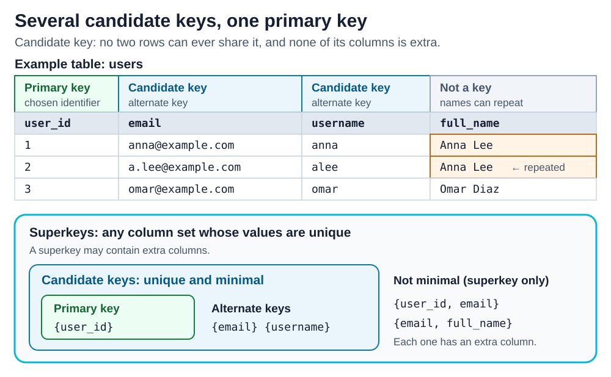

# Primary Key vs Candidate Key

<sub>[Back to Computer Science](../Readme.md#content)</sub>

# Front

What is the difference between a candidate key and a primary key in a relational table?

# Back

A **candidate key** is a minimal set of columns that identifies each row: no two rows can have the same value in it, and no column in it is extra. A table can have several candidate keys. The **primary key** is the one candidate key that the designer chooses as the main identifier of the rows. **Every primary key is a candidate key, but a table has only one primary key.**

## Test each column set

To find the candidate keys, ask two questions about a set of columns:

1. **Is it unique?** Can two valid rows ever have the same value?
2. **Is it minimal?** Is every column needed? Remove any one column, and the rest must no longer be unique.

In the `users` table below, `user_id`, `email`, and `username` pass both tests, so each one is a candidate key. `full_name` fails the first test, because two users can both be called Anna Lee. A set that passes only the first test is a **superkey**. For example, `{user_id, email}` is unique, but `user_id` alone is unique too, so `email` is an extra column.

The designer chooses `user_id` as the primary key. The candidate keys that are not chosen, `email` and `username`, are called **alternate keys**. In the diagram, the top part labels each column of the table. The nested boxes show that every primary key is a candidate key, and every candidate key is a superkey.



### A key is a rule, not a pattern in the data

A key must be unique for every row that the table can ever hold, not only for the rows it holds today. If ten users have ten different names, `full_name` is still not a candidate key: the next user can have a name that is already in the table. The data can prove that a column set is *not* a key, but it can never prove that a set *is* one.

## Declare the keys in SQL

SQL has no `CANDIDATE KEY` keyword. In PostgreSQL, declare the chosen candidate key with `PRIMARY KEY`, and declare each alternate key with `UNIQUE` and `NOT NULL`:

```sql
CREATE TABLE users (
    user_id   bigint GENERATED ALWAYS AS IDENTITY PRIMARY KEY,
    email     text NOT NULL UNIQUE,  -- alternate key
    username  text NOT NULL UNIQUE,  -- alternate key
    full_name text NOT NULL          -- not a key
);
```

- `PRIMARY KEY` means unique and not null. PostgreSQL allows at most one per table, so `ALTER TABLE users ADD PRIMARY KEY (email);` fails with `multiple primary keys for table "users" are not allowed`.
- A second row with the same email fails with `duplicate key value violates unique constraint "users_email_key"`.
- Keep `NOT NULL` on each alternate key. By default, `UNIQUE` does not treat two nulls as equal, so a `UNIQUE` column without `NOT NULL` accepts many rows that have no email.
- Neither `UNIQUE` nor `PRIMARY KEY` checks that a set is minimal: PostgreSQL also accepts `UNIQUE (user_id, email)`. Minimality is the designer's job.

### Which candidate key to choose

Other tables refer to a row through a **foreign key**: a column that stores the key value of that row. By default, a foreign key points to the primary key. If a primary key value changes, every row that refers to it must change too, or the database rejects the change. Thus choose a candidate key whose values never change. A user can change their email, so `email` is a poor choice. A number that the database generates, such as `user_id`, is the usual choice.

# Sources

- [Silberschatz, Korth, Sudarshan — Database System Concepts, 7th ed., Chapter 2 slides: superkey, candidate key, and primary key](https://www.db-book.com/slides-dir/PDF-dir/ch2.pdf)
- [Ramakrishnan, Gehrke — Database Management Systems, 3rd ed., Chapter 3 slides: keys, superkeys, primary and candidate keys in SQL, and why data cannot prove a constraint](https://pages.cs.wisc.edu/~dbbook/openAccess/thirdEdition/slides/slides3ed-english/Ch3_Rel_Model.pdf)
- [PostgreSQL 18 — Constraints: unique constraints and nulls, primary keys, and foreign key targets (§5.5)](https://www.postgresql.org/docs/18/ddl-constraints.html)
- [Oracle Database Development Guide, Release 26 — Choosing a Primary Key for a Table](https://docs.oracle.com/en/database/oracle/oracle-database/23/adfns/data-integrity.html#GUID-E9BD1A8C-4E1E-4342-ABC7-7853B67FDF88)
- [Microsoft Dynamics AX 2012 glossary — Alternate key](https://learn.microsoft.com/en-us/previous-versions/dynamicsax-2012/appuser-itpro/alternate-key)
