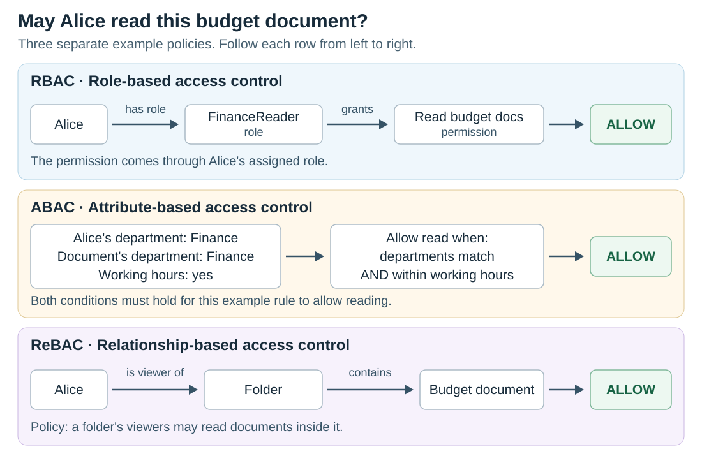

# RBAC vs ABAC vs ReBAC

[Back to Computer Science](../Readme.md#content)

# Front

How do RBAC, ABAC, and ReBAC decide whether someone can access a resource?

# Back

* **Role-based access control (RBAC)** checks permissions granted through roles.
* **Attribute-based access control (ABAC)** checks rules over attributes.
* **Relationship-based access control (ReBAC)** checks relationships to a resource.

All three concern **authorization**: deciding whether a user may perform an action on something, such as reading a document.

## What does each model check?

A **permission** allows an action on a resource. A **policy** defines the rules for granting or denying access.

| Model | Main input | Example policy for reading a budget document |
| --- | --- | --- |
| **RBAC — roles** | A role is a named collection of permissions assigned to users. | Users with the `FinanceReader` role may read budget documents. Alice has that role. |
| **ABAC — attributes** | Attributes are properties of the user, resource, requested action, or environment. | Allow `read` when the user's department matches the document's department **and** the request is during working hours. |
| **ReBAC — relationships** | Links such as ownership, membership, or sharing; rules may follow a chain of links. | A folder's viewers may read documents inside it. Alice is a viewer of the folder containing this budget document. |

Read each row from left to right. These are three separate example policies answering the same question: **may Alice read this budget document?**

## Remember the distinction

- **RBAC:** “Which role grants this permission?”
- **ABAC:** “Do the relevant properties satisfy the rule?”
- **ReBAC:** “How is this user connected to this resource?”

The models can overlap and combine.

For example, access through a role or a folder relationship can also require a working-hours check. A relationship grants access only when the policy gives that relationship the requested permission; an arbitrary connection is not enough.

# Sources

- [NIST — RBAC: roles, permissions, and additional constraints](https://csrc.nist.gov/projects/role-based-access-control/faqs)
- [NIST — Definition of attribute-based access control](https://csrc.nist.gov/glossary/term/attribute_based_access_control)
- [OpenFGA — Authorization concepts and relationship-based access](https://openfga.dev/docs/authorization-concepts)
- [OpenFGA — Combining attribute and relationship checks](https://openfga.dev/docs/learn/abac-vs-rebac)
