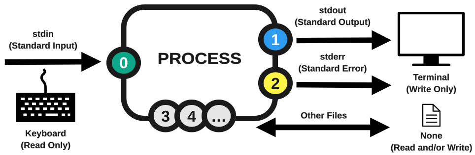

# Redirection in Linux

<sub>[Back to Computer Science](../Readme.md#content)</sub>

**Redirection** lets you choose where a command reads its input and where its output goes. For example, you can give a command a file to read and save its result in another file. Bash, the shell that runs the commands in these examples, makes those connections before the command starts.

## Follow the three streams

Start at the keyboard on the left and follow the arrow into the **process** (a running program). Each numbered circle marks a **file descriptor**, a number the process uses to identify an open connection. Follow the two arrows on the right to see where results and errors usually go.



| Number | Stream | Usual connection in a terminal |
| --- | --- | --- |
| `0` | Standard input (`stdin`) | The program reads what you type. |
| `1` | Standard output (`stdout`) | The program prints its results to the terminal. |
| `2` | Standard error (`stderr`) | The program prints messages such as errors and warnings to the terminal. |

The bottom row shows numbers `3` and up. A process can use them for other open files. They have no default destination.

## Sort a list and save the result

Try these commands in an empty directory. Each `echo` writes one line of text.

```bash
# > sends standard output (1) to fruit.txt.
# By default, it creates the file if missing or empties the existing file first.
echo pear > fruit.txt

# >> appends standard output, so apple goes after pear. It creates the file if missing.
echo apple >> fruit.txt

# < gives sort the contents of fruit.txt as standard input (0).
# > saves the sorted lines in sorted.txt, so fruit.txt keeps its original order.
# Standard error (2) still goes to the terminal. An extra descriptor such as 3
# is unnecessary here because sort reads through 0 and writes through 1.
sort < fruit.txt > sorted.txt

# Display the result. With no > here, cat prints to the terminal.
cat sorted.txt
```

You see `apple` followed by `pear`, one per line.

## Give a command several lines of input

`cat < file.txt` reads an existing file through standard input and displays its contents in the terminal. To type the input directly, use `<<` to start a **here-document**. Bash collects the lines up to the chosen end marker and gives them to the command as standard input. The marker goes on a line by itself.

```bash
cat <<END
pear
apple
END
```

`cat` prints the two fruit names. The final `END` closes the input.

## Send an error to a different place

```bash
cat fruit.txt missing.txt 2> errors.txt
```

If `missing.txt` does not exist, you still see the two lines from `fruit.txt` in the terminal. The missing-file message goes to `errors.txt` because the `2` in `2>` selects standard error. A plain `>` selects standard output.

To save both the fruit and the error message in one file, use `2>&1`.

```bash
cat fruit.txt missing.txt > run.log 2>&1
```

Bash applies redirections from left to right. First `> run.log` points standard output (`1`) at the file. Then `2>&1` gives standard error (`2`) the same destination that `1` has at that moment. If you reverse them to `2>&1 > run.log` in a terminal, the error still appears on the screen and only the fruit goes to the file.

# Sources

- [GNU Bash Reference Manual — Redirections](https://www.gnu.org/software/bash/manual/html_node/Redirections.html)
- [Alexon Oliveira, Red Hat — How to manipulate files with shell redirection and pipelines in Linux](https://www.redhat.com/en/blog/linux-shell-redirection-pipelining) · [Standard input, output, and errors diagram](https://www.redhat.com/rhdc/managed-files/sysadmin/2022-04/input-output.png)
- [GNU Coreutils — sort(1)](https://man7.org/linux/man-pages/man1/sort.1.html) · [cat(1)](https://man7.org/linux/man-pages/man1/cat.1.html) · [echo(1)](https://man7.org/linux/man-pages/man1/echo.1.html)
