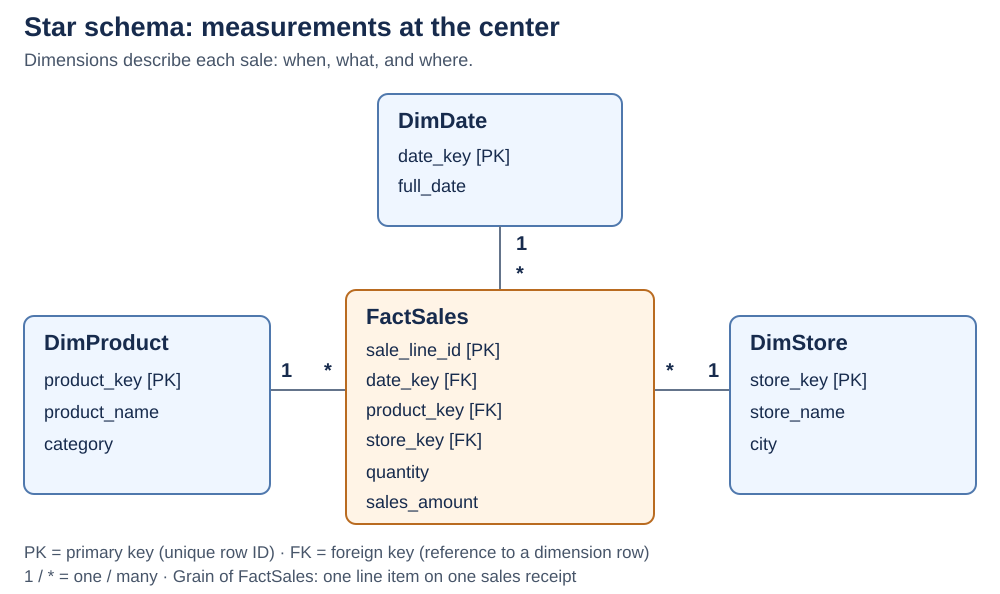
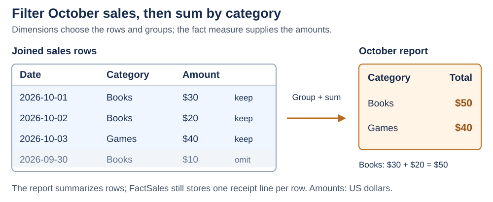

# Star Schema

<sub>[Back to Computer Science](../Readme.md#content)</sub>

A **star schema** organizes analytical data around a central **fact table** connected directly to **dimension tables**. Facts record events and measurements; dimensions describe their context. This makes questions such as “How much did each product category sell in October?” easy to express. A sales example shows the structure, the meaning of a row, and the resulting query.

## Facts, dimensions, and keys

- **Fact table:** `FactSales` records sales lines. Its **measures** are values to summarize, such as `quantity` and `sales_amount`.
- **Dimension table:** `DimProduct`, `DimDate`, or `DimStore` supplies descriptive **attributes**, such as product category, calendar date, or store city. Reports use these to filter and group facts.
- **Keys:** a dimension's **primary key (PK)** uniquely identifies a row. A **foreign key (FK)** in the fact table refers to that row. Many sales can refer to the same product: a **one-to-many** relationship from dimension to fact.

The central table holds dimension keys, while descriptions stay in the surrounding tables. Each line below connects matching keys; `1` and `*` mean one dimension row can describe many fact rows.



## Grain: what does one row mean?

Declare the **grain** before choosing columns. Here, **one fact row represents one line item on one sales receipt**, identified by `sale_line_id`. Buying three copies on that line still creates one row, with `quantity = 3`.

Every measure must describe that same event. Do not mix individual sales with monthly totals in the same fact table: summing both would count the same sales twice. The three dimension keys alone need not be unique; two receipt lines can share the same date, product, and store.

## From detail to a report

Join sales to their dimensions, select October 2026, group by category, and add each line's sales amount. In this illustrative data, all amounts use US dollars. The diagram shows the joined rows and excludes September before calculating totals.



```sql
SELECT p.category,
       SUM(f.sales_amount) AS total_sales
FROM FactSales AS f
JOIN DimProduct AS p ON p.product_key = f.product_key
JOIN DimDate AS d ON d.date_key = f.date_key
WHERE d.full_date >= '2026-10-01'
  AND d.full_date <  '2026-11-01'
GROUP BY p.category;
```

`DimStore` is unnecessary for this question. The query groups by a dimension attribute and aggregates a fact measure; the stored fact rows retain their original detail.

## Star versus snowflake

In a **star**, `DimProduct` can contain both product name and category, repeating the category across products. A **snowflake** splits that hierarchy into related tables, for example product → category, reducing repeated descriptions but adding a join to reach the category.

Flat dimensions keep reporting paths simple. They also repeat attributes, so loading and updating them must preserve consistency. Query speed depends on the database and workload; the shape alone does not guarantee faster execution.

## Avoid misleading totals

- **Match one dimension row per key.** Duplicate matches multiply joined sales rows and can inflate totals.
- **Choose a meaningful aggregation.** Sales amounts in the same currency can be summed; unit prices should not be summed. A unit price is a rate, not an amount sold.
- **Facts need not contain numeric measures.** A factless fact table can record an event such as a student's attendance; reports can count its rows.

# Sources

- [Microsoft Learn — Star schema, relationships, and snowflake dimensions](https://learn.microsoft.com/en-us/power-bi/guidance/star-schema)
- [Ralph Kimball — Fact Tables: grain and additive measurements](https://www.kimballgroup.com/2008/11/fact-tables/)
- [Ralph Kimball — Fact Tables and Dimension Tables: keys and factless events](https://www.kimballgroup.com/2003/01/fact-tables-and-dimension-tables/)
