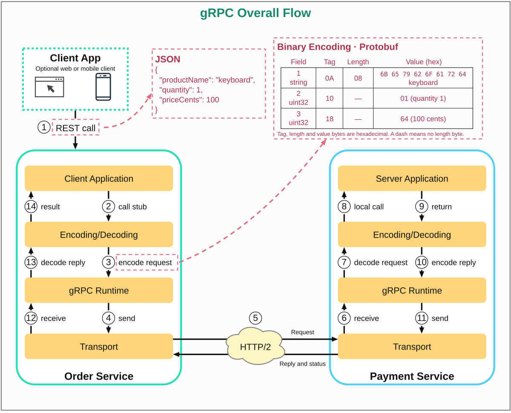

# gRPC

<sub>[Back to Computer Science](../Readme.md#content)</sub>

**gRPC lets one service call a typed method on another.** For example, the Order Service calls `Charge`, and the Payment Service runs it. This remote procedure call (RPC) usually travels over HTTP/2. A web API that returns JSON (JavaScript Object Notation) can use HTTP/2 as well.

## What both services agree on

By default, gRPC uses **Protocol Buffers (Protobuf)**. A file such as `payment.proto` defines the service, its methods, and the messages they accept and return.

```proto
syntax = "proto3";
package payments;

service PaymentService {
  rpc Charge(ChargeRequest) returns (ChargeReply);
}

message ChargeRequest {
  string product_name = 1;
  uint32 quantity = 2;
  uint32 price_cents = 3;
}

message ChargeReply {
  string payment_id = 1;
}
```

The Protobuf compiler (`protoc`) and a gRPC plugin generate message types, server code, and a **client stub** (a local object exposing `Charge`). A developer writes the payment handler. A Python client and a Java server can share the contract.

## Follow one call

Start at step 1. A browser sends JSON to the Order Service, which calls Payment through its stub. A native gRPC client can start at step 2. In the byte table, `0A` identifies field 1 as length-delimited, `08` gives its length, and the next eight bytes spell `keyboard`. The integers have no separate length field.



Follow the request down the left stack and up the right. At step 8, the handler runs. Follow the reply back to step 14. A successful **unary** call returns one message and finishes with gRPC status `OK`. An HTTP `200` response can still end with a gRPC error.

## What if the reply is late?

A **deadline** limits how long the client waits. If the reply arrives too late, the client gets `DEADLINE_EXCEEDED` even if the payment went through. Retrying the charge could bill the customer twice.

## When should you choose gRPC?

| Situation | A practical choice | Why |
| --- | --- | --- |
| Services you control exchange frequent messages. | Native gRPC | One schema generates typed clients. Protobuf keeps messages compact, and either side can stream updates within one call. |
| A public product catalog serves browsers and third-party clients. | REST-style HTTP API with JSON | Clients can use `fetch` or `curl`. A cache can reuse a response to `GET /products/42` when its headers allow it. |
| A browser needs an existing gRPC service. | gRPC-Web | A proxy can translate browser calls for the existing backend. The official web client supports unary calls and, in text mode, server streaming. |

## Where do HTTPS and HTTP versions fit?

**HTTPS** means HTTP secured with Transport Layer Security (TLS). Both gRPC and JSON APIs can use it to encrypt traffic and authenticate the server. The HTTP version determines how messages travel.

- **HTTP/1.1** works for a JSON endpoint serving older clients. An HTTP/1.1-only client needs a translating gateway to call a native gRPC backend. Responses on one HTTP/1.1 connection arrive in request order.
- **HTTP/2** lets concurrent requests share one TCP connection on separate streams. It is the usual choice for native gRPC and also works for JSON APIs.
- **HTTP/3** uses QUIC over UDP. It helps on lossy networks because a lost packet on one stream needn’t stall the others. For gRPC, check HTTP/3 support in the client, server, and any proxies. The .NET gRPC client is one implementation that supports it.

# Sources

- gRPC — [Service contracts and generated code](https://grpc.io/docs/what-is-grpc/introduction/), [call lifecycle and streaming](https://grpc.io/docs/what-is-grpc/core-concepts/), and [HTTP/2 wire protocol](https://github.com/grpc/grpc/blob/master/doc/PROTOCOL-HTTP2.md)
- gRPC — [Deadlines](https://grpc.io/docs/guides/deadlines/) and [status codes](https://grpc.io/docs/guides/status-codes/)
- Protocol Buffers — [Proto3 language guide](https://protobuf.dev/programming-guides/proto3/), [binary encoding](https://protobuf.dev/programming-guides/encoding/), and [JSON field names and types](https://protobuf.dev/programming-guides/json/)
- [gRPC-Web — Browser client and supported streaming modes](https://github.com/grpc/grpc-web#streaming-support)
- IETF — [HTTPS and server identity](https://www.rfc-editor.org/rfc/rfc9110.html#section-4.2.2) and [HTTP caching](https://www.rfc-editor.org/rfc/rfc9111.html#section-2)
- IETF — [HTTP/1.1 response ordering](https://www.rfc-editor.org/rfc/rfc9112.html#section-9.3.2), [HTTP/2 streams](https://www.rfc-editor.org/rfc/rfc9113.html#section-5), and [HTTP/3 over QUIC](https://www.rfc-editor.org/rfc/rfc9114.html#section-2)
- Microsoft — [Choosing between gRPC and JSON HTTP APIs](https://learn.microsoft.com/en-us/aspnet/core/grpc/comparison?view=aspnetcore-10.0) and [HTTP/3 in the .NET gRPC client](https://learn.microsoft.com/en-us/aspnet/core/grpc/troubleshoot?view=aspnetcore-10.0#configure-grpc-client-to-use-http3)
- [ByteByteGo — What is gRPC?](https://bytebytego.com/guides/what-is-grpc/)
