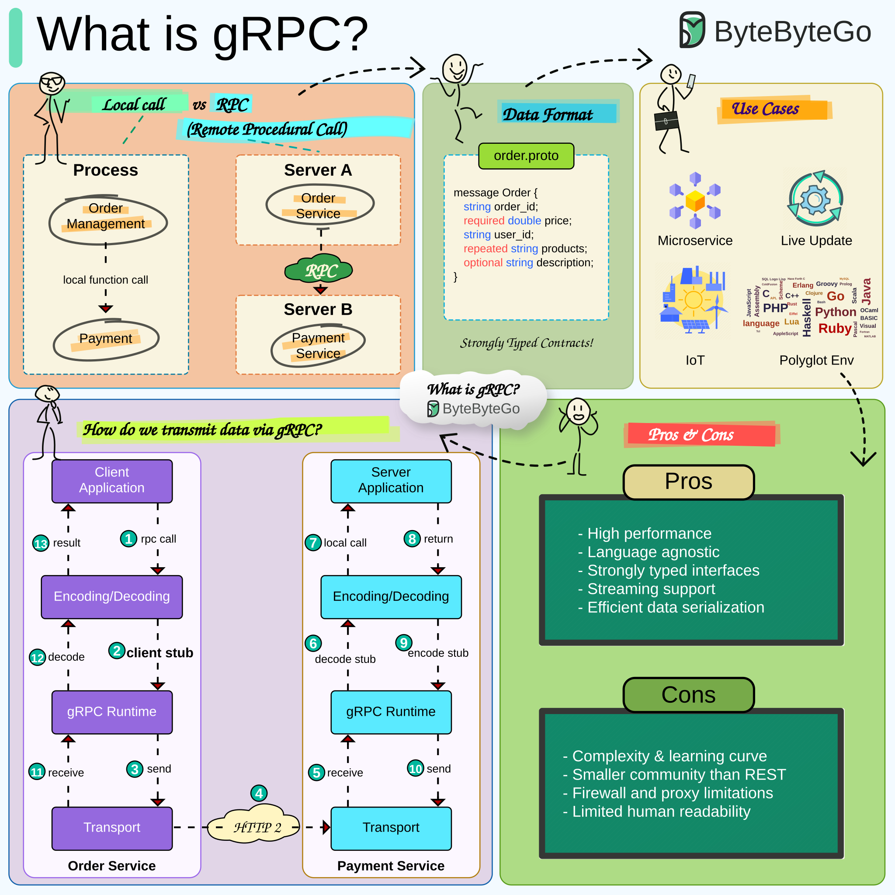

# gRPC

[Back to Computer Science](../Readme.md#content)

# Front

How does gRPC let one service call a method in another service?

# Back

**gRPC is an open-source remote procedure call (RPC) framework:** a client calls a generated local object, while the actual method runs in another service. It normally uses **Protocol Buffers (Protobuf)** to define and encode messages, and **HTTP/2 (Hypertext Transfer Protocol version 2)** to carry them over the network.

## From a method call to a network request

Suppose an **Order Service** needs the **Payment Service** to charge an order.

1. **Define the contract:** a `.proto` file describes the service methods and the fields and types of request and response messages.
2. **Generate code:** `protoc` with a gRPC plugin generates message classes and client/server code. The **client stub** is the local object exposing the remote methods; developers implement the server's business logic.
3. **Send the request:** calling the stub serializes the request—converts its structured data into bytes—and the gRPC runtime sends it over HTTP/2.
4. **Run and reply:** the server decodes the request and calls its implementation. The response travels back through the same layers, and the client receives the decoded result or an error status.

In the recreated ByteByteGo diagram, the upper left contrasts an in-process call with a call between services. Follow **1–7** in the lower left for the request and **8–13** for the result; the response also crosses the network, although the transport arrow only points right.

## Why use it?

The shared contract lets services written in different supported languages exchange typed messages. For example, a Java server can serve a Python client. Besides **unary calls** (one request, one response), gRPC supports **streaming**: multiple request messages, multiple response messages, or both directions independently.

## A remote call still has network failure modes

Local-looking syntax does not make the call local: transmission and server processing take time, and the call can fail. Set a **deadline**, the latest time the client will wait for completion; gRPC does not set one by default.

### Reading the source accurately

The infographic's “Remote Procedural Call” means **Remote Procedure Call**. Its `order.proto` block is a conceptual sketch: real Protobuf fields need unique field numbers, and `required` is not valid in proto3. “IoT” means Internet of Things; “polyglot” means using multiple programming languages. The pros/cons panel is the author's qualitative summary, not a performance guarantee or a measured community comparison.

# Sources

- [ByteByteGo — What is gRPC? (source infographic, recreated as SVG)](https://bytebytego.com/guides/what-is-grpc/)
- [gRPC — Introduction: service contracts, generated code, and Protocol Buffers](https://grpc.io/docs/what-is-grpc/introduction/)
- [gRPC — Core concepts: stubs, call lifecycle, and streaming](https://grpc.io/docs/what-is-grpc/core-concepts/)
- [gRPC — FAQ: framework and HTTP/2 transport](https://grpc.io/docs/what-is-grpc/faq/)
- [gRPC — Deadlines](https://grpc.io/docs/guides/deadlines/)
- [Protocol Buffers — Proto3 language guide: field numbers and cardinality](https://protobuf.dev/programming-guides/proto3/)
