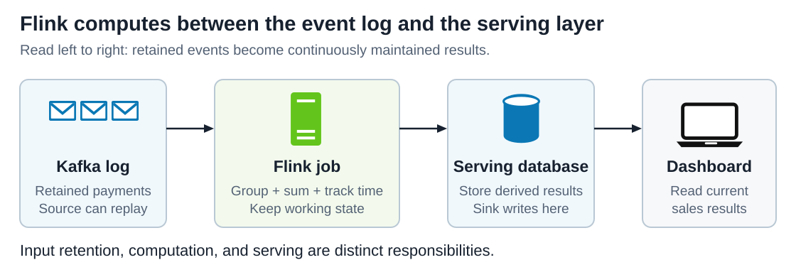

# Apache Flink

[Back to Distributed Systems](../Readme.md#content)

# Front

What is Apache Flink, what is it written in, and when would you use it or an alternative?

# Back

**Apache Flink processes streams of events across multiple machines, keeping information between events so it can update results as new data arrives.**

It is open source and written mainly in **Java**, with **Scala** used in parts of its implementation.

You can write Flink applications in Java or Python, or express the processing as SQL (Structured Query Language) queries.

## Where it is useful

Flink is useful for **fraud detection, live dashboards, and continuous data pipelines** that clean, combine, or move incoming data. It can remember earlier events or running totals; this remembered information is called **state**. It also supports batch processing of datasets with a known end, such as yesterday's files.

## A typical example: live sales totals

Imagine a retailer that wants to see sales by shop and minute. Each payment becomes an event in Kafka. A Flink job reads those events, groups them by shop and minute, and adds up the amounts. It keeps partial totals as state, so each new payment adds to the relevant total without rereading all previous orders.

Read the diagram from left to right: Kafka supplies the input (the **source**), Flink computes the totals, and its output writer (the **sink**) sends results to a database that the dashboard reads.

## What could you use instead?

- **Kafka Streams** is a library that runs inside your application and processes data stored in Kafka. Consider it when your input and output are in Kafka and you want to deploy the processing as an ordinary application, without a separate processing cluster.
- **Apache Spark Structured Streaming** processes streams using Spark's SQL engine. Consider it when you already use Spark for batch analytics and want to use the same tools for streaming. By default, it processes incoming data in small batches.

# Sources

- [Apache Flink: architecture and stream/batch processing](https://flink.apache.org/what-is-flink/flink-architecture/)
- [Apache Flink: Java implementation and Scala components](https://flink.apache.org/2022/02/22/scala-free-in-one-fifteen/) and [project source code](https://github.com/apache/flink)
- [Flink application interfaces](https://nightlies.apache.org/flink/flink-docs-release-2.3/docs/dev/overview/)
- [Apache Flink use cases](https://flink.apache.org/what-is-flink/use-cases/) — stateful applications, analytics, and data pipelines; the retailer is an illustrative example.
- [Kafka Streams introduction](https://kafka.apache.org/44/streams/introduction/)
- [Spark Structured Streaming overview](https://spark.apache.org/docs/latest/streaming/index.html)
