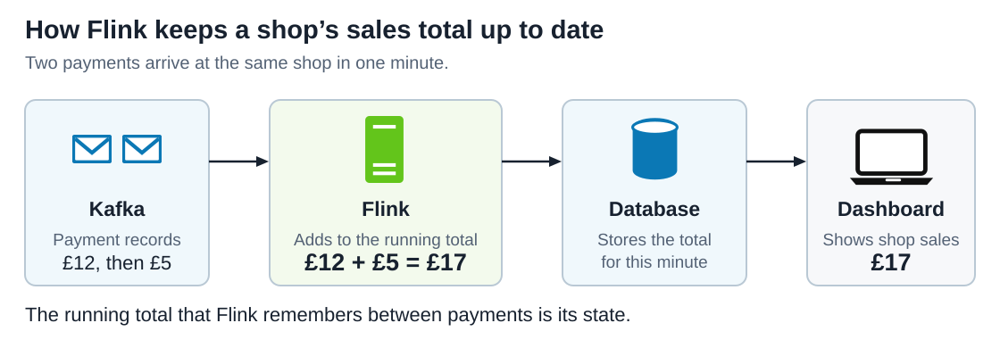

# Apache Flink

[Back to Distributed Systems](../Readme.md#content)

**Apache Flink is an open-source engine that processes streams of events and can remember information from one event to the next.** A record of one payment is an **event**. A sequence of payment records is a **stream**.

A live feed of shop payments is **unbounded**. It has no planned end, so Flink processes payments as they arrive. Yesterday’s payments form a **bounded** dataset with a known end. Flink can process that set as a **batch**.

## How does a shop keep a live sales total?

A Flink program keeps a separate total for each shop and minute. Suppose one shop’s first payment this minute is **£12**. When a **£5** payment follows, the program adds it to the £12 it remembers and gets **£17**. The information a program keeps between events is called **state**. Here, keeping the running total saves Flink from rereading earlier payments.

Follow the payments from left to right. Kafka stores the payment records. In the Flink program, the **source** reads those records from Kafka and the **sink** writes the updated total to a database. The dashboard reads the total from that database.

## Where else is Flink useful?

- **Fraud detection.** A program can remember recent payments on a card and flag an unusual pattern when the next payment arrives.
- **Continuous data pipelines.** A shop can use Flink to clean incoming sales records, combine them with product details, and send them to a reporting database as they arrive.

## How do you use Flink?

You can write the sales calculation in Java or Python, or express it as a query in SQL (Structured Query Language). In a typical deployment, a Flink cluster runs the calculation and can share the work across several computers. Flink itself is written mainly in Java, with some Scala.

## When would you choose another tool?

- **Kafka Streams** fits when your application reads from Kafka and writes its results back to Kafka. The library runs inside your application, so you can deploy it without a separate processing cluster.
- **Spark Structured Streaming** fits when your team already runs batch reports with Apache Spark, an engine for processing large datasets. You can write streaming queries much like your existing batch queries. By default, Spark handles incoming records in small batches.

# Sources

- [Apache Flink architecture](https://flink.apache.org/what-is-flink/flink-architecture/) and [stateful stream processing](https://nightlies.apache.org/flink/flink-docs-stable/docs/concepts/stateful-stream-processing/#what-is-state)
- [Flink DataStream programming guide](https://nightlies.apache.org/flink/flink-docs-stable/docs/dev/datastream/overview/#anatomy-of-a-flink-program)
- [Apache Flink use cases](https://flink.apache.org/what-is-flink/use-cases/)
- [Flink application interfaces](https://nightlies.apache.org/flink/flink-docs-release-2.3/docs/dev/overview/) and [project source code](https://github.com/apache/flink)
- [Kafka Streams introduction](https://kafka.apache.org/44/streams/introduction/)
- [Spark Structured Streaming overview](https://spark.apache.org/docs/latest/streaming/index.html)
