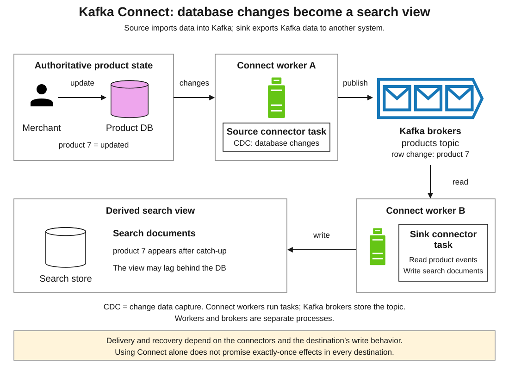
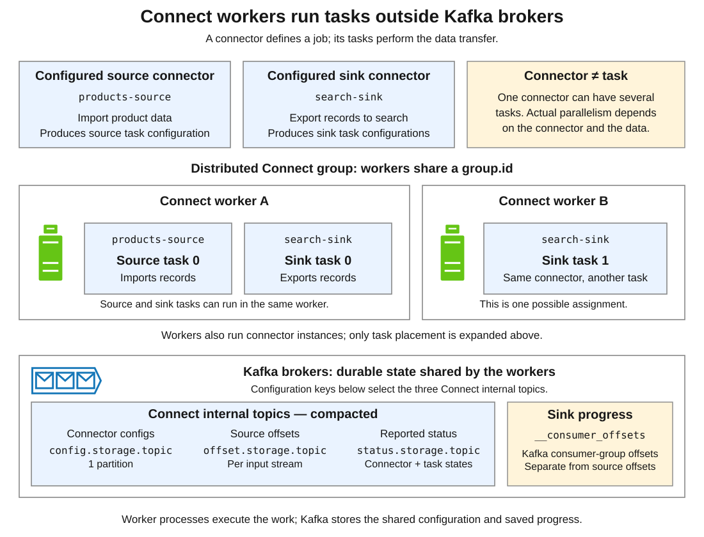
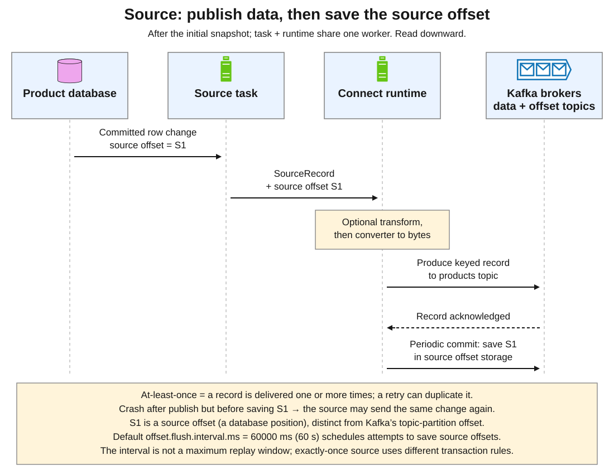
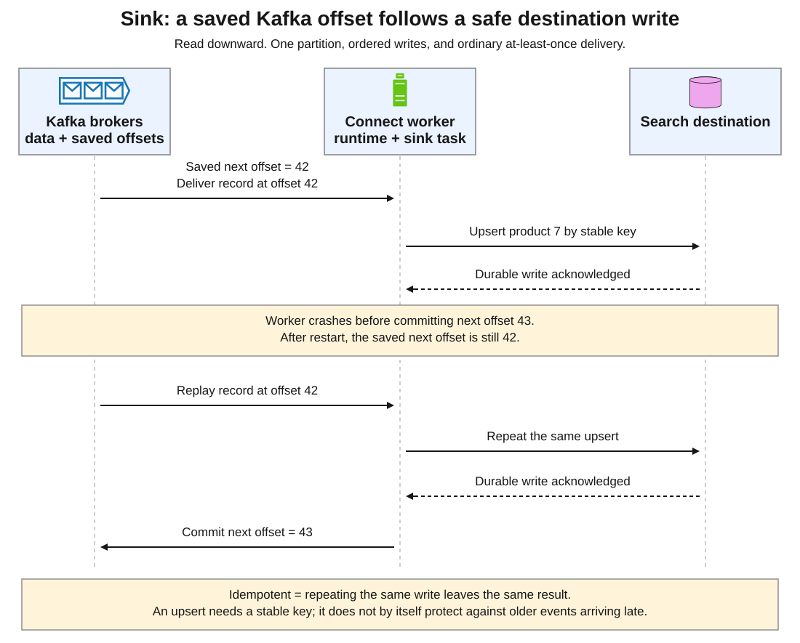
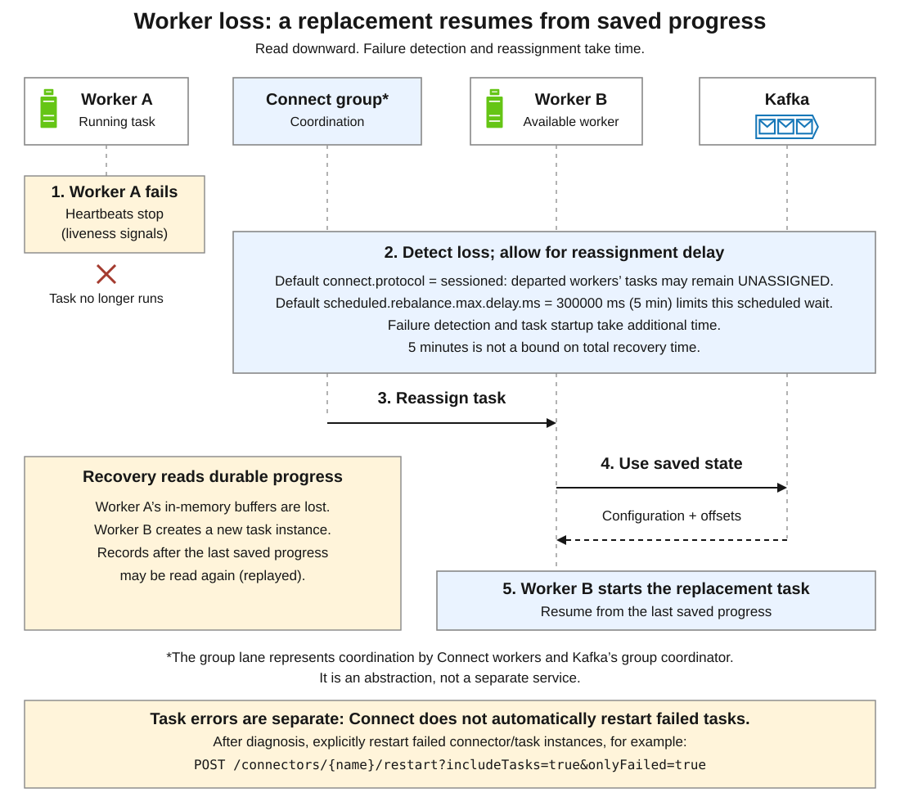
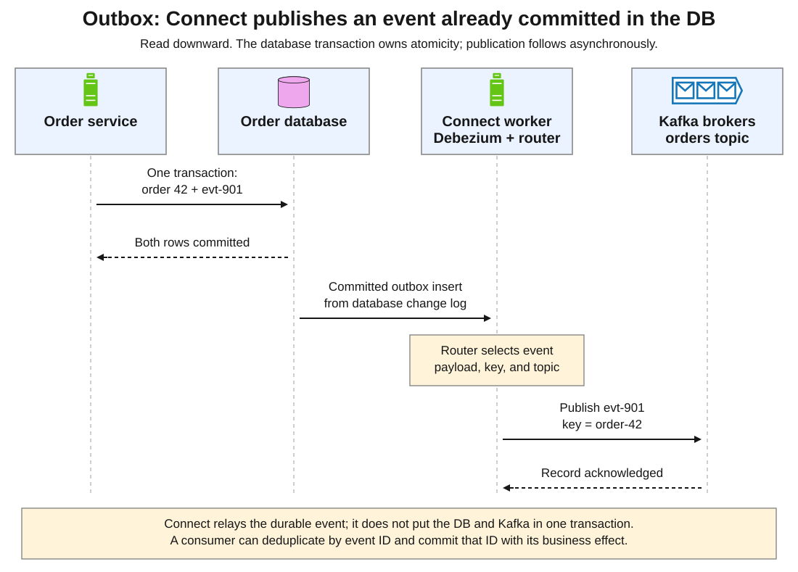

# Apache Kafka. Connect

<sub>[Back to Distributed Systems](../Readme.md#content)</sub>

**Kafka Connect is a tool that ships with Apache Kafka for streaming data between Kafka and other systems, such as databases, search engines, and file stores. You configure a ready-made connector plugin, and Connect runs the copying, remembers how far it got, and can move the work to another worker process when one dies.**

This article follows one example from start to finish. An online shop keeps its products in PostgreSQL, and customers find them through a separate search engine. When a merchant changes product 7, the new version should show up in search shortly afterwards. The example comes from [Pattern 3 of the Apache Kafka article](../Apache%20Kafka/Readme.md#pattern-3-move-data-with-kafka-connect); this article opens it up.

The sections go from why Connect exists and how it is built, through one change's trip into Kafka and out again, to failures, the outbox pattern, and when to use Connect. Kafka details follow the Kafka 4.4 documentation, and details of the Debezium plugins follow Debezium 3.7. Plugins change between versions, so check the documentation of the version you run.

1. [Why Connect exists](#1-why-connect-exists)
2. [Where it fits in the architecture](#2-where-it-fits-in-the-architecture)
3. [Connectors, tasks, workers, and the record path](#3-connectors-tasks-workers-and-the-record-path)
4. [Workers, modes, and saved progress](#4-workers-modes-and-saved-progress)
5. [Source path: how a database change enters Kafka](#5-source-path-how-a-database-change-enters-kafka)
6. [Sink path: writes, checkpoints, and duplicates](#6-sink-path-writes-checkpoints-and-duplicates)
7. [When a worker dies or a task fails](#7-when-a-worker-dies-or-a-task-fails)
8. [Pattern: transactional outbox with Connect as the relay](#8-pattern-transactional-outbox-with-connect-as-the-relay)
9. [When to use Connect, and when not to](#9-when-to-use-connect-and-when-not-to)
10. [Before you run a pipeline in production](#10-before-you-run-a-pipeline-in-production)
11. [Check your understanding](#11-check-your-understanding)

## 1. Why Connect exists

The product database is the **source of truth**: when it and the search index disagree, the database is right. The search index is a copy, arranged for fast searching, and it has to keep up with every committed change.

You could write that copy job yourself. One small program reads new changes from the database and sends them to Kafka, and another reads Kafka and writes to the search engine. Soon both programs need the same chores: converting records to bytes and back, batching, retrying, saving their position so that a restart neither skips nor repeats too much, running on several machines, and taking over when one of them dies. The next integration, say into an analytics store, needs all of it again.

Kafka Connect does these chores once, in a shared runtime. A **connector plugin** holds only what is specific to one system, such as how to read PostgreSQL's change log or how to write a document to a search engine. A **source** connector brings data into Kafka, and a **sink** connector takes data out of Kafka into another system. If a plugin already exists for your system, you configure it instead of writing code. If none exists, you can implement Connect's Java interfaces and still reuse the whole runtime.

So Connect gives you **data movement that can resume after a failure**. It does not decide what your data means, which business rules apply, or whether the destination ends up correct. Those are still yours to design.

## 2. Where it fits in the architecture

Kafka **brokers** store records in **topics**, and each topic is split into ordered **partitions**. Connect does not run inside the brokers. It runs in its own processes, called **workers**, which use the ordinary Kafka producer and consumer clients to write and read topics, just like any other application. The copying itself is done by **tasks** that run inside the workers.

Physically, a worker is a separate Java process. Connect comes in the same Kafka download as the broker, but each starts with its own script: `bin/kafka-server-start.sh` starts a broker, and `bin/connect-distributed.sh` starts a worker. For tests, a worker can share a laptop with a broker, as in the Kafka quickstart. In production, give the workers their own machines or containers, so that connectors do not compete with the brokers for CPU and memory, and so that workers can be added, restarted, or replaced without touching the brokers. Either way, a worker reaches the brokers over the network, like any other client, through the broker addresses in its `bootstrap.servers` setting.

Despite its name, Connect is not what your own application uses to send or receive messages. An application does that with the same producer and consumer clients, directly or through a framework built on them. In Spring Boot, that framework is Spring for Apache Kafka: the application sends with `KafkaTemplate` and receives in a method annotated with `@KafkaListener`. [Delivery and transactions §7](../Apache%20Kafka.%20Delivery%20and%20transactions/Readme.md#7-starting-and-handling-a-transaction-in-spring-boot) shows a Spring Boot service that sends with `KafkaTemplate`. Connect replaces the hand-written copy job from [§1](#1-why-connect-exists), not the services that create the data.

The diagram shows the running example. Start at the top left, where the merchant updates product 7 in the product database, the box labeled “Authoritative product state”. Follow the arrows to the right: a source connector task on Connect worker A picks up the change and publishes it to the `products` topic on the Kafka brokers. Then follow them down and back to the left: a sink connector task on worker B reads the change and writes a search document. The search store sits in a box called “Derived search view” because it is only a copy, and “The view may lag behind the DB”.



The source in this example uses **change data capture (CDC)**. Instead of asking the database “what changed?” over and over, a CDC connector reads the database's own change log and turns each committed insert, update, or delete into an event. Debezium provides CDC source connectors for Connect, including one for PostgreSQL. Not every source connector works this way, though. Another plugin might call a REST API every minute, or query a table for rows with a newer timestamp than last time.

Sources and sinks do not know about each other. A source only writes to a topic, and any number of sinks or ordinary applications can read that topic. Adding an analytics sink later does not change the search sink at all.

Every step is asynchronous, so a database commit does not mean that search has caught up. Search can trail the database by seconds, or by hours while a connector is stopped. If a user must see their own change immediately, for example on the product page right after saving it, read that page from the database, not from search.

## 3. Connectors, tasks, workers, and the record path

A few words come up constantly. The running example has two connectors: `products-source` reads the database, and `search-sink` writes to search.

| Term | What it is | In the example |
|---|---|---|
| **Connector plugin** | Installed code that knows how to talk to one kind of system | The Debezium PostgreSQL connector |
| **Connector** | A named, configured use of a plugin. It describes the job and splits it into tasks | `products-source` |
| **Task** | The unit that actually copies records. Each task runs on its own thread inside a worker | Source task 0 of `products-source` |
| **Worker** | A Connect process that runs connectors and tasks | Worker A and worker B |
| **Converter** | Turns Connect's in-memory records into bytes for Kafka, and bytes back into records | JSON or Avro |
| **Single Message Transformation (SMT)** | A small change to one record as it passes through | Rename a field, or send the record to another topic |

In distributed mode, described in [§4](#4-workers-modes-and-saved-progress), you create a connector by sending its configuration to the REST API of any worker, which listens on port 8083 by default. Here is the core of `products-source`, with the database connection settings left out:

```http
POST /connectors
Content-Type: application/json

{
  "name": "products-source",
  "config": {
    "connector.class": "io.debezium.connector.postgresql.PostgresConnector",
    "tasks.max": "1",
    "topic.prefix": "shop",
    "table.include.list": "public.products"
  }
}
```

`connector.class` names the plugin, and `tasks.max` caps the number of tasks; §4 explains why that cap is not a promise. The other two keys belong to Debezium. They tell it to capture the `public.products` table and to write its changes to a topic named `shop.public.products`, which the diagrams shorten to `products`.

In short, a connector plans the work, and its tasks do it. One worker can run tasks from many connectors, and the tasks of one connector can be spread over several workers.

Every record takes the same route through Connect:

```text
Source system → source task → SMTs → converter → Kafka
Kafka → converter → SMTs → sink task → destination
```

The converter is about format. It decides whether the bytes in Kafka are JSON, Avro, or something else, and whoever reads the topic must use a matching converter, or the bytes will not parse and the reading task fails. An SMT is about content, one record at a time: it can rename a field, drop a header, or pick a different topic. Work that combines several records, such as joining orders with customers or counting orders per five minutes, needs a stream processor such as Kafka Streams, or an application.

The shape of the data matters too. A **schema** lists a record's fields and their types. When a schema changes, for example because a column was added, check that every converter and reader downstream can handle both the old and the new shape. Old records stay in the topic and can be replayed long after the change.

## 4. Workers, modes, and saved progress

Connect must remember its connector configurations and how far each connector has read. For a source, that position is a **source offset**: how far the source has read in its external system. Where Connect keeps all this depends on the mode it runs in:

| Mode | How it runs | Where progress is saved | Good for |
|---|---|---|---|
| Standalone | A single worker process | Source offsets in a local file | Development, or a job that only makes sense on one machine, such as collecting that machine's log files |
| Distributed | Several workers form one Connect cluster | Configurations, source offsets, and status in Kafka topics | Production: work is balanced across the workers and moves when one fails |

Standalone mode is simple, but nothing takes over when its one process dies. In distributed mode, all workers with the same `group.id` form one cluster and divide the connectors and tasks between them. A distributed cluster with a single worker has nobody to hand work to either, so failover needs at least two workers. Extra workers also cannot help when the database, Kafka, or the search engine is the part that is down.

The diagram shows one possible way for two workers to share the example's work. In the top row, `products-source` produces one task configuration, and `search-sink` produces two. In the middle row, worker A runs “Source task 0” and “Sink task 0”, and worker B runs “Sink task 1”. Workers also run the connectors themselves, but the diagram expands only the tasks. Nothing fixes this layout: when workers join or leave, Connect divides the work again, and it can look different.



The bottom row shows why a worker can die without the cluster forgetting anything: everything worth keeping lives in Kafka, not in the workers. Three internal topics, named in the worker settings, hold it:

- `config.storage.topic` holds connector and task configurations. It should have exactly one partition.
- `offset.storage.topic` holds the source offsets. It can have many partitions (25 by default).
- `status.storage.topic` holds the reported state of every connector and task (5 partitions by default).

All three are **compacted** topics: Kafka always keeps at least the latest value for each key, so each topic works like a durable table of current settings and positions. Replicate them, because losing them means losing the cluster's configurations and progress. A second, separate Connect cluster needs its own `group.id` and its own three topics.

Sink connectors keep their progress elsewhere. A sink task reads Kafka with an ordinary consumer, so its position is a consumer-group offset, stored in Kafka's `__consumer_offsets` topic. The diagram shows it as “Sink progress”.

So two kinds of groups are involved, and they are easy to confuse. The **worker group**, identified by `group.id`, decides which worker runs which connector and task. Each sink connector also has its own **consumer group**, `connect-search-sink` by default for `search-sink`, which decides which sink task reads which partition and remembers how far it has read. [Delivery and transactions §1](../Apache%20Kafka.%20Delivery%20and%20transactions/Readme.md#1-essential-vocabulary) explains consumer groups, rebalances, and heartbeats.

### Scaling has two separate limits

`tasks.max` is a ceiling, not an order. It says “create at most this many tasks”, and a connector creates fewer when it cannot split the work that finely. It does not start any workers either. Two limits decide how much parallel work you really get:

- **The source must be splittable.** Debezium's PostgreSQL connector always runs exactly one task, whatever `tasks.max` says, so one connector's change stream cannot be spread across workers.
- **A sink cannot keep more tasks busy than there are partitions.** Sink tasks share their topics through a consumer group, and each partition goes to only one member of the group at a time. With three partitions, even if eight sink tasks start, at most three of them get a partition to read.

More workers help only when the work can be divided and the database, Kafka, and the destination can take the extra load.

## 5. Source path: how a database change enters Kafka

This section follows one change from PostgreSQL into Kafka. Assume that Debezium has finished its **initial snapshot**, a one-time copy of the rows that already existed, and now streams new changes as they commit.

PostgreSQL records every change in its [**write-ahead log (WAL)**](../Write-ahead%20log%20%28WAL%29/Readme.md) before applying it, and a position in that log is a **log sequence number (LSN)**. Debezium reads the committed changes from the WAL through PostgreSQL's logical decoding.

Read the diagram from top to bottom. “Source task” and “Connect runtime” are two roles inside the same worker process: the task is the plugin's code, and the runtime is the Connect framework that drives it.



1. The task reads the committed change to product 7. Call its position S1.
2. The task hands Connect a `SourceRecord`. Besides the key and the value, the record names its target topic and carries two more fields. The **source partition** says which input stream the record came from, such as a file or a table; it has nothing to do with Kafka's partitions. The source offset, met in [§4](#4-workers-modes-and-saved-progress), says how far into that stream the record is, here S1.
3. The runtime runs the SMTs and the converter, then produces the record to the `products` topic.
4. Kafka acknowledges the write.
5. Later, on a timer, the runtime saves S1 in the offset storage topic. After a restart, the task reads its last saved offset and resumes from there.

So there are **two different positions**, and they answer different questions:

| Position | Question it answers | Example |
|---|---|---|
| Source offset | Where should the connector resume reading the external system? | S1: a PostgreSQL log position plus Debezium's own recovery details |
| Kafka offset | Where does this record sit inside a Kafka partition? | `products`, partition `0`, offset `42` |

An LSN is not Kafka offset `42`, and neither of them identifies the business event.

The gap between steps 4 and 5 is where duplicates come from. If the worker dies after Kafka accepted the record but before S1 was saved, the replacement task starts from the previous saved offset and publishes the same change again, this time at a new Kafka offset such as `43`. Kafka's idempotent producer cannot prevent this: it removes duplicates caused by retries while one producer is running, and the restarted task uses a new producer.

This is **at-least-once delivery**: every change reaches Kafka, and after a crash some reach it twice. Everything downstream must cope with duplicates.

How far back can a replay reach? `offset.flush.interval.ms` sets how often Connect tries to save source offsets: every 60000 ms, one minute, by default. That is a schedule of attempts, not a limit. If saving fails or is delayed, the last saved offset can be much older, and a restart replays everything after it. A source connector with exactly-once support closes this gap by committing its records and their offset together in one Kafka transaction; [§6](#what-exactly-once-can-mean-here) lists what that needs.

Resuming also needs the old changes to still exist. PostgreSQL keeps WAL for Debezium through a **replication slot**, a bookmark that stops the database from deleting log segments the connector has not yet processed. That protects recovery, but it has a cost: while the connector is stopped or slow, the kept WAL grows on the database's disk. If the log that the connector needs is gone anyway, it cannot resume where it stopped and needs a new snapshot. [Patterns. Change Data Capture](../Patterns.%20Change%20Data%20Capture/Readme.md#postgresql-watch-retained-wal-and-disk-space) explains how to watch and limit the kept WAL.

## 6. Sink path: writes, checkpoints, and duplicates

A sink's progress is an ordinary consumer offset, and it means “the next record to process”. If the saved offset is `42`, record 42 has not been safely handled yet. Once it has, the sink saves `43`.

Read the diagram from top to bottom. It shows one partition and ordinary at-least-once delivery. The sink **upserts** product 7 into the search store: it writes the document under key 7, inserting it if the key is new and replacing it if the key exists. The store confirms the write. Then the worker crashes before it saves the next offset, `43`, so after the restart the saved offset is still `42`. The replacement task gets record 42 again, repeats the same upsert, and only then commits `43`.



Inside the worker, Connect fetches a batch from Kafka, converts it, applies the SMTs, and passes the records to the sink task's `put()` method. `put()` may write them at once or buffer them for a bigger write later. Before Connect saves offsets, it calls the task's `preCommit()`, whose default version calls `flush()` to push out anything still buffered. A sink task must report an offset as safe only when the destination really has the data.

Why write first and save the offset second? Because the opposite order loses data. If the sink saved `43` and then crashed before writing, record 42 would never reach search. Writing first means that a crash can cause a repeat but never a gap, so the sink has to cope with seeing the same record twice.

That is easy when writes are **idempotent**, which means that doing them twice leaves the same result as doing them once. The upsert in the diagram is idempotent: writing “product 7, price 20” twice by key leaves one correct document. A write like `stock = stock - 1` is not idempotent: a replay takes away a second item.

Idempotent upserts still do not protect the order of writes. Suppose four updates to product 7 sit at offsets 42 to 45, the sink writes all four, and it crashes before saving `46`. After the restart it writes record 42 again, so search shows an older version of product 7 until 43, 44, and 45 are written again. Records for one key can also arrive out of order in other ways, for example when two pipelines update the same document. If that matters, put a version number in each record and let the destination ignore versions older than the one it holds.

Sink plugins differ a lot in these details, so read your plugin's documentation on batching, partial failures, retries, and deletes. Debezium's JDBC sink, for example, uses plain inserts unless you set `insert.mode=upsert`, and plain inserts are not safe to replay.

### What “exactly once” can mean here

People say “exactly once” about three different boundaries, and Connect treats them differently:

- **Source to Kafka.** Connect can run supported source connectors exactly once, in distributed mode only. By default, each batch of records is written together with its source offset in one Kafka transaction. Before Connect starts new copies of a task, it fences out the old ones, so a forgotten copy cannot keep publishing. Every worker needs `exactly.once.source.support=enabled`, and the plugin must support it.
- **Kafka to the destination.** This is up to the sink plugin. It might store the Kafka offset in the destination together with the data, or make every write safe to repeat. A Kafka transaction cannot include a write to a search engine or a database.
- **The whole business operation.** Even if each record lands exactly once, that does not make a payment, an email, or a multi-step workflow happen exactly once.

If the topic that a sink reads is written with transactions, the sink should skip records from aborted transactions. A consumer reads them by default (`isolation.level=read_uncommitted`). Set `consumer.isolation.level=read_committed` on the workers, or `consumer.override.isolation.level=read_committed` on one connector, which Kafka 4.4's default override policy (`All`) allows. This only hides aborted records. It does not make the destination write and the offset commit succeed or fail together. [Apache Kafka. Delivery and transactions](../Apache%20Kafka.%20Delivery%20and%20transactions/Readme.md) explains how Kafka transactions work.

## 7. When a worker dies or a task fails

A task can stop working for two different reasons, and they recover in different ways: the worker running it can disappear, or the task itself can fail with an error.

### A worker disappears

Workers send **heartbeats**, small “I am alive” messages, every 3 seconds by default. If none arrive for 10 seconds (`session.timeout.ms`), Kafka removes the worker from the group and starts a **rebalance**, in which the remaining workers agree on a new division of connectors and tasks.

Read the diagram from top to bottom. Worker A fails in step 1. The “Connect group” column is not a separate server: as its footnote says, it stands for the coordination that the workers and Kafka's group coordinator do together. In steps 3 to 5, worker B is given the task, reads the saved configuration and offsets from Kafka, and starts a new instance of the task.



Worker B does not inherit worker A's memory. Whatever A had buffered but not saved is lost, so B resumes from the last saved offsets, and records after that point are processed again.

Step 2 can take a while, because the rebalance does not hand out the departed worker's tasks at once. With the default protocol (`connect.protocol=sessioned`), Connect first waits up to `scheduled.rebalance.max.delay.ms`, five minutes by default, for the worker to return, for example after a quick restart during an upgrade. If it comes back in time, it gets its old tasks back. Until then, those tasks are `UNASSIGNED`, and nothing runs them. So if you kill a worker in a test and its tasks stay unassigned for a few minutes, failover is not broken; it is waiting. The five minutes are not a limit on recovery time either, because failure detection and task startup come on top.

### A task fails

A task can also fail on a healthy worker, for example when a record cannot be converted or the destination rejects a write. The task's state becomes `FAILED`, and its status shows the error. **Connect does not restart failed tasks automatically.** Find and fix the cause first, then restart only the failed instances:

```http
POST /connectors/{name}/restart?includeTasks=true&onlyFailed=true
```

To see what is going on, `GET /connectors/products-source/status` returns the state of the connector and of each of its tasks, with the worker that runs each one. Check both, because a connector can be `RUNNING` while one of its tasks is `FAILED`. Check the data as well, because a task can be `RUNNING` and still deliver nothing.

## 8. Pattern: transactional outbox with Connect as the relay

Suppose an order service saves an order in its database and then publishes `OrderCreated` to Kafka as a second, separate step. If the service crashes between the two, the order exists, but the event is never sent. A **transactional outbox** closes that gap. The service writes the order and an event row into an outbox table in the same database transaction, so both are saved or neither is.

Something must then move the outbox rows to Kafka, and Connect can be that **relay**. Read the diagram from top to bottom. The transaction commits order 42 together with event `evt-901`. Only after the commit does the Connect worker see the new outbox row, through the database's change log.



The worker runs a Debezium source connector that captures inserts into the outbox table. Debezium's **Outbox Event Router** SMT, the box “Router selects event payload, key, and topic”, turns each captured row into a clean event. The row's payload becomes the record value, the order's ID `order-42` becomes the key, and the event ID `evt-901` travels in a header so that consumers can spot duplicates. The router also takes the topic name from the row; the diagram uses `orders`.

Keep the guarantees apart:

- The database transaction makes the order and its event **atomic**: both are saved, or neither is.
- Connect publishes the event afterwards, at least once.
- The database and Kafka never share one transaction.

So a consumer can receive `evt-901` twice. It should save the event ID together with its own change, in one local transaction, and skip IDs that it has already seen; [Patterns. Transactional Inbox](../Patterns.%20Transactional%20Inbox/Readme.md) shows how.

Why not stream the orders table itself with plain CDC? A raw CDC event describes storage: this row in this table changed from these values to those. An outbox event can state a business fact, such as `OrderAccepted`, in a shape designed for its consumers and independent of your table layout. Decide deliberately which of the two your consumers should depend on. [Patterns. Transactional Outbox](../Patterns.%20Transactional%20Outbox/Readme.md) covers the pattern in depth.

## 9. When to use Connect, and when not to

Connect fits whenever data has to flow continuously between Kafka and another system and a plugin exists for that system. For each case, check that the plugin supports your system's version, your data model, and the delivery behavior you need.

| Need | How Connect is used | The main question to answer |
|---|---|---|
| Keep a search index or reporting database up to date | CDC source → Kafka → sink | Can the copy lag, and are updates and deletes safe to replay? |
| Land events in object storage or an analytics store | Kafka → storage sink | How does the plugin batch, lay out files, handle schemas, and replay? |
| Feed existing database data into stream processing | Source connector → Kafka → stream processor | Can the source capture the changes you need without overloading the database? |
| Publish events from a transactional outbox | CDC source with the outbox router → Kafka | Are outbox rows written in the same transaction as the business data, and can consumers handle duplicates? |
| Connect an external API or an older messaging system | A suitable source or sink plugin | Does the plugin handle cursors, rate limits, acknowledgments, and recovery correctly? |
| Copy data between Kafka clusters | MirrorMaker 2, which is built on Connect | What do you need for offset translation, failover, and replication? |

Connect often sits on both sides of a stream processor: database → Connect source → Kafka → Kafka Streams or Apache Flink → Kafka → Connect sink → destination. Connect moves the data, and the processor does the computation.

### When another tool fits better

- **Business logic.** Deciding what an order means, authorizing a payment, or running a workflow belongs in an application that uses the Kafka producer and consumer APIs, or a framework built on them.
- **Combining records.** Joins, time windows, and running totals need a stream processor. SMTs are only for small changes to one record at a time.
- **An immediate answer.** If the caller needs a result right away, use a direct service call. A Connect pipeline is asynchronous and sends no reply.
- **A small one-time copy.** A database export and import, or a short script, is simpler when you need neither continuous streaming nor Kafka's ability to replay.
- **No suitable plugin.** Compare the cost of writing and operating your own connector with that of a small dedicated application. “Connect supports databases” does not mean that a plugin supports your database and the behavior you need.

## 10. Before you run a pipeline in production

**Agree on the data contract.** Decide the keys, the format and schema, how deletes are represented, how much lag is acceptable, and how duplicates are handled. Debezium wraps each change in an envelope that holds the `before` and `after` versions of the row plus metadata, so the sink must understand that envelope, or an SMT such as Debezium's `ExtractNewRecordState` must flatten it first. Deletes need the same care. A **tombstone** is a record with a key and a null value, and not every sink turns it into a delete: Debezium's JDBC sink ignores delete events unless you set `delete.enabled=true`.

**Install the same plugins on every worker.** A task can move to any worker, so every worker needs the same plugins in a directory listed in `plugin.path`, and network access to every system that the tasks talk to. Load passwords through a config provider, a plugin that reads them from an external source and is enabled with the worker's `config.providers` setting, rather than writing them into the connector JSON. Secure the REST API too, because by default anyone who can reach it can start and stop connectors.

**Tell bad data apart from broken infrastructure.** A malformed record fails in a converter or an SMT, while an unreachable destination is a connection problem. A connector's own retries and Connect's error settings do not necessarily cover the same failures.

By default (`errors.tolerance=none`), any error in a converter or an SMT fails the task. With `errors.tolerance=all`, Connect skips such problem records instead, and they never reach the destination. For sinks, `errors.deadletterqueue.topic.name` names a **dead-letter queue (DLQ)**, a Kafka topic that receives the failed records for later inspection. Add `errors.deadletterqueue.context.headers.enable=true` to get the error details in the record headers; it is off by default. A DLQ does not catch every failure, such as an unreachable destination, and nothing in it is repaired or replayed automatically.

**Watch progress, not only status.** Track task states, consumer lag on the sink side, how far behind the source is, errors, failed offset commits, and how fresh the data in the destination is. A source with no new data and a stuck source can look the same unless you check something specific to the source, such as the replication slot's lag in PostgreSQL.

**Keep enough history to recover.** A source can resume only while the external system still has the changes it needs, such as the WAL. A sink can replay only the records that Kafka still retains. An outage that lasts longer than either retention needs a new snapshot or a rebuild of the destination.

## 11. Check your understanding

1. Product changes must reach search continuously. What does Connect save you from building, and where does that work run? Could an SMT count orders per five minutes?

   <details>
   <summary>Answer</summary>

   Connect saves you from writing and running your own readers, writers, position tracking, retries, and failover. Plugins handle the specific systems, and the work runs in worker processes outside the brokers. An SMT changes one record at a time, so a five-minute count belongs in a stream processor.

   </details>

2. A change at source offset S1 lands in Kafka partition 0 at offset 42. The worker crashes before it saves S1. Are S1 and 42 the same kind of position? Can the replay reach back more than 60 seconds?

   <details>
   <summary>Answer</summary>

   No. S1 marks how far the connector has read in the database, and 42 marks where the record sits in a Kafka partition. After the restart, the change can be published again at a new Kafka offset. And yes: 60 seconds is only how often Connect tries to save offsets, so after failed saves the last saved offset can be much older.

   </details>

3. The sink writes product 7 from offset 42 to search, then the worker crashes before it saves 43. What happens after the restart, and why is an upsert by key safer here than `stock = stock - 1`?

   <details>
   <summary>Answer</summary>

   The saved offset is still 42, so record 42 is delivered and written again. An upsert by key leaves the same document no matter how often it runs, while a decrement removes another item each time. Upserts still need a version check if an older version of a record can arrive after a newer one.

   </details>

4. A killed worker's tasks stay `UNASSIGNED` for several minutes. On another, healthy worker, a task is `FAILED`. Do both recover the same way?

   <details>
   <summary>Answer</summary>

   No. The unassigned tasks wait for the departed worker to return, up to five minutes by default plus detection and startup time, and then go back to it or to another worker automatically. The failed task stays failed, because Connect does not restart it: fix the cause, then restart it with the request from [§7](#a-task-fails).

   </details>

5. Does `tasks.max=8` give you eight parallel PostgreSQL CDC tasks, or eight busy sink tasks on a topic with three partitions?

   <details>
   <summary>Answer</summary>

   Neither. Debezium's PostgreSQL connector always runs one task. The sink's consumer group gives each of the three partitions to only one task, so at most three tasks have work. Adding workers changes neither limit.

   </details>

6. A sink writes records from an aborted Kafka transaction into search. Which setting is missing, and would it make the search writes atomic with the offset commits?

   <details>
   <summary>Answer</summary>

   `consumer.isolation.level=read_committed` on the workers, or the per-connector override if the override policy allows it. It hides aborted records, but it does not make the search write and the offset commit atomic; that needs support in the sink plugin.

   </details>

7. With `errors.tolerance=all` and a DLQ topic set, a malformed record skips search and lands in the DLQ without any error details. Why are the details missing, and will Connect deliver the record later?

   <details>
   <summary>Answer</summary>

   Error headers are off by default; set `errors.deadletterqueue.context.headers.enable=true`. Tolerance only allows Connect to skip the record. The DLQ keeps it for investigation, and nothing repairs or redelivers it automatically.

   </details>

8. An order and its outbox event commit together. Has Connect made the database and Kafka one transaction? What protects a consumer when the event is published twice?

   <details>
   <summary>Answer</summary>

   No. The database transaction only guarantees that the event exists whenever the order does, and Connect publishes it afterwards, at least once. The consumer protects itself by saving the event ID together with its own change in one local transaction and skipping IDs that it has already seen.

   </details>

# Sources

- [Apache Kafka 4.4 — Kafka Connect overview](https://kafka.apache.org/44/kafka-connect/overview/)
- [Apache Kafka 4.4 — Quickstart: a broker and a Connect worker started from the same download on one machine](https://kafka.apache.org/44/getting-started/quickstart/)
- [Apache Kafka 4.4 — Connect user guide: worker scripts and `bootstrap.servers`, modes, internal topics, REST API, transformations, error reporting, exactly-once support, and security](https://kafka.apache.org/44/kafka-connect/user-guide/)
- [Apache Kafka 4.4 — Connector development guide: connectors and tasks, source offsets, sink flushes, and exactly-once sources](https://kafka.apache.org/44/kafka-connect/connector-development-guide/)
- [Apache Kafka 4.4 — Connect administration: rebalance delay, connector and task states, and restarts](https://kafka.apache.org/44/kafka-connect/administration/)
- [Apache Kafka 4.4 — Connect configuration: worker and connector settings and their defaults](https://kafka.apache.org/44/configuration/kafka-connect-configs/)
- [Apache Kafka 4.4 — Consumer configuration: `isolation.level`](https://kafka.apache.org/44/configuration/consumer-configs/)
- [Apache Kafka 4.4 — SourceRecord API: source partition and source offset](https://kafka.apache.org/44/javadoc/org/apache/kafka/connect/source/SourceRecord.html)
- [Apache Kafka 4.4 — SourceTask API](https://kafka.apache.org/44/javadoc/org/apache/kafka/connect/source/SourceTask.html)
- [Apache Kafka 4.4 — SinkTask API: `put()`, `flush()`, and `preCommit()`](https://kafka.apache.org/44/javadoc/org/apache/kafka/connect/sink/SinkTask.html)
- [Apache Kafka 4.4 — Design: idempotent producer, log compaction, and tombstones](https://kafka.apache.org/44/design/design/)
- [Apache Kafka 4.4 — Distribution: consumer-group offsets in `__consumer_offsets`](https://kafka.apache.org/44/implementation/distribution/)
- [Apache Kafka 4.4 — Geo-replication: MirrorMaker 2 is built on Connect](https://kafka.apache.org/44/operations/geo-replication-cross-cluster-data-mirroring/)
- [Debezium 3.7 — PostgreSQL connector: single task, snapshots, topic names, and replication slots](https://debezium.io/documentation/reference/3.7/connectors/postgresql.html)
- [Debezium 3.7 — JDBC sink connector: upsert mode, delete handling, and change-event envelopes](https://debezium.io/documentation/reference/3.7/connectors/jdbc.html)
- [Debezium 3.7 — Outbox Event Router](https://debezium.io/documentation/reference/3.7/transformations/outbox-event-router.html)
- [Spring Boot — Apache Kafka support: Spring for Apache Kafka, `KafkaTemplate`, and `@KafkaListener`](https://docs.spring.io/spring-boot/reference/messaging/kafka.html)
