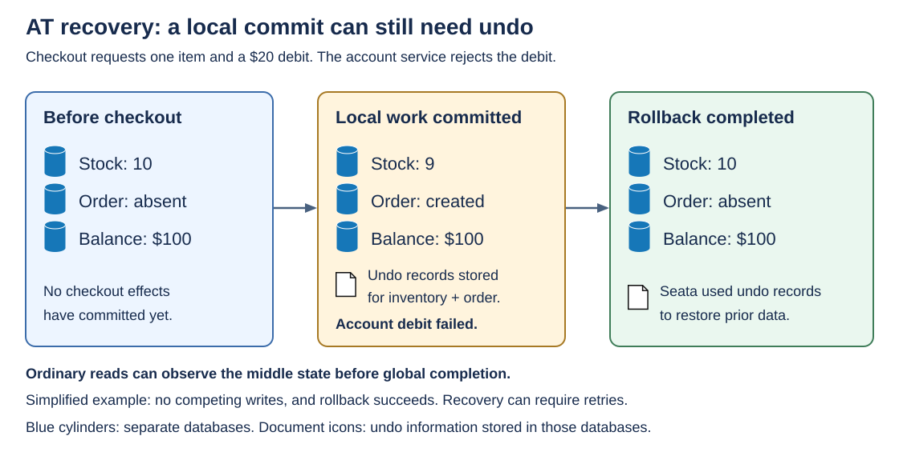
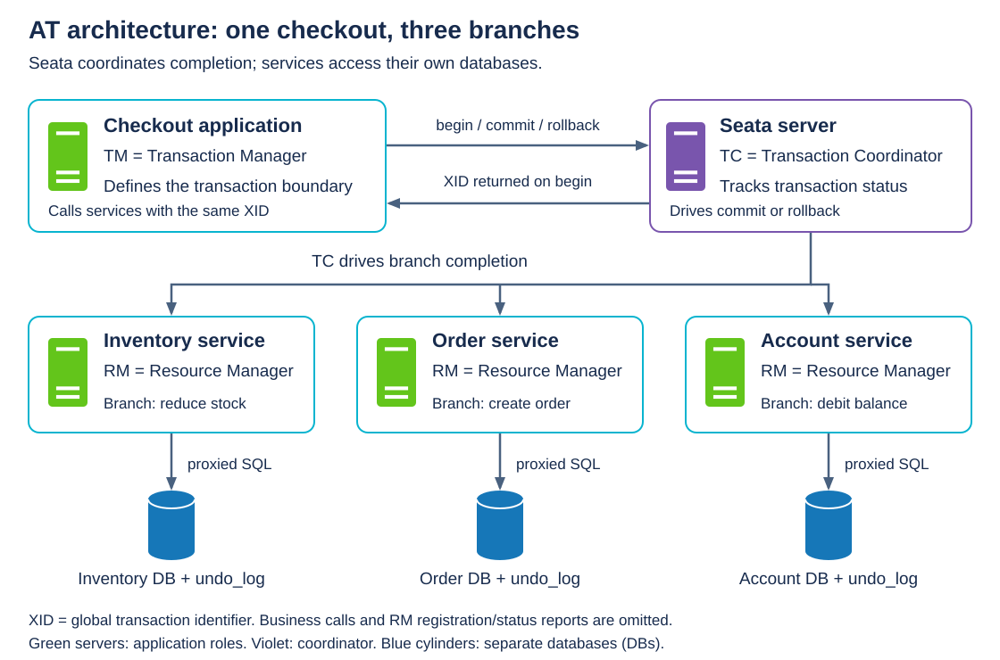

# Apache Seata

[Back to Distributed Systems](../Readme.md#content)

**Apache Seata coordinates transactions across services that keep their data in separate databases.**

A shop saves your order, but the charge fails. Who puts the item back in stock? Seata’s **Automatic Transaction (AT)** mode can undo database changes. Other actions, such as refunding a payment, need rules supplied by the service.

1. [One checkout, three databases](#1-one-checkout-three-databases)
2. [How AT puts an item back](#2-how-at-puts-an-item-back)
3. [How the services find the same checkout](#3-how-the-services-find-the-same-checkout)
4. [Choosing a transaction mode](#4-choosing-a-transaction-mode)

## 1. One checkout, three databases

A **local transaction** groups changes in one database. A **commit** saves them together. A **rollback** discards them while the transaction is open. If stock, orders, and accounts share a database, one transaction can cover checkout.

Now give each service its own database. Inventory commits a stock change from 10 units to 9. The order service commits a new order. When the account service rejects the $20 debit, stock is still 9 and the unpaid order still exists.

The checkout is a **global transaction**. A **branch** is one participant’s unit of work, such as the stock update. Seata tracks the branches so it knows which services to contact on failure.

## 2. How AT puts an item back

In AT, a **data-source proxy** sits between each service and its database. For the stock update, it records the old value (the **before-image**, 10) and the new value (the **after-image**, 9) in the `undo_log` table. The database commits the update and its undo record together, so both survive a crash.

Follow the stock count from left to right. The middle panel shows what a shopper can see before rollback.

On **global rollback**, inventory starts a new local transaction. If stock matches the after-image (9), it restores 10. If stock already matches the before-image (10), it skips the write. The order service removes the order. The balance stays at $100 because the debit failed. On **global commit**, the changes stand and Seata cleans up the undo records in the background.

A plain `SELECT` can see 9 while checkout is pending because inventory committed locally. Seata calls this AT default **global read uncommitted**. A **global lock** prevents conflicting writes by other participating transactions. To read at **global read committed**, use `SELECT ... FOR UPDATE` through the proxy inside an AT global transaction or a `@GlobalLock` method. If another transaction holds the row’s global lock, the read retries until the lock clears or retries run out.

Suppose a writer bypasses Seata and sets stock to 8 before the rejected debit triggers rollback. With Seata 2.6.0’s default undo checks, 8 matches neither image. Seata leaves 8 in place, marks the global transaction `RollbackFailed`, and stops retrying. An operator must reconcile the stock, then delete the affected undo record.

## 3. How the services find the same checkout

Each checkout gets a global transaction identifier (**XID**). Seata’s framework integrations, such as its Dubbo filter, pass the XID across service calls. Custom call paths must pass it to the receiving service so its work joins the right checkout.

| Role | Job in this checkout |
| --- | --- |
| **Transaction Manager (TM)** | The checkout application asks Seata to begin, then requests commit or rollback. |
| **Transaction Coordinator (TC)** | The Seata server returns the XID, tracks branches, and directs their commit or rollback. |
| **Resource Manager (RM)** | Each service’s Seata client registers its branch and carries out the decision. For rollback, it finds the undo record by XID and branch identifier. |

In the architecture diagram below, the coordinator sends inventory a rollback request. Inventory updates its database. The diagram omits service calls carrying the XID and branch registrations.

In Java, `@GlobalTransactional` marks the checkout method as a transaction boundary. AT needs a reachable coordinator, supported databases and statements, and a proxy and undo table per database. Rolling back an order leaves its confirmation email in the customer’s inbox. AT has no undo record for sending it.

After a request timeout, checkout may still be pending. Use `GlobalTransactionContext.reload(xid).getStatus()` to check. For retryable failures, `server.recovery.committingRetryPeriod` and `server.recovery.rollbackRetryPeriod` set retry intervals. `server.maxCommitRetryTimeout` and `server.maxRollbackRetryTimeout` control how long retries continue.

## 4. Choosing a transaction mode

What can a participant do if checkout fails after its part succeeds?

| Mode | What happens in checkout | When it fits |
| --- | --- | --- |
| **AT** | Inventory commits the stock change with an undo record. | AT supports the writes, and readers can tolerate seeing a pending change. |
| **Try-Confirm-Cancel (TCC)** | **Try** reserves $20. **Confirm** spends it. **Cancel** releases it. | The service can implement all three operations and [handle repeated Confirm calls](../Transactions.%20Try-Confirm-Cancel/Readme.md#duplicate-requests-and-uncertain-responses) so the customer pays only once. |
| **Saga** | The service charges $20. If checkout fails later, it issues a refund. The refund is a [**compensation**](../Transactions.%20Saga/Readme.md#saga-and-tcc), a new action that corrects an earlier one. | A long workflow has meaningful compensations, and customers can tolerate seeing the charge before the refund. |
| **XA** | Under the X/Open XA standard, the database **prepares** the debit, promising it can commit later. It waits for the coordinator to request commit or rollback. | Databases and drivers support XA, and other work can [wait for locks held by prepared branches](../Transactions.%20Two-phase%20commit/Readme.md#why-a-prepared-transaction-can-block). |

## Check your understanding

1. The account service rejects the debit. Why can the unpaid order still exist?

   

   
Answer

   The order service already committed in its own database. Rolling back the debit affects only the account database.

   

2. A shopper reads 9 units before rollback restores 10. Why could they see 9, and what does Seata call this behavior?

   

   
Answer

   Inventory committed 9 locally while the global outcome was pending. A plain query can see that local commit. Seata calls this **global read uncommitted**.

   

3. Two checkouts fail together. How does inventory find the right undo record?

   

   
Answer

   Each checkout has its own XID. The resource manager looks up the undo record by XID and branch identifier.

   

4. Which mode fits a $20 hold? Which fits a charge followed by a refund?

   

   
Answer

   TCC reserves the $20 until Confirm or Cancel. In Saga the charge takes effect, and the customer can see it before the refund arrives.

   

5. Checkout is pending. How does a prepared XA update differ from an AT local commit?

   

   
Answer

   In XA the database holds locks while it waits to commit or roll back. In AT it has already committed the change and its undo record.

   

# Sources

- [Apache Seata 2.6 overview and AT isolation](https://seata.apache.org/docs/overview/what-is-seata/)
- [Transaction roles](https://seata.apache.org/docs/overview/terminology/) and [checkout example](https://seata.apache.org/docs/user/quickstart/).
- [AT data-source proxy](https://seata.apache.org/docs/user/mode/at/), [undo records](https://seata.apache.org/docs/dev/mode/at-mode/), [database support](https://seata.apache.org/docs/user/datasource/), and [SQL restrictions](https://seata.apache.org/docs/user/sqlreference/sql-restrictions/).
- Seata v2.6.0 — [image checks](https://github.com/apache/incubator-seata/blob/v2.6.0/rm-datasource/src/main/java/org/apache/seata/rm/datasource/undo/AbstractUndoExecutor.java#L251-L282), [undo conflicts](https://github.com/apache/incubator-seata/blob/v2.6.0/rm-datasource/src/main/java/org/apache/seata/rm/datasource/undo/AbstractUndoLogManager.java#L432-L445), [retry decision](https://github.com/apache/incubator-seata/blob/v2.6.0/server/src/main/java/org/apache/seata/server/coordinator/DefaultCore.java#L461-L476), and [rollback status](https://github.com/apache/incubator-seata/blob/v2.6.0/server/src/main/java/org/apache/seata/server/session/SessionHelper.java#L261-L276).
- Seata v2.6.0 — [when the proxy intercepts a query](https://github.com/apache/incubator-seata/blob/v2.6.0/rm-datasource/src/main/java/org/apache/seata/rm/datasource/exec/ExecuteTemplate.java#L84-L87) and [locking read retries](https://github.com/apache/incubator-seata/blob/v2.6.0/rm-datasource/src/main/java/org/apache/seata/rm/datasource/exec/SelectForUpdateExecutor.java#L93-L116).
- [XID propagation](https://seata.apache.org/docs/user/microservice/), [transaction status API](https://seata.apache.org/docs/user/api/), and [recovery retries](https://seata.apache.org/docs/user/configurations/).
- [TCC reservations](https://seata.apache.org/docs/user/mode/tcc/), [repeated TCC requests](https://seata.apache.org/blog/seata-tcc/), [Saga compensation](https://seata.apache.org/docs/user/mode/saga/), and [XA preparation](https://seata.apache.org/docs/user/mode/xa/).
- Diagram icons — [server](../../system%20design/01.%20Scaling/images/single-server.svg), [database](../../system%20design/10.%20Notification%20System/images/improved-design.svg), and [document](../../system%20design/26.%20Payment%20System/images/settlement-report.svg).
