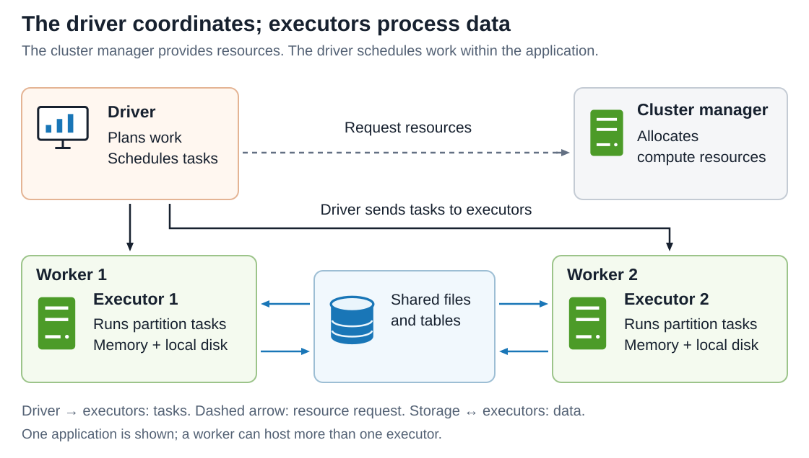

# Apache Spark

[Back to Distributed Systems](../Readme.md#content)

# Front

How does Apache Spark process large datasets across multiple machines?

# Back

**Apache Spark is an open-source engine that processes large datasets in parallel across a cluster (a group of computers).** It splits data into **partitions** (chunks) and coordinates work on them, so a calculation can use several machines.

## Who uses Spark, and for what?

These published reports describe particular deployments:

| Organization and report date | Workload and reported benefit |
| --- | --- |
| **Uber, 2025** | Migrated data-preparation and interactive workflows from Hive on Spark to Spark's SQL (Structured Query Language) engine, covering about five million monthly queries. Reported **50% lower runtime and resource use** overall. |
| **Facebook / Meta, 2016** | Rebuilt a pipeline preparing data for ranking, processing over **60 terabytes** of compressed input. Reported about **5× lower latency** after engine and pipeline improvements. |
| **Airbnb, 2024** | Prepared training, validation, and prediction datasets for listing embeddings: numerical representations used to find similar listings. Model training was a separate part of the system. |

Reported speedups apply to those specific migrations.

## What problem does Spark solve?

Imagine a shop with years of orders. One computer may take too long to scan them and calculate daily sales totals. Splitting work across machines requires scheduling work, combining partial results, and recovering from failures. Spark supplies this machinery.

Spark is the **processing layer**: it reads stored records or arriving events and produces derived datasets. In this illustrative design, checkout records orders in a transactional database; Spark prepares reporting tables and inputs for recommendation models. Applications can serve those prepared results.

## How it works

- The **driver** plans the calculation and schedules **tasks**, units of computation that process partitions.
- **Executors** are processes on worker machines that run those tasks and hold temporary data.
- A **cluster manager** allocates computing resources to the application.

In the diagram, the driver sends tasks to executors; executors read and write the actual data in shared storage.

## Example: sales by country

Each task calculates sales totals within its own partition. A **shuffle** redistributes the partial totals so values for the same country can be combined. If two partitions produce `A:10` and `A:5`, combining them gives country A a total of `15`.

This is **batch processing**: working on a bounded input, such as yesterday's sales. Spark also supports **stream processing** for continually arriving records.

## Benefits and limits

- **Recovery:** Spark can recompute lost results by repeating the operations that created them, provided the required inputs remain available.
- **Reuse:** caching keeps computed data for later calculations, avoiding repeated work.
- **Overhead:** shuffles move data between machines and involve disk activity. Spark uses both memory and disk; processing is not entirely in memory.

# Sources

- [Apache Spark overview: batch and stream processing](https://spark.apache.org/)
- [Cluster mode overview: drivers, executors, tasks, and resource allocation](https://spark.apache.org/docs/latest/cluster-overview.html)
- [Programming guide: partitions, shuffles, caching, and recovery](https://spark.apache.org/docs/latest/rdd-programming-guide.html)
- [Uber: migrating Hive workloads to Spark SQL (2025)](https://www.uber.com/us/en/blog/how-uber-migrated-from-hive-to-spark-sql-for-etl-workloads/)
- [Meta: a 60 TB+ Spark production use case (2016)](https://engineering.fb.com/2016/08/31/core-infra/apache-spark-scale-a-60-tb-production-use-case/)
- [Airbnb: learning and applying listing embeddings (2024)](https://airbnb.tech/wp-content/uploads/sites/19/2024/12/Learning-and-Applying-Airbnb-Listing-Embeddings-.pdf)
