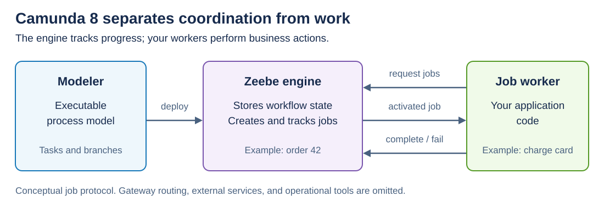
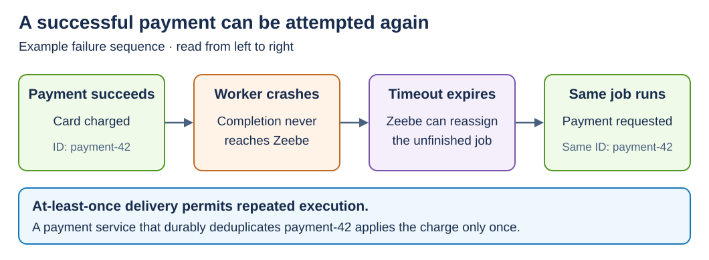

# Camunda

[Back to Distributed Systems](../Readme.md#content)

**Camunda is a process orchestration platform:** it coordinates tasks across services and people while tracking the overall workflow. This article focuses on **Camunda 8**, its Zeebe engine, and what happens when distributed work fails.

## The mental model

Imagine an order that must reserve stock, collect payment, and arrange delivery. Some orders also need human approval. Camunda records where each order is in that process and what must happen next.

You define the workflow using **BPMN** (Business Process Model and Notation), a visual language for tasks, branches, and events. A **process definition** is the reusable model; a **process instance** is one running order. **Variables** carry its data, such as `orderId` and a payment result.

- **Modeler** creates executable process diagrams.
- **Tasklist** lets people work on human tasks.
- **Operate** shows running processes and helps operators investigate failures.

## Zeebe coordinates; workers do the work

**Zeebe** is Camunda 8's distributed workflow engine. When an instance reaches a service task, Zeebe creates a **job**, a work item with a type such as `charge-payment`. A **job worker** is application code that requests matching jobs, performs the business action, and reports completion or failure.

The diagram separates the model, stored workflow state, and worker code. The arrows between Zeebe and the worker show their job protocol.

Zeebe divides process data into **partitions**; an instance stays in one partition throughout its execution. Each partition has a leader and, when replication is configured, followers. **Raft**, a consensus protocol, replicates records and elects a replacement leader after failure. Progress requires a majority of that partition's replicas. This protects workflow state; it does not make an external payment atomic with a workflow update.

## Retries can repeat a business action

Suppose a worker charges a customer, then crashes before reporting completion. Zeebe still sees unfinished work. After the activation timeout, the job can be assigned again: delivery is **at least once**, so execution can repeat.

Read left to right: the payment succeeds before the engine knows it. A repeated request needs the same business operation identifier.

Make the action **idempotent**: repeating it has the same intended effect as performing it once. For example, send `payment-42` on every attempt and have the payment service deduplicate that identifier durably. Generating a new identifier for each retry defeats this protection.

When a worker reports failure, it supplies the remaining retry count and can request a backoff delay. At zero retries, Zeebe raises an **incident**, and that job waits for resolution. An activation timeout alone does not decrement the retry count. Operators can use Operate to investigate and recover stuck work.

## Compensation and practical limits

Camunda does **not** create one atomic transaction across the engine and every service database. If payment succeeded but delivery cannot proceed, model a **compensation**, such as refunding the payment. This is a new business action that counteracts an earlier effect, not a database rollback. You must implement the refund behavior and define when to trigger it.

This supports a **Saga**: a workflow of local transactions with compensating actions. Intermediate effects can remain visible while recovery runs, and compensations need failure handling too.

Camunda is useful when a process spans services, waits for events or people, and needs visible progress and recovery. As a practical tradeoff, a simple operation inside one service may not justify adding a workflow engine. Camunda 8 is available as a managed cloud service or a self-managed deployment.

# Sources

- [Camunda 8 overview and components](https://docs.camunda.io/docs/components/concepts/concepts-overview/)
- [Processes, BPMN, and variables](https://docs.camunda.io/docs/components/concepts/processes/)
- [Zeebe partitions](https://docs.camunda.io/docs/components/zeebe/technical-concepts/partitions/)
- [Clustering, Raft, and quorum](https://docs.camunda.io/docs/components/zeebe/technical-concepts/clustering/)
- [Job workers, timeouts, and retries](https://docs.camunda.io/docs/components/concepts/job-workers/)
- [Failure handling, idempotency, and Saga compensation](https://docs.camunda.io/docs/components/best-practices/development/dealing-with-problems-and-exceptions/)
- [BPMN compensation handlers](https://docs.camunda.io/docs/components/modeler/bpmn/compensation-handler/)
