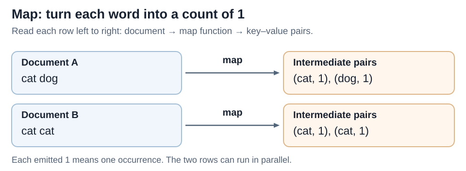
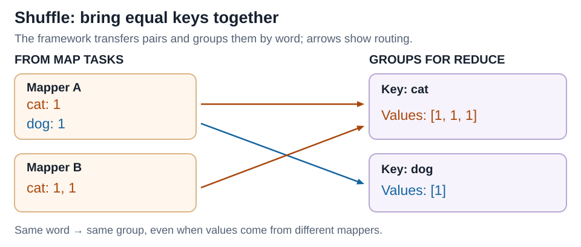
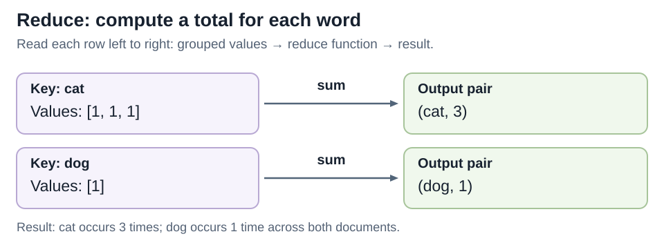

# MapReduce

[Back to Distributed Systems](../Readme.md#content)

**MapReduce is a programming model for processing large datasets: transform records into key–value pairs, group matching keys, then compute a result for each group.** The official spelling is **MapReduce**, one word. A distributed implementation spreads the work across a cluster—a group of computers—and handles scheduling, data transfer, and retries. Below: a small example, the distributed benefits, and real systems that use the model.

## The example

Count words in two documents: `cat dog` and `cat cat`. A **key** identifies a group, here a word; a **value** carries information about it, here an occurrence count. A **job** is the complete computation; a **task** is one scheduled piece of its work.

## Step 1 — Map records independently

When a map task reads a document, the map function emits `(word, 1)` for each word. The two documents can be processed in parallel because neither needs the other's result. In general, one input record can produce zero, one, or many pairs.

## Step 2 — Shuffle and group by key

The framework routes intermediate pairs so that all values for the same key reach the same reduce task. This transfer is the **shuffle**; Hadoop also sorts and groups the keys. Now `cat` has `[1, 1, 1]` and `dog` has `[1]`, regardless of which mapper emitted them. One reduce task can handle many keys; a key does not require its own machine.

## Step 3 — Reduce each group

Given a key and its grouped values, the reduce function sums the counts: `(cat, 3)` and `(dog, 1)`. The job writes these results to output storage. **Reduce need not mean sum**: it can also construct a list of documents containing each word, creating an index for search.

## Why distribute it?

Many map tasks scan different chunks concurrently, and reduce tasks process different groups concurrently. The framework tracks tasks and can rerun failed work on another worker. With storage such as the Hadoop Distributed File System (**HDFS**), it can schedule map tasks near their input to reduce network traffic.

Retries mean task code may run more than once. External effects, such as updating another database, need their own protection against duplicates; retrying a task does not automatically make every external write happen exactly once.

## Which systems use it, and for what?

| System | Role and example use |
| --- | --- |
| **Google's original MapReduce** | The 2004 paper describes production use for rebuilding web-search indexes and analyzing large datasets. This is a historical deployment, not a claim about Google's current search architecture. |
| **Apache Hadoop MapReduce** | A distributed execution framework for large batch jobs. Examples include word counts and log summaries, such as requests per URL. It manages parallel tasks and failure recovery. |
| **Amazon EMR** | A managed platform that can run Hadoop MapReduce on AWS, for example to process files in Amazon S3 into reporting datasets. EMR also runs other engines; not every EMR job is MapReduce. |
| **Apache CouchDB** | Map/reduce **views** provide indexed queries and aggregates over documents, such as spending totals by month. Views update incrementally as documents change; this is a database use of the model, not a Hadoop batch job. |

## Where it fits—and its cost

Classic Hadoop MapReduce suits **batch processing**: handling a bounded dataset, such as yesterday's logs. Its shuffle moves data over the network, and intermediate data can use disk. These costs make it a poor default for answering each interactive request. A heavily repeated key can also concentrate work in one reduce task. The practical question is whether the computation splits into independent record processing followed by useful grouping.

# Sources

- [Google: MapReduce paper (2004)](https://storage.googleapis.com/gweb-research2023-media/pubtools/4449.pdf)
- [Apache Hadoop: MapReduce Tutorial](https://hadoop.apache.org/docs/current/hadoop-mapreduce-client/hadoop-mapreduce-client-core/MapReduceTutorial.html)
- [AWS: Amazon EMR architecture and processing engines](https://docs.aws.amazon.com/emr/latest/ManagementGuide/emr-overview-arch.html)
- [Apache CouchDB: Introduction to Views](https://docs.couchdb.org/en/stable/ddocs/views/intro.html)
