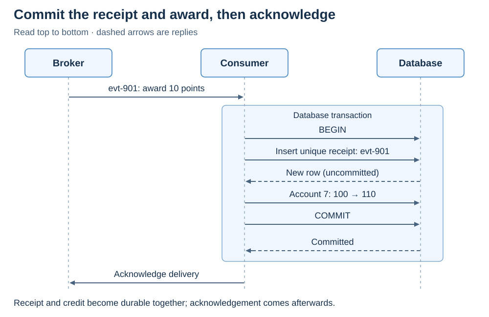
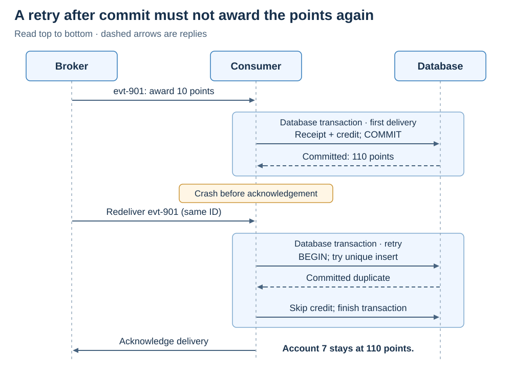
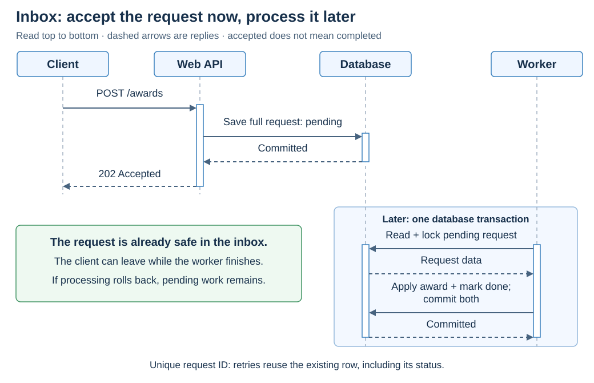
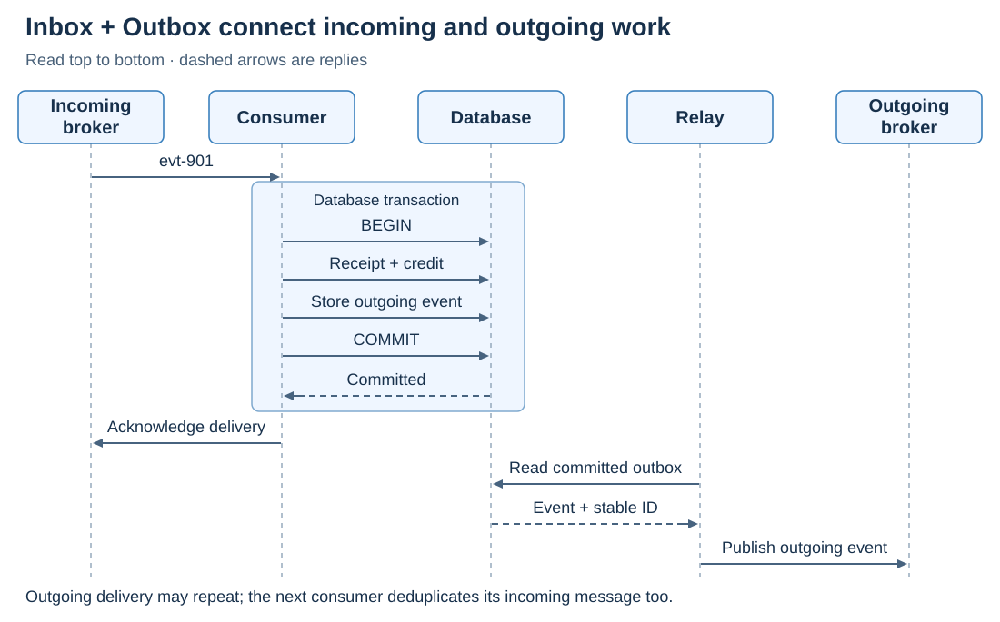

# Patterns. Transactional Inbox

<sub>[Back to Distributed Systems](../Readme.md#content)</sub>

A **transactional inbox** lets a service recognize a message it has already handled.

The service records the message ID in the **same database transaction** as the change the message requests. Either both changes take effect or neither does. If a loyalty service receives the same “award 10 points” message twice, the balance goes from 100 to 110 and stays there.

1. [Why one award can be counted twice](#1-why-one-award-can-be-counted-twice)
2. [How the inbox records an award](#2-how-the-inbox-records-an-award)
3. [What survives a crash](#3-what-survives-a-crash)
4. [Saving the request for later](#4-saving-the-request-for-later)
5. [Sending an event after the award](#5-sending-an-event-after-the-award)

## 1. Why one award can be counted twice

A **message broker**, RabbitMQ in this example, delivers `evt-901` to the loyalty service. The service is the **consumer**. It adds 10 points to account 7 and commits the change, saving a balance of 110. Before it can send an **acknowledgement** (ack) to tell the broker it has finished, the service crashes.

When the consumer’s connection closes, RabbitMQ requeues the unacknowledged message. **At-least-once delivery** means each message reaches a consumer one or more times. Adding 10 again for `evt-901` would bring the balance to **120**.

Sending the ack first risks losing the award. A crash before the points are saved would leave the balance at 100 while the broker considers the delivery complete.

## 2. How the inbox records an award

The inbox table holds one **receipt** for each consumer and message pair. For this award the pair is `(loyalty-credit, evt-901)`.

- `loyalty-credit` identifies the job of awarding points. Every running copy of the loyalty service uses this name. A separate reporting job can use its own name and process the same message.
- `evt-901` identifies this particular award. Every retry carries that ID. A later purchase by account 7 gets a new ID and can earn points again.

Read the diagram from top to bottom. Everything inside the **Database transaction** frame commits together, including the receipt and the points. Only then does the consumer acknowledge the delivery.



In PostgreSQL, the **handler** (the code that awards the points) runs this insert **inside the award transaction**. The primary key `(consumer_name, message_id)` makes each pair unique.

```sql
INSERT INTO inbox_processed (consumer_name, message_id)
VALUES ('loyalty-credit', 'evt-901')
ON CONFLICT (consumer_name, message_id) DO NOTHING
RETURNING message_id;
```

- **One row returned.** The handler inserted a new receipt. It adds 10 points, commits and acknowledges the delivery.
- **No row returned.** A receipt already exists. The handler skips the award, finishes the transaction and acknowledges the duplicate.

If the update fails or matches no account, the handler rolls back. In RabbitMQ it can request another delivery with `basic.reject` and `requeue=true`. On a quorum queue, each such rejection counts toward the delivery limit. Configure a route to a **dead-letter queue** so a message that exceeds the limit goes there for inspection.

Kafka tracks progress by **offset**, a position in a log partition. Fetching records advances the consumer’s position. Use manual commits and retry the failed record. Commit past its offset in that partition only after success or after safely setting it aside for inspection. Otherwise a restart can skip the award.

What if two copies arrive at once? Both consumers could look for a receipt and find none. With PostgreSQL’s default settings, a competing insert for the same key waits. If the first transaction commits, the second skips the award. If the first rolls back, the second can insert the receipt and award the points.

The receipt guards one message. Two different awards, `evt-901` and `evt-902`, can reach account 7 together. If both handlers read 100 and write back 110, one award is lost. Use `SET points = points + 10` so PostgreSQL applies each increment to the current balance. A rule that spans several messages needs its own protection, such as a constraint or lock.

## 3. What survives a crash

| When the consumer crashes | What the database holds | What the retry does |
|---|---|---|
| Before the transaction commits | No receipt, 100 points | Inserts the receipt and awards 10 points. |
| After the commit, before the ack | One receipt, 110 points | Skips the award and acknowledges the delivery. |

The diagram follows the second case. The retry finds the receipt and the balance stays at 110. This consumer is **idempotent** because processing the same award twice has the same effect as processing it once.



If the connection drops during the commit, either outcome in the table above is possible. Retry the **whole transaction**, starting with the receipt insert. Keep receipts for as long as a duplicate can arrive, including a manual retry days later. Once the receipt is deleted, an old copy looks new.

## 4. Saving the request for later

Sometimes an HTTP client needs a quick answer and the points can wait. In the diagram, the client sends `POST /awards`. The web service saves the **whole request** in the inbox under a unique request ID, with the account, the number of points and a `pending` status. A retry with the same ID reuses that row.

After the first commit, the service replies `202 Accepted`, meaning it has accepted the request for processing. The request is stored and the award is still pending. In the **Later: one database transaction** frame, a background worker locks the pending row, adds the points and marks it `done` before committing.



If the worker crashes before its commit, the award rolls back and the request stays `pending`. The service now has everything it needs to retry the work itself.

## 5. Sending an event after the award

Suppose the loyalty service commits the points and crashes before publishing `PointsAwarded`. A retry finds the receipt and skips the award. How will the other service hear about it?

A **transactional outbox** is a table of messages waiting to be sent. In the **Database transaction** frame, the loyalty service saves the inbox receipt, the points and the outgoing event together. After the commit, a separate process called a **relay** reads the outbox and publishes the event.



The inbox protects changes in the loyalty database. A rollback there cannot undo work another system has already done, such as sending an email. The relay can publish the same event again after a crash, so it reuses the event ID and the receiving service handles repeats.

See [Transactional Outbox](../Patterns.%20Transactional%20Outbox/Readme.md).

## Check your understanding

1. The account shows 110 points. Why might the broker still deliver the award again?

   <details>
   <summary>Answer</summary>

   The consumer committed the points, but the broker never received its acknowledgement.

   </details>

2. What could happen if the consumer committed the receipt first and added the points in a second transaction?

   <details>
   <summary>Answer</summary>

   A crash between the two commits would leave a receipt and only 100 points. The retry would skip an award that never happened.

   </details>

3. The consumer asked the database to commit but lost the connection before it heard back. What should it retry?

   <details>
   <summary>Answer</summary>

   The whole transaction. If the receipt survived, the insert skips the award. If the transaction rolled back, the retry can award the points.

   </details>

4. An HTTP client receives `202 Accepted` and disconnects. What must the worker be able to recover?

   <details>
   <summary>Answer</summary>

   The full pending request, including which account to credit and by how much. The worker can then finish the award and mark it done in one transaction.

   </details>

5. What should survive if the loyalty service crashes after committing the award but before announcing it?

   <details>
   <summary>Answer</summary>

   The receipt, the updated balance and a `PointsAwarded` event in the outbox. The relay can publish the saved event after recovery.

   </details>

# Sources

- [Chris Richardson — Handling duplicate messages with the Idempotent Consumer pattern](https://microservices.io/post/microservices/patterns/2020/10/16/idempotent-consumer.html)
- [RabbitMQ — Consumer acknowledgements and redelivery](https://www.rabbitmq.com/docs/confirms) and [quorum queue poison message handling](https://www.rabbitmq.com/docs/quorum-queues#poison-message-handling)
- [Apache Kafka — Consumer position and committed offsets](https://kafka.apache.org/44/javadoc/org/apache/kafka/clients/consumer/KafkaConsumer.html)
- [PostgreSQL 18 — Transactions](https://www.postgresql.org/docs/18/tutorial-transactions.html), [INSERT and RETURNING](https://www.postgresql.org/docs/18/sql-insert.html), [index uniqueness checks](https://www.postgresql.org/docs/18/index-unique-checks.html) and [transaction isolation](https://www.postgresql.org/docs/18/transaction-iso.html)
- [Particular — How long to keep duplicate detection data](https://docs.particular.net/nservicebus/outbox/)
- [Wolverine — Durable messaging and inbox recovery](https://wolverinefx.net/guide/durability/)
- [RFC 9110 — 202 Accepted](https://www.rfc-editor.org/rfc/rfc9110.html#name-202-accepted)
- [Frap — Inbox pattern illustration, CC0](https://en.wikipedia.org/wiki/File:Inbox-pattern.svg)
- [Chris Richardson — Transactional Outbox](https://microservices.io/patterns/data/transactional-outbox.html)
