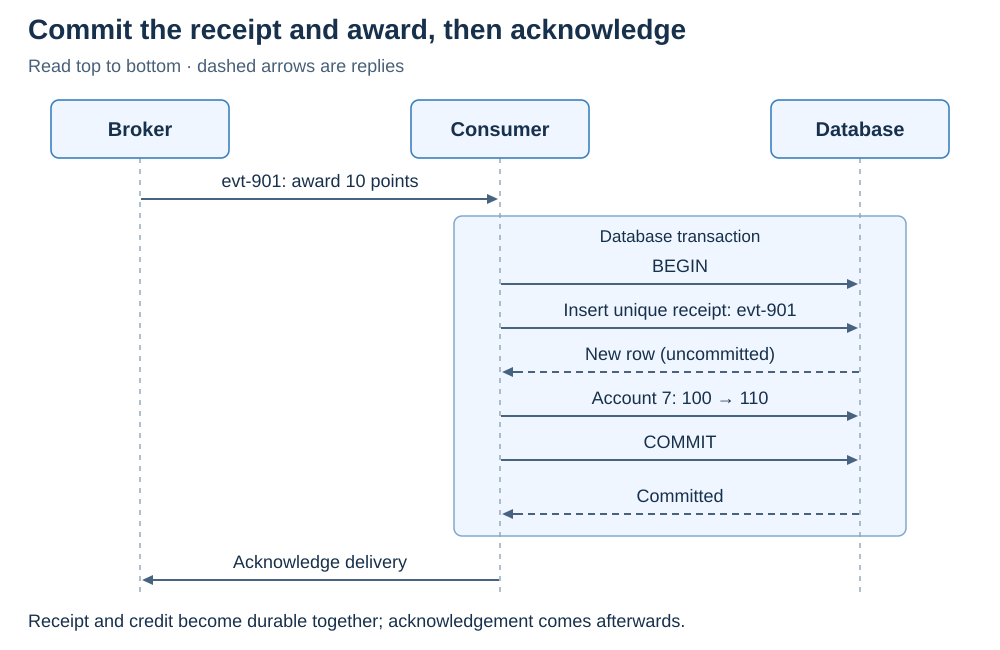
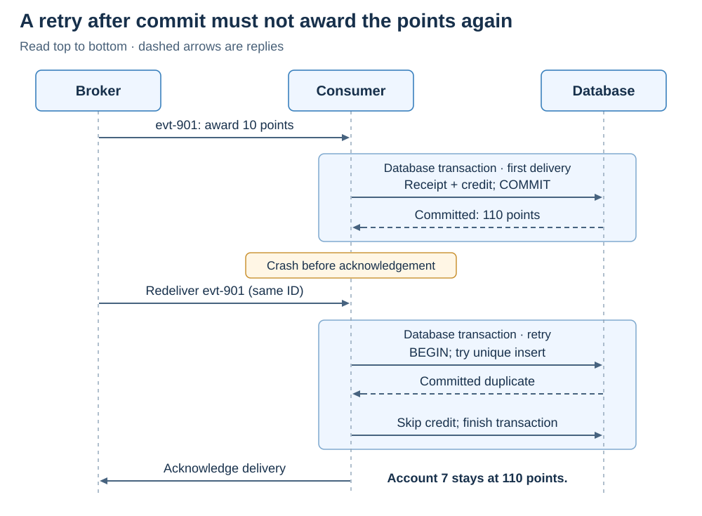
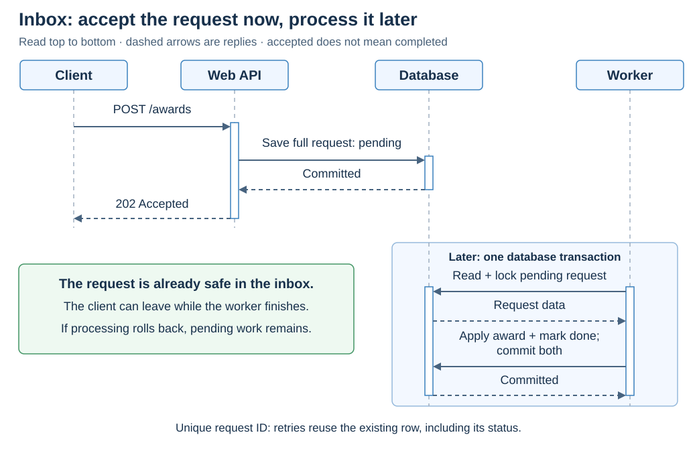
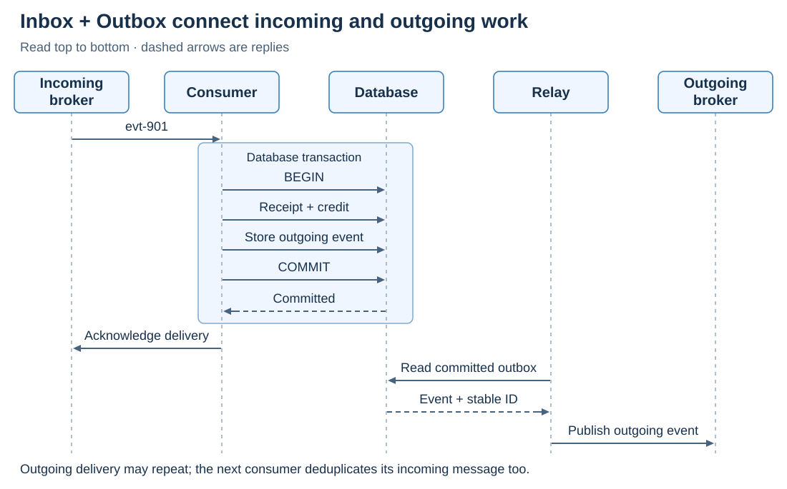

# Patterns. Transactional Inbox

<sub>[Back to Distributed Systems](../Readme.md#content)</sub>

**A transactional inbox is a table in a service's own database that keeps track of incoming messages. The service updates it in the same transaction as the work each message asks for, so "this message is handled" and the work itself are saved together or not at all.**

That one rule lets a service survive crashes and repeated deliveries without doing any work twice. The article starts with a loyalty service that counts one award twice, builds the fix, and runs it in PostgreSQL. Then it covers two copies of a message arriving at once, the choice of key, the pattern's second form (save now, process later), the pairing with the Transactional Outbox, and the limits that remain.

## The problem: one award, counted twice

A loyalty service gets its work from a **message broker**, such as RabbitMQ or Kafka, which stores messages and hands them to the services that read them, the **consumers**. Message `evt-901` says: award account `7` ten points. The account has `100` points.

The consumer's **handler**, the code that does the work, adds the points and commits: the account now has `110`. Then the consumer sends the broker an **acknowledgement**, or **ack**, to say that it has finished. Until the ack arrives, the broker keeps the message.

Now suppose the consumer crashes after the commit but before the ack, or the ack gets lost on the way. The broker cannot tell whether the work happened, so it delivers `evt-901` again, to the same consumer after a restart or to another running copy of the service. The handler adds ten points again, and the account shows `120` for a single award.

This is not a broker bug. Brokers such as Kafka and RabbitMQ are normally used with **at-least-once delivery**: every message arrives, but some arrive more than once. Kafka's exactly-once transactions do not help here, because they cover writes to Kafka, not the handler's database ([details](../Apache%20Kafka.%20Delivery%20and%20transactions/Readme.md#database-writes-and-service-calls)).

Sending the ack first only swaps the failure. If the consumer acks and then crashes before it commits, the broker treats the message as done, and the award is lost: the account stays at `100`. RabbitMQ's automatic acknowledgement mode behaves this way, and its documentation calls that mode unsafe.

So the ack must come after the commit, and the handler must cope with seeing a message again. A consumer that gives the same result whether a message arrives once or several times is an **idempotent consumer**, and a transactional inbox is a common way to build one.

## The fix: record the message in the same transaction

Add a second table to the loyalty database: the inbox. It holds one row for each message that the handler has finished, and this article calls such a row a **processing receipt**. Its key combines the handler's name, `loyalty-credit`, with the message ID, `evt-901`; [Choosing the key](#choosing-the-key) explains why it needs both.

The handler then does its database work in one **transaction**, a group of changes that the database saves together when you commit and undoes together when you roll back:

1. Insert the receipt `(loyalty-credit, evt-901)`.
2. If the insert added a row, add the ten points.
3. Commit.
4. Only after the commit succeeds, ack the message.

The key is unique, so the database accepts only one receipt per message. For a duplicate, the insert adds nothing, and the handler skips step 2. It still commits and acks, so that the broker stops redelivering the message.

In the image below, read from top to bottom; dashed arrows are replies. Everything in the `Database transaction` frame, from `BEGIN` to `Committed`, is one transaction, so the receipt and the change `Account 7: 100 → 110` are saved together. `New row (uncommitted)` means that the database has accepted the receipt, but other transactions cannot see it yet. `Acknowledge delivery` sits outside the frame, because the broker takes no part in the database transaction.



After the commit, the database holds the receipt and `110` points. Until then, both changes exist only inside the open transaction, even if the handler has already added the points. If the consumer crashes at that point, the database rolls both changes back: the account is back at `100`, with no receipt. The redelivery then runs the work again, and that is not a second award, because the first attempt left nothing behind.

**So never commit the receipt on its own.** If the handler commits the receipt first and adds the points in a second transaction, a crash between the two commits keeps the receipt but loses the points. Every redelivery then finds the receipt and skips the work, and the account stays at `100` for good. The opposite order fails the opposite way: the points survive without a receipt, and the redelivery awards them again, for `120`. A receipt in one database and points in another are two separate commits too, whatever the application code calls them.

Wolverine, a .NET messaging framework, describes the first of these bugs in an earlier version of its own duplicate check. It committed the receipt before the handler ran. When a handler failed and the message was retried, the retry found the receipt left by its own failed attempt, and Wolverine rejected it as a duplicate of itself. Wolverine now writes the receipt in the handler's transaction.

Work that fails quietly needs the same care. If account `7` does not exist, the `UPDATE` changes zero rows and raises no error. Committing then would record an award that was never applied, and the message would never be retried. So treat "zero rows updated" as a failure and roll back. If a message truly can never succeed, the handler may record that as its final outcome, but as a deliberate decision, not by accident.

## A crash after the commit is now harmless

Here is the crash from the problem again, with the inbox in place. In the image below, the first delivery commits (`Committed: 110 points`), and the consumer crashes before it can ack. The broker redelivers `evt-901` with the same ID. In a new transaction, the insert reports a `Committed duplicate`, so the consumer skips the credit, finishes the transaction, and acks. The account stays at `110`.



The ack is still outside the transaction, so the crash can still happen; the inbox makes it harmless. Wherever the crash hits, the next attempt finds a state that it handles correctly:

| Where the crash happens | What the database holds | What the next attempt does |
|---|---|---|
| Before the commit | Nothing has changed: no receipt, `100` points. | Inserts the receipt and awards the points. |
| After the commit, before the ack | The receipt and `110` points. | Finds the receipt, skips the award, and acks. |
| During the commit, so its reply never arrives | One of the two rows above, and the consumer cannot tell which. | Runs the whole transaction again, receipt check included. |

The last row is the tricky one. A lost reply to `COMMIT` does not mean that the commit failed; the database may have saved everything just before the connection broke. So never retry only the points update, which would award the points twice if the commit had succeeded. Retry the whole transaction, receipt insert first, and either outcome ends correctly.

## Try it in PostgreSQL

Run this setup once in a scratch database. The `inbox_processed` table holds the receipts. It does not store the message itself, because until the consumer acks, the broker keeps the message and can deliver it again.

```sql
CREATE TABLE loyalty_account (
    account_id bigint PRIMARY KEY,
    points integer NOT NULL
);

CREATE TABLE inbox_processed (
    consumer_name text NOT NULL,
    message_id text NOT NULL,
    recorded_at timestamptz NOT NULL DEFAULT CURRENT_TIMESTAMP,
    PRIMARY KEY (consumer_name, message_id)
);

INSERT INTO loyalty_account (account_id, points) VALUES (7, 100);
```

Each delivery runs the transaction below. `DO` runs an anonymous block of PostgreSQL procedural code, so that the example can branch on whether the insert added a row. A real handler makes the same decision in application code, from the result that its database driver returns, on the same connection and in the same transaction.

```sql
BEGIN ISOLATION LEVEL READ COMMITTED;

DO $$
DECLARE
    accepted_message text;
BEGIN
    INSERT INTO inbox_processed (consumer_name, message_id)
    VALUES ('loyalty-credit', 'evt-901')
    ON CONFLICT (consumer_name, message_id) DO NOTHING
    RETURNING message_id INTO accepted_message;

    IF accepted_message IS NOT NULL THEN
        UPDATE loyalty_account
        SET points = points + 10
        WHERE account_id = 7;

        IF NOT FOUND THEN
            RAISE EXCEPTION 'Account 7 does not exist';
        END IF;
    END IF;
END;
$$;

COMMIT;
```

Here is how the block decides:

- `ON CONFLICT (consumer_name, message_id) DO NOTHING` turns a duplicate key into "insert nothing" instead of an error. Naming the key matters: only a clash on this key counts as a duplicate, and any other error still aborts the transaction.
- `RETURNING message_id INTO accepted_message` gets a row back only if the insert added one. For a duplicate, `accepted_message` stays `NULL`, and the `UPDATE` is skipped.
- `FOUND` is false after an `UPDATE` that matched no row, and `RAISE EXCEPTION` then aborts the transaction.

Run the delivery twice. Both runs print `BEGIN`, `DO`, and `COMMIT`, and the tables end up with one receipt and `110` points. If account `7` were missing, psql, PostgreSQL's command-line client, would print `ERROR:  Account 7 does not exist`, and the closing `COMMIT` would answer `ROLLBACK`: nothing is saved, not even the receipt. The application then skips the ack and lets its retry policy decide what happens next.

## Two copies at the same time

Duplicates can also arrive in parallel. Two running copies, or **instances**, of the loyalty service can receive the same message at almost the same moment, for example when Kafka moves a consumer's work to a new instance while the old one is still busy with it (the [Transactional Outbox article](../Patterns.%20Transactional%20Outbox/Readme.md#how-a-consumer-processes-the-same-message-twice) shows how). Call the two instances A and B.

A `SELECT` to check first does not help: A and B can both look, both find nothing, and both award the points. The unique insert is the real guard. If A has inserted the receipt but not yet committed, B's insert neither fails nor skips. It simply hangs until A's transaction ends:

| A's transaction | What happens to B |
|---|---|
| A commits. | B's insert adds nothing, B skips the award, and the points are awarded once. |
| A rolls back. | B's insert goes through, and B awards the points itself. |

That is the behavior under `READ COMMITTED`, the **isolation level** that the example sets. An isolation level is the rule for what one transaction sees of other transactions' changes, and `READ COMMITTED` is PostgreSQL's default. Under `REPEATABLE READ` or `SERIALIZABLE`, B's insert fails instead, with `could not serialize access due to concurrent update` (error code `40001`). Nothing is saved, so this is safe, but B must retry the whole transaction, and the retry then finds the receipt. The [MVCC article](../../cs/Multiversion%20concurrency%20control/Readme.md#writers-still-collide) explains why the isolation level changes the outcome.

Keep the transaction short, because B holds a database connection while it waits. If B gives up because of a lock timeout, a deadlock, or a serialization failure, the error says nothing about whether the message was processed. Treat it as a failed attempt and retry the whole transaction.

The receipt protects one message, not the account. `evt-901` and `evt-902` have different keys, so two awards to account `7` do not wait for each other. That is why the example writes `points = points + 10`: PostgreSQL makes the second update wait and then applies it to the new value, so both awards count. If the application instead read the balance and wrote back a total, both awards could read `110` and both write `120`, and one award would be lost. Any other rule that spans several messages needs its own constraint or lock.

## Choosing the key

The receipt's key has two parts, and each part prevents a different mistake:

| Key part | Example | What it identifies |
|---|---|---|
| `consumer_name` | `loyalty-credit` | The handler, shared by all of its instances, so a receipt written by one instance stops a duplicate on any other. |
| `message_id` | `evt-901` | One message. The sender keeps the same ID on every retry. |

Each part has a tempting wrong alternative:

- **The account ID instead of the message ID.** Account `7` can rightly earn points many times. Keyed by account, the next award, `evt-902`, would be skipped as a "duplicate".
- **An instance name instead of the handler name.** If instance A records `loyalty-1` and the redelivery reaches instance B, which looks for `loyalty-2`, B finds nothing and awards the points again.
- **No handler name at all.** If an analytics handler keeps its receipts in the same table, whichever handler comes second finds the other's receipt for `evt-901` and skips work it never did. Wolverine's documentation reports that this has happened, and its `MessageIdentity.IdAndDestination` setting adds the destination to the key.

## The other form: save now, process later

So far, the handler did the work while the broker waited for the ack. The inbox can also work the other way round: save the message, confirm it at once, and do the work later. This **save-now form** is the inbox pattern as Wikipedia describes it, and how Wolverine's durable inbox handles broker messages.

As an HTTP (Hypertext Transfer Protocol) request, the award looks like this. A client sends `POST /awards` to a **Web API** (application programming interface), a service that accepts requests over HTTP. The API saves the whole request in the inbox with the status `pending` and replies `202 Accepted` only after the commit. Later, a **worker**, a background process, locks the pending row, awards the points, and marks the row `done`, all in one transaction. If that transaction rolls back, the row simply stays `pending` for the next attempt. In the image below, the worker's whole job sits in the frame `Later: one database transaction`.



`202` means "accepted for processing", not "done". The HTTP standard adds that the request may still be refused when it is processed, so the client needs another way to learn the result, such as a status link in the response. What the commit before `202` gives the client is the promise that the request is stored: if the API crashes right after replying, the worker still finds it.

Once the sender has its confirmation, it will not send the request again, so the inbox row is now the only copy of the work. That gives the service new duties:

- **Store the whole request.** The worker needs the account and the number of points. An inbox that saved only the ID before confirming would have lost the award.
- **Retry and recover on its own.** No broker will redeliver anything. The service must retry failed work, pick up work left behind by a crashed worker, and set aside work that keeps failing.
- **Let only one worker take a row.** Two workers that both read the same `pending` row would both award the points. Locking the row and committing the award together with `done`, as the image shows, prevents that. In PostgreSQL, `SELECT ... FOR UPDATE SKIP LOCKED` locks a row and lets other workers skip it instead of waiting.
- **Expire abandoned claims with care.** A design that first commits a separate `processing` status needs a timeout after which another worker may take the row over. If the timeout is too short, work that is merely slow runs twice, which is why Wolverine asks for its `InboxStaleTime` to exceed the longest expected handler run.
- **Answer duplicates with the existing row.** A retried request carries the same request ID, which is the table's unique key. If it arrives while the first copy is still `pending`, the API confirms the existing row. It must not create a second task, and it must never reset a `done` row to `pending`.

Both forms follow the same rule: the mark that says "handled", a receipt or a `done` status, commits in the same transaction as the work. They differ in who holds the message until then:

| | Process right away | Save now, process later |
|---|---|---|
| What the inbox row holds | A receipt: the handler name and the message ID. | The whole message, its ID, and its status. |
| When the sender gets its confirmation | After the work commits. | As soon as the message is saved. |
| Who retries after a failure | The broker, by redelivering. | The service itself. |
| What "handled" looks like | The receipt exists. | The status is `done`. |

## Inbox and outbox together

Suppose the loyalty service must also publish a `PointsAwarded` event. Publishing it straight from the handler brings the original problem back on the sending side. A crash after the commit loses the event for good, because the redelivery finds the receipt and skips everything. A publish followed by a rollback announces points that were never saved.

The [Transactional Outbox](../Patterns.%20Transactional%20Outbox/Readme.md) fixes this. The handler writes the event into an **outbox** table in the same transaction, and a **relay**, a separate background process, later publishes the committed rows. In the image below, the `Database transaction` frame holds three writes: the receipt and the points (`Receipt + credit`) and the event (`Store outgoing event`). After `Committed`, the consumer acks. Later, on its own schedule, the `Relay` reads the outbox and publishes the event to the `Outgoing broker`.



The two tables protect opposite ends of the service:

| Table | What it records | What it prevents |
|---|---|---|
| Inbox | Incoming messages that were handled, or, in the save-now form, that are still waiting. | Doing the work twice for one incoming message. |
| Outbox | Outgoing messages that still have to be published. | Losing an outgoing message when the service crashes after the commit. |

The relay can publish an event twice if it crashes between publishing it and recording that ([the Outbox article explains how](../Patterns.%20Transactional%20Outbox/Readme.md#why-an-event-can-be-published-twice)). So the event carries a stable ID, read back in the `Event + stable ID` reply, and whoever consumes `PointsAwarded` needs an inbox of its own. Frameworks often bundle the two: MassTransit's Consumer Outbox is an inbox and an outbox in one.

These are still local transactions, one per service. They make each service's own step reliable, but they do not turn a workflow across several services into one transaction; that is the job of a [saga](../Transactions.%20Saga/Readme.md).

## Limits to plan for

### The message ID must stay the same

Deduplication works only if every retry carries the original ID. A sender that creates a new ID for each attempt makes every retry look new. Watch for three related traps:

- **IDs that are unique only per sender.** If two producers or two **tenants** (customers that share one system) can both send an `evt-901`, add the producer or tenant to the key. Otherwise the second message is wrongly skipped.
- **One action, two IDs.** If the same purchase can arrive as two different messages, for example from two upstream systems, the inbox sees two new IDs. Only a business rule can catch that, such as a unique constraint that allows one award per purchase.
- **Broker positions are not message IDs.** A Kafka topic is split into **partitions**, and each record in a partition has a position number, its **offset**. A republished event gets a new offset, so deduplicate by the event's own ID. NServiceBus, another .NET messaging framework, warns likewise that a broker's built-in message ID can change between duplicate sends.

Kafka adds one more rule, about progress rather than identity. It keeps the progress of each group of consumers as one committed offset per partition: the position of the next record to read. Committing `13` tells Kafka that everything before it is finished. So when records are processed in parallel, commit only up to the first unfinished one, or a crash will skip it for good. See [Kafka consumer offsets](../Apache%20Kafka.%20Delivery%20and%20transactions/Readme.md#3-consumer-offsets).

### How long to keep receipts

A receipt protects a message only while the receipt exists. Once it is deleted, a late copy looks new and runs again. So keep receipts for as long as a copy can still arrive, counting broker redeliveries, delayed retries, and manual retries after an incident. Defaults can be short: Wolverine keeps handled messages for at least 5 minutes, so a copy that arrives 10 minutes later may be processed again. No retention period protects against replaying arbitrarily old messages.

A **replay**, deliberately reading old messages again, needs the same care. A replay into the same `consumer_name` skips the finished work, which is usually the point. To rebuild data from scratch, for example a new reporting table, use a new `consumer_name` and an empty destination, so that the old receipts do not block the rebuild. Never delete live receipts to force a replay: that awards customers points they already have. In the save-now form, cleanup may delete old `done` rows but never `pending` ones, which are unfinished work.

### Calls to other systems are outside the transaction

A rollback can undo rows, but not a sent email or a charged card. Suppose the handler calls a payment API, the call succeeds, and the transaction then fails. The receipt rolls back too, so the retry calls the API a second time, even though the receipt insert came first.

Write the intent to call into the outbox, so that the call happens after the commit, and make the receiving system tolerate repeats. If its API accepts **idempotency keys**, send the same key on every attempt, for example one built from the message ID, and learn how long the key lasts: Stripe's v1 API may remove a key once it is 24 hours old, and reusing it after that starts a new request. Inbox and outbox alone cannot make an external action happen exactly once.

### No duplicates does not mean the right order

`OrderCreated` and `OrderShipped` have different IDs, so the inbox accepts each of them once, but it knows nothing about their order. If `OrderShipped` arrives first, the handler must cope, for example by checking a version number, waiting for the missing event, or rejecting a step that is not valid in the current state. A new ID only proves that a message is new, not that it is valid now.

### Messages that keep failing

A database that was briefly unavailable may work on the next retry, but a malformed message fails every time. Such a **poison message** needs a limit on retries and a place to go afterwards, usually a **dead-letter queue**, where someone can inspect and repair it. Never mark a failing message as processed just to stop the retries; that silently drops the award.

### What the inbox costs

Every message adds a row, an index entry, and later a delete. To size the table, multiply the message rate by the retention time: 200 messages per second kept for 7 days is about 121 million receipts, before indexes. Monitor how often duplicates arrive, failed and waiting transactions, and, in the save-now form, the age of the oldest `pending` row and the number of failed messages.

## When to use it

Use a transactional inbox when messages can arrive more than once, the handler changes data in a database, and making that change twice would be wrong. Loyalty points, stock adjustments, and accounting entries are typical examples.

A separate table is not always needed. If the business change already has a unique operation ID, the business table's own unique constraint can do the job: the [Saga article](../Transactions.%20Saga/Readme.md#inbox-publication-order-and-change-data-capture) uses one `transfer_log` key, `('tr-42', 'credit')`, both to catch duplicates and to record the step. A single conditional update that refuses to apply the same message twice works too. Whichever form you choose, one rule holds: **the record that says a message was handled must commit in the same transaction as the change it protects.**

# Sources

- [Wikipedia — Inbox and outbox pattern: save received data first, then process it with retries](https://en.wikipedia.org/wiki/Inbox_and_outbox_pattern)
- [Frap — Inbox sequence illustration, CC0; visual reference for `inbox-sequence.svg`](https://en.wikipedia.org/wiki/File:Inbox-pattern.svg)
- [RFC 9110 — HTTP 202 Accepted](https://www.rfc-editor.org/rfc/rfc9110.html#name-202-accepted)
- [Microservices.io — Idempotent Consumer pattern and the processed-messages key](https://microservices.io/patterns/communication-style/idempotent-consumer.html)
- [Microservices.io — Handling duplicate messages: lost acknowledgements, Kafka's exactly-once limit, and IDs stored in business records](https://microservices.io/post/microservices/patterns/2020/10/16/idempotent-consumer.html)
- [PostgreSQL 18 — Transactions](https://www.postgresql.org/docs/18/tutorial-transactions.html)
- [PostgreSQL 18 — INSERT, conflict handling, and RETURNING](https://www.postgresql.org/docs/18/sql-insert.html)
- [PostgreSQL 18 — Index uniqueness checks](https://www.postgresql.org/docs/18/index-unique-checks.html)
- [PostgreSQL 18 — Transaction isolation, concurrent updates, and serialization failures](https://www.postgresql.org/docs/18/transaction-iso.html)
- [PostgreSQL 18 — SELECT locking clause and SKIP LOCKED](https://www.postgresql.org/docs/18/sql-select.html#SQL-FOR-UPDATE-SHARE)
- [PostgreSQL 18 — PL/pgSQL basic statements](https://www.postgresql.org/docs/18/plpgsql-statements.html)
- [PostgreSQL 18 — DO procedural blocks](https://www.postgresql.org/docs/18/sql-do.html)
- [RabbitMQ — Consumer acknowledgements and publisher confirms](https://www.rabbitmq.com/docs/confirms)
- [Apache Kafka 4.4 — KafkaConsumer API and offset management](https://kafka.apache.org/44/javadoc/org/apache/kafka/clients/consumer/KafkaConsumer.html)
- [Wolverine — Idempotency in messaging](https://wolverinefx.net/tutorials/idempotency)
- [Wolverine — Durable messaging](https://wolverinefx.net/guide/durability/)
- [MassTransit — Outbox and Consumer Outbox](https://masstransit.massient.com/concepts/outbox)
- [Particular — NServiceBus Outbox, deduplication retention, and storage sizing](https://docs.particular.net/nservicebus/outbox/)
- [Stripe — Idempotent requests](https://docs.stripe.com/api/idempotent_requests)
