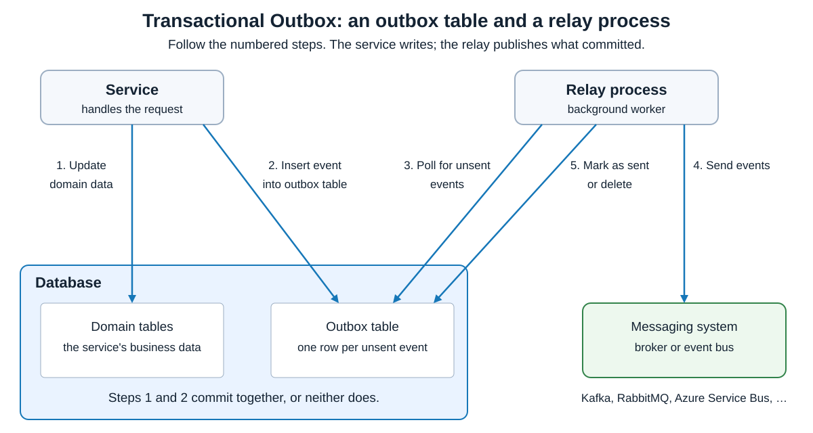
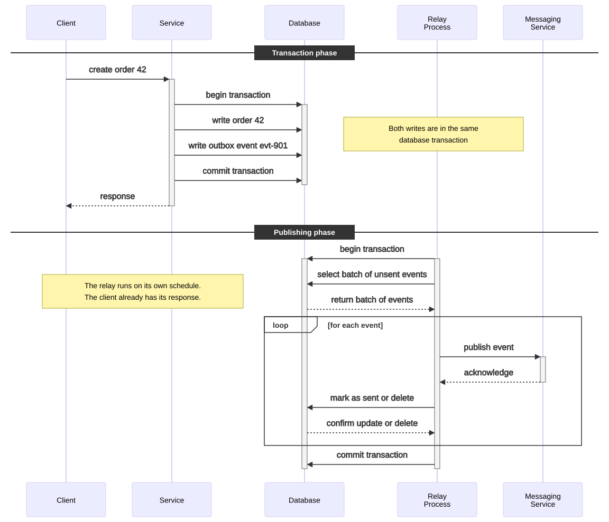
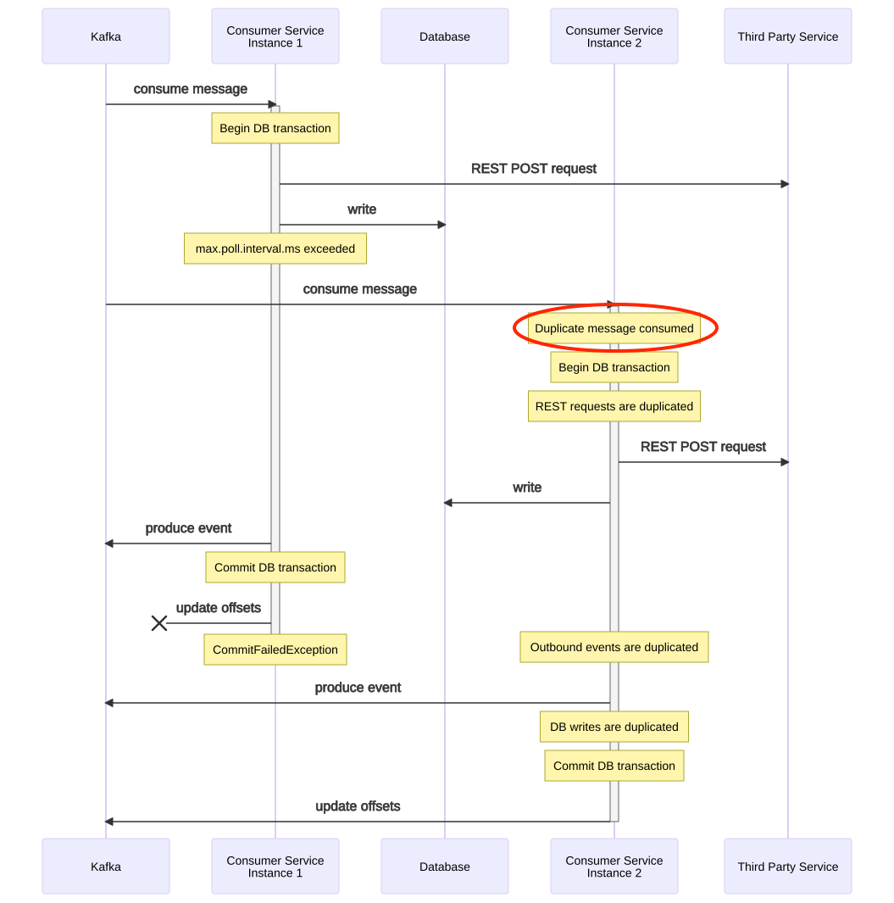
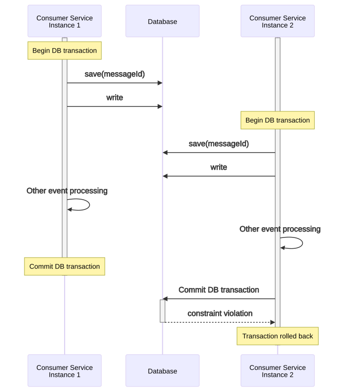
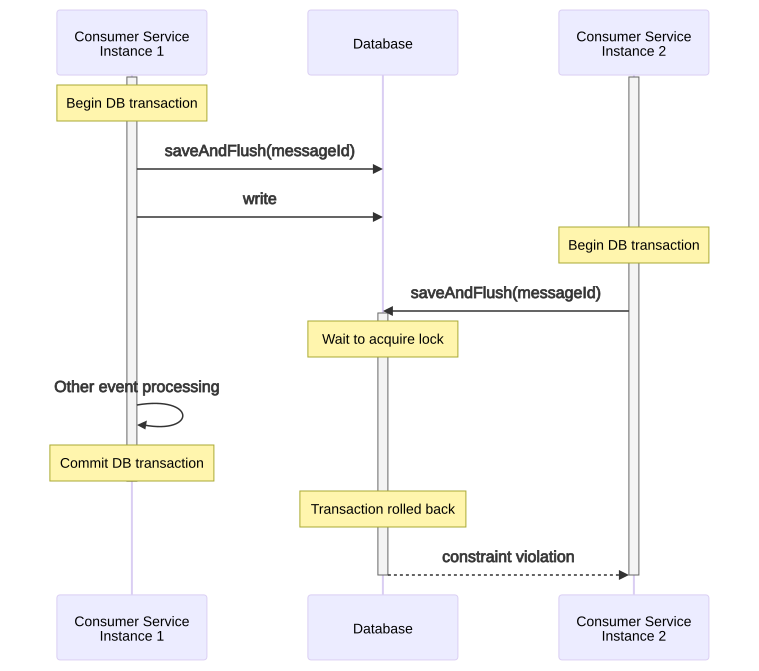
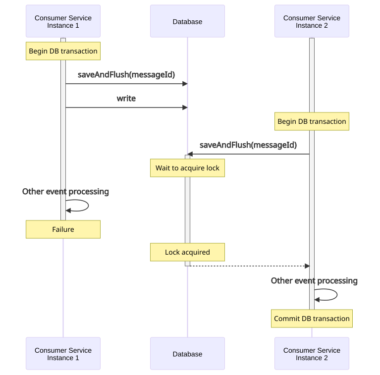
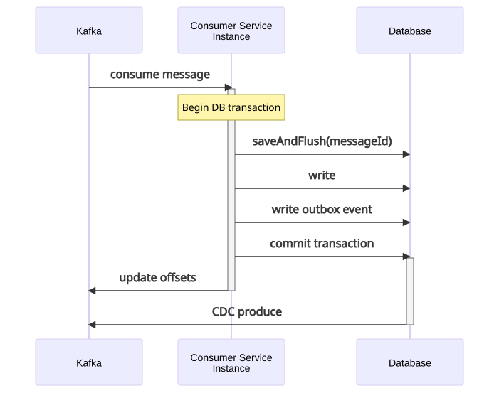
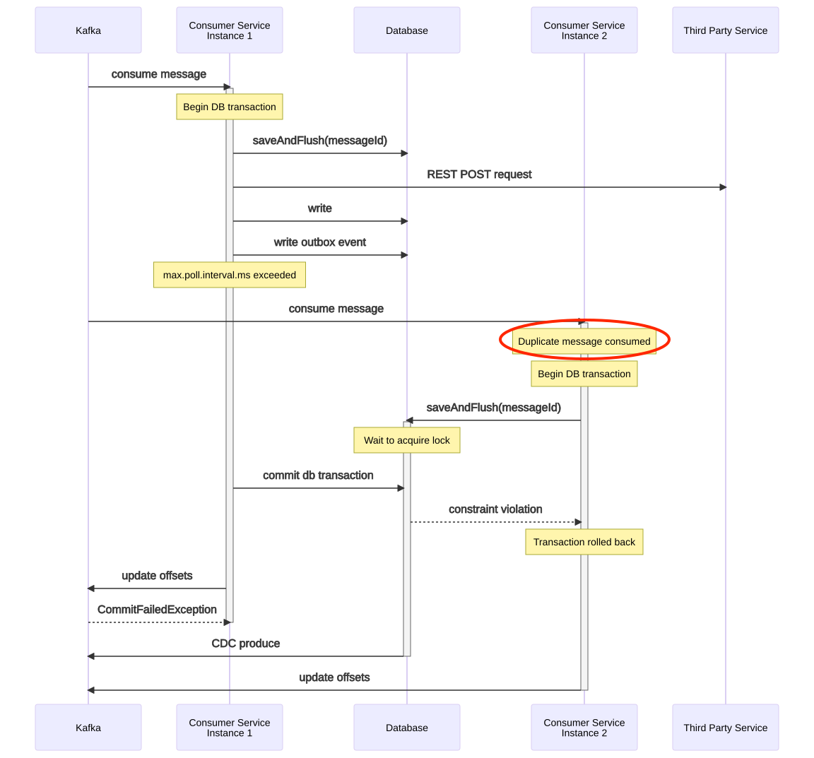

# Patterns. Transactional Outbox

<sub>[Back to Distributed Systems](../Readme.md#content)</sub>

**Transactional Outbox (aka Outbox pattern) saves a business change and the event that announces it in one local database transaction, so both commit or neither does.** A separate **relay** then publishes the saved events to a message broker such as Kafka.

The relay can publish an event more than once, so consumers must tolerate duplicates. After the problem and the pattern's two parts, the article shows how a consumer can process one message twice, how a deduplication table prevents it, and how Spring Data JPA and Hibernate affect the timing.

## The problem it solves

An order service handles `create order 42`. It must save the order in its database and publish an `OrderCreated` event to Kafka so that other services can react. That is two writes to two systems, and no transaction covers both:

- **Save, then publish.** If the service crashes between the two writes, the order exists, but no event is ever sent.
- **Publish, then save.** If the save fails, other services react to an order that does not exist.

Swapping the writes only swaps the failure. This is the **dual-write problem**.

## How it works

The pattern turns the publish into a second database write. It adds two parts: an **outbox table** in the service's own database, and a **relay** process that publishes from it.

### The outbox table

The service no longer publishes `OrderCreated` itself. Instead, the transaction that inserts order `42` into the orders table also inserts a row into the outbox table: event ID `evt-901`, type `OrderCreated`, and a **payload** with the event data. Both tables live in the same database, so the database commits both rows or neither. No broker is involved yet.

In the image below, steps 1 and 2 are those two writes inside one transaction. Steps 3 to 5 are the relay's later work: poll for unsent events, send them, and mark them as sent or delete them.



No standard defines the outbox table's columns. This is a common starting point:

| Column | Type | Purpose |
|---|---|---|
| `id` | `INT` or `UUID` | The event's unique ID. |
| `event_type` | string | The event's type, such as `OrderCreated`. |
| `payload` | JSON or text | The serialized event. |
| `created_at` | timestamp | When the event was stored. |
| `sent_at` | nullable timestamp | When the event was published; `NULL` means not sent yet. |

Add what your system needs, such as `entity_id` for the order the event belongs to, `retries` and `error_message` for events that keep failing, or `correlation_id` for tracing.

### The relay

The relay is a background worker, also called an **outbox processor** or **event dispatcher**. It reads committed outbox rows and publishes them to a broker such as Kafka, RabbitMQ, Amazon EventBridge, or Azure Service Bus. After the broker acknowledges an event, the relay marks its row as sent or deletes it.

The image below follows order `42` from top to bottom; dashed arrows are replies. In the `Transaction phase`, the service writes the order and event `evt-901` in one transaction and answers the client. In the `Publishing phase`, the relay selects a batch of unsent events and runs the `loop [for each event]`: publish, wait for the acknowledgement, then mark as sent or delete.



The client has its response before anything is published, because the relay runs on its own schedule. The relay also has its own transaction, separate from the service's. It covers only the relay's reads and its `mark as sent or delete` updates.

Polling the table, as shown here, is one way to build a relay. The other is [**change data capture (CDC)**](../Patterns.%20Change%20Data%20Capture/Readme.md): a tool such as Debezium reads committed changes from the database's log and publishes the new outbox rows. A CDC relay does not mark rows. It remembers its position in the log instead. CDC tools can also expect their own column names: Debezium's outbox event router reads `id`, `aggregatetype`, `aggregateid`, and `payload` unless you point those settings at your own columns.

### Why an event can be published twice

The relay marks a row only after the broker acknowledges the event. If the relay crashes after publishing `evt-901` but before marking its row, it publishes `evt-901` again after it restarts. This is the price of never losing an event: the pattern delivers **at least once**, not exactly once.

A consumer that is not ready for this can send the same email twice or charge a card twice. A retry keeps the same event ID, which is what lets a consumer recognize the repeat.

## How a consumer processes the same message twice

Duplicates do not only come from the relay. Kafka itself can give one message to two instances of the same consumer service.

A Kafka consumer works in a loop: it polls for a batch of records, processes them, and polls again. It records its progress by committing an **offset**, its position in a **partition**, an ordered part of a topic. If an instance goes longer than `max.poll.interval.ms` between two polls, its Kafka client treats it as stuck and leaves the **consumer group**, the instances that split the topic's partitions between them, so another instance can take over its partitions. The stuck instance never committed its offset, so the new owner receives the same records again, while the first instance may still be working on them.

Kafka does this on purpose. Without it, an instance that is stuck but still alive would hold its partitions forever, and nobody would process them.

The image below shows the result. The `REST POST request` arrows are calls to a third-party web service, such as a payment provider, which keeps its own data. (REST stands for Representational State Transfer, a common style for web APIs.) Instance 1 exceeds `max.poll.interval.ms` in the middle of its work, and instance 2 receives the same message, circled as `Duplicate message consumed`. From there, the notes on instance 2's side list what now happens twice: `REST requests are duplicated`, `Outbound events are duplicated`, and `DB writes are duplicated`.



Instance 1 cannot even record its progress. It has left the group, so its own Kafka client rejects the offset commit with a `CommitFailedException`, shown as the arrow that ends in a cross. That protects the offset, but it does not undo the work instance 1 already did.

## Handling duplicates: the idempotent consumer

Duplicates will happen, so every consumer must be able to receive the same message twice without doing the work twice. Such a consumer is an **idempotent consumer**. There are two ways to build one:

- **Make the work naturally repeatable.** For example, insert a row only if it is not already there, so a second run changes nothing.
- **Remember what was processed.** Keep a **deduplication table**, also called an **inbox table**, of processed message IDs. The producer gives each message a unique ID, in the payload or in a Kafka header.

The second approach works for any business logic. It relies on a **unique constraint** on the message ID and on this order of steps:

1. Start a database transaction and insert the message ID.
2. Do the business work.
3. Commit the transaction, then commit the Kafka offset.

If the insert fails because the ID already exists, the message is a duplicate. The consumer rolls back, commits the offset so that Kafka does not deliver the message again, and does nothing else.

Why insert the ID instead of first looking it up? Two instances can both look, both find nothing, and both go ahead. The unique constraint is what actually stops the second one, because the database accepts only one row per ID. So the insert itself can be the check.

Store the event's own ID, not the order ID: one order produces many events over time, and each must be tracked separately. The table protects a message only while its ID is stored. If IDs are deleted after a retention period, such as an hour, six hours, or a few days, a redelivery or replay that arrives later looks new and runs again.

## Deep dive: Spring Data JPA and Hibernate

The rest of the article uses **Spring Data JPA**, a Java data-access library built on the Jakarta Persistence API, with **Hibernate**, an object-relational mapper that turns changes to Java objects into SQL. They matter here because `save()` does not run the insert when you call it.

### When the insert reaches the database

Hibernate keeps changes in memory and sends them to the database during a **flush**. A flush runs the SQL inside the current transaction but does not commit it. Hibernate's documentation calls this a **transactional write-behind cache**. By default, Hibernate flushes just before commit, or earlier when a query in the same transaction needs to see the pending changes.

For the deduplication insert, that delay matters, because the unique check runs only when the insert reaches the database. Two instances that handle the same message can both call `save()` and both do their business work. Only at commit does the second one hit the constraint and roll back.

The image below shows that run. It leaves out Kafka and the third-party service and starts after both instances received the same message. The arrows into `Database` show when each instance calls the repository, not when the SQL runs: Hibernate holds both writes until it flushes, here at commit. Only the second `Commit DB transaction` gets a `constraint violation`.



The rollback undoes all of the second instance's database changes, including any outbox rows. What it cannot undo is work outside the database, such as a REST call to a payment provider or an event sent straight to Kafka.

### Flushing early with `saveAndFlush()`

`saveAndFlush()` saves the entity and flushes at once, so the insert reaches the database immediately, still uncommitted. That changes the race. With an ordinary unique constraint, PostgreSQL makes a second insert of the same ID wait until the first transaction ends:

- If the first transaction commits, the waiting insert fails with a uniqueness violation.
- If the first transaction rolls back, there is no conflict, and the waiting insert succeeds.

In the image below, instance 2's `saveAndFlush(messageId)` stops at `Wait to acquire lock`. When instance 1 commits, instance 2 gets the `constraint violation`. The `Transaction rolled back` note on the `Database` line means instance 2's transaction, not instance 1's: instance 2 rolls back before it does any other work.



In code, there is no lookup first. The insert is the check, and a duplicate arrives as Spring's `DataIntegrityViolationException`:

```java
private void deduplicate(UUID eventId) throws DuplicateEventException {
   try {
      processedEventRepository.saveAndFlush(new ProcessedEvent(eventId));
   } catch (DataIntegrityViolationException e) {
      throw new DuplicateEventException(eventId);
   }
}
```

Call it at the start of the transaction that also does the business work. This is the recommended approach, because the duplicate stops before the expensive or irreversible steps. If the event triggers a payment, `save()` lets both instances reach the payment call, while `saveAndFlush()` lets only the first one through.

If instance 1 fails before it commits (`Failure` in the image below), its uncommitted row disappears. Instance 2's insert then goes through (`Lock acquired`), and instance 2 processes the message itself.



Early flushing stops two instances from passing the check at the same time. It does not put a remote payment inside the database transaction. If instance 1 had already paid before it failed, instance 2 would pay again, unless the payment provider recognizes the repeated request. That is the job of an **idempotency key**: a unique key that the client sends with a request and that the provider uses to recognize retries. Both instances must send the same key, for example one derived from the event ID.

### Adding the outbox table

Now put both patterns together. A consumer that publishes events of its own should write them to the outbox instead of sending them straight to Kafka. Then one database transaction holds three writes: the processed message ID, the business change, and the outgoing event. Here a Kafka message triggers the outbox write, but any request that changes the database can write one, as `create order 42` did in [The relay](#the-relay).

The image below has no relay column, so the outgoing event seems to leave the `Database` by itself. It does not. The `CDC produce` arrow is the relay in its CDC form, such as a Debezium connector running on [Kafka Connect](../Apache%20Kafka.%20Connect/Readme.md#8-pattern-transactional-outbox-with-connect-as-the-relay). Committing a transaction publishes nothing on its own.



Only the database writes are atomic. The offset commit, `update offsets`, and the relay's publication happen outside the transaction. If the consumer crashes after the commit but before the offset commit, Kafka delivers the message again, the insert fails on the stored ID, and the consumer skips the message.

## Both protections together

The image below replays the timeout scenario from [How a consumer processes the same message twice](#how-a-consumer-processes-the-same-message-twice), now with both patterns. Instance 1 has flushed the message ID and made its `REST POST request` when it exceeds `max.poll.interval.ms`, and instance 2 receives the same message. Instance 2's `saveAndFlush(messageId)` waits at `Wait to acquire lock`. When instance 1 commits, instance 2 gets the `constraint violation` and rolls back, so it never makes the REST call.

Instance 1's offset commit still fails with a `CommitFailedException`, because instance 1 left the group. Instance 2 now owns the partition, so its offset commit is the one that counts. The outgoing event comes from instance 1's committed outbox row, through `CDC produce`.



This run is safe because instance 1 committed. If instance 1 had made the call and then crashed before committing, instance 2 would process the message again and repeat the call. Remote calls still need an idempotency key.

## Important boundaries

- **Atomic locally, consistent eventually.** The outbox makes the service's own writes atomic. Other services see the change later, after the relay runs. The outbox does not turn a workflow across several services into one transaction; a [saga](../Transactions.%20Saga/Readme.md) coordinates that.
- **Ordering.** To keep one order's events in sequence, use the order ID as the Kafka key, so they all land in the same partition. A key cannot fix a relay that publishes them out of order, for example with several relay workers.
- **External effects.** [Kafka transactions](../Apache%20Kafka.%20Delivery%20and%20transactions/Readme.md#database-writes-and-service-calls) do not cover an external database or a payment service. Each remote call needs its own retry protection.
- **Operations.** Monitor how many events wait unsent and whether the relay fails. Delete sent rows only when the relay no longer needs them to recover, and plan for events that keep failing.

## Summary

On the sending side, commit the business change and its outbox event in one transaction, and let a relay publish the event later. Expect some events to be published twice. On the receiving side, insert the message ID first, flush it with `saveAndFlush()`, and commit it with the business change, so a duplicate stops before it does any work. Calls outside the database still need idempotency keys.

## Self-check

1. What goes wrong if the order service saves order `42` and then publishes `OrderCreated` straight to Kafka? Why must the outbox table live in the service's own database?

   <details>
   <summary>Answer</summary>

   A crash between the two writes leaves an order that no other service hears about, and publishing first instead risks an event for an order that was never saved. The outbox turns the publish into a second database write in the same local transaction, so both commit or neither does. That works only because both tables are in one database: an outbox somewhere else would bring back the dual-write problem.

   </details>

2. The relay marks a row as sent only after the broker acknowledges the event. Why can an event then be published twice, and what does that require from consumers?

   <details>
   <summary>Answer</summary>

   If the relay stops after the broker accepted `evt-901` but before it marked the row, it publishes `evt-901` again after it restarts. Delivery is at least once, not exactly once. A retry keeps the same event ID, so consumers must recognize a repeated ID and skip the work.

   </details>

3. How does a polling relay know which events it has already published, and how does a CDC relay know?

   <details>
   <summary>Answer</summary>

   A polling relay reads the outbox table itself. It selects rows that are still unsent, such as rows whose `sent_at` is `NULL`, and marks or deletes each row after the broker acknowledges its event. A CDC relay does not mark rows: it reads the database log and remembers its position in that log.

   </details>

4. How can two instances of one consumer service process the same Kafka message at the same time?

   <details>
   <summary>Answer</summary>

   Instance 1 takes longer than `max.poll.interval.ms` between two polls, so its Kafka client leaves the consumer group, and instance 2 takes over the partition. Instance 1 never committed its offset, so instance 2 receives the same message while instance 1 is still working on it. Instance 1's later offset commit fails with a `CommitFailedException`, but its work is already done.

   </details>

5. Why does an idempotent consumer insert the message ID instead of first checking whether the ID exists?

   <details>
   <summary>Answer</summary>

   Two instances can both check, both find nothing, and both continue. Only the unique constraint stops the second one, because the database accepts a single row per ID. So the insert is the check: if it fails, the message is a duplicate.

   </details>

6. With Hibernate's default `save()`, why can both instances run their business logic before one of them is rejected?

   <details>
   <summary>Answer</summary>

   `save()` only queues the insert in Hibernate's memory. The SQL, and with it the unique check, runs at flush time, by default just before commit. Both instances get through their business logic, and the second one fails only when it commits. Its database changes roll back, but a REST call that it already made does not.

   </details>

7. With `saveAndFlush()`, instance 1 has flushed the message ID but not committed when instance 2 inserts the same ID. What happens if instance 1 commits, and what happens if it rolls back?

   <details>
   <summary>Answer</summary>

   Instance 2's insert waits for instance 1's transaction to end. If instance 1 commits, instance 2 gets a uniqueness violation and rolls back before it does any other work. If instance 1 rolls back, its row disappears, instance 2's insert succeeds, and instance 2 processes the message.

   </details>

8. A consumer that also writes to an outbox commits three writes together. Which three are they, and what happens if the consumer crashes after the commit but before it commits its Kafka offset?

   <details>
   <summary>Answer</summary>

   The processed message ID, the business change, and the outgoing outbox event. After the crash, Kafka delivers the message again. The insert fails on the stored ID, so the consumer skips the business change and the outbox write and only commits the offset. The relay still publishes the original event.

   </details>

9. Instance 1 made a payment and then crashed before it committed. Why does instance 2 pay again, even with `saveAndFlush()`, and what prevents the second payment?

   <details>
   <summary>Answer</summary>

   Instance 1's rollback removed its message ID, so instance 2's insert succeeds, and instance 2 processes the message, payment included. The database cannot undo a payment that a remote service made. The payment provider must recognize the retry, which takes an idempotency key that both instances send, for example one derived from the event ID.

   </details>

10. The deduplication table deletes IDs after six hours. What happens when the same message is replayed a day later?

    <details>
    <summary>Answer</summary>

    The ID is no longer in the table, so the insert succeeds, and the message looks new. The business logic runs again, including any remote calls. The protection lasts only as long as the ID is stored.

    </details>

# Sources

- [NP Blog — Transactional Outbox Pattern: From Theory to Production](https://www.npiontko.pro/2025/05/19/outbox-pattern)
- [Habr (OTUS) — Russian translation of the same article](https://habr.com/ru/companies/otus/articles/967974/)
- [Lydtech — Kafka Idempotent Consumer & Transactional Outbox](https://www.lydtechconsulting.com/blog/kafka-idempotent-consumer-transactional-outbox)
- [Microservices.io — Transactional Outbox and relay failures](https://microservices.io/patterns/data/transactional-outbox.html)
- [Microservices.io — Idempotent Consumer and unique processed-message keys](https://microservices.io/patterns/communication-style/idempotent-consumer.html)
- [AWS — Transactional Outbox, dual writes, and saga boundaries](https://docs.aws.amazon.com/prescriptive-guidance/latest/cloud-design-patterns/transactional-outbox.html)
- [Hibernate — Flushing and delayed database writes](https://docs.hibernate.org/orm/current/userguide/html_single/#flushing)
- [Spring Data JPA — JpaRepository: flush and saveAndFlush](https://docs.spring.io/spring-data/jpa/reference/api/java/org/springframework/data/jpa/repository/JpaRepository.html)
- [PostgreSQL — Index uniqueness checks and concurrent transactions](https://www.postgresql.org/docs/18/index-unique-checks.html)
- [Debezium — Outbox Event Router: the outbox pattern, identifiers, keys, and payloads](https://debezium.io/documentation/reference/stable/transformations/outbox-event-router.html)
- [Debezium — Outbox implementation, recovery, and eventual consistency](https://debezium.io/blog/2019/02/19/reliable-microservices-data-exchange-with-the-outbox-pattern/)
- [Apache Kafka — KafkaConsumer: detecting consumer failures, poll interval, and offset commit failure](https://kafka.apache.org/43/javadoc/org/apache/kafka/clients/consumer/KafkaConsumer.html)
- [Apache Kafka 4.0.0 — `ConsumerCoordinator`: a commit from a member that is no longer in the group fails in the client](https://github.com/apache/kafka/blob/4.0.0/clients/src/main/java/org/apache/kafka/clients/consumer/internals/ConsumerCoordinator.java#L1268-L1283)
- [Apache Kafka — Delivery semantics and external-system boundaries](https://kafka.apache.org/43/design/design/#message-delivery-semantics)
- [Stripe — Idempotent requests](https://docs.stripe.com/api/idempotent_requests)
