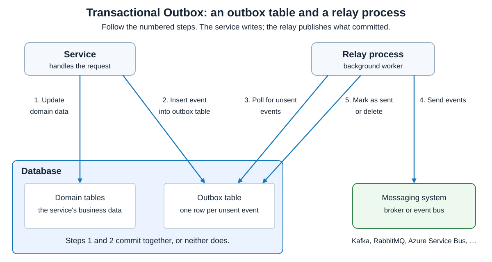
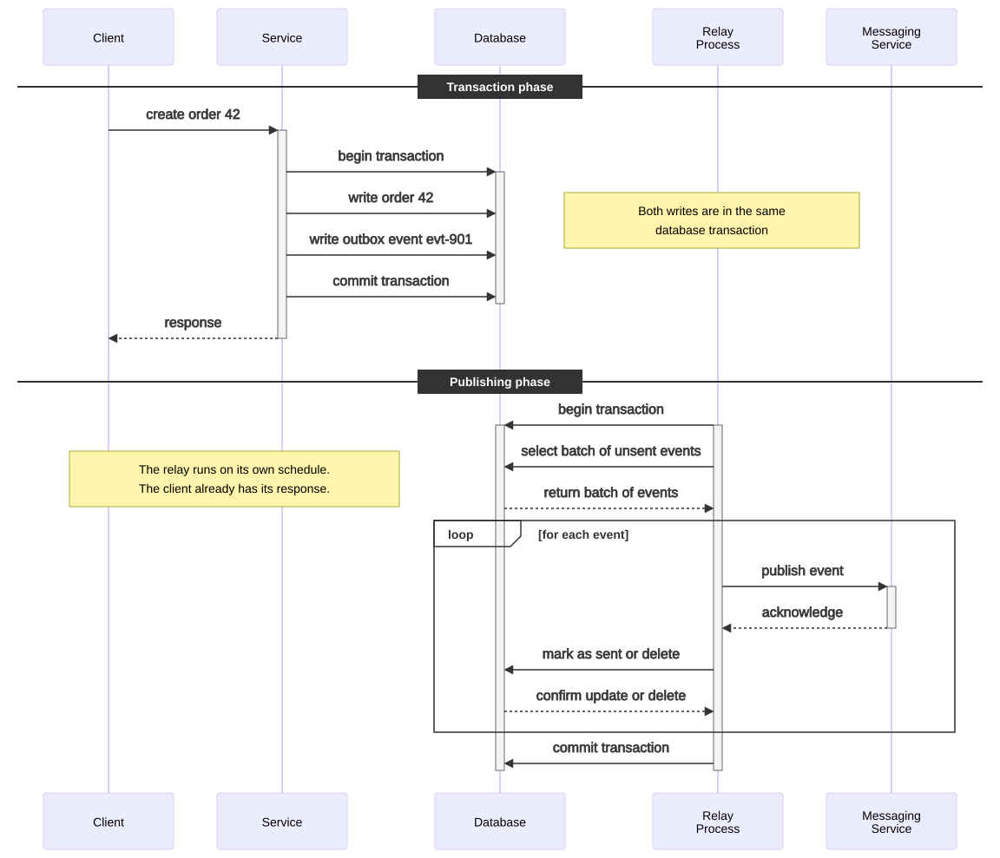
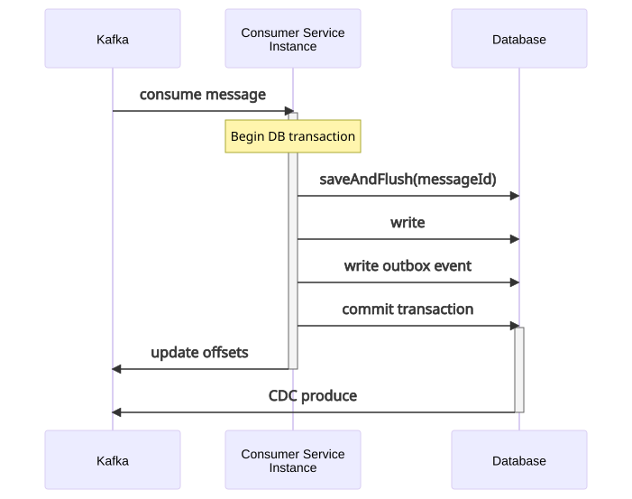
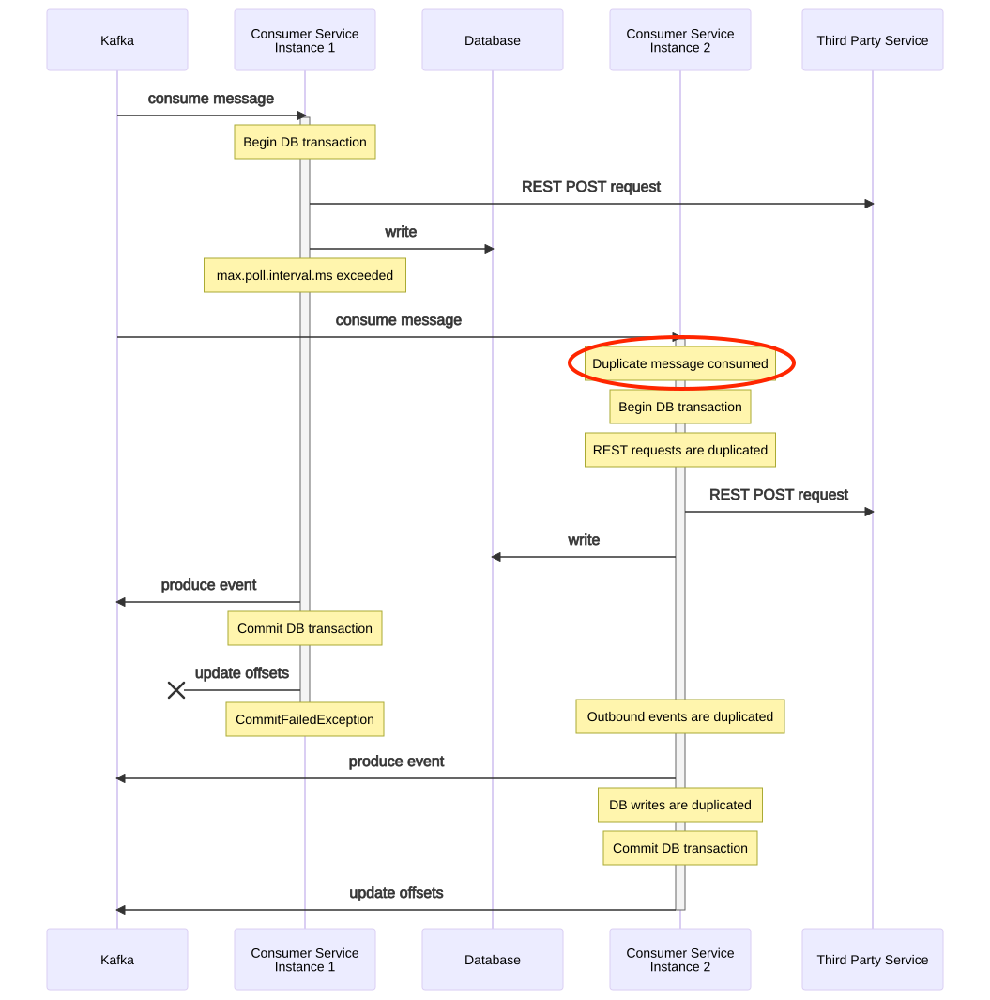
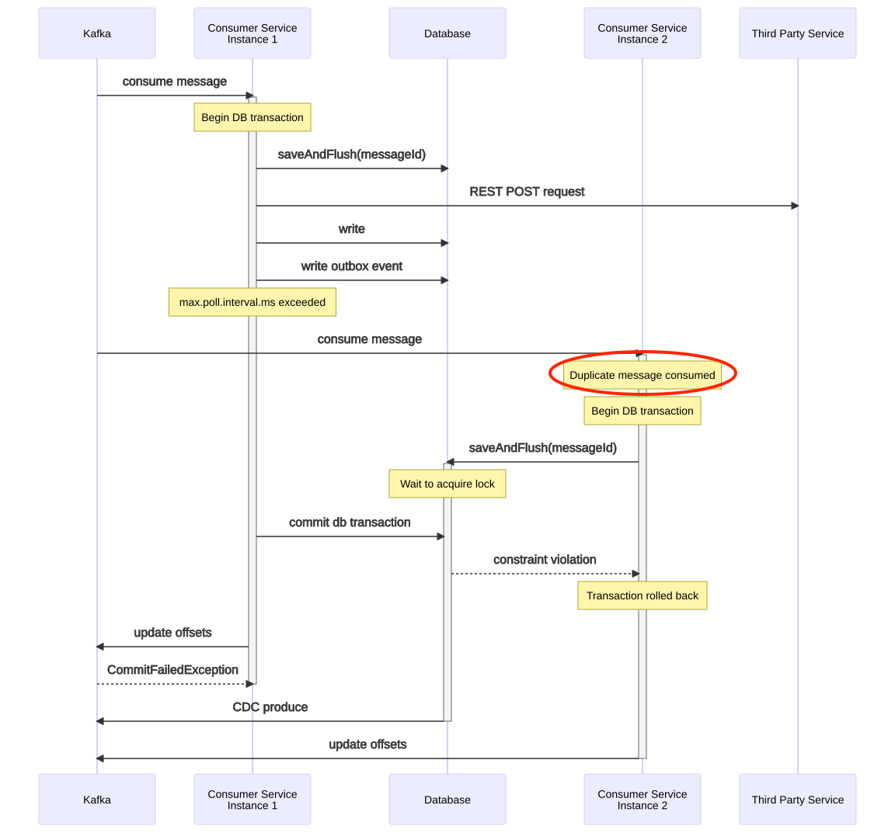

# Patterns. Transactional Outbox

<sub>[Back to Distributed Systems](../Readme.md#content)</sub>

**A transactional outbox saves a business change and its outgoing event in one database transaction.** After commit, a background worker called a **relay** can publish the event even if the service that saved it crashes.

Checkout accepts order `42` for one book. Inventory must reserve one copy even if the event arrives twice.

1. [Why two writes can disagree](#1-why-two-writes-can-disagree)
2. [How the transactional outbox works](#2-how-the-transactional-outbox-works)
3. [How the relay publishes and retries](#3-how-the-relay-publishes-and-retries)
4. [How inventory reserves one book](#4-how-inventory-reserves-one-book)
5. [Why billing flushes before charging](#5-why-billing-flushes-before-charging)
6. [Boundaries and summary](#6-boundaries-and-summary)

## 1. Why two writes can disagree

Checkout must save order `42` and send `OrderCreated` to Kafka, the **message broker**. Either write can succeed alone. This is the **dual-write problem**.

- **Save the order first.** A crash after commit but before the send leaves a real order that inventory never hears about.
- **Send the event first.** If the database then rolls back, inventory can reserve a book for an order that never existed.

## 2. How the transactional outbox works

Checkout adds an `outbox` table to its database. In the diagram, arrows 1 and 2 are writes in **one transaction**. The relay handles arrows 3 through 5.



The **payload** records what the customer ordered. If the quantity changes later, the relay can still send the original event.

```sql
BEGIN;
INSERT INTO orders (id, item, quantity)
VALUES (42, 'book', 1);

INSERT INTO outbox (event_id, event_type, order_id, payload, sent_at)
VALUES ('evt-901', 'OrderCreated', 42, '{"item":"book","quantity":1}', NULL);
COMMIT;
```

If either insert fails, both roll back. After commit, checkout can confirm the order even while Kafka is down. Inventory may still show the book as available until it processes the event.

## 3. How the relay publishes and retries

A **polling relay** reads committed rows with `sent_at IS NULL`. In the lower half of the diagram, it sends `evt-901`, waits for Kafka to confirm receipt, then sets `sent_at` or deletes the row.



| When processing stops | What survives | On recovery |
|---|---|---|
| Checkout rolls back | Neither row | Nothing to send. |
| Checkout commits before the relay sends | Order and pending event | The relay sends `evt-901`. |
| Kafka accepts the send before the relay records success | Kafka has the event, but the row is still pending | The relay sends `evt-901` again. |

Marking the row first could lose the event on a crash. Waiting for acknowledgement keeps the row available for retry. If the reply is lost, Kafka may receive the **same event ID** twice. Retrying until Kafka accepts the event gives **at-least-once publication**.

## 4. How inventory reserves one book

Inventory is the **consumer** of `OrderCreated`. Each message carries the event ID. Reserving one book for every copy of `evt-901` would reserve too many. An **idempotent consumer** makes repeated deliveries have the same effect as one.

An **inbox** holds one **receipt** per processed message and consumer. Checkout's `event_id` becomes the inbox's `message_id`. The diagrams call that same value `messageId`.

The key `(consumer_name, message_id)` is unique. Inventory workers share the name `inventory`, so only one can commit `('inventory', 'evt-901')`. Billing charges customers and uses `('billing', 'evt-901')` for its own receipt. See [how to insert a receipt in a shared inbox](../Patterns.%20Transactional%20Inbox/Readme.md).

Inventory inserts the receipt and reserves the book in one transaction. If the reservation fails, both roll back and a retry can do the work. A committed receipt protects against repeats for as long as inventory keeps it.

Inventory can also announce `StockReserved`. In the diagram, the receipt, stock change (`write`), and outgoing outbox event all commit together. The bottom arrow shows a relay publishing that event from the database log using **change data capture (CDC)**.



A Kafka **partition** is an ordered log. An **offset** gives a record's position in it. These three records describe two events.

| Offset | Order ID | Event ID | What inventory does |
|---|---|---|---|
| 70 | 42 | `evt-901` | Reserve one book for `OrderCreated`. |
| 71 | 42 | `evt-901` | Skip the repeat using the receipt from 70. |
| 72 | 42 | `evt-902` | Release the book for `OrderCancelled`. |

After committing the reservation for record 70, inventory commits offset 71 as its next position. A crash between those commits can bring **record 70 itself** back. The receipt covers that replay too. Advancing to 71 before the reservation commits could skip the work entirely.

## 5. Why billing flushes before charging

In the diagrams, `Consumer Service Instance 1` and `Consumer Service Instance 2` are billing workers 1 and 2. `Third Party Service` is the payment provider. Worker 1 calls it for `evt-901`. If worker 1 exceeds `max.poll.interval.ms` between polls, worker 2 can take over the partition and reread the record from the last committed offset.

The first diagram shows billing **without a receipt or an outbox**. At `Duplicate message consumed`, worker 2 repeats the charge request and database write. Both `produce event` arrows go straight to Kafka, publishing the event twice. The crossed arrow shows worker 1’s offset commit failing after it loses the partition.



### Why the timing of the insert matters

Both workers can look for a receipt and find none. With plain `save()`, Hibernate can hold each worker's receipt in memory until commit. `save()` can return to both workers **before PostgreSQL sees either insert**. Each worker can then call the provider. A duplicate-key error at commit comes too late to undo a charge.

Billing uses Spring Data JPA's `saveAndFlush()` before charging. It saves the receipt and **flushes** all pending changes to the database. The transaction stays open. PostgreSQL checks the unique receipt key as it executes the insert.

In the second diagram, worker 1 has inserted the receipt for `evt-901` and calls the provider. Worker 2 tries the same key and stops at `Wait to acquire lock`. If worker 1 commits, worker 2's insert fails. Worker 2 rolls back before calling the provider, then commits the offset. The relay publishes worker 1's outbox event.



If worker 1 rolls back after charging, its receipt disappears and worker 2's insert can succeed. The charge survives. Both workers take the **idempotency key** from the event ID. Worker 2 reads `evt-901` from the redelivered event and sends the same `Idempotency-Key: evt-901` as worker 1. A provider that honors the key recognizes the retry and skips a second charge.

## 6. Boundaries and summary

- **Across services.** Each outbox transaction covers one database. A saga coordinates the local transactions. If payment fails, it can ask inventory to release the book. See [how saga compensation works](../Transactions.%20Saga/Readme.md).
- **Ordering.** Key events by order ID to route creation and cancellation to one partition. The relay must send creation first. For ordering and replay within a partition, see [Kafka delivery and transactions](../Apache%20Kafka.%20Delivery%20and%20transactions/Readme.md).
- **Relay recovery.** A polling relay checks pending rows. A CDC relay resumes at its saved log position. See [CDC recovery](../Patterns.%20Change%20Data%20Capture/Readme.md) and [Debezium as the outbox relay](../Apache%20Kafka.%20Connect/Readme.md#8-pattern-transactional-outbox-with-connect-as-the-relay).

### Three rules to remember

1. **Save together.** Commit the order and its outbox event in one database transaction.
2. **Publish after commit.** Retry with the original event ID until the broker acknowledges the send.
3. **Apply once.** Commit the receipt and local change before the Kafka offset. For one charge per event, reuse the event ID as the payment key.

## Check your understanding

1. Checkout publishes before saving the order. What can go wrong?

   <details>
   <summary>Answer</summary>

   Inventory can reserve a book for an order that rolls back.

   </details>

2. Kafka is down when checkout confirms order `42`. What must the database hold?

   <details>
   <summary>Answer</summary>

   The order and its outbox event committed together. The relay can send the event when Kafka recovers.

   </details>

3. Kafka has `evt-901`, yet the polling relay sees a pending row. Why?

   <details>
   <summary>Answer</summary>

   Kafka accepted the send. A lost reply or a crash before the relay marked the row leaves it pending.

   </details>

4. Why can inventory skip offsets 70 and 71 on replay, yet process 72 for the same order?

   <details>
   <summary>Answer</summary>

   Both copies carry `evt-901`, whose receipt committed with the reservation. The cancellation at 72 carries `evt-902` and gets its own receipt.

   </details>

5. Worker 1 flushes its receipt and calls the provider. How does worker 1's commit or rollback affect worker 2?

   <details>
   <summary>Answer</summary>

   If worker 1 commits, worker 2 skips the charge when its insert fails. If worker 1 rolls back, worker 2 retries with `evt-901`. The provider recognizes the repeat.

   </details>

6. Payment is declined after inventory reserves a book. What can release it?

   <details>
   <summary>Answer</summary>

   A saga can ask inventory to release the book in a new local transaction.

   </details>

# Sources

- [Chris Richardson — Transactional Outbox](https://microservices.io/patterns/data/transactional-outbox.html) and [Idempotent Consumer](https://microservices.io/patterns/communication-style/idempotent-consumer.html)
- [Nazarii Piontko — Outbox components and polling sequence](https://www.npiontko.pro/2025/05/19/outbox-pattern)
- [Debezium — Outbox events and Kafka keys](https://debezium.io/blog/2019/02/19/reliable-microservices-data-exchange-with-the-outbox-pattern/) and [PostgreSQL connector recovery](https://debezium.io/documentation/reference/stable/connectors/postgresql.html)
- [Apache Kafka — Consumer offsets and poll timeouts](https://kafka.apache.org/43/javadoc/org/apache/kafka/clients/consumer/KafkaConsumer.html)
- [Lydtech Consulting — Consumer transaction and concurrent flush diagrams](https://www.lydtechconsulting.com/blog/kafka-idempotent-consumer-transactional-outbox)
- [Hibernate — Flushing](https://docs.hibernate.org/orm/current/userguide/html_single/#flushing) and [Spring Data JPA — JpaRepository](https://docs.spring.io/spring-data/jpa/reference/api/java/org/springframework/data/jpa/repository/JpaRepository.html)
- [PostgreSQL — Index uniqueness checks](https://www.postgresql.org/docs/18/index-unique-checks.html)
- [Chris Richardson — Saga and compensating transactions](https://microservices.io/patterns/data/saga.html)
- [AWS — Outbox event ordering](https://docs.aws.amazon.com/prescriptive-guidance/latest/cloud-design-patterns/transactional-outbox.html)
- [Stripe — Idempotent requests](https://docs.stripe.com/api/idempotent_requests)
