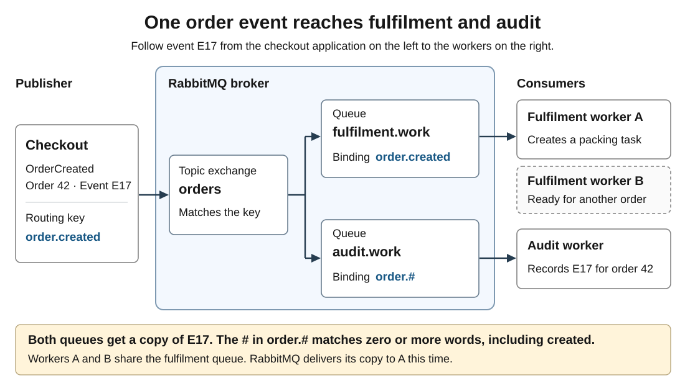
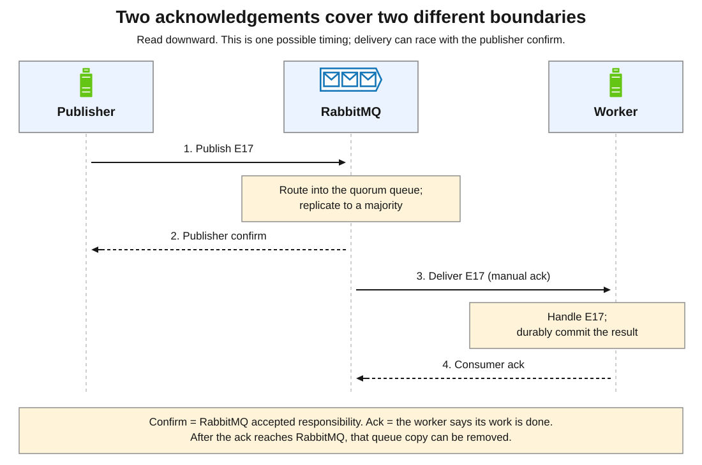
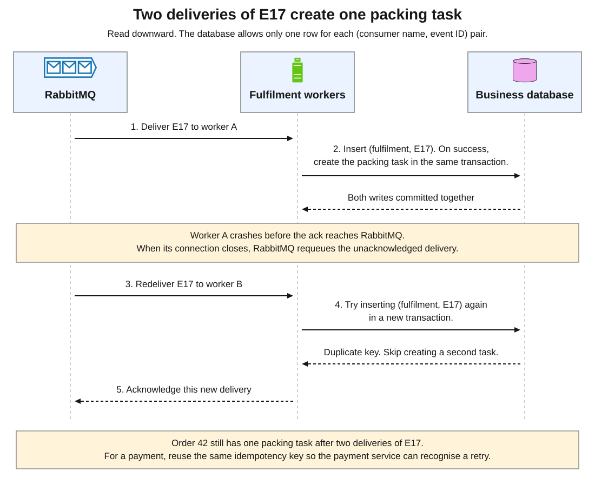
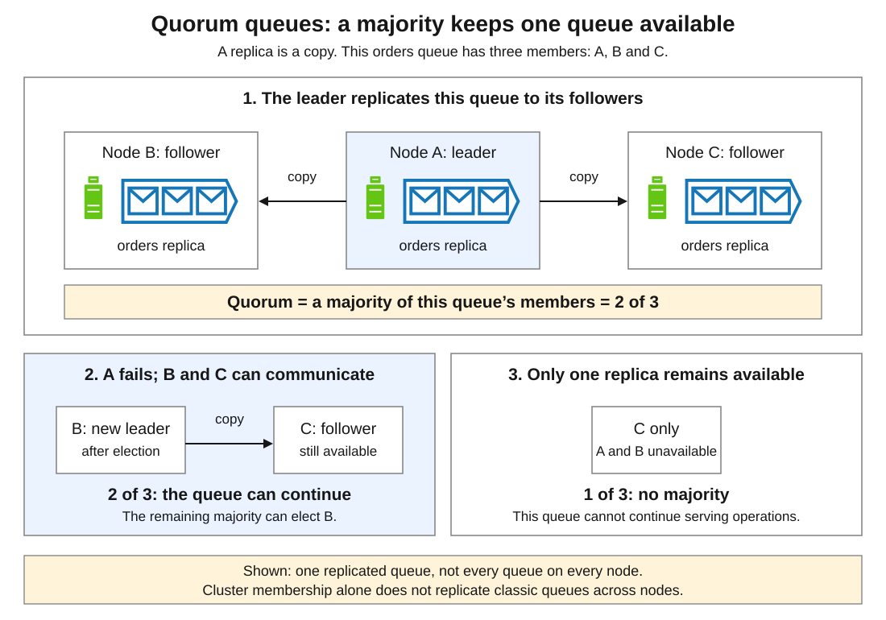
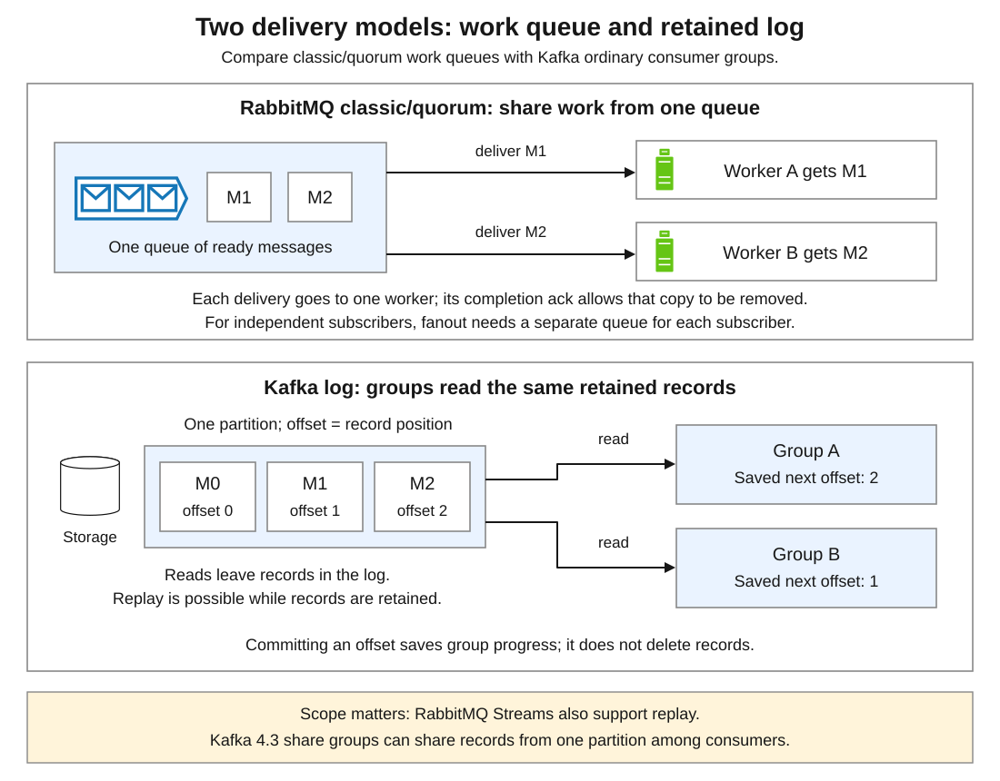
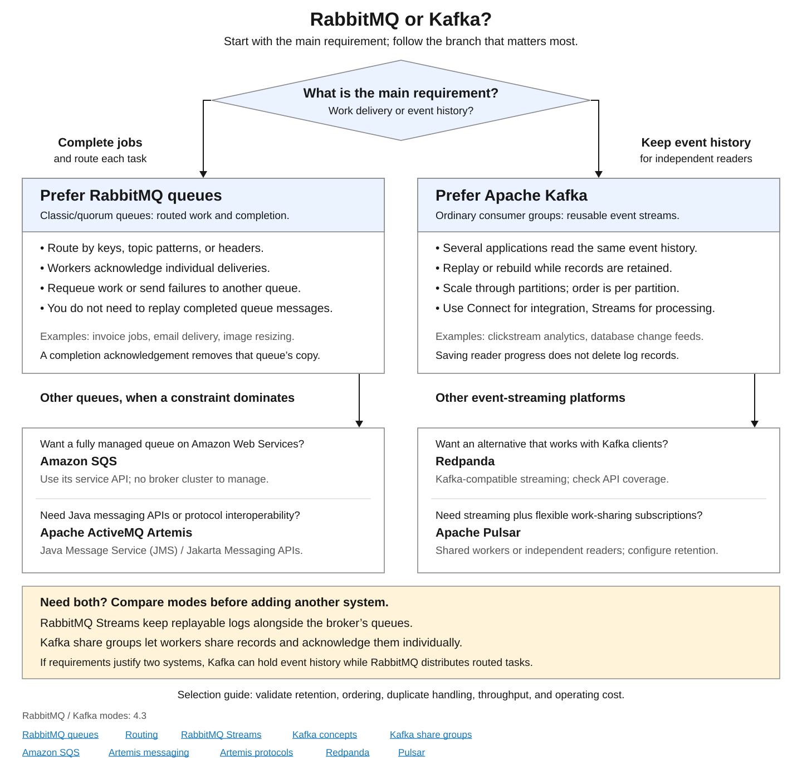

# RabbitMQ

<sub>[Back to Distributed Systems](../Readme.md#content)</sub>

**RabbitMQ is a message broker.** It accepts a message from one application and holds it in a queue until another application can act on it. Imagine buying a book online. Checkout can give you an order number while the warehouse software is still offline. When it comes back, it can pick up the message and create a packing task.

Follow that order from checkout to the warehouse, then see what happens if a worker crashes or orders arrive faster than the warehouse can handle them.

1. [Why put a queue between checkout and the warehouse?](#1-why-put-a-queue-between-checkout-and-the-warehouse)
2. [Follow one order through RabbitMQ](#2-follow-one-order-through-rabbitmq)
3. [How exchanges route messages](#3-how-exchanges-route-messages)
4. [Publishing, delivery, and acknowledgements](#4-publishing-delivery-and-acknowledgements)
5. [Crashes, duplicates, and database transactions](#5-crashes-duplicates-and-database-transactions)
6. [Queue types and broker failures](#6-queue-types-and-broker-failures)
7. [Retries, load, and ordering](#7-retries-load-and-ordering)
8. [RabbitMQ versus Apache Kafka](#8-rabbitmq-versus-apache-kafka)
9. [Where RabbitMQ fits](#9-where-rabbitmq-fits)
10. [Real production examples](#10-real-production-examples)
11. [Check your understanding](#11-check-your-understanding)

## 1. Why put a queue between checkout and the warehouse?

Suppose checkout calls the warehouse directly and waits for it to create a packing task. A ten-minute warehouse outage now prevents checkout from completing that call. The shop would like to accept the order while the warehouse catches up.

Checkout saves the order and **publishes** (sends) a message announcing that the order was created. A **queue** in RabbitMQ holds that message for a warehouse program called a **worker**. Checkout can now respond to the customer while the worker creates the packing task later. This is **asynchronous processing**. How long work can wait depends on the queue’s storage and expiry limits.

A queue also gives the warehouse time to catch up after a rush. If 500 orders arrive each second and workers finish 300, the **backlog** of unfinished orders grows by 200 each second. It shrinks only when workers finish orders faster than new ones arrive.

## 2. Follow one order through RabbitMQ

The warehouse needs a packing task for order 42. A separate audit service needs a record that the order was placed. Checkout can tell both by publishing one **event**, a message describing something that already happened.

```json
{"type": "OrderCreated", "order_id": 42, "event_id": "E17"}
```

`42` identifies the order. `E17` identifies this particular event about it. Alongside the body, checkout sends a **routing key**, the label `order.created`. In the diagram, follow `E17` across the top branch to the warehouse, then follow the lower branch to see what audit receives.



1. **Publisher.** Checkout sends the event once. *Producer* is another name for the sending application.
2. **Exchange.** Inside RabbitMQ, the exchange named `orders` decides which queues should receive the message. A rule connecting an exchange to a queue is a **binding**. Here, both queues have a matching rule.
3. **Queue.** RabbitMQ puts a copy of `E17` in `fulfilment.work` and another in `audit.work`. If the audit service is offline, its copy can wait while the warehouse gets on with packing.
4. **Consumer.** A warehouse worker receives the fulfilment copy and creates a packing task. An audit worker receives the other copy and writes an audit entry. Each worker runs application code.

**Add a worker to share the work. Add a queue when another service needs its own copy.** Either warehouse worker can create the packing task, so they share `fulfilment.work`. If the audit worker shared that queue too, it could take the only delivery and leave the warehouse without a packing task.

## 3. How exchanges route messages

Why did both queues receive `E17`? The `orders` exchange is a **topic exchange**. It compares the routing key with each binding’s pattern. Fulfilment asks for `order.created`. Audit asks for `order.#`, which matches `order` followed by any number of dot-separated words. The key `order.created` matches both. The exchange chooses the destinations, and the queues hold the copies.

The **exchange type** determines how RabbitMQ interprets a binding. Applications or deployment tools set up the exchanges, queues, and bindings before publishing. Together these are called the **topology**.

| Exchange type | How it chooses queues | Example |
|---|---|---|
| **Direct** | The binding key must equal the routing key. | Every queue bound with `invoice` gets a message labelled `invoice`. |
| **Fanout** | Sends a copy to every bound queue, whatever the key. | Every subscribed service needs the same deployment notice. |
| **Topic** | `*` matches exactly one word and `#` matches zero or more. | `order.*` matches `order.created`. For `order.payment.failed`, use a pattern such as `order.#`. |
| **Headers** | Tests named message attributes called *headers*. | Route using headers for region and document format. |

Sending one event to several independent services is the [message fanout pattern](../Patterns.%20Fanout/Readme.md#message-fanout-independent-reactions). Here, a topic exchange does it because two bindings match `order.created`. A fanout exchange would send *every* event to both bound queues.

For a **command** such as `GenerateInvoice`, the sender is asking for work to be done. If it already knows the queue name, it can use the **default exchange** (named `""`). RabbitMQ automatically binds each queue to this exchange with its own name as the routing key. That is how sending “directly to a queue” works.

## 4. Publishing, delivery, and acknowledgements

Suppose both queues received `E17` while the warehouse workers were offline. RabbitMQ can confirm the publication to checkout. Later, a worker can acknowledge that it saved the packing task. Look at who sends each signal and what they know at that moment.

| Signal | Who sends it to whom? | What it tells the recipient in this example |
|---|---|---|
| **Publisher confirm** | RabbitMQ → checkout | RabbitMQ finished handling the publication. Every queue that matched accepted its copy. A confirm is possible even if none matched. |
| **Manual consumer acknowledgement** (*ack*) | Warehouse worker → RabbitMQ | The worker reports it has finished this delivery. RabbitMQ can remove the fulfilment copy. Audit can acknowledge its copy separately. |

Read the arrows downward. The queue shown here is a **quorum queue**. It keeps copies on multiple servers, and a majority must accept the message before RabbitMQ confirms a routed publication. The worker’s delivery and the publisher’s confirm can arrive in either order.



### How the worker receives an order

These examples use **RabbitMQ 4.3** and **Advanced Message Queuing Protocol (AMQP) 0-9-1**, the rules the client and broker use to communicate. A worker opens a network connection and a **channel**, a session within that connection.

**The worker chooses push or pull by the call it makes.**

RabbitMQ recommends push for long-running workers.

For a classic or quorum queue, RabbitMQ waits for the worker to subscribe or request a message.

- For **push**, the worker calls `basic.consume` once to subscribe to `fulfilment.work`. RabbitMQ then sends orders as they become available. This is the recommended choice for a long-running worker.
- For **pull**, the worker calls `basic.get` each time it wants one message. An empty queue gives an empty answer. This is useful for a one-off check, but repeatedly polling an empty queue wastes resources.

### Who chooses when an order is acknowledged?

The **worker** also chooses the acknowledgement mode. Its client library sends that setting to RabbitMQ once per push subscription or with each pull request. **Manual acknowledgement is the default in RabbitMQ’s AMQP 0-9-1 method definitions** (`no-ack=false`). For example, Python’s Pika client defaults to `auto_ack=False` for both calls.

- With **manual acknowledgement**, the warehouse worker saves the packing task, commits it, then calls `basic.ack` with the **delivery tag** RabbitMQ supplied. It must use the channel that received the delivery because tags are local to that channel. Using the wrong channel can close it with an unknown-delivery-tag error.
- To select **automatic acknowledgement** in Pika, the developer passes `auto_ack=True` when subscribing or fetching. RabbitMQ considers the order delivered as soon as it sends it. If the worker crashes before saving the packing task, the work can be lost.

### What if no queue matches?

A publisher enables confirms on its channel. Even an unroutable publication can receive a positive confirm. By default, RabbitMQ discards it if no queue matches and no **alternate exchange** can route it. An alternate exchange is a fallback destination for routing.

To detect that case, publish with `mandatory=true` and handle returned messages. RabbitMQ returns an unroutable mandatory message before confirming it. If the audit binding works but the fulfilment binding is missing, one queue *did* match, so there is no return. Check the bindings when both services must receive the event.

## 5. Crashes, duplicates, and database transactions

Warehouse worker A saves a packing task for order 42, then crashes before RabbitMQ receives its ack. The database already has the task. RabbitMQ still sees an unfinished delivery. When the broker detects that the channel or connection has closed, it puts the message back on the queue. Worker B can receive `E17` again. This is **redelivery**.

Follow `E17` across the crash in the diagram. Both workers try to record the same event ID in the database. What happens on the second attempt depends on whether the first transaction committed.



An **idempotent consumer** can handle the same event twice with the same result as handling it once. Give the database a uniqueness rule on `(consumer_name, event_id)`. Both warehouse workers use the name `fulfilment`. Each first tries to insert `(fulfilment, E17)` and, if that succeeds, creates the packing task in **the same transaction**. The worker acknowledges its delivery after the transaction commits. Audit uses a different consumer name, so it can record its own work for `E17`.

This also works if two workers receive copies of `E17` at the same time. In PostgreSQL, the second insert waits for the first transaction. If the first commits, the second gets a duplicate-key error for `(fulfilment, E17)`. That worker rolls back and acknowledges its delivery without creating another packing task. If the first rolls back, the second can insert the pair and create the task.

A publisher can also lose its confirm and send the event again. Reuse `E17` for the retry. RabbitMQ sets `redelivered=true` when it delivers a message again after requeuing it. A fresh publication can arrive with `redelivered=false` even though the application has already seen `E17`. Use the stable event ID for duplicate detection.

### At-most-once, at-least-once, and exactly-once

For order 42, a delivery is one attempt to hand `E17` to a worker. The business result is a packing task saved in the warehouse database. Two deliveries can produce one task. Push and pull can both use either acknowledgement mode.

| Guarantee | How it works | What a worker crash can mean for order 42 |
|---|---|---|
| **At-most-once delivery** | With automatic acknowledgement, RabbitMQ considers this queue copy delivered as soon as it sends it. | If the worker crashes before saving the task, the warehouse can end up with **zero packing tasks**. |
| **At-least-once delivery** | With manual acknowledgement, the worker saves the task before sending its ack. If its connection closes first, RabbitMQ can deliver the message again. | If the worker crashes after saving the task but before the ack reaches RabbitMQ, another worker can repeat the insert and leave **two packing tasks**. |
| **Exactly-once processing** | Classic and quorum queues cannot guarantee that the worker runs exactly once. The warehouse can ensure an **exactly-once database effect** by inserting the unique event ID and the task in one transaction. | A second worker can receive `E17` and attempt the same insert. Once one transaction commits, the database contains **one packing task** for the event. |

The delivery rows describe one published copy in one queue. For at-least-once delivery from checkout through a recoverable failure, checkout must route the message to the intended durable queue, wait for a publisher confirm, and retry unconfirmed sends. Use persistent messages with a durable classic queue. The queue must retain the message until a worker succeeds. Expiry or a policy that drops failed messages can still discard it. An external payment needs its own duplicate protection, such as an idempotency key accepted by the payment service.

**RabbitMQ Streams** can also produce an *effectively-once* result when an application reads from one stream and writes one result per processing step to another. For example, one active publisher with a stable name uses each input’s position (its **offset**) as the output’s publishing ID. After a crash it resumes from the last ID the target stream stored. Repeated writes with the same ID are filtered out, so the output appears once even if the code runs again. This guarantee covers the write to the target stream.

### What if checkout crashes before publishing?

If checkout saves order 42 and crashes before sending `E17`, RabbitMQ has nothing to deliver. Sending first creates the opposite risk. The warehouse could receive an event for an order whose database transaction later fails.

A [transactional outbox](../Patterns.%20Transactional%20Outbox/Readme.md#how-it-works) saves the order and an outgoing event in the same database transaction. A separate program called a **relay** reads committed outbox entries, publishes them, and records which sends succeeded after checking returns and confirms. If it crashes after publication but before recording success, it can send `E17` again. The worker’s uniqueness rule handles that case.

## 6. Queue types and broker failures

Suppose a queue holds 50 orders when its server goes down. If the server restarts with its disk intact, **durability** lets it recover stored work. If that disk is permanently lost, recovery requires another copy. **Replication** keeps copies on different servers. Each running RabbitMQ server is a **node**. Several cooperating nodes form a **cluster**.

| RabbitMQ 4.3 structure | What happens to the data? | When it fits |
|---|---|---|
| **Classic queue** | Lives on one node. For restart safety use a durable queue, publish persistent messages, and wait for confirms. If the disk is lost, so is its only copy. | Work that can use a single copy, including temporary reply queues. |
| **Quorum queue** | A durable queue that copies messages across nodes. A majority must accept each routed message before the publisher gets a confirm. | Packing tasks that must survive the loss of one machine in a three-replica setup. |
| **Stream** | A persistent, replicated sequence of messages that readers can revisit. Age and size limits determine how long history remains available. | An audit reader needs to replay past orders. |

In the diagram, each **replica** is a copy of the *same queue*. The leader coordinates updates. If its machine fails, the other two replicas can elect a new leader when they can communicate. Two of three is a majority, or **quorum**. With only one replica reachable, this queue cannot continue serving work.



Delivery pauses while the surviving replicas [elect a new leader using Raft](../Raft/Readme.md#3-leader-election). Clients using the failed node must reconnect to a surviving one. Put replicas on separate machines if the queue must survive a machine failure. Joining a cluster leaves a classic queue with a single copy.

Quorum queues persist messages regardless of the publisher’s persistence flag. If a quorum queue later [dead-letters a message](#7-retries-load-and-ordering) into a classic queue, the message keeps its original flag. To survive a restart there, the classic queue must be durable and the publisher must have marked the message as persistent.

A stream reader can resume from an **offset**, a position in the stored sequence. A **superstream** splits one logical stream into parts so several nodes can share its load.

## 7. Retries, load, and ordering

### When should a worker retry?

If the warehouse database is temporarily offline, give it time to recover before trying `E17` again. If a message is missing its required order ID, the same worker code will fail every time. A message that keeps causing failures is a **poison message**. An application error alone may leave its delivery unacknowledged. The worker must decide whether to retry it or set it aside.

To give up on a delivery, the worker sends a **negative acknowledgement** using `basic.reject` (a *reject*) or `basic.nack` (a *nack*). Both take a `requeue` flag. With `requeue=true`, the worker asks RabbitMQ to put the message back on the queue for another attempt.

On a **RabbitMQ 4.3 quorum queue**, `basic.reject` with requeue counts as a failed delivery and increases `x-delivery-count`. A `basic.nack` with requeue leaves that counter unchanged, so repeated nacks can continue indefinitely. A worker crash or connection loss also counts as a failure.

For a permanently malformed order, use `requeue=false`. A configured **dead-letter exchange (DLX)** can then route the message to a **dead-letter queue (DLQ)** for inspection. Without a DLX the broker discards it. Message expiry or exceeding the quorum queue’s default `delivery-limit` of 20 can also trigger dead-lettering. The `x-death` header records that history. Log the event ID and application error so someone can repair and resubmit the job.

### Quorum queue retry settings

Built-in delayed retry is off by default for RabbitMQ 4.3 quorum queues. A queue policy with `delayed-retry-type=all` and `delayed-retry-min` in milliseconds spaces out retries. The optional `delayed-retry-max` caps the delay. Set an application retry limit if you need to cap attempts that use nacks.

By default, a dead-letter transfer can lose work when its destination is unavailable. A source quorum queue can retain a message until the destination confirms receipt. That requires `dead-letter-strategy=at-least-once`, `overflow=reject-publish`, a configured DLX and the `stream_queue` feature flag enabled. Keep the destination binding in place. Pending transfers use storage, and transfer retries can produce duplicates.

### How much work can one worker hold?

With manual acknowledgements, **prefetch** limits the number of deliveries a subscribed worker may have outstanding. A per-consumer prefetch of 10 (`basic.qos` with `global=false`) lets RabbitMQ send ten orders. Once ten are awaiting acks, it waits. One ack frees a slot for one more delivery. A small limit can leave workers idle. A large one can leave a slow worker holding work that another worker could handle.

Two queue measurements help explain a delay. **Ready** (`messages_ready`) counts messages still waiting to be delivered. **Unacknowledged** (`messages_unacknowledged`) counts messages already sent for which RabbitMQ is waiting for an ack. If ready messages pile up and the queue shows zero consumers, check that the workers are running and subscribed. If many deliveries stay unacknowledged, check whether workers are slow, stuck, or forgetting to acknowledge. Memory or disk alarms can also block publishers.

### What happens when a worker takes too long?

In RabbitMQ 4.3, only quorum queues enforce the consumer acknowledgement timeout. The default is **30 minutes**. On timeout, RabbitMQ cancels an AMQP 0-9-1 consumer that supports cancellation notifications (`consumer_cancel_notify`). Otherwise it closes the channel with `PRECONDITION_FAILED`. Outstanding deliveries return for another attempt. Timeout returns do not increase the failed-delivery counter.

For a genuinely long job, choose an appropriate `consumer-timeout` policy or split the job into shorter pieces that can each be saved safely. Recover the cancelled subscription or closed channel so the worker can receive work again.

### Can the second order finish first?

Yes. A single publishing channel sends messages into a queue in order. If worker A gets a large order and worker B gets a small one, B can finish first. Messages from multiple publishing channels can interleave, and priorities or redelivery can also change the order workers observe. When updates for one order must run in sequence, route them consistently to the same queue and process them one at a time with one active consumer. A retry must also preserve their sequence.

## 8. RabbitMQ versus Apache Kafka

Suppose the warehouse finished last week’s packing tasks. Today a new analytics service wants to read those original events. An acknowledged copy in a RabbitMQ work queue is gone. A Kafka **topic** holds a history in one or more **partitions**, each an ordered sequence of records. Analytics can start at an earlier offset as long as those records are still retained.

Read the top of the diagram as workers sharing jobs. At the bottom, two Kafka **consumer groups** read the same partition. Each group saves its own next position, so one group can be ahead of the other. The Kafka lesson explains [how readers share partitions within a group](../Apache%20Kafka/Readme.md#sharing-work-versus-independent-subscriptions).



| Question | RabbitMQ classic or quorum queues | Kafka 4.3 ordinary consumer groups |
|---|---|---|
| What does finishing change? | An ack lets that queue remove its copy. | Committing an offset saves the group’s position. Records remain subject to retention or compaction policies. |
| How do workers share work? | Several consumers can take deliveries from one queue. | A partition has one assigned reader per group at a time. Extra readers can sit idle. |
| How do two applications receive the same event? | Bind one queue for each application. | Give each application its own consumer group. |
| Who chooses the destination and starts delivery? | The publisher names an exchange. Bindings select queues. Workers usually subscribe for push delivery. | The producer selects a topic and a partition, often by key. Consumers fetch records. |
| Where does ordering apply? | Within a queue, subject to the concurrency and retry effects above. | Within a partition. Different partitions have independent order. |

A RabbitMQ **topic exchange** matches labels to queues. A Kafka **topic** stores records. Both products also offer other models. **RabbitMQ Streams** retain history for replay. **Kafka share groups**, production-ready since Kafka 4.2, let multiple workers share records from a partition and acknowledge them individually. External effects such as payments still need their own duplicate protection. The Kafka transactions lesson explains [what happens when a consumer calls an external service](../Apache%20Kafka.%20Delivery%20and%20transactions/Readme.md#database-writes-and-service-calls).

## 9. Where RabbitMQ fits

Ask what should happen *after* the first worker succeeds. If the next invoice worker should move on to a different job, follow the work-queue branch on the left. If a newly added reader needs to reconstruct last month’s sales, follow the retained-history branch on the right.



The lower boxes narrow the choice. On the left, Amazon Simple Queue Service (SQS) provides a managed queue, while Artemis supports Java’s standard messaging interfaces. On the right, Redpanda supports Kafka clients, and Pulsar lets consumers share work or read independently through separate subscriptions.

The **“Need both?”** panel applies when one service needs tasks and another needs history. RabbitMQ can keep tasks in queues and history in **RabbitMQ Streams**. Kafka can retain records while share groups distribute work. **Kafka Streams**, in the upper-right box, is a library an application uses to process Kafka records, for example to total sales by day.

| Requirement | A design choice |
|---|---|
| Generate invoices, thumbnails, or reports in the background | Let workers share a job queue. Give each job an ID and save the result before acknowledging it. |
| Let several services react to each order | Give each service its own queue and binding. Each can fall behind or recover independently. |
| Route requests by service or region | Put that information in the routing key and bind the intended queues. Check for missing routes. |
| Absorb a temporary spike | Give the queue enough storage to hold the backlog and the workers enough capacity to drain it afterward. |

If the caller needs an immediate result, a direct service call may be simpler. Sending a request and waiting for a reply through RabbitMQ still requires a deadline and a way to handle a missing reply.

The open-source RabbitMQ server is written primarily in Erlang, and its command-line tools use Elixir. You can run the broker yourself or use a managed RabbitMQ service such as Amazon MQ.

## 10. Real production examples

### LAIKA gave new employees phone extensions

At the animation studio LAIKA, creating a user account produced an event. The phone system listened for it and assigned an extension. Other listeners could react to the same event as the studio added onboarding tasks. The account system could announce one fact without knowing how to configure a phone. LAIKA’s 2019 account also describes using RabbitMQ to control virtual machines.

### Bloomberg routed requests by service name

At RabbitMQ Summit 2019, Bloomberg engineer David Liu described how each calling application chose where to send a market-data request. The application put the destination’s service ID in the routing key. Consumers declared their queues, and a topic exchange routed each request to the queue matching the caller’s choice.

### McGraw-Hill used a work queue for reports

McGraw-Hill’s 2021 report illustrates the same task-queue pattern with **Amazon SQS**. In the original system, a monitoring process called **Watchdog** polled PostgreSQL for pending reports and started Spark clusters to process them. The clusters repeatedly started and shut down. Adding clusters opened more database connections, increasing contention. In a test of 2,030 simulated reports, 142 missed a four-hour deadline.

After the redesign, Watchdog monitored SQS for pending work, and consumers inside the Spark clusters took job IDs from the queues. The same test finished all 2,030 reports within four hours with at most five clusters. The team wanted to remove completed tasks and chose SQS over the Kafka model it considered at the time. It also identified the risk of saving a job in the database separately from sending its ID to the queue, the same gap checkout faces with `E17`.

## 11. Check your understanding

1. Checkout accepts 500 orders each second and the warehouse finishes 300. What does the customer gain from the queue, and what happens to the backlog?

   <details>
   <summary>Answer</summary>

   The customer can receive an order number before packing finishes. The backlog grows by 200 orders each second until the rates change.

   </details>

2. Either of two warehouse workers can create a packing task for order 42. Audit must also record the event. How many queues are needed, and who gets `E17`?

   <details>
   <summary>Answer</summary>

   Two queues. Either warehouse worker gets the delivery from `fulfilment.work`. The audit worker receives a separate copy from `audit.work`.

   </details>

3. Which of `order`, `order.created`, and `order.payment.failed` match `order.*`? Which match `order.#`?

   <details>
   <summary>Answer</summary>

   Only `order.created` matches `order.*` because the star stands for one word. All three match `order.#` because the hash can stand for zero, one, or several words.

   </details>

4. Checkout gets a positive confirm. Could the warehouse still be offline? What if neither queue matched?

   <details>
   <summary>Answer</summary>

   Yes. A routed message can wait in its queue after confirmation. An unroutable publication can also receive a confirm. With `mandatory=true` the publisher gets a return if no queue receives the message. A missing fulfilment binding can go unnoticed if the audit binding still works.

   </details>

5. How can a warehouse worker wait for new orders without repeatedly asking an empty queue?

   <details>
   <summary>Answer</summary>

   Subscribe once with `basic.consume`. RabbitMQ pushes available deliveries. With `basic.get` the worker has to ask again for each one.

   </details>

6. Worker A saved a packing task and crashed before its ack reached RabbitMQ. How can at-least-once delivery of `E17` still produce exactly one packing task?

   <details>
   <summary>Answer</summary>

   Both workers first try to insert the unique pair `(fulfilment, E17)` in the transaction that creates the packing task. A has already committed, so B’s insert gets a duplicate-key error for that pair. B rolls back and acknowledges its delivery.

   </details>

7. Checkout saves an order and crashes before publishing. What would let another process finish the send?

   <details>
   <summary>Answer</summary>

   Save an outgoing event in the same transaction as the order. A relay can later publish that outbox entry. Retries reuse the event ID.

   </details>

8. A broker machine loses its disk. How does recovery differ for a durable classic queue and a quorum queue with replicas on three separate machines?

   <details>
   <summary>Answer</summary>

   The classic queue’s only copy was on the lost disk. The two surviving quorum queue replicas can elect a leader if they can communicate and continue serving confirmed work.

   </details>

9. A malformed order keeps coming back. Will repeatedly calling `basic.nack` with `requeue=true` reach the default quorum queue delivery limit in 4.3?

   <details>
   <summary>Answer</summary>

   No. A nack leaves the failure counter unchanged. A reject with requeue increments it. For a permanent error, reject without requeue and use a configured dead-letter route so someone can inspect the message.

   </details>

10. A subscribed quorum queue worker has prefetch 10 and stops acknowledging. What happens as it reaches ten outstanding orders? What can happen later?

    <details>
    <summary>Answer</summary>

    RabbitMQ pauses new deliveries to that worker. If the acknowledgement timeout expires, the consumer is cancelled or its channel closes, and outstanding deliveries return to the queue.

    </details>

11. A new analytics service needs last week’s completed orders. Where could it read them?

    <details>
    <summary>Answer</summary>

    From a Kafka topic or RabbitMQ stream that still retains those records. An ordinary work queue can remove its copy once the worker acknowledges it.

    </details>

12. An invoice takes a minute to generate. What would let a customer request one now and download it later?

    <details>
    <summary>Answer</summary>

    Put a job ID on a work queue and return it to the caller. A worker can generate the invoice, save the result under that ID, and then acknowledge the delivery.

    </details>

13. At LAIKA, why was a new-account event enough to trigger phone setup?

    <details>
    <summary>Answer</summary>

    The phone system listened for that event and knew how to assign an extension. The account service only needed to announce that it had created a user.

    </details>

# Sources

- [RabbitMQ’s AMQP 0-9-1 model explained](https://www.rabbitmq.com/tutorials/amqp-concepts)
- [RabbitMQ’s AMQP 0-9-1 method definitions and default field values](https://github.com/rabbitmq/rabbitmq-codegen/blob/main/amqp-rabbitmq-0.9.1.json)
- [Pika’s subscription, polling, and acknowledgement options](https://pika.readthedocs.io/en/stable/modules/adapters/blocking.html)
- [RabbitMQ work queues tutorial](https://www.rabbitmq.com/tutorials/tutorial-two-python)
- [RabbitMQ topic routing tutorial](https://www.rabbitmq.com/tutorials/tutorial-five-python)
- [Exchanges in RabbitMQ 4.3](https://www.rabbitmq.com/docs/4.3/exchanges)
- [Alternate exchanges in RabbitMQ 4.3](https://www.rabbitmq.com/docs/4.3/ae)
- [RabbitMQ channels](https://www.rabbitmq.com/docs/channels)
- [RabbitMQ 4.3 consumer acknowledgements and publisher confirms](https://www.rabbitmq.com/docs/4.3/confirms)
- [RabbitMQ 4.3 consumers and acknowledgement timeouts](https://www.rabbitmq.com/docs/4.3/consumers)
- [RabbitMQ 4.3 reliability and recovery](https://www.rabbitmq.com/docs/4.3/reliability)
- [The idempotent consumer pattern](https://microservices.io/patterns/communication-style/idempotent-consumer.html)
- [How PostgreSQL resolves concurrent inserts of a unique key](https://www.postgresql.org/docs/current/index-unique-checks.html)
- [The transactional outbox pattern](https://microservices.io/patterns/data/transactional-outbox.html)
- [Idempotent requests in the Stripe payment API](https://docs.stripe.com/api/idempotent_requests)
- [RabbitMQ 4.3 queues, durability, and ordering](https://www.rabbitmq.com/docs/4.3/queues)
- [RabbitMQ 4.3 quorum queues, retries, and delivery limits](https://www.rabbitmq.com/docs/4.3/quorum-queues)
- [RabbitMQ 4.3 clustering and replica placement](https://www.rabbitmq.com/docs/4.3/clustering)
- [RabbitMQ 4.3 streams and superstreams](https://www.rabbitmq.com/docs/4.3/streams)
- [RabbitMQ 4.3 effectively-once stream processing](https://www.rabbitmq.com/docs/4.3/stream-effectively-once-processing)
- [RabbitMQ 4.3 dead-letter exchanges](https://www.rabbitmq.com/docs/4.3/dlx)
- [RabbitMQ 4.3 consumer prefetch](https://www.rabbitmq.com/docs/4.3/consumer-prefetch)
- [RabbitMQ 4.3 monitoring](https://www.rabbitmq.com/docs/4.3/monitoring)
- [RabbitMQ 4.3 memory and disk alarms](https://www.rabbitmq.com/docs/4.3/alarms)
- [Apache Kafka 4.3 topics, partitions, and consumer groups](https://kafka.apache.org/43/getting-started/introduction/)
- [Apache Kafka 4.3 consumer design and delivery semantics](https://kafka.apache.org/43/design/design/)
- [Apache Kafka 4.3 topic retention and compaction](https://kafka.apache.org/43/configuration/topic-configs/)
- [Production-ready Kafka share groups in the Kafka 4.2 upgrade notes](https://kafka.apache.org/43/getting-started/upgrade/#notable-changes-in-420)
- [Kafka 4.3 share consumer API](https://kafka.apache.org/43/javadoc/org/apache/kafka/clients/consumer/KafkaShareConsumer.html)
- [Kafka Streams client library](https://kafka.apache.org/43/streams/core-concepts/)
- [Amazon Simple Queue Service](https://docs.aws.amazon.com/AWSSimpleQueueService/latest/SQSDeveloperGuide/welcome.html)
- [Java messaging interfaces in Apache Artemis](https://artemis.apache.org/components/artemis/documentation/latest/using-jms.html)
- [Kafka client compatibility in Redpanda](https://docs.redpanda.com/streaming/current/develop/kafka-clients/)
- [Apache Pulsar subscription types](https://pulsar.apache.org/docs/5.0.x/concepts-messaging/)
- [RabbitMQ request/reply tutorial](https://www.rabbitmq.com/tutorials/tutorial-six-python)
- [RabbitMQ server and command-line tool build requirements](https://www.rabbitmq.com/docs/build-server)
- [Amazon MQ managed message brokers](https://docs.aws.amazon.com/amazon-mq/latest/developer-guide/welcome.html)
- [LAIKA’s account provisioning with RabbitMQ (2019)](https://www.rabbitmq.com/blog/2019/12/16/laika-gets-creative-with-rabbitmq-as-the-animation-companys-it-nervous-system)
- [Bloomberg engineers on routing financial-data requests (2019)](https://www.cloudamqp.com/blog/growing-a-farm-of-rabbits/)
- [McGraw-Hill and AWS on distributing report jobs with SQS (2021)](https://aws.amazon.com/blogs/architecture/increasing-mcgraw-hills-application-throughput-with-amazon-sqs/)
