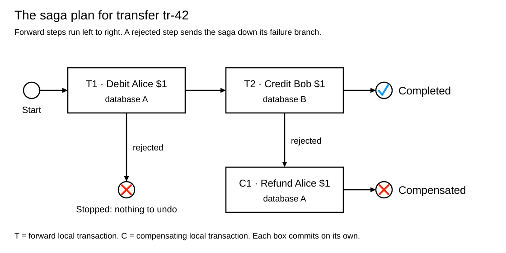
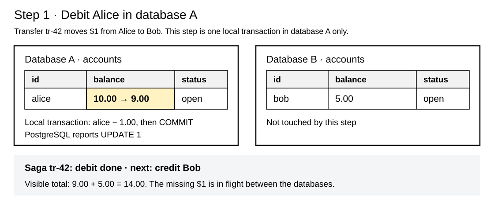
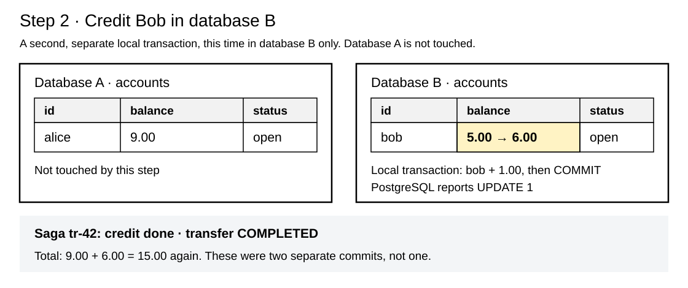
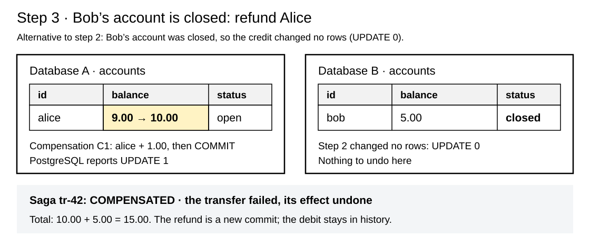
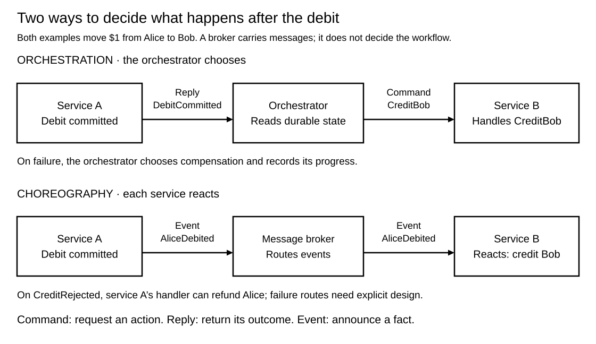
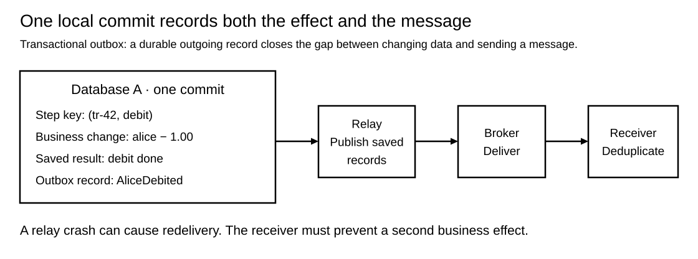
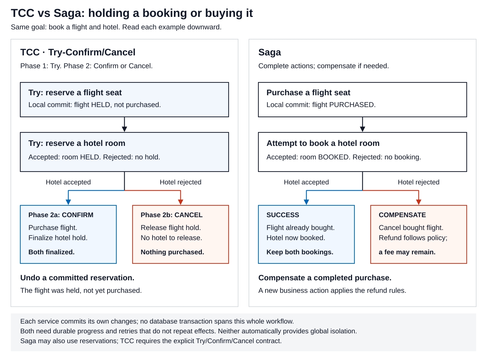

# Transactions. Saga

<sub>[Back to Distributed Systems](../Readme.md#content)</sub>

**A saga runs one business operation across several databases as a chain of local transactions, each committed on its own. If a later step fails, the saga runs compensating transactions that undo the effects of the steps that already committed.** Because nothing commits the whole operation at once, other users can see it half done: a saga gives up the isolation of one big transaction so that each database can stay in charge of its own data.

This article follows one example from start to finish: moving **$1 from Alice's account in database A to Bob's account in database B**. It first shows why one database transaction cannot do this, then runs the saga step by step in SQL, including what happens when the second step fails. The later sections add what a real saga needs: rules for what others see between the steps, someone to run the steps, safe retries, reliable messages, and recovery when progress stops. The article ends by comparing sagas with Try-Confirm/Cancel (TCC) and two-phase commit.

## The problem: one transfer, two databases

A payment app keeps its accounts in two PostgreSQL databases, `db_a` and `db_b`, each owned by its own service. **Service A** owns database A, which holds Alice's account, and **service B** owns database B, which holds Bob's. Both databases have the same small table:

```sql
-- Database A
CREATE TABLE accounts (
    id      text PRIMARY KEY,
    balance numeric(12, 2) NOT NULL CHECK (balance >= 0),
    status  text NOT NULL DEFAULT 'open'    -- 'open' or 'closed'
);

INSERT INTO accounts (id, balance) VALUES ('alice', 10.00);
```

```sql
-- Database B: the same CREATE TABLE, then
INSERT INTO accounts (id, balance) VALUES ('bob', 5.00);
```

The `numeric` type keeps money exact, and the `CHECK` constraint stops any balance from going below zero.

The transfer should leave Alice with $9 and Bob with $6. If both accounts lived in one database, one transaction would do it:

```sql
BEGIN;
UPDATE accounts SET balance = balance - 1.00 WHERE id = 'alice';
UPDATE accounts SET balance = balance + 1.00 WHERE id = 'bob';
COMMIT;
```

Both updates would commit together or not at all. Across two databases, this is impossible. A PostgreSQL connection works inside exactly one database, so its transaction can change only that database's tables. A query in database A that even names database B fails:

```sql
-- Database A
SELECT balance FROM db_b.public.accounts WHERE id = 'bob';
```

```text
ERROR:  cross-database references are not implemented: "db_b.public.accounts"
```

The `postgres_fdw` extension can make Bob's table look local, but it commits the remote transaction separately and does not support two-phase commit, so the two commits are still not atomic.

The transfer therefore needs two commits, and something can go wrong between them. If the app commits Alice's debit and then crashes before it credits Bob, Alice has $9, Bob has $5, and a dollar has disappeared.

There are two ways out. **Two-phase commit** makes both databases commit together, at the price of participant support and locks that stay held until the coordinator's decision arrives; the [Two-phase commit](../Transactions.%20Two-phase%20commit/Readme.md) article covers it. A **saga** accepts two separate commits and manages the gap between them. It cannot close the gap, but it turns it into a known state that the system can always finish or undo.

If you have read the System Design chapter [Digital Wallet](../../system%20design/27.%20Digital%20Wallet/Readme.md), this is its transfer between accounts A and C. There, each account partition is replicated with Raft. Replication keeps the copies of one partition in sync; it does not make two partitions commit together, so the chapter uses a saga across partitions for the same reason.

## The plan: steps and their compensations

A saga starts with a plan. For this transfer, the plan has three local transactions:

- **T1** debits Alice by $1 in database A.
- **T2** credits Bob by $1 in database B.
- **C1** refunds Alice's $1 in database A. It is the **compensating transaction** for T1, and it runs only if T2 fails.

A **local transaction** is an ordinary transaction inside one database, with its own `COMMIT`. A compensating transaction is local too: it does not roll anything back, but commits a new change that cancels the effect of an earlier one.

The original 1987 paper on sagas states the promise precisely. For forward steps T1 … Tn with compensations C1 … Cn−1, the system runs either all the forward steps, T1 … Tn, or the first few of them followed by their compensations in reverse order: T1 … Tj, Cj … C1. For this transfer, that leaves three possible outcomes: T1 and T2 both commit, and the transfer is **completed**; T1 commits and C1 refunds it, and the transfer is **compensated**; or T1 itself is rejected, and nothing changes. The last forward step never needs a compensation, because no later step can fail after it. This is what people mean when they call a saga **eventually consistent**: it reaches one of these outcomes through recovery, but not immediately and not within any fixed time.



Read the figure from left to right along the top for the success path. A rejected step sends the saga down its failure branch: a rejected T1 stops the saga with nothing to undo, and a rejected T2 starts C1.

The component that follows the plan and remembers how far it got is the **orchestrator**. It can be a service of its own or a part of service A. What matters is that it records each step's outcome durably, so that after a crash it can continue the saga instead of forgetting it. A saga can also run without an orchestrator, as [Who runs the steps](#who-runs-the-steps-orchestration-or-choreography) shows.

### Why it is called a saga

**Saga is a name, not an acronym.** Hector Garcia-Molina and Kenneth Salem introduced the term in their 1987 paper *Sagas*, and its acknowledgments credit **Bruce Lindsay** with suggesting it. In everyday English, a saga is a long story told in parts, which makes a handy memory aid: **the business operation is the story, and its local transactions are the chapters**. The paper does not explain why Lindsay picked the word, so treat this as a mnemonic, not as history.

## Step 1 — Debit Alice in database A



The orchestrator asks service A to debit Alice. Service A runs one local transaction in database A:

```sql
-- Database A
BEGIN;
UPDATE accounts
SET    balance = balance - 1.00
WHERE  id = 'alice' AND status = 'open' AND balance >= 1.00;
COMMIT;
```

PostgreSQL reports how many rows the `UPDATE` changed. `UPDATE 1` means the debit happened. `UPDATE 0` means Alice's account is closed or holds less than $1: T1 is rejected, nothing has changed, and the saga ends with nothing to undo. Without the `balance >= 1.00` condition, the `CHECK` constraint would still stop an overdraft, but with an error instead of a clean `UPDATE 0`.

After the `COMMIT`, Alice has $9 and Bob still has $5. The orchestrator records “debit done” for transfer `tr-42` before it moves on, so a crash at this point does not lose track of the dollar.

This intermediate state is real. Anyone who adds up the two balances right now gets $14 instead of $15, because the missing dollar is in flight between the databases. [Between the steps](#between-the-steps-other-transactions-see-the-half-done-work) explains why that matters.

## Step 2 — Credit Bob in database B



With the debit recorded, the orchestrator asks service B to credit Bob:

```sql
-- Database B
BEGIN;
UPDATE accounts
SET    balance = balance + 1.00
WHERE  id = 'bob' AND status = 'open';
COMMIT;
```

`UPDATE 1`: Bob now has $6, and the orchestrator marks `tr-42` **completed**. The total is $15 again. These were still two separate commits. The orchestrator's “completed” record says that both happened, but it does not merge them into one commit after the fact.

The client does not have to wait for all of this. The app can accept the request at once, return the transfer ID `tr-42` with the status “pending”, and let the client check the status later. For a short saga, the app can instead wait and answer “completed”. Either way, a pending transfer must look different from a completed one, and a client timeout does not mean that the transfer failed, so the client keeps `tr-42` to check the status or to retry. Waiting changes the response time, not the guarantees: the steps still commit separately.

## Step 3 — If Bob's account is closed, refund Alice



Now go back to the moment after Step 1, and suppose that Bob closed his account a minute earlier. Step 2's `UPDATE` finds no open account and reports `UPDATE 0`: database B has definitively rejected the credit. Alice has already paid, so the orchestrator runs the compensation C1 in database A:

```sql
-- Database A
BEGIN;
UPDATE accounts
SET    balance = balance + 1.00
WHERE  id = 'alice';
COMMIT;
```

Alice is back to $10, Bob still has $5, and the orchestrator marks `tr-42` **compensated**: the transfer failed, and its effect was undone. Nothing was rolled back in the database sense. The refund is a new commit, and both the debit and the refund stay in the history.

Three rules keep compensation correct:

- **Undo only what committed.** Bob's credit never changed his balance, so there is nothing to undo in database B. Running `balance - 1.00` for Bob would take a dollar that he never received.
- **Compensate only after a definite “no”.** `UPDATE 0` is a definite answer. A timeout is not: the credit may have happened, as [A timeout means the outcome is unknown](#a-timeout-means-the-outcome-is-unknown) explains.
- **Keep trying until the compensation commits.** If the refund fails for a temporary reason, the transfer stays unresolved and the orchestrator retries. It must not report “compensated” before the refund commits.

The SQL so far assumes that every statement runs exactly once. Real networks break that assumption: a request can time out after it succeeded, or arrive twice. [Timeouts and retries](#timeouts-and-retries-make-each-step-safe-to-repeat) adds the missing protection.

## Compensation repairs an effect, not a snapshot

Suppose Alice receives an unrelated $20 deposit between the debit and the refund. She then has $29, and the refund must leave her with $30. If C1 wrote back her old balance of $10 instead, it would erase the deposit. That is why C1 adds $1 to whatever the balance is now. The original paper makes the same point with airline seats: a compensation undoes a step's effect in business terms, but it does not necessarily return the database to the state it had before the step.

Compensation is a business action, so the business defines it. Canceling a reservation may free a seat; refunding a card payment may keep a fee and leave an audit trail. A compensation can fail like any other step, so it needs recorded progress, retries, and sometimes a person.

The plan compensates in reverse order, which is the safe default when each step depends on the one before. The original paper also allows steps that do not depend on each other to run in parallel; their compensations must then respect the same dependencies.

## Between the steps, other transactions see the half-done work

**A saga does not isolate the whole operation.** Each local transaction is isolated inside its own database, but between the steps, everyone can see the intermediate state. Between Step 1 and Step 2, a report that adds up all balances finds $14 instead of $15. Nothing is broken in either database; the saga simply has not finished yet.

Microsoft's saga guidance names three anomalies that this can cause:

| Anomaly | What it looks like with transfers |
| --- | --- |
| Lost update | One saga writes a value that it read earlier and overwrites another saga's change, for example by setting Alice's balance to a total computed before a concurrent deposit. |
| Dirty read | Another workflow uses a step's result before the saga is final, for example a cashback program that rewards Alice's payment shortly before the saga refunds it. |
| Nonrepeatable read | Two steps of one saga read different data because another saga committed in between, for example a funds check that passes and a later step that finds the money gone. |

Here, “dirty” means work that has committed locally but is not yet final for the business. It is not a SQL dirty read, which reads another transaction's uncommitted changes: PostgreSQL never allows that, at any isolation level. A database can prevent SQL dirty reads and still expose a saga's half-finished state.

Microsoft also lists six countermeasures. Each one needs enforcement by the service that owns the data; a `PENDING` label or a history table alone protects nothing.

| Countermeasure | How it applies to a transfer |
| --- | --- |
| Semantic lock | Mark the work as in progress, for example as a pending amount that other withdrawals must respect, and make conflicting operations wait or fail. |
| Commutative updates | Use changes whose order does not matter: `balance = balance - 1.00` instead of writing a computed total. |
| Pessimistic view | Reorder the steps so that updates others could misread happen late, in retryable steps after the [point of no return](#the-point-of-no-return-compensable-pivot-and-retryable-steps). |
| Reread values | Check that the data has not changed before you update it, and stop the step if it has. |
| Version files | Keep a log of all operations on a record and apply them in the correct order. |
| Risk-based concurrency | Choose the mechanism by business risk: a saga for low-risk updates, a distributed transaction for high-risk ones. |

Step 1's SQL already uses two of these. It adjusts the balance instead of writing a new total, which is a commutative update. Its `balance >= 1.00` condition checks the funds in the same statement that spends them, which is the safe form of rereading: if another transaction changes Alice's row first, PostgreSQL re-evaluates the condition against the new version of the row before it applies the update. A check in one statement followed by a write in another would leave a race. Commutative updates still need the other protections: `balance - 1.00` on its own does not stop overspending, and a repeated statement would still apply twice.

## Who runs the steps: orchestration or choreography

So far, an orchestrator has told each service what to do. That is one of two ways to coordinate a saga. Three kinds of messages are involved:

- A **command** asks a service to do something: `CreditBob`.
- A **reply** answers one command: `DebitCommitted` tells the orchestrator that its debit request succeeded.
- An **event** announces a fact to every subscriber: `AliceDebited` says that Alice's debit committed.

A reply and an event can describe the same fact; they differ in who receives them. In the failure path, a `CreditRejected` event lets service A's handler start the refund. These message names are illustrative.

The figure shows how the same debit leads to the credit in each style. In choreography, a message broker carries the events, and the services decide what to do next.



| Question | Orchestration | Choreography |
| --- | --- | --- |
| Who chooses the next step? | The orchestrator reads results and sends commands. | Each service reacts to the events it subscribes to. |
| Where does the workflow live? | In one place: the orchestrator. | Spread across the services' event handlers. |
| How does compensation start? | The orchestrator sends compensating commands. | A failure event triggers a compensating handler. |
| Main cost | The orchestrator must be durable and recoverable. | Dependencies, timeouts, and overall progress get hard to follow as the flow grows. |

Orchestration suits a transfer, because the progress of every transfer is explicit in one place. The orchestrator is a role, not a single machine: another worker can take over from its durable state. Choreography removes the central decision-maker but still depends on every service and on the messaging infrastructure. Both styles need durable state and recovery rules.

## Timeouts and retries: make each step safe to repeat

### A timeout means the outcome is unknown

Suppose service B commits Bob's credit, but its reply is lost. The orchestrator sees a timeout, not a rejection. If it refunded Alice now, Alice would have $10 and Bob $6: the saga would have created a dollar.

A timeout therefore means “we do not know yet”. The orchestrator must either find out what happened or repeat the same request, and repeating is safe only if a step cannot apply twice.

### Record each step once

A step is **idempotent** if running it twice has the same effect as running it once. To make the credit idempotent, give it a stable **idempotency key**, here transfer `tr-42` plus step `credit`, and let database B remember the keys it has used. Add one small table next to `accounts` in each database:

```sql
CREATE TABLE transfer_log (
    transfer_id text NOT NULL,
    step        text NOT NULL,     -- 'debit', 'credit', or 'refund'
    result      text NOT NULL,     -- 'done', 'rejected', or 'canceled'
    PRIMARY KEY (transfer_id, step)
);
```

The table name and columns are this article's choice: a saga needs durable records like these, not this exact schema. Service B then performs the credit and records its result in one statement:

```sql
-- Database B: credit Bob at most once for tr-42
WITH credit AS (
    UPDATE accounts
    SET    balance = balance + 1.00
    WHERE  id = 'bob' AND status = 'open'
    RETURNING id                      -- returns a row only if Bob was credited
)
INSERT INTO transfer_log (transfer_id, step, result)
SELECT 'tr-42', 'credit',
       CASE WHEN EXISTS (SELECT 1 FROM credit) THEN 'done' ELSE 'rejected' END;
```

PostgreSQL runs a single statement like this as one transaction, so the balance change and its log row commit together or not at all. If the request arrives again, the `INSERT` hits the primary key and fails, and PostgreSQL cancels the whole statement, including the `UPDATE`:

```text
ERROR:  duplicate key value violates unique constraint "transfer_log_pkey"
DETAIL:  Key (transfer_id, step)=(tr-42, credit) already exists.
```

Bob is credited once, however many times the request arrives. On this error, SQLSTATE `23505` (`unique_violation`), service B answers with the result it recorded the first time:

```sql
SELECT result FROM transfer_log WHERE transfer_id = 'tr-42' AND step = 'credit';
```

A rejection is recorded too, as `result = 'rejected'`, so a delayed copy of the request cannot credit Bob later, after the saga has refunded Alice. Service A protects the debit and the refund in the same way, with the keys `('tr-42', 'debit')` and `('tr-42', 'refund')`. The key belongs to the step, not to a network message: a retry must reuse the same key, or the database cannot recognize it. Keep the log rows at least as long as a late duplicate could still arrive.

### Settle an unknown outcome before compensating

Back to the lost reply. Asking service B whether the credit happened is not enough: if B has no record yet, the original request may still be on its way and could arrive after the refund. Instead, the orchestrator asks service B to close the door on it, by recording the credit as canceled if no result exists yet:

```sql
-- Database B
INSERT INTO transfer_log (transfer_id, step, result)
VALUES ('tr-42', 'credit', 'canceled')
ON CONFLICT DO NOTHING;

SELECT result FROM transfer_log WHERE transfer_id = 'tr-42' AND step = 'credit';
```

If the result is `done`, the credit happened: the orchestrator completes the transfer and does not refund Alice. If it is `canceled` or `rejected`, the credit can no longer happen, because any late copy of the request now hits the existing key: the orchestrator refunds Alice. Either way, the decision rests on a durable record, not on a guess.

## Hand off each step reliably: outbox and inbox

One more gap remains. Service A commits Alice's debit and then crashes before it sends “debit done”. The database has the debit, but nobody else knows. The **transactional outbox** closes this gap: service A writes the business change and the outgoing message, as a row in an outbox table, in the same local transaction. A separate **relay** later reads the committed outbox rows and publishes them. The [Transactional Outbox](../Patterns.%20Transactional%20Outbox/Readme.md) article covers the pattern in detail.



If the service crashes after the commit, the outbox row survives and the relay publishes it later. If the relay publishes a message and crashes before it records that, it publishes the message again after it restarts. Receivers therefore still need the idempotency from the previous section. The outbox closes the gap between the database and the message broker; it does not create a global transaction or make arbitrary side effects happen exactly once.

The orchestrator needs the same discipline for its own progress. Otherwise it can record “credit requested” without arranging to send the command, or send the command and forget that it did.

### Inbox, publication order, and change data capture

The receiving side has a matching tool. A **transactional inbox** records the identity of each message that a service has accepted, in the same local transaction as the business change, and the service acknowledges the message to the broker only after that commit. If the transaction rolls back, the recorded identity rolls back too, so a redelivery can retry the work. In this design, the `transfer_log` key `('tr-42', 'credit')` can serve as that identity, so one table provides both inbox deduplication and step idempotency. If retries carry new transport message IDs, the receiver must still check the stable step key: checking only the message ID would allow a second credit. A separate “already processed?” query followed by an unprotected update leaves a race; the primary key makes the check and the write one atomic action.

A relay can poll the outbox table, or use **change data capture (CDC)** to read committed changes from the database's transaction log. Debezium's outbox event router is one example: its event ID supports deduplication, and its entity key routes related events to the same Kafka partition, which keeps them in order. Keep events about the same account in order, so that a later update cannot overtake an earlier one; monitor the oldest unpublished row; and delete rows only when the relay no longer needs them. **The outbox handles reliable handoff; the saga decides what happens next.**

## The point of no return: compensable, pivot, and retryable steps

Not every step can be undone. Microsoft's saga guidance sorts steps into three kinds:

| Kind | Meaning | In the transfer |
| --- | --- | --- |
| Compensable | Can be undone by a compensating transaction. | T1: C1 refunds the debit. |
| Pivot | The point of no return: once it commits, the saga must finish. | T2: once Bob's credit commits, the transfer is done. |
| Retryable | Comes after the pivot and is retried until it succeeds, never undone. | Sending Alice a receipt: an email outage leaves the receipt pending; it does not reverse the transfer. |

Put every check that can reject the operation before the pivot. A step after the pivot that can still fail for a business reason has no path to completion. Whether a step is the pivot is a business decision: a card payment is not automatically a pivot, because a refund may be an acceptable compensation. And no saga can undo a delivered parcel just because it can reverse a database row. Retrying cannot guarantee that every external action eventually becomes possible, so permanent failures need an explicit policy, such as handing the case to a person.

## Recovery deadlines and observability

A saga is only as reliable as the process that finishes it. Store enough to resume both forward steps and compensations after a crash: the transfer ID, its current state, each step's key and result, the number of attempts, and the last error. Watch for transfers that stay pending too long and for compensations that keep failing, and run a reconciliation job that compares each transfer's state with the `transfer_log` rows in both databases.

Retry temporary failures with growing delays instead of a tight loop, and store the time of the next attempt, so that restarting a worker does not reset the schedule. Give each transfer a recovery deadline and an owner. When the deadline passes, the transfer is **unresolved and needs a person**, not compensated; opening a support ticket does not refund anyone.

Carry `tr-42` through every command, event, log line, and trace. It ties the whole saga together for debugging, while each step still has its own idempotency key. A trace shows where progress stopped; only the durable records in the databases show what actually committed.

## Saga in practice

**Airbnb described a production example of compensation-based workflows in April 2026: Skipper, its embedded Java/Kotlin workflow engine.** Skipper records progress so that work can resume after a crash. Its `@Compensate` annotation pairs an action with an operation that counteracts its effect. After a failure, the engine runs the applicable compensations in reverse order, such as releasing inventory or refunding a charge. This is **saga-like behavior**: Airbnb's article describes the mechanism without calling it a saga.

Airbnb built compensation into the engine so that teams would stop building their own cleanup and recovery logic again and again. By the time of that article, Skipper had run in production for more than a year across **over 15 use cases**, including payments, insurance, and wallet workflows, with a reported **peak of 10,000 workflows per second on DynamoDB**. That is the engine's overall throughput; the article gives no separate rate for payment workflows or for workflows that use compensation.

**Amazon Web Services (AWS), Microsoft Azure, and Google Cloud all recommend considering a saga for business operations that span independent services**, when compensation and temporary inconsistency are acceptable. Each service commits its own work, and the workflow handles retries and recovery across service boundaries. AWS's service-selection guide, updated **September 4, 2026**, also lists sagas as an orchestration workload. These are published design recommendations; they do not tell us which protocol Amazon.com's own checkout uses.

## Saga and TCC

**A saga coordinates completed business actions and their compensations; TCC requires an explicit reservation contract.** In **Try-Confirm/Cancel (TCC)**, **Try** checks the prerequisites and reserves what is needed to finish. The second phase then either **Confirms** the reservations or **Cancels** them; Confirm and Cancel are alternatives, never both. Both patterns commit locally before the whole operation finishes, so local commits alone do not tell them apart.

The difference is what the first write means. In this article's saga, Step 1 completes the debit: Alice has $9, and a later rejection needs a separate refund. In TCC, Try only reserves the dollar. Its local commit leaves Alice with **$9 available and $1 reserved** for `tr-42`, where the **available balance** is the money she can still spend. Confirm turns the reservation into a final debit; Cancel releases it, and Alice has $10 available again if nothing else happened.

Bob's side must also secure its part during Try, even though receiving money needs no funds reservation: service B must establish that it can accept the credit and keep that ability until Confirm or Cancel. TCC moves every prerequisite of completion into Try; a saga can discover a rejection after earlier steps have completed, as in Step 3.

A booking example makes the difference easier to see. Holding a flight seat corresponds to reserving Alice's dollar; buying the seat corresponds to the saga's completed debit.

Two side-by-side panels compare TCC on the left with Saga on the right. Read each panel downward: a flight seat is held or purchased, then the hotel accepts or definitively rejects the request. The lower branches are alternative outcomes. Compare releasing the TCC flight hold with canceling the saga's purchased flight under its refund policy.



The takeaway rows at the bottom of the panels name what recovery acts on: “Undo a committed reservation” in TCC and “Compensate a completed purchase” in the saga. The summary band beneath both panels lists what the two share, including that a saga can also use reservations.

**A missing reservation API does not automatically rule out TCC.** If you control the resource, you can implement durable holds and make competing operations respect them. But if an external hotel offers only immediate purchases, recording `PENDING` in your own database does not reserve its rooms: checking availability during Try and buying during Confirm leaves time for another customer to buy the last room. That hotel cannot safely join TCC. A saga may instead buy immediately, if later cancellation is an acceptable compensation; fees and irreversible effects still matter.

Frameworks do not change this. Apache Seata's saga mode can coordinate progress and retries, but the services still supply the business actions and compensations: Seata cannot invent a refund policy. Likewise, a TCC coordinator cannot make an external service honor a reservation that the service does not support. The [Try-Confirm/Cancel](../Transactions.%20Try-Confirm-Cancel/Readme.md) article covers TCC in full.

## Choosing the transaction boundary

Start with one question: **can the rule you must protect stay inside one local transaction?** Such a rule is an **invariant**, for example “the total amount of money never changes”. The System Design chapter [Hotel Reservation System](../../system%20design/22.%20Hotel%20Reservation%20System/Readme.md) discusses sagas for consistency across services, but its chosen design keeps reservations and inventory in one relational database, so one local transaction protects them.

| Approach | How it commits and recovers | Main consideration |
| --- | --- | --- |
| One local transaction | Related writes commit or roll back together in one database. | Prefer this when the data can live together, as in the hotel design. |
| Two-phase commit (2PC) | Participants prepare; a transaction manager decides a global commit or rollback. | Needs participant support and recovery machinery. Prepared PostgreSQL transactions keep their locks until resolved. |
| TCC | Participants commit reservations, then confirm or cancel them. | Participants must secure completion during Try and honor the reservation. |
| Saga | Participants commit independently; recovery goes forward or compensates committed effects. | The business must accept intermediate states and define meaningful compensations. |

Two-phase commit is about atomic commitment; on its own, it does not guarantee every isolation property. A saga avoids holding one database transaction open for the whole business operation, but it moves a lot of correctness work into the application.

Use a saga when the operation really spans independent databases and the business can live with pending work and compensation. If a rule must hold atomically across all the affected data, moving that data together, or using an atomic commit protocol, may be the better design.

## Self-check

1. Why can one PostgreSQL transaction not move the dollar from database A to database B?

   <details>
   <summary>Answer</summary>

   A PostgreSQL connection works inside one database, so its transaction can change only that database's tables; even naming the other database fails with `cross-database references are not implemented`. The transfer needs two commits, and a crash between them leaves it half done.

   </details>

2. After Step 1 commits, what does a report that adds up all balances show, and why?

   <details>
   <summary>Answer</summary>

   $14 instead of $15. Alice's debit has committed in database A, but Bob's credit has not happened yet, so the dollar is in flight. The report sees it because a saga does not isolate the whole operation.

   </details>

3. Step 2 reports `UPDATE 0` because Bob's account is closed. Why does the saga refund Alice instead of also running `balance - 1.00` for Bob?

   <details>
   <summary>Answer</summary>

   `UPDATE 0` means that Bob's balance never changed, so database B has nothing to undo; subtracting $1 there would take money that Bob never received. Only Alice's committed debit has an effect to compensate.

   </details>

4. Alice receives a $20 deposit between the debit and the refund. Why does C1 add $1 instead of restoring her earlier balance?

   <details>
   <summary>Answer</summary>

   A compensation undoes an effect, not a snapshot. Restoring the old $10 would erase the deposit; adding $1 to the current $29 leaves the correct $30.

   </details>

5. The credit request times out. Why is refunding Alice at once unsafe?

   <details>
   <summary>Answer</summary>

   The credit may have committed, with only the reply lost. A refund would then leave Alice with $10 and Bob with $6, creating a dollar.

   </details>

6. How does the `transfer_log` primary key stop a retried credit from paying Bob twice?

   <details>
   <summary>Answer</summary>

   The credit and its log row commit in one statement. A second attempt hits the existing `('tr-42', 'credit')` key and fails with `unique_violation`, which cancels the whole statement, including the balance update. Service B then returns the recorded result.

   </details>

7. After a timeout, why does the orchestrator insert a `canceled` row before it decides to refund Alice?

   <details>
   <summary>Answer</summary>

   Without a record, the original credit request could still arrive after the refund. The `canceled` row makes any late credit fail on the key. If the row already says `done` instead, the insert changes nothing, the credit happened, and the transfer completes without a refund.

   </details>

8. How do `CreditBob`, `DebitCommitted`, and `AliceDebited` differ?

   <details>
   <summary>Answer</summary>

   `CreditBob` is a command that asks service B to act. `DebitCommitted` is a reply that tells the orchestrator the outcome of its debit command. `AliceDebited` is an event that announces the committed debit to every subscriber.

   </details>

9. Why does a transactional outbox still need idempotent receivers?

   <details>
   <summary>Answer</summary>

   The relay can publish a message, crash before recording that, and publish it again after a restart. The outbox keeps the message together with the local change; the receiver's idempotency stops the repeated message from applying a second effect.

   </details>

10. Can a saga-level dirty read happen even though PostgreSQL never allows SQL dirty reads?

    <details>
    <summary>Answer</summary>

    Yes. Another workflow can use a step's locally committed result before the saga is final, for example a cashback reward for a payment that is later refunded. No uncommitted data is read.

    </details>

11. In the transfer, which step is the pivot, and what must be true of the steps after it?

    <details>
    <summary>Answer</summary>

    T2, Bob's credit: once it commits, the transfer must finish. Steps after the pivot must be retryable, with an idempotent path to completion, and every business check that could reject the operation must run before the pivot.

    </details>

12. Does reaching a recovery deadline mean that compensation succeeded?

    <details>
    <summary>Answer</summary>

    No. It means that the transfer is unresolved and needs a person. Keep its state and recorded outcomes; a deadline is not evidence of a refund.

    </details>

13. What distinguishes TCC's Try from the saga's Step 1?

    <details>
    <summary>Answer</summary>

    Try only reserves the dollar: Alice has $9 available and $1 held, and Cancel releases the hold. The saga's Step 1 completes the debit, so undoing it needs a separate refund. TCC also requires every participant, including service B, to secure completion during Try.

    </details>

# Sources

Primary sources checked on 2026-09-14. The practice section and its sources were checked on 2026-09-16; classifying Skipper's compensation mechanism as saga-like is an interpretation of Airbnb's documented behavior, not terminology used in that article. Microsoft's saga recommendation is covered by its Architecture Center source listed below.

The two-database SQL walkthrough was added on 2026-10-26. Every SQL statement and error message in it was run on a local PostgreSQL 18.6 server, and the behavior it relies on was checked against the PostgreSQL 18 documentation below. The account names, balances, transfer ID, and message names are illustrative.

Coverage review also used [Timofei Ivankov — Distributed transactions in microservices: from Saga to Two-Phase Commit (Habr, Russian)](https://habr.com/ru/articles/906484/). Added concepts were checked against the primary sources below; its broad claims about Saga atomicity and synchronous APIs are qualified in the teaching text.

- [Garcia-Molina and Salem — Sagas: definition, the guarantee of T1 … Tn or T1 … Tj, Cj … C1, and semantic compensation](https://www.cs.princeton.edu/techreports/1987/070.pdf)
- [Princeton — Sagas publication record: authors and 1987 date](https://www.cs.princeton.edu/research/techreps/598)
- [Merriam-Webster — saga: ordinary meaning and word history](https://www.merriam-webster.com/dictionary/saga)
- [PostgreSQL 18 — Managing databases: one database per connection](https://www.postgresql.org/docs/18/manage-ag-overview.html)
- [PostgreSQL 18 — postgres_fdw: remote transactions committed separately, no two-phase commit](https://www.postgresql.org/docs/18/postgres-fdw.html)
- [PostgreSQL 18 — Numeric types: numeric for monetary amounts](https://www.postgresql.org/docs/18/datatype-numeric.html)
- [PostgreSQL 18 — UPDATE: the UPDATE count command tag](https://www.postgresql.org/docs/18/sql-update.html)
- [PostgreSQL 18 — Transactions tutorial: every statement runs inside a transaction](https://www.postgresql.org/docs/18/tutorial-transactions.html)
- [PostgreSQL 18 — WITH queries: data-modifying statements and RETURNING](https://www.postgresql.org/docs/18/queries-with.html)
- [PostgreSQL 18 — INSERT: ON CONFLICT DO NOTHING and the INSERT command tag](https://www.postgresql.org/docs/18/sql-insert.html)
- [PostgreSQL 18 — Error codes: 23505 unique_violation](https://www.postgresql.org/docs/18/errcodes-appendix.html)
- [PostgreSQL 18 — Transaction isolation: no dirty reads, SQL anomalies, and concurrent conditional updates](https://www.postgresql.org/docs/18/transaction-iso.html)
- [PostgreSQL documentation — PREPARE TRANSACTION](https://www.postgresql.org/docs/current/sql-prepare-transaction.html)
- [Microsoft Azure Architecture Center — Saga pattern: compensable, pivot, and retryable steps, three anomalies, and six countermeasures](https://learn.microsoft.com/en-us/azure/architecture/patterns/saga)
- [Microsoft Azure Architecture Center — Compensating Transaction pattern](https://learn.microsoft.com/en-us/azure/architecture/patterns/compensating-transaction)
- [Microsoft Azure — Retry pattern: transient failures, backoff, and retry limits](https://learn.microsoft.com/en-us/azure/architecture/patterns/retry)
- [Chris Richardson — Saga pattern: local commits, compensation, and lack of isolation](https://microservices.io/patterns/data/saga.html)
- [Chris Richardson — Saga design: compensating business failures and semantic locks](https://microservices.io/post/microservices/2019/07/09/developing-sagas-part-1.html)
- [Chris Richardson — Transactional outbox](https://microservices.io/patterns/data/transactional-outbox.html)
- [Chris Richardson — Idempotent Consumer: processed-message identities in the local transaction](https://microservices.io/patterns/communication-style/idempotent-consumer.html)
- [AWS Builders' Library — Making retries safe with idempotent APIs](https://aws.amazon.com/builders-library/making-retries-safe-with-idempotent-APIs/)
- [AWS Prescriptive Guidance — Saga orchestration](https://docs.aws.amazon.com/prescriptive-guidance/latest/cloud-design-patterns/saga-orchestration.html)
- [AWS Prescriptive Guidance — Saga choreography](https://docs.aws.amazon.com/prescriptive-guidance/latest/cloud-design-patterns/saga-choreography.html)
- [Debezium — Outbox event router: event IDs, entity keys, and routing](https://debezium.io/documentation/reference/stable/transformations/outbox-event-router.html)
- [Airbnb Engineering — Skipper: Java/Kotlin workflows, compensation, production use, and throughput (April 28, 2026)](https://medium.com/airbnb-engineering/skipper-building-airbnbs-embedded-workflow-engine-f6c34552146f)
- [AWS Prescriptive Guidance — Saga pattern: when to use it and the cost of compensation](https://docs.aws.amazon.com/prescriptive-guidance/latest/modernization-data-persistence/saga-pattern.html)
- [AWS Decision Guides — Choosing a serverless service: Saga and orchestration (updated September 4, 2026)](https://docs.aws.amazon.com/decision-guides/latest/decision-guides/choosing-aws-serverless-service.html)
- [Google Cloud — Workflows best practices: apply retries and the Saga pattern](https://docs.cloud.google.com/workflows/docs/best-practice#apply_retries_and_the_saga_pattern)
- [Apache Seata — Saga mode: orchestration, retries, and application-defined compensation](https://seata.apache.org/docs/user/mode/saga/)
- [Apache Seata — TCC mode: service-level operations and application-defined handlers](https://seata.apache.org/docs/user/mode/tcc/)
- [Oracle MicroTx — Try-Confirm/Cancel: reservations and prerequisites for confirmation](https://docs.oracle.com/en/database/oracle/transaction-manager-for-microservices/24.2/tmmdg/tcc-transaction-model.html)
- [Transactions. Try-Confirm/Cancel — companion article](../Transactions.%20Try-Confirm-Cancel/Readme.md). The local `tcc-versus-saga.svg` is reused from its [comparison diagram](../Transactions.%20Try-Confirm-Cancel/images/tcc-versus-saga.svg), with the accessible title aligned to the visible headline; the booking example applies the reservation and compensation rules in the sources above.
- [System Design — Digital Wallet: the same transfer across Raft-replicated account partitions](../../system%20design/27.%20Digital%20Wallet/Readme.md). The local `saga-plan.svg` redraws the chapter's [saga.svg](../../system%20design/27.%20Digital%20Wallet/images/saga.svg) flow for the Alice and Bob example, without its credit-reversal branch.
- [System Design — Hotel Reservation System: data consistency among services](../../system%20design/22.%20Hotel%20Reservation%20System/Readme.md)
- [Raft — consensus and replicated state machines](https://raft.github.io/)
