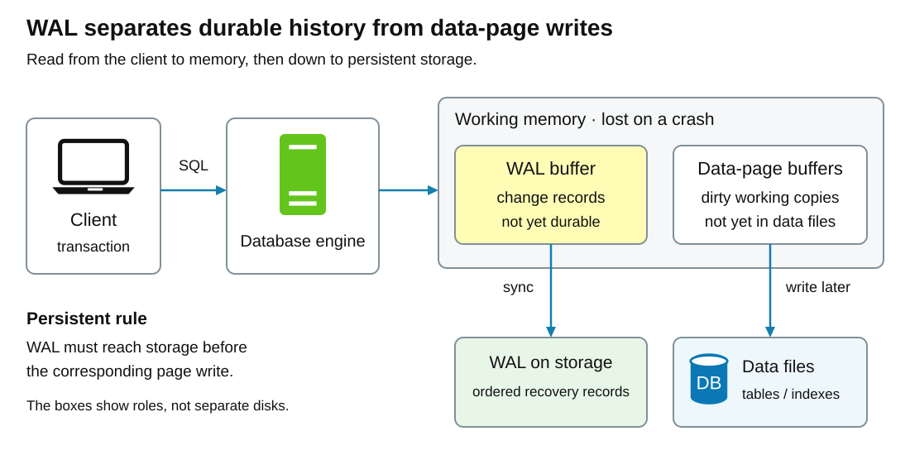
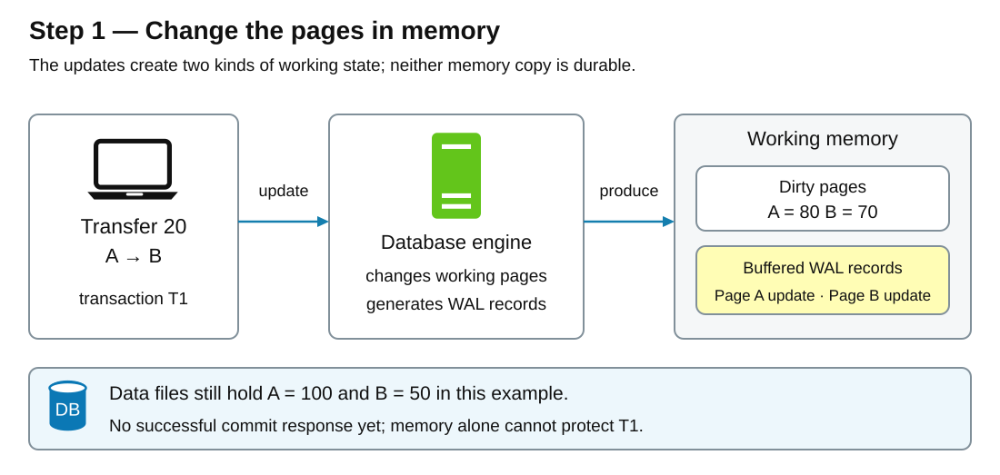
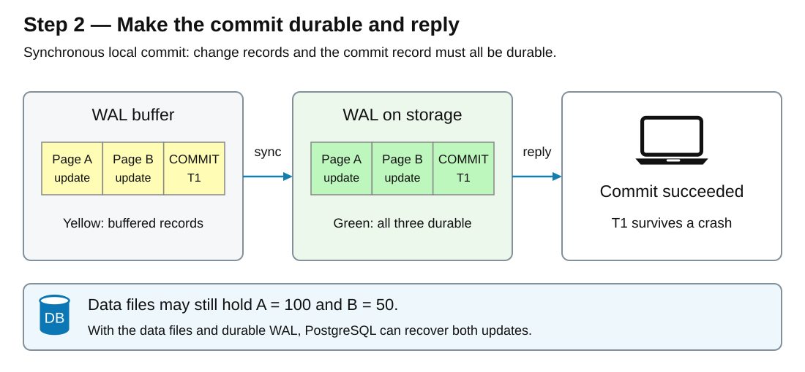
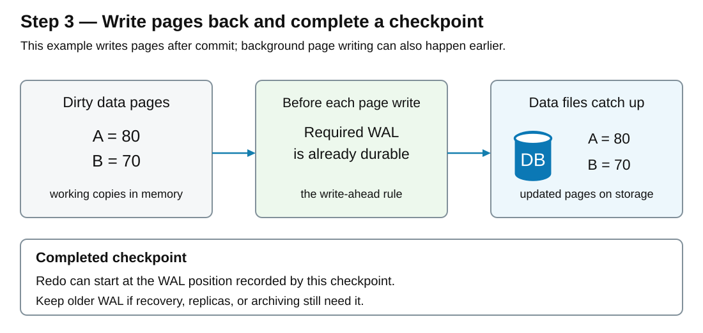
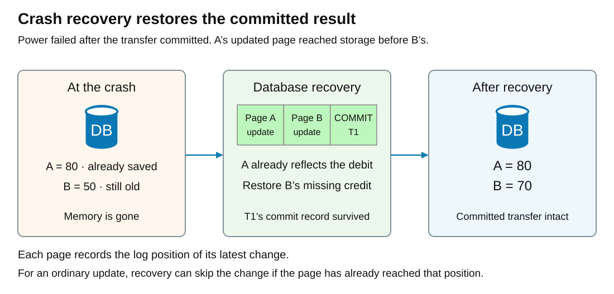

# Write-ahead log (WAL)

<sub>[Back to Distributed Systems](../Readme.md#content)</sub>

**A write-ahead log (WAL) lets a database make a transaction durable while some changed data pages are still only in memory.** Before writing a changed page to its data file, the database saves enough information in the log to recover that change. With synchronous local commit, the database can acknowledge success once the log, including the commit record, is safe on storage.

Suppose the database confirms a transfer of `20` from account A to account B. Power fails after the page with A’s debit reaches storage but before the page with B’s credit does. Where does the missing `20` come from on restart? The example uses PostgreSQL 18, an ordinary table protected by WAL, synchronous local commit, and storage that honors requests to persist writes.

1. [What the database keeps in memory and on storage](#1-what-the-database-keeps-in-memory-and-on-storage)
2. [A transfer from update to durable storage](#2-a-transfer-from-update-to-durable-storage)
3. [What happens after a crash?](#3-what-happens-after-a-crash)
4. [Why pay for a second write?](#4-why-pay-for-a-second-write)
5. [Which failures does the promise cover?](#5-which-failures-does-the-promise-cover)
6. [What changes in other engines?](#6-what-changes-in-other-engines)

## 1. What the database keeps in memory and on storage

A **data page** is a fixed-size block in a table or index file. PostgreSQL keeps working copies of pages in shared memory called the **buffer pool**. A **dirty page** is a working copy that has changed since it was read or last written back. Its changes can be committed or still in progress.

The diagram has two paths out of memory. On the left, PostgreSQL appends recovery records to WAL in the order it generates them. On the right, it writes working pages back to their places in the data files. WAL and the data files can live on the same device.



**Write ahead** describes the order in which changes reach storage. PostgreSQL can change a page in memory while its WAL record is still buffered. Before writing that page back, it must make the corresponding WAL durable. A write that only reaches the operating system’s cache can still disappear in a power failure. A successful synchronization, such as `fsync`, tells PostgreSQL the storage will retain those bytes through that failure.

## 2. A transfer from update to durable storage

Account A starts at `100` and B at `50`. Each account has one row. Assume the rows are on different pages, each page has room for its updated row, and nobody else updates either account. The application groups the two updates into one **transaction**, labeled `T1` in the diagrams, so both take effect together.

```sql
BEGIN;
UPDATE accounts SET balance = balance - 20 WHERE id = 'A';
UPDATE accounts SET balance = balance + 20 WHERE id = 'B';
COMMIT;
```

If the application committed the debit separately and crashed before sending the credit, the database would correctly preserve just the debit. Here, `BEGIN` and `COMMIT` tell PostgreSQL that both updates must succeed or fail together.

### Step 1 — Change the pages in memory



The updates create new row versions with balances `80` and `70` and generate WAL records for the page changes. The database can use those records to reconstruct the changes without running the original SQL. In the execution shown, the data files still contain `100` and `50`.

Page writes and commit can happen in either order. PostgreSQL can save A’s dirty page before the transfer commits, provided the WAL for that page is already durable. A page labeled `A = 80` contains the updated row version. The old version with `100` is still there. Another session reading both balances before commit sees `100` and `50` because its **snapshot** (its view of committed transactions) excludes the unfinished transfer.

### Step 2 — Make the commit durable and reply



On `COMMIT`, PostgreSQL appends a **commit record** identifying the transaction as complete. It waits until WAL is durable **through the end of that record** before replying that the transfer succeeded. Because WAL is one ordered stream, this also covers both earlier updates, even if records from other transactions are interleaved. At this point the transfer can survive a power failure even if the data file still holds the old versions of both pages.

**What would a query see right now?** After `COMMIT` returns, a new `SELECT` on the primary server, using PostgreSQL’s default Read Committed isolation, sees `80` and `70`. Its snapshot now includes the transfer, and it can read the updated pages directly from the buffer pool, even while both pages are still dirty.

### Step 3 — Write pages back and complete a checkpoint



In this execution, PostgreSQL eventually writes both updated pages back to the data file. A **checkpoint** makes sure the page changes covered by a particular log position are safely on storage and records where recovery can begin. Transactions can continue while this work runs, so the recorded starting position can be earlier than the checkpoint record itself.

Commit answers “Will this transfer survive a crash?” A completed checkpoint answers “How far back must recovery start reading WAL?” PostgreSQL can recycle old WAL files once local recovery can skip them and other consumers, such as a replica or an archive process, have finished with them.

## 3. What happens after a crash?

Return to the moment when the commit is durable and only A’s updated page has reached its data file. Memory is lost. PostgreSQL reads the last completed checkpoint and scans WAL forward from the position it specifies. **Redo** means using those records to reconstruct changes to database pages.



**Why does A finish at `80` instead of being debited again to `60`?** PostgreSQL tracks progress on each page. A **log sequence number (LSN)** is a position in WAL. For an ordinary page update, redo compares the end of the update’s record with the LSN on the page. If the page already includes that update or a later one, redo can skip the change. If the page is behind, redo applies the change and advances its LSN. This brings B up to `70` without issuing a second transfer.

A power cut can also interrupt a *single* page write. Such a **torn page** contains a mix of old and new bytes. With `full_page_writes` enabled, PostgreSQL records a full image of a page on its first modification after a checkpoint. Redo can restore that image and then apply later changes, even when the damaged page is unusable as a starting point.

### What if the commit or its reply is missing?

| What survived the crash? | What a new query sees after recovery | Why |
|---|---|---|
| Change records exist, but the transfer never committed. A’s updated page may even be on disk. | `A = 100`, `B = 50` | Redo can restore the new row versions. PostgreSQL checks their transaction’s status and shows readers the earlier, committed versions. |
| The commit record is durable. B’s page is still old. | `A = 80`, `B = 70` | WAL supplies the missing page change and establishes that the transaction committed. |
| The commit record is durable, but the client lost the reply. | `A = 80`, `B = 70` | Losing a message changes what the client knows. The transfer still committed. |

A timeout alone leaves the client uncertain which outcome occurred. Repeating the SQL as a new transaction could move another `20`. A retry-safe application reuses one **transfer ID** for every attempt. It enforces uniqueness on that ID and records it and the outcome in the same transaction as both balance changes. A repeat request for the same transfer can then return the recorded result.

## 4. Why pay for a second write?

The two account pages can be far apart in the data files. WAL lets the commit wait on one sequential stream while the database writes those pages later. If several transactions update the same page before it is written back, one page write can include all their changes. **Group commit** also lets one WAL synchronization cover multiple transactions whose commit records fall within the synchronized range.

The cost is the extra log data and the work of replaying it after a crash. More frequent checkpoints can shorten recovery, at the cost of writing dirty pages more often and generating more full-page images.

## 5. Which failures does the promise cover?

- **Power loss on one server.** The example assumes `fsync=on` and synchronous local commit. With `synchronous_commit=off`, PostgreSQL can acknowledge a transfer whose WAL is still in memory. A crash can then lose the whole transfer while leaving the database consistent. Turning `fsync` off can also allow corruption because the required write ordering may be lost.
- **Loss of the primary server’s storage.** A locally durable commit says nothing about whether a second server has received it. If an asynchronous replica takes over too early, it can be missing the transfer. A replica that already has the WAL safely stored can still show an older balance until it replays that WAL.
- **Restoring a backup.** A base backup supplies a starting copy of the database. An unbroken archive of WAL from the start of that backup through the desired recovery point lets PostgreSQL bring the copy forward. For example, if someone commits an accidental deletion, restoring a separate copy to just before that commit lets you recover the deleted data.

## 6. What changes in other engines?

| Engine | How it uses WAL |
|---|---|
| PostgreSQL | Normal queries read table and index pages through the buffer pool. Crash recovery uses WAL to bring those pages and transaction status up to date. |
| SQLite in WAL mode | A reader can fetch the newest page visible to it directly from WAL, falling back to the main database file. A checkpoint copies pages back. With `synchronous=FULL`, SQLite syncs WAL at commit. With `NORMAL`, a power failure can lose recent commits. |
| RocksDB | Recovery uses WAL to rebuild an in-memory table (the **memtable**) whose newest entries have yet to reach sorted table files. By default, a write survives a process crash, but a machine failure can lose recent writes still in the operating system’s cache. |

## Check your understanding

1. Power fails after PostgreSQL writes the page containing A’s debit, but before the transfer commits. What balances can a new query see after restart?

   <details>
   <summary>Answer</summary>

   `100` and `50`. A page write can precede commit. PostgreSQL’s visibility rules keep the unfinished transfer’s row versions out of the query result.

   </details>

2. The transfer commits, a new query reads the two updated balances, and then power fails before either changed page reaches its data file. Where did the balances come from before and after the crash?

   <details>
   <summary>Answer</summary>

   Before the crash, the query could read the committed versions from the buffer pool. After the crash, the old data files and durable WAL let PostgreSQL reconstruct the same `80` and `70`. The transfer did not have to wait for a checkpoint.

   </details>

3. The client times out on `COMMIT`. Why can PostgreSQL safely replay WAL while repeating the application request could debit A twice?

   <details>
   <summary>Answer</summary>

   Redo applies a record to a page only if the page LSN shows that the page does not have that change. A’s page already has the debit, so redo skips it and applies only B’s credit. Resending the SQL starts new work, which could move the balances from `80` and `70` to `60` and `90`. Reusing a transfer ID recorded atomically with the transfer lets the application recognize the earlier success.

   </details>

4. PostgreSQL wants to write A’s dirty page back to its data file. The WAL record for the debit is still in the operating system’s cache. What must happen first?

   <details>
   <summary>Answer</summary>

   PostgreSQL must make WAL durable through the last change recorded on A’s page. Otherwise a power failure could leave the changed page on storage while erasing the log record needed to recover it. Once the WAL is durable, the page write can proceed even if the transfer is still open.

   </details>

5. Power fails while PostgreSQL writes B’s page. Part of the page on storage has new bytes and part has old bytes. Why can redo not simply apply the credit record to this page? What lets recovery repair it?

   <details>
   <summary>Answer</summary>

   A credit record describes a change to a valid page. A torn page is not a valid starting point. With `full_page_writes` enabled, WAL holds a full image of B’s page from its first change after the last checkpoint. Redo restores that image and then applies the later records, including the credit.

   </details>

6. A team makes checkpoints more frequent to shorten recovery after a crash. Why might the database now write more data during normal operation?

   <details>
   <summary>Answer</summary>

   A frequently updated page may be written back at several checkpoints where one later write would have covered all its changes. With `full_page_writes` enabled, the first change to that page after each checkpoint also puts another full-page image in WAL.

   </details>

7. The primary confirms the transfer with synchronous local commit. Seconds later, the primary’s storage fails and an asynchronous replica takes over. Is the transfer sure to be on the new primary?

   <details>
   <summary>Answer</summary>

   No. The commit waited only for WAL on the primary’s storage. An asynchronous replica can lag behind, so it can take over without the transfer’s commit record. The client then has a confirmation for a transfer that the new primary does not have. Only a commit that also waits for a replica to store the WAL prevents this.

   </details>

# Sources

- [PostgreSQL 18 — Write-ahead logging and group commit](https://www.postgresql.org/docs/18/wal-intro.html)
- [PostgreSQL 18 — Transactions and the transaction boundary](https://www.postgresql.org/docs/18/tutorial-transactions.html)
- [PostgreSQL 18 — Transaction isolation and what a query sees](https://www.postgresql.org/docs/18/transaction-iso.html#XACT-READ-COMMITTED)
- [PostgreSQL 18.0 source — Buffer lookup and write-ahead ordering](https://github.com/postgres/postgres/blob/REL_18_0/src/backend/storage/buffer/bufmgr.c)
- [PostgreSQL 18 — WAL positions and restart from a checkpoint](https://www.postgresql.org/docs/18/wal-internals.html)
- [PostgreSQL 18 — Checkpoints, full-page images, and WAL recycling](https://www.postgresql.org/docs/18/wal-configuration.html)
- [PostgreSQL 18 — Page layout and the page LSN](https://www.postgresql.org/docs/18/storage-page-layout.html)
- [PostgreSQL 18.0 source — Page LSN comparisons and full-page image restoration](https://github.com/postgres/postgres/blob/REL_18_0/src/backend/access/transam/xlogutils.c)
- [PostgreSQL 18.0 source — Row visibility after a transaction is interrupted](https://github.com/postgres/postgres/blob/REL_18_0/src/backend/access/heap/heapam_visibility.c)
- [PostgreSQL 18 — Storage reliability](https://www.postgresql.org/docs/18/wal-reliability.html) and [asynchronous commit](https://www.postgresql.org/docs/18/wal-async-commit.html)
- [PostgreSQL 18 — Log shipping and synchronous replication](https://www.postgresql.org/docs/18/warm-standby.html) and [continuous archiving and point-in-time recovery](https://www.postgresql.org/docs/18/continuous-archiving.html)
- [SQLite — Write-ahead logging, reads, and checkpoints](https://sqlite.org/wal.html)
- [RocksDB — Write Ahead Log](https://github.com/facebook/rocksdb/wiki/Write-Ahead-Log-%28WAL%29) and [synchronous writes](https://github.com/facebook/rocksdb/wiki/Basic-Operations#synchronous-writes)
- [Amazon Builders’ Library — Making retries safe with idempotent APIs](https://aws.amazon.com/builders-library/making-retries-safe-with-idempotent-APIs/)
- Diagram credits — [database symbols](../../system%20design/01.%20Scaling/images/database.svg) and [log-record colors](../../system%20design/19.%20Distributed%20Message%20Queue/images/partition-increase.svg)
