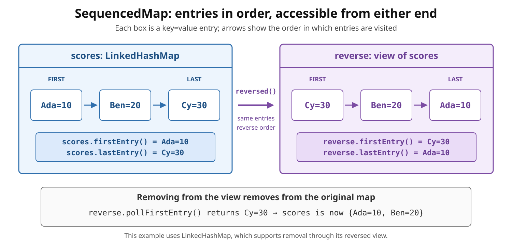

# Collections: `SequencedMap`

<sub>[Back to Java](../Readme.md#content)</sub>

# Front

What does `SequencedMap` add to Java maps, and what does `reversed()` return?

# Back

**`SequencedMap` was introduced in JDK 21 as part of Sequenced Collections (JEP 431).**

`SequencedMap<K, V>` extends `Map<K, V>` with a defined first-to-last order of **entries** (key–value pairs), operations at both ends, and a reversed view. It does not extend `SequencedCollection`.

**Encounter order** is the order in which entries are visited. A default `LinkedHashMap` uses insertion order; a `TreeMap` uses sorted key order. Sequenced does not necessarily mean insertion-ordered.

The diagram shows the same entries from both directions. Removing the reversed view's first entry removes the original map's last entry.



## Core operations

- Read an entry: `firstEntry()`, `lastEntry()`
- Remove and return an entry: `pollFirstEntry()`, `pollLastEntry()`
- Insert or update a mapping and position it at an end: `putFirst(k, v)`, `putLast(k, v)`
- Reverse encounter order: `reversed()`

The read methods, and supported poll operations, return `null` on an empty map. Returned entries are **snapshots**; their `setValue()` cannot update the map.

End modifications are **optional** and may throw `UnsupportedOperationException`. `LinkedHashMap` supports them, including moving an existing key with `putFirst` or `putLast`. `TreeMap` rejects these two positioning methods because key comparison determines its order.

## `reversed()` is a view

It does not copy or sort the entries. It swaps first/last and reverses iteration order. If modification through the view is supported, it writes through to the underlying map.

```java
import java.util.LinkedHashMap;
import java.util.SequencedMap;

public final class SequencedMapDemo {
    public static void main(String[] args) {
        SequencedMap<String, Integer> scores = new LinkedHashMap<>();
        scores.put("Ada", 10);
        scores.put("Ben", 20);
        scores.put("Cy", 30);

        SequencedMap<String, Integer> reverse = scores.reversed();

        System.out.println(scores.firstEntry());  // Ada=10
        System.out.println(reverse.firstEntry()); // Cy=30

        reverse.pollFirstEntry();
        System.out.println(scores); // {Ada=10, Ben=20}
    }
}
```

## Ordered collection views

`sequencedKeySet()` and `sequencedEntrySet()` return `SequencedSet` views;

`sequencedValues()` returns a `SequencedCollection` view.

They follow the map's encounter order and expose end access and `reversed()`.

Ordinary `keySet()`, `values()`, and `entrySet()` also follow that order, but their declared return types do not expose the sequenced operations.

# Sources

- [Oracle guide — Creating Sequenced Collections, Sets, and Maps (JEP 431)](https://docs.oracle.com/en/java/javase/21/core/creating-sequenced-collections-sets-and-maps.html)
- [Java SE 21 `SequencedMap` API](https://docs.oracle.com/en/java/javase/21/docs/api/java.base/java/util/SequencedMap.html)
- [Java SE 21 `LinkedHashMap` API](https://docs.oracle.com/en/java/javase/21/docs/api/java.base/java/util/LinkedHashMap.html)
- [Java SE 21 `TreeMap` API](https://docs.oracle.com/en/java/javase/21/docs/api/java.base/java/util/TreeMap.html)
