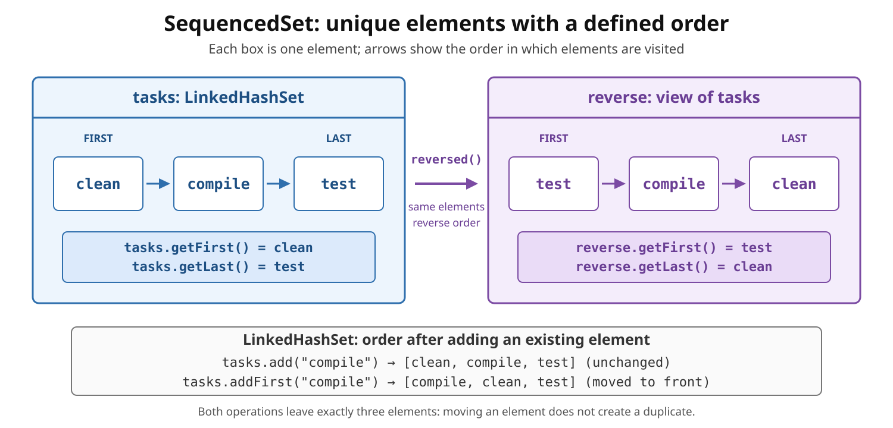

# Collections: `SequencedSet`

<sub>[Back to Java](../Readme.md#content)</sub>

# Front

What does `SequencedSet` add to Java sets, and what does `reversed()` return?

# Back

**`SequencedSet` was introduced in JDK 21 as part of Sequenced Collections (JEP 431).**

`SequencedSet<E>` extends both `Set<E>` and `SequencedCollection<E>`: it combines **unique elements** with a defined first-to-last order, operations at both ends, and a reversed view.

**Encounter order** is the order in which elements are visited. `LinkedHashSet` uses insertion order; `TreeSet` uses sorted element order. Sequenced does not necessarily mean insertion-ordered.

The diagram shows a set and its reversed view, then contrasts adding an existing element with moving it to the front.



## Core operations

- Read: `getFirst()`, `getLast()`
- Add at an end: `addFirst(e)`, `addLast(e)`
- Remove and return an element: `removeFirst()`, `removeLast()`
- Reverse encounter order: `reversed()`, returning `SequencedSet<E>`

On an empty set, end reads and supported end removals throw `NoSuchElementException`.

End modifications are **optional** and may throw `UnsupportedOperationException`. `TreeSet` rejects `addFirst` and `addLast` because element comparison determines its order.

## Unique elements can change position

In `LinkedHashSet`, ordinary `add(e)` leaves an existing element in place and returns `false`. `addFirst(e)` or `addLast(e)` moves it to the requested end without adding a duplicate.

## `reversed()` is a view

It does not copy or sort the elements. It swaps first/last and reverses iteration order. If modification through the view is supported, it writes through to the underlying set.

```java
import java.util.LinkedHashSet;
import java.util.List;
import java.util.SequencedSet;

public final class SequencedSetDemo {
    public static void main(String[] args) {
        SequencedSet<String> tasks =
                new LinkedHashSet<>(List.of("clean", "compile", "test"));
        SequencedSet<String> reverse = tasks.reversed();

        System.out.println(tasks.getFirst());   // clean
        System.out.println(reverse.getFirst()); // test

        System.out.println(tasks.add("compile")); // false; unchanged
        tasks.addFirst("compile");
        System.out.println(tasks); // [compile, clean, test]

        reverse.removeFirst(); // removes test from tasks
        System.out.println(tasks); // [compile, clean]
    }
}
```

Set equality still **ignores order**: sets with the same elements compare equal even when their encounter orders differ.

# Sources

- [Oracle guide — Creating Sequenced Collections, Sets, and Maps (JEP 431)](https://docs.oracle.com/en/java/javase/21/core/creating-sequenced-collections-sets-and-maps.html)
- [Java SE 21 `SequencedSet` API](https://docs.oracle.com/en/java/javase/21/docs/api/java.base/java/util/SequencedSet.html)
- [Java SE 21 `SequencedCollection` API — inherited end operations](https://docs.oracle.com/en/java/javase/21/docs/api/java.base/java/util/SequencedCollection.html)
- [Java SE 21 `LinkedHashSet` API](https://docs.oracle.com/en/java/javase/21/docs/api/java.base/java/util/LinkedHashSet.html)
- [Java SE 21 `TreeSet` API](https://docs.oracle.com/en/java/javase/21/docs/api/java.base/java/util/TreeSet.html)
