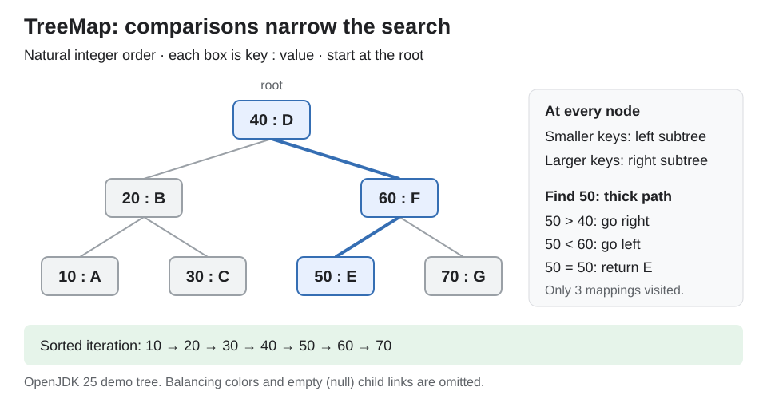
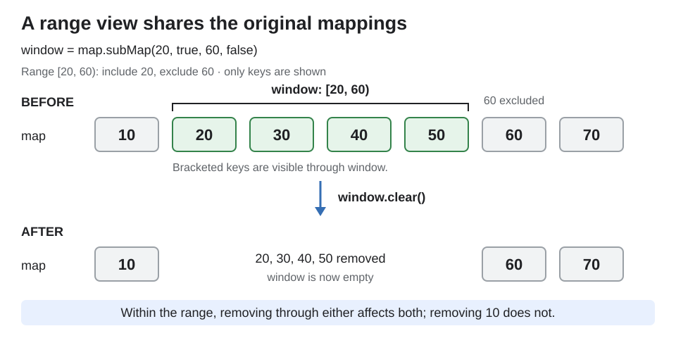

# Collections. TreeMap

<sub>[Back to Java](../Readme.md#content)</sub>

**`TreeMap`, introduced in Java 1.2, keeps keys sorted so a machine log can answer “Which setting was active at minute 45?”**

The machine switched to D at minute 40 and E at minute 50. Its log has no change at 45. The answer is D, the most recent setting at or before 45.

1. [Read the log](#1-read-the-log)
2. [Trace a search](#2-trace-a-search)
3. [Find a neighbor](#3-find-a-neighbor)
4. [Why a count disappears](#4-why-a-count-disappears)
5. [Clear a window](#5-clear-a-window)
6. [Time complexity of the main methods](#6-time-complexity-of-the-main-methods)
7. [Nulls and shared access](#7-nulls-and-shared-access)
8. [Choose a map](#8-choose-a-map)

## 1. Read the log

A **map** pairs a **key** (minute) with a **value** (setting). Each pair is an **entry**, or mapping. Keys are unique. Values can repeat. Predict the three reads.

```java
import java.util.TreeMap;

class ChangeLog {
    public static void main(String[] args) {
        var map = new TreeMap<Integer, String>();
        map.put(50, "E");
        map.put(40, "D");

        System.out.println(map.keySet());
        System.out.println(map.get(45));
        System.out.println(map.floorEntry(45));
    }
}
```

```text
[40, 50]
null
40=D
```

Printing `keySet()` lists keys in order. `get` needs an exact key. `floorEntry` finds the greatest key at or below the target. Before the first change it returns `null`. Check the result before calling `getValue()`. A second write at the same minute replaces the setting. Store a list per minute if both changes matter.

## 2. Trace a search

Now the log has seven changes. Each **node** holds one entry. Start at the top node, the **root**. At every node, smaller keys lie to its left and larger ones to its right.

By default the map uses the keys’ **natural order**. It calls `searchKey.compareTo(storedKey)`, and `map.comparator()` returns `null`. Pass a **comparator** (an ordering rule) to the constructor and it calls `comparator.compare(searchKey, storedKey)` instead. Negative goes left, positive goes right, zero finds the entry.

Follow **Find 50: thick path** from `40 : D` right to `60 : F`, then left to `50 : E`. Try 45. It follows the same path, then finds an empty link left of 50. Only 40 qualified as its floor. To reproduce **Sorted iteration**, visit each left subtree, its node, then its right subtree.



### Why the path stays short

Let **n** count entries in the whole map. In a plain search tree, inserting sorted keys can form a chain n nodes long. A **red-black tree** keeps paths short. Every path from the root to an empty link has the same number of black nodes, and two red nodes cannot be consecutive. Inserts and deletes can recolor nodes and rearrange nearby links (**rotations**) to restore these rules. The longest path is at most twice as long as the shortest. Doubling n adds only a constant to the height bound. The range example’s insertion order gives the pictured shape in OpenJDK 25.

The tree uses O(n) space because each mapping occupies one node with links and a color.

## 3. Find a neighbor

`TreeMap` implements `NavigableMap`, a sorted map with neighbor queries. Choose a direction, then decide whether an exact match counts.

| Wanted minute | Method | Ask for 40 (present) | Ask for 45 (absent) |
|---|---|---:|---:|
| Latest strictly before | `lowerKey` | 30 | 40 |
| Latest at or before | `floorKey` | 40 | 40 |
| Earliest at or after | `ceilingKey` | 40 | 50 |
| Earliest strictly after | `higherKey` | 50 | 50 |

Replace `Key` with `Entry` to retrieve the setting too. A missing neighbor yields `null`.

- `firstEntry()` and `lastEntry()` read the endpoints. `pollFirstEntry()` and `pollLastEntry()` also remove them. All four return `null` on an empty map.
- `firstKey()` and `lastKey()` return endpoint keys. On empty they throw `NoSuchElementException`.
- Since Java 21, sorted maps implement `SequencedMap`. On a `TreeMap`, `putFirst` and `putLast` throw `UnsupportedOperationException` because comparison fixes the position.

A neighbor or endpoint entry is a **snapshot**. Save `floorEntry(45)`, then call `map.put(40, "D2")`. The saved pair still reads `40=D`, and its `setValue` throws `UnsupportedOperationException`. If the value were a mutable list, both references would still see additions to that list.

## 4. Why a count disappears

A word index should keep one count per spelling and list shorter words first. `String::length` supplies each word's length. **Predict the second write's return value, the size, and the two lookups.**

```java
import java.util.Comparator;
import java.util.TreeMap;

class WordCounts {
    public static void main(String[] args) {
        var lengthOrder = Comparator.comparingInt(String::length);
        var words = new TreeMap<String, Integer>(lengthOrder);
        words.put("cat", 1);
        System.out.println(words.put("dog", 2));
        System.out.println(words.size());
        System.out.println(words.get("cat"));
        System.out.println(words.get("dog"));
        System.out.println(words.containsKey("dog"));
        System.out.println(words.keySet());
    }
}
```

1. The first write stores `cat=1`. The second compares “dog” with “cat”. Both lengths are 3, so the **comparison returns zero**.
2. Zero means “found the key”. The map returns the old value 1 and replaces it with 2. Both spellings now retrieve 2. The tree makes no further `equals` or `hashCode` check.
3. Value replacement is documented. OpenJDK 25 retains the first key object, which explains the last line.

```text
1
1
2
2
true
[cat]
```

**Fix the ordering.** Replace the line constructing `words` with this line and rerun the program.

```java
var words = new TreeMap<String, Integer>(lengthOrder.thenComparing(Comparator.naturalOrder()));
```

Tied lengths now compare by text. The second write returns `null` for a new key. The result is `{cat=1, dog=2}`. Recover overwritten counts from the original records.

To obey the general `Map` contract, comparison must return zero exactly when `equals` returns true. The length-only map runs but breaks this rule: `"cat".equals("dog")` is false. Even natural order can disagree with `equals`. The `BigDecimal` values constructed from `"4.0"` and `"4.00"` compare as zero numerically, while `equals` distinguishes their decimal places.

Keep comparisons stable. Changing a stored key’s ordering field can send a search down the wrong branch. Remove the key before mutation and reinsert it, or use immutable keys. Natural-order keys must implement `Comparable` and be mutually comparable. Even the first `put` of a plain `Object` throws `ClassCastException`. OpenJDK 25 compares that first key with itself.

## 5. Clear a window

An editor needs a separate report for minutes 20 through 59. A **live view** shares the entries in its range. In **BEFORE**, follow the **window: [20, 60)** bracket from 20 to **60 excluded**. Predict the surviving keys, then follow **window.clear()** to **AFTER**.



```java
import java.util.TreeMap;

class ChangeWindow {
    public static void main(String[] args) {
        var map = new TreeMap<Integer, String>();
        map.put(40, "D");
        map.put(20, "B");
        map.put(60, "F");
        map.put(10, "A");
        map.put(30, "C");
        map.put(50, "E");
        map.put(70, "G");

        var window = map.subMap(20, true, 60, false);
        var copy = new TreeMap<>(window);
        System.out.println(window.keySet());
        window.clear();
        System.out.println(map.keySet());
        System.out.println(copy.keySet());
        map.put(45, "D2");
        System.out.println(window.keySet());
    }
}
```

```text
[20, 30, 40, 50]
[10, 60, 70]
[20, 30, 40, 50]
[45]
```

The view erases four original entries and later shows the new 45. Writing 60 through `window` throws `IllegalArgumentException`. Edit `copy` for an independent report. The `TreeMap(SortedMap)` constructor preserves ordering. Its **shallow copy** owns the entries and shares their key and value objects.

`subMap(20, 60)` also selects [20, 60). `headMap(60)` selects keys before 60. `tailMap(20)` selects 20 onward. These short forms return `SortedMap`. Use the forms with inclusion flags for a `NavigableMap` result. `descendingMap()` and `reversed()` give a live view in reverse order. Its `lowerKey(40)` on the original seven keys is 50.

## 6. Time complexity of the main methods

Ask **how many entries the operation must visit**. Here *n* counts all entries in `map`, and *k* counts the entries in a bounded `window` such as [20, 60). O(1) work stays constant as the map grows. An O(log n) search can follow one path through the balanced tree. An O(n) scan can visit every entry.

The Java `TreeMap` API guarantees **O(log n)** for `get`, `containsKey`, `put` and `remove`. The other bounds below describe OpenJDK 25. Times are worst-case bounds assuming constant-time key comparisons and value equality tests. For long strings, add the time spent comparing their characters.

### Operations on the whole map

| Method | Time | Why |
|---|---|---|
| `get(key)`, `containsKey(key)` | O(log n), guaranteed | Compare keys down one path until a match or an empty link. Return the value or report whether the key exists. |
| `put(key, value)`, `remove(key)` | O(log n), guaranteed | Find the position and return the previous value, or `null` if absent. A replacement changes one value. Inserting or deleting a node can also require rebalancing. |
| `lowerKey`, `floorKey`, `ceilingKey`, `higherKey` and their `Entry` forms | O(log n) | Find the closest qualifying key on one side. The search descends the tree and may climb back to a qualifying ancestor. |
| `firstKey`, `lastKey`, `firstEntry`, `lastEntry`, `pollFirstEntry`, `pollLastEntry` | O(log n) | Follow left or right links to an endpoint. Polling also removes it and may rebalance the tree. |
| `containsValue(value)` | O(n) | Keys determine the branches. To rule out a missing value, inspect every entry. |
| Iterate all of `map.entrySet()` or `map.keySet()` | O(n) total | Follow links from each node to the next in sorted order. Over the whole walk, each tree edge is crossed at most twice. Add the cost of the loop body. |
| `map.size()`, `map.clear()` | O(1) | Size reads a stored count. Clearing the whole map resets the count and drops the root reference. Garbage collection can reclaim nodes later. |

### Operations on a range

| Method | Time | Why |
|---|---|---|
| Create a `subMap`, `headMap`, `tailMap` or reverse view (`descendingMap`, `reversed`) | O(1) | The view refers to the same tree and records its bounds or direction. It copies no entries. |
| `window.get`, `containsKey`, `put`, `remove` | O(log n) | Check the bounds. An in-range key is still searched in the whole backing tree. |
| Iterate `window.entrySet()` or copy with `new TreeMap<>(window)` | O(log n + k) total | Locate the boundaries, then traverse the selected entries in order. The sorted-map constructor can build the copy directly from that order. |
| `window.size()` | O(log n + k) to count, O(1) while cached | The first call walks the range. Adding or deleting a key anywhere in the backing map makes the next call count again. |
| `window.clear()` | O((k + 1) log n) upper bound | Locate the boundaries, then remove k entries individually. Each deletion can cost O(log n). Entries outside the window survive. |

Suppose the log starts empty. Insert minutes 20, 30, 40 and 50, calling `window.size()` after each insertion. The four calls count 1 + 2 + 3 + 4 = 10 entries in total. In a window large enough for *m* distinct inserts, counting from scratch each time costs O(m²) entry visits. If the report needs only the final count, call `window.size()` after the batch to scan the range once.

## 7. Nulls and shared access

Null values are allowed. If `get(45)` returns `null`, `containsKey(45)` distinguishes a missing key from a stored null. Natural order rejects `get(null)` and `put(null, value)` with `NullPointerException`. A comparator can place null keys first.

```java
import java.util.Comparator;
import java.util.TreeMap;

class NullKey {
    public static void main(String[] args) {
        var map = new TreeMap<Integer, String>(Comparator.nullsFirst(Comparator.naturalOrder()));
        map.put(null, "n");
        map.put(5, "five");
        System.out.println(map.floorKey(3));
        System.out.println(map.floorEntry(3));
    }
}
```

```text
null
null=n
```

The first line could mean “no match” or “matched the null key”. The second shows an entry exists with value `"n"`.

An **iterator** walks entries. A `TreeMap` iterator is **fail-fast**. Adding or deleting a mapping during a walk can trigger `ConcurrentModificationException` even in one thread. Delete the current entry with the iterator's own `remove()`. Replacing a value preserves the structure.

Fail-fast detection is best effort. `TreeMap` has no built-in synchronization. For shared reads and writes, including value replacements, all callers can use a `Collections.synchronizedNavigableMap` wrapper or its views. Hold the original wrapper’s lock throughout iteration, even over a view.

## 8. Choose a map

For the same keys in three iteration orders, see [HashMap vs LinkedHashMap vs TreeMap](../Collections.%20HashMap%20vs%20LinkedHashMap%20vs%20TreeMap/Readme.md).

| Requirement | Choice | Reason |
|---|---|---|
| Exact ID only | `HashMap` | Expected O(1) lookup with well-distributed hashes. Key order is unspecified. |
| List IDs by first arrival | Default `LinkedHashMap` | Iteration follows insertion order. |
| Setting active at minute 45 | `TreeMap.floorEntry(45)` | Finds the latest qualifying minute in O(log n) on OpenJDK 25. |
| Report or erase an interval | `TreeMap.subMap` | Copy the view for an independent report. Clear it to erase original entries. |
| Concurrent writes and sorted keys | [ConcurrentSkipListMap](../Concurrency.%20ConcurrentSkipListMap/Readme.md) | Threads can read and update safely. An iterator may see changes made during its walk. |

## Check your understanding

1. Changes arrive at 50 then 40. At 45, what do `get` and `floorEntry` return?

   <details>
   <summary>Answer</summary>

   `null` and `40=D`. Only the floor accepts an earlier minute. Before the first change even the floor returns `null`.

   </details>

2. A million keys arrive already sorted. Why is `get` still cheap? What about `containsValue` for an absent value?

   <details>
   <summary>Answer</summary>

   Rebalancing keeps the key path logarithmic. Ruling out a value requires a full scan because values have no tree order.

   </details>

3. At 40, how do you find the previous, current and next changes? Does Java promise the same time bound as for `get`?

   <details>
   <summary>Answer</summary>

   `lowerEntry(40)` gives `30=C`, `floorEntry(40)` gives `40=D`, and `higherEntry(40)` gives `50=E`. Their O(log n) cost follows from OpenJDK 25. The API names `get`, `containsKey`, `put` and `remove` in its guarantee.

   </details>

4. After the two writes, what does `words.remove("owl")` do with each comparator?

   <details>
   <summary>Answer</summary>

   By length alone, “owl” finds the one three-letter entry, returns 2 and empties the map. With the text tie-breaker it returns `null` and both words survive.

   </details>

5. Clear [20, 60), then write 45 through the original. What do the window and its earlier copy show? Does 60 survive?

   <details>
   <summary>Answer</summary>

   The window shows only 45. The copy still has 20, 30, 40 and 50. The original keeps 60 because the upper bound excludes it.

   </details>

6. A bounded window contains 100 of a million changes. You call `window.size()` twice, add a new key outside the window, and call it again. Which calls walk the range?

   <details>
   <summary>Answer</summary>

   On OpenJDK 25, the first call locates the bounds and counts 100 entries. The second reuses that count in O(1). The outside insertion invalidates it, so the third walks the range again even though the answer is still 100. The whole map's `size()` always reads its stored count in O(1).

   </details>

7. A writer uses the synchronized wrapper. What must a reader lock to iterate over a window?

   <details>
   <summary>Answer</summary>

   Hold the original wrapper's lock from iterator creation through the end of the loop. The writer uses the same lock.

   </details>

8. Which map lists IDs by first arrival? What if the caller only looks up exact IDs?

   <details>
   <summary>Answer</summary>

   A default `LinkedHashMap` keeps insertion order. For exact lookup alone, a `HashMap` offers expected constant time with well-distributed hashes.

   </details>

# Sources

- [Java SE 25 TreeMap — ordering, time guarantees, constructors and endpoint behavior](https://docs.oracle.com/en/java/javase/25/docs/api/java.base/java/util/TreeMap.html)
- [Java SE 25 NavigableMap — neighbors, snapshots and range views](https://docs.oracle.com/en/java/javase/25/docs/api/java.base/java/util/NavigableMap.html) and [SortedMap — natural order and comparator](https://docs.oracle.com/en/java/javase/25/docs/api/java.base/java/util/SortedMap.html)
- [Java SE 25 Comparator — comparison, tie-breaking and nulls](https://docs.oracle.com/en/java/javase/25/docs/api/java.base/java/util/Comparator.html), [Map — mutable keys](https://docs.oracle.com/en/java/javase/25/docs/api/java.base/java/util/Map.html) and [BigDecimal — comparison and equality](https://docs.oracle.com/en/java/javase/25/docs/api/java.base/java/math/BigDecimal.html#compareTo(java.math.BigDecimal))
- [Java 21 sequenced collections](https://docs.oracle.com/en/java/javase/21/core/creating-sequenced-collections-sets-and-maps.html) and [Java SE 25 SequencedMap](https://docs.oracle.com/en/java/javase/25/docs/api/java.base/java/util/SequencedMap.html)
- [Open Data Structures — red-black tree color rules and height](https://opendatastructures.org/ods-java/9_2_RedBlackTree_Simulated_.html)
- [OpenJDK 25 source — search paths, balancing, replacements, range counts and sorted construction](https://raw.githubusercontent.com/openjdk/jdk/jdk-25%2B36/src/java.base/share/classes/java/util/TreeMap.java)
- [Java SE 25 AbstractMap.clear](https://docs.oracle.com/en/java/javase/25/docs/api/java.base/java/util/AbstractMap.html#clear()) and [AbstractCollection.clear — removal during iteration](https://docs.oracle.com/en/java/javase/25/docs/api/java.base/java/util/AbstractCollection.html#clear())
- [Java SE 25 Collections — locking a synchronized navigable map and its views](https://docs.oracle.com/en/java/javase/25/docs/api/java.base/java/util/Collections.html#synchronizedNavigableMap(java.util.NavigableMap))
- [Java SE 25 HashMap](https://docs.oracle.com/en/java/javase/25/docs/api/java.base/java/util/HashMap.html), [LinkedHashMap](https://docs.oracle.com/en/java/javase/25/docs/api/java.base/java/util/LinkedHashMap.html) and [ConcurrentSkipListMap](https://docs.oracle.com/en/java/javase/25/docs/api/java.base/java/util/concurrent/ConcurrentSkipListMap.html)
