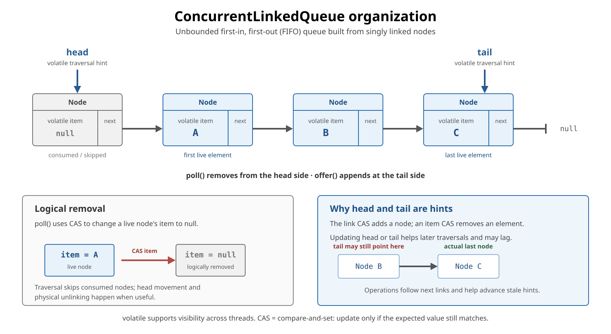
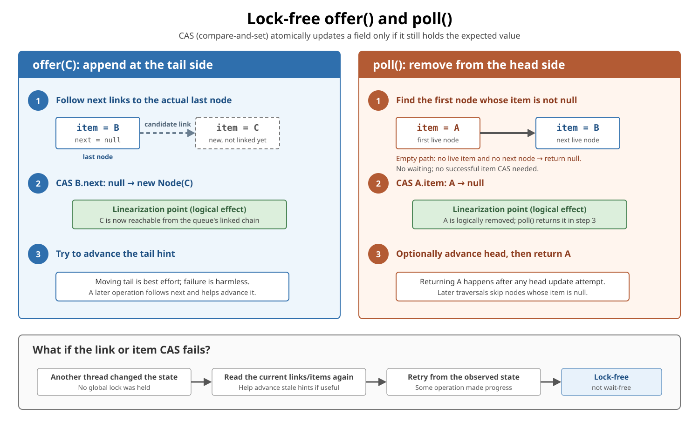

# Concurrency. ConcurrentLinkedQueue

<sub>[Back to Java](../Readme.md#content)</sub>

**Java 5 introduced `ConcurrentLinkedQueue`, an unbounded, thread-safe first-in, first-out (FIFO) queue.**

A print worker calls `poll()` to claim the oldest waiting job. If the queue is empty, the worker gets `null` and can do something else. Even with a million jobs waiting, claiming the next one usually takes only a few steps. Cancelling a particular job by name might require inspecting all million.

1. [Taking the next job](#1-taking-the-next-job)
2. [How concurrent offers and polls work](#2-how-concurrent-offers-and-polls-work)
3. [Time complexity of the main methods](#3-time-complexity-of-the-main-methods)
4. [Checking, claiming, and iterating](#4-checking-claiming-and-iterating)
5. [What a worker sees after a handoff](#5-what-a-worker-sees-after-a-handoff)
6. [Choosing a queue for a worker](#6-choosing-a-queue-for-a-worker)

## 1. Taking the next job

A **producer** adds a job at the back, or **tail**. The print worker is the **consumer**. It removes the oldest waiting job from the front, or **head**. Try predicting each output before reading the comment.

```java
import java.util.concurrent.ConcurrentLinkedQueue;

class PrintQueue {
    public static void main(String[] args) {
        var jobs = new ConcurrentLinkedQueue<String>();
        jobs.offer("A");
        jobs.offer("B");
        System.out.println(jobs.peek()); // A (still queued)
        System.out.println(jobs.poll()); // A
        System.out.println(jobs.poll()); // B
        System.out.println(jobs.poll()); // null
    }
}
```

`poll()` returns `null` when it finds the queue empty. That result does not mean the producers have finished. A worker that stops on the first `null` can miss a job offered a moment later. Storing `null` would make the result ambiguous, so `offer(null)` throws `NullPointerException`. Because the queue is **unbounded**, there is no capacity limit that makes `offer(job)` or `add(job)` return `false`. Both return `true` for a non-null job.

### Queue properties at a glance

| Property | What to remember |
|---|---|
| Order | FIFO. The next successful poll claims the oldest waiting job. |
| Capacity | Unbounded. A growing backlog consumes heap space. |
| Empty retrieval | `poll()` and `peek()` return `null` without waiting for a producer. |
| Null elements | Inserting `null` throws `NullPointerException`. |
| Progress | Non-blocking. Operations can finish even if another worker pauses. |
| Iterator | Weakly consistent. A walk can see concurrent changes and leaves the jobs available to workers. |
| `size()` | Counts waiting jobs by traversing the queue. Concurrent changes can make the count inaccurate. |

## 2. How concurrent offers and polls work

The Java API promises FIFO retrieval. The diagrams show how OpenJDK 26 implements it. The node fields and traversal hints are internal details that can change across implementations.

Each **node** holds a job reference in `item` and a link to the next node in `next`. The internal `head` and `tail` references are **traversal hints** that tell a thread where to start looking. In the diagram, `head` points to the node labeled “consumed / skipped”. Follow its `next` arrow to A, the oldest **live** job. C is the last node because its `next` link is empty.



### Claiming a job with compare-and-set

The four fields `item`, `next`, `head`, and `tail` are `volatile`. A volatile write is visible to a subsequent volatile read of that field. A separate check and update are still two steps. Two workers can both read A before either clears it. To claim A, each uses **compare-and-set (CAS)**, which checks and changes the field in one indivisible operation. CAS compares reference identity (`==`), so it requires the very same object. A value search such as `remove(x)` calls `equals()` and can match a different, equal object.

Only one worker can change A’s `item` to `null`. This is **logical removal**, shown in the panel of that name. A is out of the queue immediately, even if its node stays linked. The other worker can skip that node and claim B. If it reaches the end without finding a live job, it returns `null`.

### Why the head and tail hints can lag

Look at **“Why head and tail are hints”** in the same diagram. Letting `head` and `tail` lag saves CAS operations on these shared references. Every live job remains reachable from `head`. A worker starting at a cleared node follows the links to the first live job. Likewise, if `tail` still points to B after C has been linked, a producer can follow B’s link to C.

### When an offer or poll takes effect

Read steps 1–3 down each panel of the next diagram. In **“offer(C): append at the tail side”**, the producer finds B, links C, then may advance `tail`. In **“poll(): remove from the head side”**, the worker finds A, clears its `item`, then may advance `head` before returning A. Step 2 in each panel is the **linearization point**, the instant the successful insertion or removal takes effect. Finish with the bottom panel, **“What if the link or item CAS fails?”** Another thread won that race, so the caller reads the current state and tries again.



If `offer(A)` finishes before `offer(B)` begins, job A goes first. If the calls overlap, the first job linked gets the earlier place. Even when A is claimed first, B can finish printing first if the worker holding A pauses.

### Progress guarantees

The Java API describes the queue algorithm as **non-blocking**, the term the Michael–Scott paper uses for system-wide progress. In modern terminology, `offer(e)` and `poll()` are **lock-free** members of the non-blocking family. They use no queue lock. As long as callers keep taking steps, some call finishes, even if one worker repeatedly loses a CAS race. A **wait-free** algorithm would also bound each caller’s own steps. Neither guarantee sets a wall-clock deadline. The scheduler can pause a worker, and garbage collection can pause the application. For a diagram showing why every wait-free algorithm is also lock-free, see [How the progress guarantees relate](../Concurrency.%20Progress%20Guarantees/Readme.md#how-the-guarantees-relate).

## 3. Time complexity of the main methods

The Java API explicitly documents an O(n) traversal for `size()` and warns that concurrent changes can make the result inaccurate. The other time estimates below describe the OpenJDK 26 implementation. For example, the API specifies what `poll()` returns, while its usual O(1) cost follows from where that implementation starts looking.

Ask **how many links the method must follow**. Here *n* counts reachable nodes on an otherwise quiet queue, including nodes whose items have been cleared. O(1) means work bounded independently of queue length. O(n) means work growing at most linearly with *n*.

| Method | Time | Why |
|---|---|---|
| `offer(e)`, `add(e)` | Usually O(1) | Start at the tail hint, find the final link, and attach one new node. A lagging hint can require extra hops. |
| `poll()`, `remove()` | Usually O(1) | Start at the head hint, skip cleared items, and claim the first live one. A long run of cleared nodes at the front can take O(n) to cross. On empty, `poll()` returns `null` and `remove()` throws `NoSuchElementException`. |
| `peek()`, `element()`, `isEmpty()` | Usually O(1) | Skip cleared nodes and stop at the first live item or the end. On empty, `peek()` returns `null`, `element()` throws `NoSuchElementException`, and `isEmpty()` returns `true` without counting the queue. |
| `size()` | O(n) | Walk the chain and count live items. The queue keeps no running count. |
| `contains(x)`, `remove(x)` | Up to O(n) with constant-time equality | Compare live items using `x.equals(item)` until a match or the end. A match at the front can be cheap. `remove(x)` also claims one match. For expensive comparisons, add their total cost to the walk. |
| Full iteration, `forEach(action)`, `toArray()` | O(n) for the traversal | Follow the links and skip cleared items. Add any work the loop body or action does. The array needs one result slot per copied reference. |
| `addAll(batch)` | Usually O(m) for *m* incoming items | Build a chain from the input, then link it at the tail. This assumes a linear pass over the input and a nearby tail hint. |

The usual O(1) rows describe a short path at either end. Crossing *k* extra links costs O(k + 1) even without competition. Concurrent changes can also force retries or restarts. The starting queue size alone cannot bound the work of a competing caller.

A worker calling `remove()` can usually claim the first of a million jobs in a few steps. `remove("missing")` must check every waiting job on a stable queue. Even draining the queue can get expensive if a lone worker checks `size()` before every `poll()`. With four jobs it counts 4 + 3 + 2 + 1 live items. For an initial backlog of *j* jobs, counting alone takes quadratic time, O(j²).

## 4. Checking, claiming, and iterating

### The check-then-act race

Suppose each print job is a `Runnable`, and calling its `run()` method prints it. This worker fragment contains a **check-then-act race**. The queue can change between the check and the action.

```java
if (!jobs.isEmpty()) {
    jobs.poll().run(); // poll() can return null here
}
```

Start with just job A in the queue.

| Order | Worker 1 | Worker 2 | Queue afterward |
|---|---|---|---|
| 1 | `isEmpty()` returns `false`. | | A |
| 2 | | `poll()` claims A. | Empty |
| 3 | `poll()` returns `null`. Calling `run()` on it throws `NullPointerException`. | | Empty |

Each queue call is thread-safe. The first call reserves nothing for the next one. Checking `peek()` first has the same race. To fix the worker, claim once and test the reference that **this call** returned.

```java
Runnable job = jobs.poll();
if (job != null) {
    job.run();
}
```

For another example of this race, where two callers try to reserve the same seat, see [Check-Then-Act in Java](../Concurrency.%20Check-Then-Act/Readme.md).

### Why iterating can print a job twice

An iterator is **weakly consistent**. It can run while the queue changes and visits continuously present entries once in FIFO order. It may also reflect some changes, without throwing `ConcurrentModificationException`. Iteration is useful for a status screen. If a worker instead executes `for (Runnable job : jobs) { job.run(); }`, printing A leaves A queued. A second worker can then poll A and print the same job again. Workers that execute jobs should claim them with `poll()`.

### Snapshots and bulk operations

`toArray()` can collect references seen at different instants. For an exact copy of queue membership, coordinate the copy with every thread that can change the queue. Even then, the array holds references to the same jobs. A mutable job’s fields can still change after the copy. Bulk operations such as `addAll` and `removeIf` have no general API guarantee that an observer sees the whole change at once.

## 5. What a worker sees after a handoff

The main thread produces a job and sets its ordinary `int` field to `12` before offering it. The worker keeps polling until it claims the job. What value will it print?

```java
import java.util.concurrent.ConcurrentLinkedQueue;

class JobHandoff {
    static class Job {
        int pages;
    }

    public static void main(String[] args) throws InterruptedException {
        var jobs = new ConcurrentLinkedQueue<Job>();
        Thread worker = new Thread(() -> {
            Job job;
            while ((job = jobs.poll()) == null) {
                Thread.onSpinWait();
            }
            System.out.println(job.pages);
        });
        worker.start();
        Job job = new Job();
        job.pages = 12;
        jobs.offer(job);
        worker.join();
    }
}
```

The worker **prints `12`**. The queue provides **safe publication** of the job by making the producer’s earlier writes visible to the worker. The write to `pages` before `offer(job)` **happens-before** the worker’s read of `pages` after retrieving that job. A producer write of `13` after insertion could race with the worker’s read. Use immutable jobs or coordinate later updates separately.

`Thread.onSpinWait()` tells the runtime that the worker is busy-waiting. Spinning keeps this example short but consumes CPU time, so use `BlockingQueue.take()` for a worker that should sleep until its next job arrives. At the end of the example, `worker.join()` makes the main thread wait for the worker to finish.

## 6. Choosing a queue for a worker

Use `ConcurrentLinkedQueue` when workers have other things to do after an empty poll and the application can tolerate the backlog. Each waiting job occupies memory. If producers continually outpace the workers, the backlog can exhaust the heap. When the JVM can no longer allocate a queue node, it throws `OutOfMemoryError`.

If an idle worker should sleep until a job arrives, use a `BlockingQueue` and call `take()`. If it should wait only up to a deadline, `poll(timeout, unit)` returns `null` when that wait expires without a job.

If the application can buffer just 100 jobs, both `new ArrayBlockingQueue<>(100)` and `new LinkedBlockingQueue<>(100)` enforce that capacity during insertion. A separate `size() < 100` check on a `ConcurrentLinkedQueue` lets two producers see 99 and both insert. On either bounded queue, `put(job)` waits for space and `offer(job)` returns `false` when full. Slowing producers in response to limited capacity is **backpressure**. For a worked example of how quickly a 100-job queue fills, see [ArrayBlockingQueue vs LinkedBlockingQueue](../Concurrency.%20ArrayBlockingQueue%20vs%20LinkedBlockingQueue/Readme.md#capacity-is-an-application-decision).

If threads need to add and remove at both ends, `ConcurrentLinkedDeque` supplies those operations.

## Check your understanding

1. You offer A and B, peek twice, then poll three times. Which five values come back?

   <details>
   <summary>Answer</summary>

   A, A, A, B, and `null`. Looking leaves A in place. Each successful poll claims one occurrence. The empty result says only that no job was available at that instant.

   </details>

2. One producer starts offering job A. A second producer starts later and links job B first. Both workers see job B. Which job is ahead, and what happens to the worker that loses the race for it?

   <details>
   <summary>Answer</summary>

   B is ahead because its link took effect first. Only one worker can clear B’s item. The other looks for the next live job and can return `null` if it reaches the end. A worker can lose repeatedly while the queue as a whole makes progress.

   </details>

3. One worker keeps losing CAS races while other workers finish their calls. Is that possible in a lock-free queue? What extra guarantee would wait-free give?

   <details>
   <summary>Answer</summary>

   Yes. The successful workers demonstrate system-wide progress. Wait-free would guarantee that each worker that keeps taking steps finishes its own call within a bounded number of those steps.

   </details>

4. The queue grows from ten to a million jobs. Which of `peek()`, `size()`, and `remove("missing")` would you expect to slow down most? How does `remove()` differ?

   <details>
   <summary>Answer</summary>

   Counting and searching for an absent value each require a full pass. Peeking and removing the head usually touch a few nodes. Cleared nodes can add hops, and competing callers can force retries.

   </details>

5. A worker enters the branch in `if (!queue.isEmpty()) return queue.poll();`. How could that branch return `null`? How would you safely claim and run a job?

   <details>
   <summary>Answer</summary>

   Another worker can remove the last job between the check and the poll. This is a check-then-act race. Call `poll()` once, save its result, and run the returned job only if that reference is non-null.

   </details>

6. One worker prints jobs in a for-each loop. Another prints jobs by polling the same queue. Could a job submitted just once be printed twice?

   <details>
   <summary>Answer</summary>

   Yes. The loop can visit and print A while its queue entry is still live. The other worker can then claim A with `poll()` and print it again. Have both workers poll to claim each entry before printing.

   </details>

7. A status screen sees A and then B in one traversal. Must there have been an instant when both jobs were waiting together?

   <details>
   <summary>Answer</summary>

   No. Suppose A and X are waiting. The monitor observes A and pauses at X. A worker removes A. A producer appends B after X. The monitor can then reach B, even though A had already left. The same issue applies to an array copy.

   </details>

8. In the handoff example, could the worker print the default value `0`? What if the producer changes `pages` to `13` after offering the job?

   <details>
   <summary>Answer</summary>

   The worker prints `12` in the example. The queue publishes the write made before insertion. A later unsynchronized write has no such guarantee, so the worker cannot rely on seeing `13`.

   </details>

9. Two producers see 99 waiting jobs and each adds one. How can the application enforce a limit of 100 and also let an idle worker sleep?

   <details>
   <summary>Answer</summary>

   Use an `ArrayBlockingQueue` with capacity 100. Its insertion operation enforces the limit, so at most one of those two jobs fits before a removal. A producer can wait with `put()` or handle a failed `offer()`. An idle worker can wait with `take()`.

   </details>

# Sources

- [Java SE 26 — ConcurrentLinkedQueue contract and memory consistency](https://docs.oracle.com/en/java/javase/26/docs/api/java.base/java/util/concurrent/ConcurrentLinkedQueue.html)
- [Java SE 26 — Queue and the meaning of an empty poll](https://docs.oracle.com/en/java/javase/26/docs/api/java.base/java/util/Queue.html)
- [Java SE 26 — java.util.concurrent package and memory consistency](https://docs.oracle.com/en/java/javase/26/docs/api/java.base/java/util/concurrent/package-summary.html#MemoryVisibility)
- [OpenJDK 26 — ConcurrentLinkedQueue implementation at the release tag](https://raw.githubusercontent.com/openjdk/jdk/jdk-26-ga/src/java.base/share/classes/java/util/concurrent/ConcurrentLinkedQueue.java)
- [Java SE 26 — AbstractQueue and its exception-throwing methods](https://docs.oracle.com/en/java/javase/26/docs/api/java.base/java/util/AbstractQueue.html)
- [Java SE 26 — BlockingQueue waiting and timed operations](https://docs.oracle.com/en/java/javase/26/docs/api/java.base/java/util/concurrent/BlockingQueue.html)
- [Java SE 26 — ArrayBlockingQueue capacity and waiting operations](https://docs.oracle.com/en/java/javase/26/docs/api/java.base/java/util/concurrent/ArrayBlockingQueue.html)
- [Java SE 26 — LinkedBlockingQueue capacity](https://docs.oracle.com/en/java/javase/26/docs/api/java.base/java/util/concurrent/LinkedBlockingQueue.html)
- [Java SE 26 — ConcurrentLinkedDeque and access at both ends](https://docs.oracle.com/en/java/javase/26/docs/api/java.base/java/util/concurrent/ConcurrentLinkedDeque.html)
- [Java SE 26 — Thread.onSpinWait](https://docs.oracle.com/en/java/javase/26/docs/api/java.base/java/lang/Thread.html#onSpinWait())
- [Java SE 26 — OutOfMemoryError](https://docs.oracle.com/en/java/javase/26/docs/api/java.base/java/lang/OutOfMemoryError.html)
- [Michael and Scott — Simple, Fast, and Practical Non-Blocking and Blocking Concurrent Queue Algorithms (1996), §§1 and 3.3](https://www.cs.rochester.edu/~scott/papers/1996_PODC_queues.pdf)
- [Michael and Scott — non-blocking concurrent queue algorithm](https://www.cs.rochester.edu/research/synchronization/pseudocode/queues.html)
