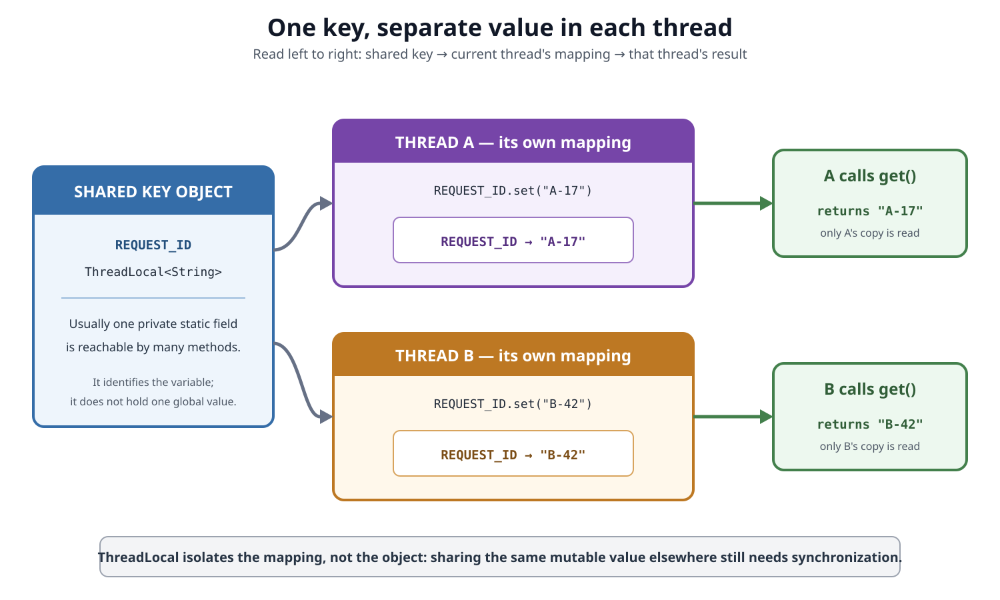
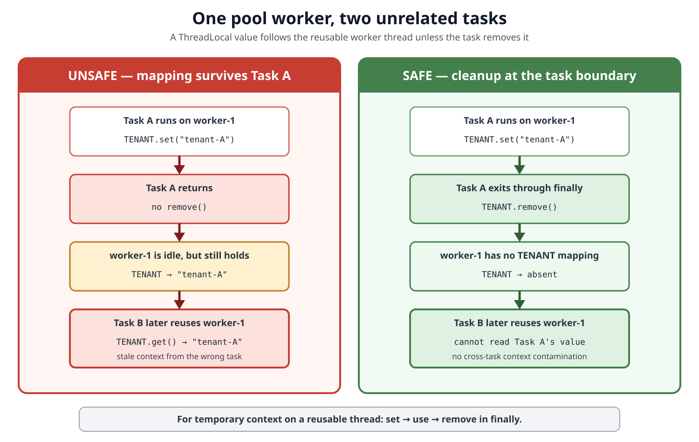
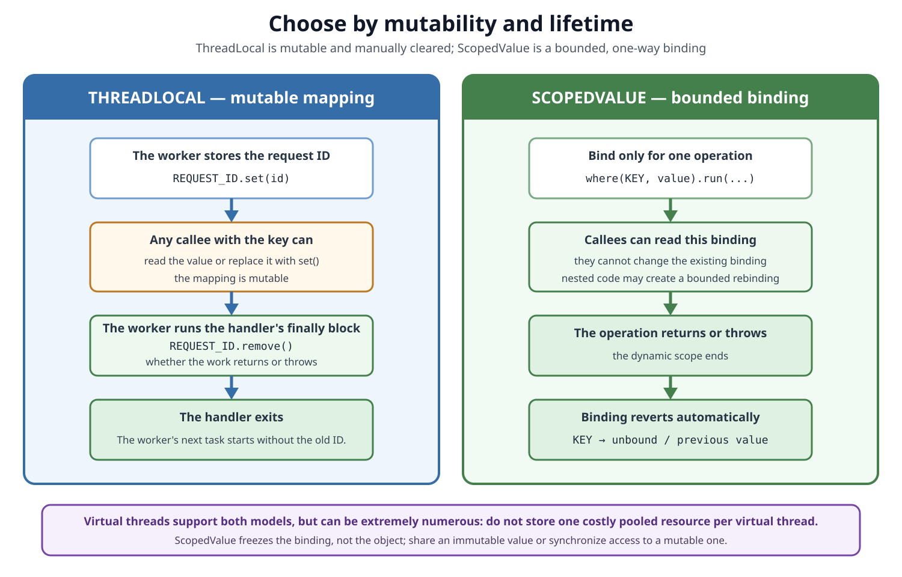

# Concurrency. ThreadLocal

<sub>[Back to Java](../Readme.md#content)</sub>

**`ThreadLocal` was introduced in Java 1.2.**

A `ThreadLocal` lets methods running on the **same Java thread** look up a value using a shared key. For example, a request handler can store a request ID and a logger several calls deeper can read it. Two threads can use the same logger and print different IDs. What happens when *one* thread handles both requests in turn?

1. [Who is calling get?](#1-who-is-calling-get)
2. [What does the first read return?](#2-what-does-the-first-read-return)
3. [What survives a request?](#3-what-survives-a-request)
4. [What keeps a value in memory?](#4-what-keeps-a-value-in-memory)
5. [What happens when work moves?](#5-what-happens-when-work-moves)
6. [Which tool fits the job?](#6-which-tool-fits-the-job)

## 1. Who is calling get?

A server keeps a `ThreadLocal<String>` in a `static final` field named `REQUEST_ID`. The field holds one **key**. Calling `REQUEST_ID.set(id)` creates or updates the calling thread's **entry**. It maps the shared key to that thread's ID. The diagram calls this a **mapping**. When the logger calls `REQUEST_ID.get()`, it reads the value in its thread's entry.

Thread A stores `"A-17"`. Thread B then stores `"B-42"`. What will A's logger read? Follow A's row across the diagram, then trace B's row.



A still reads `"A-17"`. Even if A removes its entry, B still reads `"B-42"`. Each lookup depends on **both the current thread and the key**.

The diagram's “copy” means each thread has its own place to store a reference. Java does not clone the object when you call `set()`. If both threads store the same mutable list, both can edit it. To keep changes private, give each thread a separate list. If threads must update one shared list, coordinate those updates.

## 2. What does the first read return?

What if the thread has no entry for this key? With `new ThreadLocal<String>()`, its first `get()` returns `null`. With `ThreadLocal.withInitial(() -> "no ID")`, it runs the supplied function, stores `"no ID"`, and returns it. This function is the **initializer**. It runs when a thread reads a missing entry.

Start on a fresh thread with the second key. Work down the first column and predict each read before looking at the result.

| Calls on this thread, in order | What the read returns and why |
|---|---|
| `set("A-17")`, then `get()` | `"A-17"`. The write created the entry before the first read, so the initializer never ran. |
| `set(null)`, then `get()` | `null`. The entry exists and holds that value. |
| `remove()`, then `get()` | `"no ID"`. The read finds no entry and runs the initializer. |
| `get()` again | `"no ID"`. The value from the previous read is still there. |

## 3. What survives a request?

A **task** is a piece of work, such as handling a request. A **worker** is a thread that runs tasks. Suppose a server gives one worker a customer request, then a health check with no request ID. The customer request finishes and leaves its ID on the worker. The health check logs that ID. The requests never even overlapped.

The diagram traces the same bug with a tenant name, which identifies a customer account. If the application uses that name to choose which account to update, task B could change tenant A's data. Follow task B on each side to see how task A's cleanup prevents that security failure.



This Java 21+ program sends both tasks to a single-worker executor. In `main`, each `submit(...).get()` waits for the submitted task to finish. In `log()`, `REQUEST_ID.get()` reads the worker's ID. Predict the two output lines, then predict what changes if you omit `remove()`.

```java
import java.util.concurrent.Executors;

class RequestLog {
    private static final ThreadLocal<String> REQUEST_ID =
            ThreadLocal.withInitial(() -> "no ID");

    static void handle(String id) {
        REQUEST_ID.set(id);
        try {
            log();
        } finally {
            REQUEST_ID.remove();
        }
    }

    static void log() {
        System.out.println(REQUEST_ID.get());
    }

    public static void main(String[] args) throws Exception {
        try (var executor = Executors.newSingleThreadExecutor()) {
            executor.submit(() -> handle("A-17")).get();
            executor.submit(RequestLog::log).get();
        }
    }
}
```

With cleanup, the program prints `A-17`, then `no ID`. Without cleanup, it prints `A-17` twice. The worker that set the ID runs the handler's `finally` block before it can pick up the next task, even if `log()` throws. Moving `remove()` into `main` would clear the submitting thread's entry and leave the worker's ID in place.

**What if a nested method changes the ID?** If the outer handler sets `"A-17"` and a nested operation sets `"audit"`, calling `remove()` in the nested operation loses the outer ID. The nested operation must restore the previous state. A plain `get()` cannot tell whether an entry was absent before the call, because it initializes a missing entry. Section 6 shows a way to get automatic restoration.

## 4. What keeps a value in memory?

Suppose the value holds a whole request instead of just its ID. As long as the worker is alive and the key is reachable, the worker can retain the request and all the objects the request refers to. Calling `remove()` releases that reference. The objects can be collected when nothing else keeps them alive.

**How can a heap dump show a missing key beside a live value?** A heap dump is a snapshot of objects in memory and the references between them. In OpenJDK 25, a thread's internal table, `ThreadLocalMap`, holds each key **weakly**. That means the table alone cannot keep the key alive. The same entry holds its value **strongly**, which keeps the value alive.

A `static final` field keeps the key reachable while its class is in use, so a later task can still look up the old value. If the program instead abandons a temporary key, garbage collection can clear the key while its entry retains the value. Later table operations can clear stale entries, and a thread that terminates releases its thread-local state. The table layout and its cleanup timing are OpenJDK implementation details.

## 5. What happens when work moves?

| Where does the logger run? | Which ID can it read? |
|---|---|
| A helper on the same thread | The caller's ID, even several method calls deeper. |
| A newly created child thread | With ordinary `ThreadLocal`, the child gets its own initial value on first read. With `InheritableThreadLocal`, inheritance is on by default. If the parent has an entry **when the child is created**, the child inherits an initial value from it. Otherwise the child's first read initializes its own entry. |
| An existing pool worker | The worker reads its own entry. Submitting another task leaves that entry alone. A `CompletableFuture` stage running on another thread also reads that thread's entry. |
| The same virtual thread after it resumes | Its own entry, even if the underlying platform thread, called a **carrier**, has changed. |

**What gets inherited?** The default `InheritableThreadLocal.childValue(parentValue)` returns the parent's reference, so a parent and child can still share one mutable object. Override `childValue` to give the child a different value. To turn off inheritance for a new thread, set `inheritInheritableThreadLocals(false)` on its builder, for example `Thread.ofPlatform().inheritInheritableThreadLocals(false)`.

**Why can inheritance seem to work for just the first request?** Submit a task that reads the ID to a fresh `Executors.newFixedThreadPool(1)`. The default thread factory creates the worker during that first submission. If the submitting thread's inheritable ID is `"req-1"`, the new worker inherits it. Change the submitter's ID to `"req-2"` and submit a second read. The same worker still reads `"req-1"`. Pass the ID into each task when it needs the current request's value.

**What does a thread-local cache cost?** Virtual threads became final in JDK 21 with JEP 444. Suppose the function passed to `ThreadLocal.withInitial(...)` opens a database connection. A pooled worker opens one on its first `get()` and reuses it across tasks while it keeps the entry. A virtual-thread-per-task executor gives each task a fresh thread. Every task that calls `get()` therefore opens its own connection on first use. Enough tasks doing this at once can exhaust the database's connection limit. Borrow and return connections through a bounded connection pool. For a service that limits simultaneous calls, a `Semaphore` can cap access.

When migrating a worker pool, the JDK option `-Djdk.traceVirtualThreadLocals=true` prints a stack trace when a virtual thread sets a thread-local value.

## 6. Which tool fits the job?

Pass the ID **as a parameter** when only a few methods need it. A call like `log(id)` makes the dependency visible. Use **ThreadLocal** when a library already expects thread-local context or when a thread genuinely owns mutable state. For example, `ThreadLocal.withInitial(ArrayList::new)` gives a pooled worker a scratch list on its first read. The next task on that worker gets the same list, including any elements the previous task left behind. Calling `clear()` on the list in `finally` empties it for reuse. Calling `remove()` on the key makes the next `get()` create a fresh list. If only one task needs the list, it can keep it in a local variable.

**Scoped Values** became final in JDK 25 with JEP 506. Scoped values enable developers to **store and share immutable data within and across threads**. Use a `ScopedValue` when methods in several classes need to read the same ID while handling a request. It reduces boilerplate because intermediate methods can call one another without passing the ID as an argument.

With a `ThreadLocal`, any method with the key can call `set()` and overwrite the ID its caller will read. A `ScopedValue` has no `set()` method. A callee can read the ID or bind a different ID for a nested call. Follow both columns in the diagram to see who can change the ID and what happens when the call returns or throws.



In this JDK 25 example, the inner call temporarily gives the logger a different ID. What does the second line print?

```java
class ScopedLog {
    private static final ScopedValue<String> ID = ScopedValue.newInstance();

    public static void main(String[] args) {
        ScopedValue.where(ID, "A-17").run(() -> {
            ScopedValue.where(ID, "audit").run(ScopedLog::log);
            log();
        });
    }

    static void log() {
        System.out.println(ID.get());
    }
}
```

The inner call prints `audit`. Once it returns, the outer call prints `A-17`. When the outer call finishes, the key is unbound again. A binding fixes which object a reader gets. If that object is mutable and shared, its contents still need a thread-safe access pattern.

## Check your understanding

1. In a short interview answer, explain how a single static field lets two requests log different IDs and when that design needs cleanup.

   <details>
   <summary>Answer</summary>

   The field holds one `ThreadLocal` key. Each thread stores its own ID under that key, so a logger on the same thread can read it. If the server reuses a worker, I remove the ID on that worker in the request handler's `finally` block.

   </details>

2. A key's initializer returns a fresh list. You call `set(null)` before your first `get()`. When would you actually receive a new list?

   <details>
   <summary>Answer</summary>

   The first read returns the stored `null`. Remove the entry and read again to run the initializer and receive a fresh list.

   </details>

3. A worker writes an ID and then the handler throws. A coworker suggests clearing the ID from the thread waiting for the result. Which thread needs to do it, and where?

   <details>
   <summary>Answer</summary>

   The worker that set the ID must clear its own entry in a `finally` block around the request work. The waiting thread can only clear its own entry.

   </details>

4. A heap dump shows a live worker with a thread-local entry whose key is `null` and whose value is a large buffer. How can both be true?

   <details>
   <summary>Answer</summary>

   In OpenJDK 25 the entry holds its key weakly and its value strongly. The collector could clear an abandoned key while the worker's table still retains the buffer.

   </details>

5. A parent sets an inheritable ID to `"A"`, creates a child, then changes its own ID to `"B"` before starting the child. Which ID does the child read? What if the parent submits the ID-reading task to an existing worker?

   <details>
   <summary>Answer</summary>

   With the default inheritance settings, the child received `"A"` at creation. An existing worker keeps whatever value it already had, which depends on when it was created and what ran on it. To deliver `"B"` to the task, pass it explicitly.

   </details>

6. A virtual thread resumes on another carrier. What happens to its thread-local ID? Suppose four tasks each call `get()` twice on a `ThreadLocal` whose initializer opens a connection. How many connections open on one fresh pooled worker? How many with a fresh virtual thread per task? Assume no task removes the entry.

   <details>
   <summary>Answer</summary>

   The virtual thread keeps its ID across the carrier change. The pooled worker opens **one** connection and reuses it for all four tasks. The virtual threads open **four** connections, one on each thread's first read. Each second read reuses that thread's connection.

   </details>

7. In `ScopedLog`, the logger calls `ID.get()` on the `ScopedValue<String>` key `ID`, currently bound to `"A-17"`. How can an audit call log `"audit"` and still let the outer handler log `"A-17"` if the audit throws?

   <details>
   <summary>Answer</summary>

   Run the audit inside `ScopedValue.where(ID, "audit").run(...)`. Catch the exception outside that nested call while still inside the outer binding. By the time the catch block calls `log()`, the nested call has ended and `ID.get()` reads `"A-17"` again.

   </details>

8. A submitter's `InheritableThreadLocal<String>` holds `"boot"` when it creates `Executors.newFixedThreadPool(1)` with the default thread factory. It sets `"req-1"`, submits a read and waits. Then it sets `"req-2"` and submits a second read. Which two IDs do the tasks see? What changes if the submitter first sends an empty warm-up task to that pool while its ID is still `"boot"`?

   <details>
   <summary>Answer</summary>

   With a fresh pool, both reads return `"req-1"`. Creating the pool leaves it without a worker. The first submission creates the worker while the submitter holds `"req-1"`. With the warm-up, both reads return `"boot"` because that earlier submission created the worker. In both cases, later submissions reuse the worker's existing entry.

   </details>

9. On a fresh worker, task A adds `"draft"` to `SCRATCH.get()`. The key was created with `ThreadLocal.withInitial(ArrayList::new)`. Task B later calls `SCRATCH.get()` on that worker. Which list and contents does B see if A leaves the list alone, calls `SCRATCH.get().clear()` in `finally`, or calls `SCRATCH.remove()` there?

   <details>
   <summary>Answer</summary>

   - **Leave it alone.** B gets the same list containing `"draft"`.
   - **Clear the list.** B gets the same list, now empty. The worker's entry still points to it.
   - **Remove the entry.** B gets a new empty list. Its first read runs `ArrayList::new` again.

   </details>

# Sources

- [Oracle Java SE 26 · ThreadLocal API](https://docs.oracle.com/en/java/javase/26/docs/api/java.base/java/lang/ThreadLocal.html)
- [Oracle Java SE 25 · ArrayList.clear()](https://docs.oracle.com/en/java/javase/25/docs/api/java.base/java/util/ArrayList.html#clear())
- [Oracle Java SE 26 · Thread-local variables and thread pools](https://docs.oracle.com/en/java/javase/26/core/thread-local-variables.html)
- [Oracle Java SE 25 · Single-worker executors](https://docs.oracle.com/en/java/javase/25/docs/api/java.base/java/util/concurrent/Executors.html#newSingleThreadExecutor())
- [Oracle Java SE 25 · ThreadPoolExecutor worker creation](https://docs.oracle.com/en/java/javase/25/docs/api/java.base/java/util/concurrent/ThreadPoolExecutor.html)
- [OpenJDK 25 · ThreadLocalMap entries and cleanup](https://github.com/openjdk/jdk/blob/jdk-25%2B36/src/java.base/share/classes/java/lang/ThreadLocal.java#L348-L376)
- [Oracle Java SE 26 · InheritableThreadLocal API](https://docs.oracle.com/en/java/javase/26/docs/api/java.base/java/lang/InheritableThreadLocal.html)
- [Oracle Java SE 25 · Thread builder inheritance settings](https://docs.oracle.com/en/java/javase/25/docs/api/java.base/java/lang/Thread.Builder.html#inheritInheritableThreadLocals(boolean))
- [OpenJDK · JEP 444, Virtual Threads](https://openjdk.org/jeps/444)
- [Oracle Java SE 25 · Virtual threads and per-thread resources](https://docs.oracle.com/en/java/javase/25/core/virtual-threads.html)
- [OpenJDK · JEP 506, Scoped Values](https://openjdk.org/jeps/506)
- [Oracle Java SE 25 · ScopedValue API](https://docs.oracle.com/en/java/javase/25/docs/api/java.base/java/lang/ScopedValue.html)
