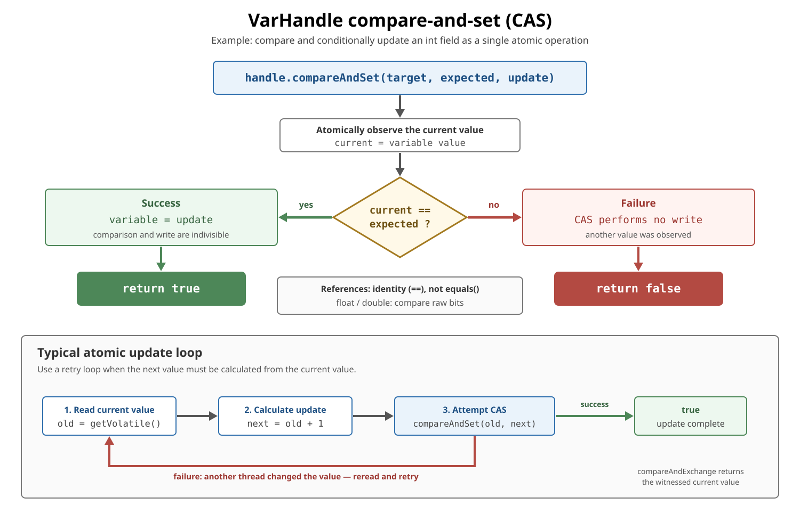
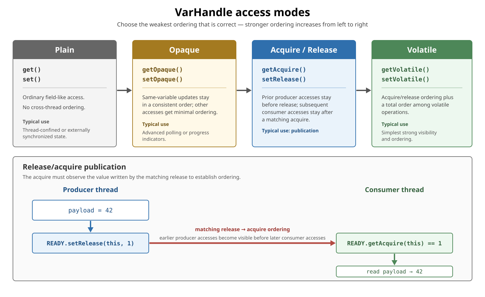

# Concurrency. VarHandle

<sub>[Back to Java](../Readme.md#content)</sub>

**Variable Handles (`VarHandle`) were introduced in JDK 9 with JEP 193.**

**A `VarHandle` is a typed reference to a variable**, such as an instance field, static field, or array element. An **access mode** specifies how a read, write, or update behaves.

- The **variable type** is the stored type, such as `int`.
- **Coordinate types** describe the arguments that locate a variable. Pass the object for an instance field, the array and index for an element, and no coordinates for a static field.

The goal of VarHandle is to define a standard for invoking equivalents of `java.util.concurrent.atomic` and `sun.misc.Unsafe` operations on fields and array elements.

1. [What a handle identifies](#1-what-a-handle-identifies)
2. [How to enforce a limit](#2-how-to-enforce-a-limit)
3. [How a ready flag publishes data](#3-how-a-ready-flag-publishes-data)
4. [When to use a VarHandle](#4-when-to-use-a-varhandle)
5. [Check your understanding](#5-check-your-understanding)

## 1. What a handle identifies

Each `Counter` has its own `int value`. All threads can share the immutable `static final` handle `VALUE`. Its `getAndAdd(this, 1)` adds 1 to **this counter** and returns its old value.

```java
import java.lang.invoke.MethodHandles;
import java.lang.invoke.VarHandle;

final class Counter {
    private int value;
    private static final VarHandle VALUE;

    static {
        try {
            VALUE = MethodHandles.lookup().findVarHandle(
                    Counter.class, "value", int.class);
        } catch (ReflectiveOperationException e) {
            throw new ExceptionInInitializerError(e);
        }
    }

    int incrementAndGet() {
        int previous = (int) VALUE.getAndAdd(this, 1);
        return previous + 1;
    }
}
```

The lookup checks field access once. The cast `(int)` gives the result type. `javac` accepts `1L`, but passing a `long` to this `int` handle throws `WrongMethodTypeException` at run time.

For array elements, `MethodHandles.arrayElementVarHandle(int[].class)` works on any `int[]`.

Use `findStaticVarHandle` for static fields. Here `findVarHandle` on a static field would throw `IllegalAccessException`, wrapped by the initializer in `ExceptionInInitializerError`.

## 2. How to enforce a limit

With 7 reservations and a limit of 8, both threads see a free place. **`getAndAdd` adds unconditionally**, so two calls take the count to 9. **Compare-and-set (CAS)** checks for an expected value and writes only on a match, in one atomic step.

Both call `VALUE.compareAndSet(this, 7, 8)` on the same counter. The diagram's `target` is `this`, the object coordinate. One call writes 8 and returns `true`. The other finds 8, writes nothing, and returns `false`.



`Counter.tryReserve` adds a limit check after the diagram's step 1, the read. If the counter is full, it returns `false`.

```java
boolean tryReserve(int limit) {
    while (true) {
        int current = (int) VALUE.getVolatile(this);
        if (current >= limit) {
            return false;
        }
        if (VALUE.compareAndSet(this, current, current + 1)) {
            return true;
        }
    }
}
```

`getVolatile` and CAS use volatile reads. A successful CAS also uses a volatile write. See [section 3](#3-how-a-ready-flag-publishes-data).

`compareAndExchange` makes the same update and returns the **witnessed value** it read. Here the winner gets 7 and the other caller gets 8.

For references, CAS checks whether the current and expected values refer to the same object. For `float` and `double`, it compares raw bits, so `+0.0` and `-0.0` differ.

## 3. How a ready flag publishes data

Give both threads the same `Publication` before starting them. Follow the lower half of the diagram. The **producer** writes 42 to `payload`, then sets `ready` to 1 once (release). If the **consumer** reads that 1 (acquire), it must see 42 in `payload`. A 0 means it can retry.



```java
import java.lang.invoke.MethodHandles;
import java.lang.invoke.VarHandle;

final class Publication {
    private int payload;
    private int ready;  // starts at 0
    private static final VarHandle READY;

    static {
        try {
            READY = MethodHandles.lookup().findVarHandle(
                    Publication.class, "ready", int.class);
        } catch (ReflectiveOperationException e) {
            throw new ExceptionInInitializerError(e);
        }
    }

    void publish() {
        payload = 42;
        READY.setRelease(this, 1);
    }

    int tryRead() {
        if ((int) READY.getAcquire(this) == 1) {
            return payload;
        }
        return -1;  // not ready yet
    }
}
```

The diagram's top row compares four **access modes**.

- **Plain** (`get` / `set`) adds no cross-thread ordering.
- **Opaque** (`getOpaque` / `setOpaque`) orders updates to the flag alone.
- **Acquire/release** makes the payload visible when the consumer sees the producer's release.
- **Volatile** also places all volatile operations in a single order.

The handle method sets the ordering. Even on a `volatile` field, `get` is plain. On an ordinary field, `getVolatile` is volatile.

## 4. When to use a VarHandle

| Need | Tool |
|---|---|
| A shared flag | Declare the field `volatile`. |
| A standalone counter | `AtomicInteger.incrementAndGet()` |
| Atomic or ordered access to an existing field or array element | Use a `VarHandle`. Writing through a handle to a `final` field throws `UnsupportedOperationException`. |
| One change spanning several fields | Use the same `synchronized` lock for updates and reads. |

Using a `VarHandle` gives no automatic speed advantage over `AtomicInteger` or `synchronized`.

The last example uses the **existing field** approach. One shared handle updates each object's `int refCount`. A separate `AtomicInteger` per object would take space and add a reference to follow.

### Where libraries use VarHandle

| Where | Operation and target | Purpose |
|---|---|---|
| OpenJDK · `ConcurrentLinkedQueue.offer` | `compareAndSet` on a node's `next` link | Append only if the link is empty. When two producers race, one links its item and the other retries. |
| OpenJDK · `CompletableFuture.completeValue` | `compareAndSet` on `result` | Fill the result only while it is `null`. Only one competing completion wins. |
| OpenJDK · `AtomicReferenceArray` | `arrayElementVarHandle(Object[].class)`, the factory from §1 | `getAndSet` uses this handle to replace one element and return its old reference atomically. |
| LMAX Disruptor · event-processing library | `setRelease` and `getAcquire` on a slot's availability flag | Publish an event in a ring buffer, an array whose slots are reused. A consumer that sees the matching flag can read the event written there. |
| Elasticsearch · `AbstractRefCounted.decRef` | `getAndAdd(this, -1)` on `refCount` | Release a reference. The caller that gets back 1 reduced the count to 0 and closes the resource. |

## 5. Check your understanding

1. Two counters share the same `VALUE` handle. Which one gets incremented?

   <details>
   <summary>Answer</summary>

   The object passed as the coordinate. Inside `incrementAndGet()`, that is `this`.

   </details>

2. Two callers see 7 reservations. Why does only one `tryReserve(8)` succeed?

   <details>
   <summary>Answer</summary>

   Only one CAS changes 7 to 8. The other caller rereads 8 and stops at the limit.

   </details>

3. If `getOpaque` reads 1, must the consumer see 42 in `payload`?

   <details>
   <summary>Answer</summary>

   No. Opaque ordering covers only the flag. An acquire read that sees the release of 1 also makes `payload` visible.

   </details>

4. Why use one lock for both the debit and the credit in a transfer?

   <details>
   <summary>Answer</summary>

   Each update affects one balance. Readers using the same lock see the whole transfer.

   </details>

# Sources

- [OpenJDK — JEP 193, Variable Handles](https://openjdk.org/jeps/193)
- [Java SE 25 — VarHandle access modes](https://docs.oracle.com/en/java/javase/25/docs/api/java.base/java/lang/invoke/VarHandle.html)
- [Java SE 25 — MethodHandles.Lookup.findVarHandle](https://docs.oracle.com/en/java/javase/25/docs/api/java.base/java/lang/invoke/MethodHandles.Lookup.html#findVarHandle(java.lang.Class,java.lang.String,java.lang.Class))
- [Java SE 25 — MethodHandles.arrayElementVarHandle](https://docs.oracle.com/en/java/javase/25/docs/api/java.base/java/lang/invoke/MethodHandles.html#arrayElementVarHandle(java.lang.Class))
- [Java Language Specification §17.1 — Synchronization](https://docs.oracle.com/javase/specs/jls/se25/html/jls-17.html#jls-17.1)
- OpenJDK 25.0.4.1 — [ConcurrentLinkedQueue.offer](https://github.com/openjdk/jdk25u/blob/jdk-25.0.4.1-ga/src/java.base/share/classes/java/util/concurrent/ConcurrentLinkedQueue.java#L361), [CompletableFuture.completeValue](https://github.com/openjdk/jdk25u/blob/jdk-25.0.4.1-ga/src/java.base/share/classes/java/util/concurrent/CompletableFuture.java#L305), [AtomicReferenceArray.getAndSet](https://github.com/openjdk/jdk25u/blob/jdk-25.0.4.1-ga/src/java.base/share/classes/java/util/concurrent/atomic/AtomicReferenceArray.java#L140)
- [LMAX Disruptor 4.0.0 — MultiProducerSequencer](https://github.com/LMAX-Exchange/disruptor/blob/4.0.0/src/main/java/com/lmax/disruptor/MultiProducerSequencer.java)
- [Elasticsearch 9.5.3 — AbstractRefCounted.decRef](https://github.com/elastic/elasticsearch/blob/v9.5.3/libs/core/src/main/java/org/elasticsearch/core/AbstractRefCounted.java#L71)
