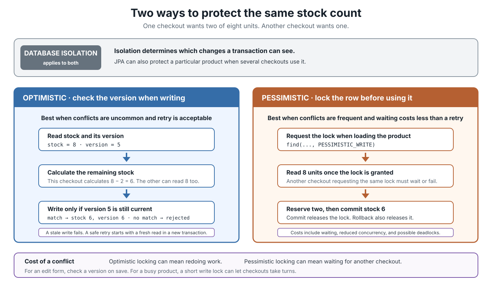
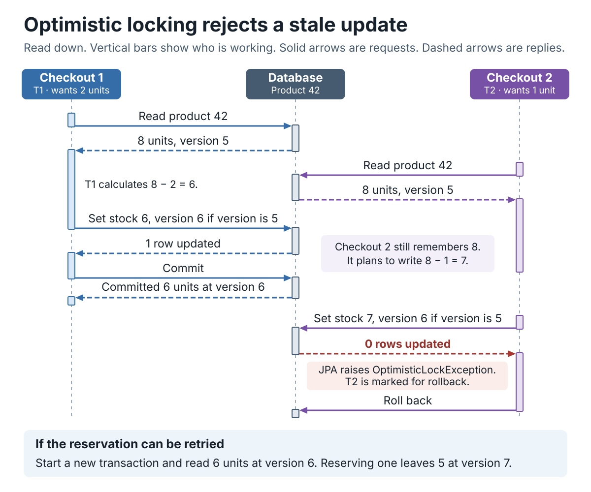
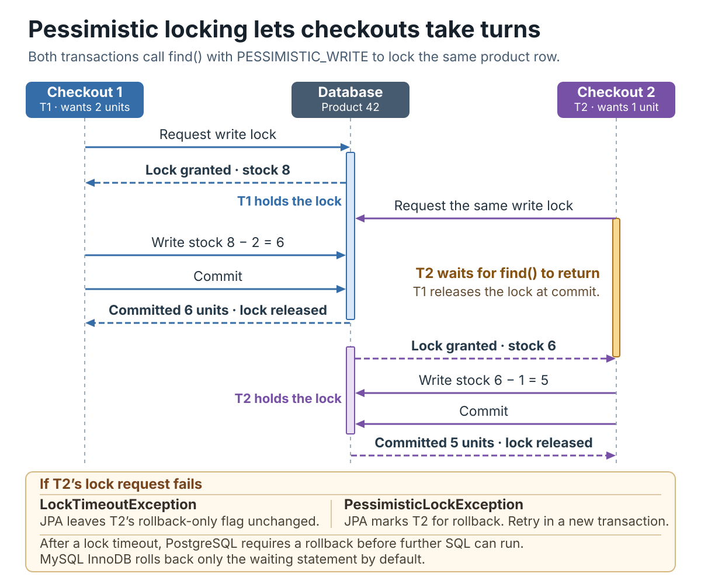
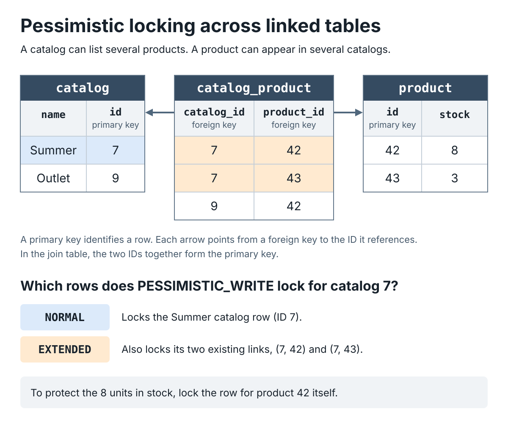

# JPA. Locking

<sub>[Back to Java](../Readme.md#content)</sub>

Jakarta Persistence (originally the Java Persistence API, or JPA) offers two ways to protect the stock count.

* **Optimistic locking** lets both checkouts calculate a new count and rejects a write based on an old version.
* **Pessimistic locking** lets a checkout acquire a database lock before it checks stock, so a competing checkout must wait or handle a failed lock request.

Let's see what happens without either of them and why locking could be necessary.

1. [How a sale gets lost](#1-how-a-sale-gets-lost)
2. [Detecting a stale update with a version](#2-detecting-a-stale-update-with-a-version)
3. [Locking the product before checking stock](#3-locking-the-product-before-checking-stock)
4. [Choosing a lock mode](#4-choosing-a-lock-mode)
5. [Handling a conflict or timeout](#5-handling-a-conflict-or-timeout)
6. [Which rows a pessimistic lock covers](#6-which-rows-a-pessimistic-lock-covers)
7. [Alternatives to JPA entity locking](#7-alternatives-to-jpa-entity-locking)

## 1. How a sale gets lost

A **transaction** groups database operations so they commit together or roll back together. Each checkout runs in its own transaction and loads its own `Product` object for the same database row. JPA calls this object an **entity**. An `EntityManager` tracks the objects it loads. While it tracks an object, that object is **managed**. The **provider**, such as Hibernate, implements JPA and sends the changes to the database.

Suppose each checkout writes the count it calculated. The database allows the second write and neither checkout checks whether the row has changed.

| Event | First checkout (T1) | Second checkout (T2) | Committed stock |
|---|---|---|---|
| Both read | Reads 8 | Reads 8 | 8 |
| First sale | Reserves 2 and commits `8 − 2 = 6` | Still remembers 8 | 6 |
| Second sale | | Reserves 1 and commits `8 − 1 = 7` | **7** |

The second checkout overwrote the first sale’s stock change. This is a **lost update**. Database **isolation** governs what concurrent transactions can see and which operations can succeed. At the **read-committed** level, a new query can see another checkout’s committed changes. An object already loaded into memory can still hold the old value. The diagram shows where each JPA strategy intervenes for one product. Follow the left side to see when a stale write is detected, or the right side to see when a competing writer has to wait.



## 2. Detecting a stale update with a version

The **stock** tells us how many units remain. The **version** tells us which revision of the product each checkout saw. With `@Version`, the provider checks that revision whenever it updates or deletes the entity. It advances the version on update.

Read the sequence from top to bottom. Both checkouts read **8 units at version 5**. T1 commits **6 units at version 6**. Follow T2’s write request next. It still expects version 5, so the database reports **zero rows updated**.



Here is one way a provider could write T2’s change in SQL. `id = 42` selects the product. `version = 5` requires it to be the same revision T2 read.

```sql
UPDATE product
SET stock = 7, version = 6
WHERE id = 42 AND version = 5;
```

**Zero rows match.** The database keeps T1’s stock count of 6. The provider raises `OptimisticLockException` and marks T2’s transaction for rollback. If the reservation is safe to retry, a new transaction can reload 6, check availability again, and reserve one to leave **5**. Reusing the old calculated value of 7 would lose T1’s sale again.

### How to enable the check

```java
import jakarta.persistence.Entity;
import jakarta.persistence.GeneratedValue;
import jakarta.persistence.Id;
import jakarta.persistence.Version;

@Entity
public class Product {
    @Id
    @GeneratedValue
    private Long id;

    private int stock;

    @Version
    private long version;

    public void reserve(int quantity) {
        if (quantity <= 0 || quantity > stock) {
            throw new IllegalArgumentException("Quantity must be positive and available");
        }
        stock -= quantity;
    }
}
```

Each checkout runs the following code in its own active transaction. Here `em` is its `EntityManager`, product `42` exists, and `quantity` is `2` for T1 or `1` for T2.

```java
Product product = em.find(Product.class, 42L);
product.reserve(quantity);
```

The `@Version` field is all the provider needs for this check when you change a managed product.

### When the check happens

`reserve()` changes the Java object. A **flush** sends pending changes to the database. A **commit** makes the transaction’s changes final. If you call `em.flush()` and the version check fails there, you can catch `OptimisticLockException` at that call. If the conflict first surfaces during a resource-local `EntityTransaction.commit()`, catch `RollbackException` and look for `OptimisticLockException` in its cause chain.

## 3. Locking the product before checking stock

`PESSIMISTIC_WRITE` works without a version column. In this example, `Product` has no `@Version` field. Each checkout requests a lock on the product row before reading its stock.

Run the same two checkouts again, starting with eight units. Each uses a fresh `EntityManager` and read-committed isolation.

```java
Product product = em.find(Product.class, 42L, LockModeType.PESSIMISTIC_WRITE);
product.reserve(quantity);
```

If T1 acquires the lock first, it can check stock and reserve two. While it holds the lock, T2 cannot acquire a conflicting lock or change or delete that row. **Commit or rollback releases the lock.** If T1 commits and T2’s waiting `find()` succeeds with the new count of 6, T2 can reserve one and commit 5. If T2’s lock request fails, it never reaches `reserve()` in this code. An ordinary reader may still see a previously committed value, depending on the database and isolation level.

Follow T2’s lock request down to its reply. T1 commits during that wait, so T2 reads **6 units** when it acquires the lock. A request that times out can fail while T1 still holds the lock. The panel at the bottom previews the two lock exceptions that [section 5](#5-handling-a-conflict-or-timeout) explains.



`em.lock(product, mode)` can also lock a product that is already managed. Suppose T2 reads 8 units and T1 then commits a change to 6. If T2 now requests a pessimistic lock on a **versioned** product, JPA must check the version. The stale copy causes an `OptimisticLockException`, which the provider may report at `lock()`, flush, or commit. Without a version, the lock can succeed while T2’s Java object still says 8.

Request the lock on the first read, or use `em.refresh(product, LockModeType.PESSIMISTIC_WRITE)` to reload and lock an already-managed product before deciding how many units to reserve.

For several products, `setLockMode()` requests a lock on each returned entity. This query orders the products by ID. On PostgreSQL, a single `SELECT … ORDER BY … FOR UPDATE` sorts before locking, so checkouts using the same order request these rows consistently.

```java
List<Product> products = em.createQuery(
        "select p from Product p where p.id in :ids order by p.id", Product.class)
    .setParameter("ids", ids)
    .setLockMode(LockModeType.PESSIMISTIC_WRITE)
    .getResultList();
```

## 4. Choosing a lock mode

Start with `@Version` when edits seldom collide or a person may leave a form open. Choose `PESSIMISTIC_WRITE` when checkouts frequently compete for the same product and waiting during a short transaction costs less than discarding work. Collect user input before taking a database lock. If a transaction needs several locks, acquiring them in a consistent order reduces the risk of a **deadlock**, where transactions each wait for a lock the other holds. The database breaks the cycle by aborting one transaction. That checkout receives a lock exception (section 5) and must start a new transaction if it retries.

Sometimes a transaction reads one entity but writes another. Suppose the versioned product from section 2 also has a price. A checkout reads that price and writes an order line. Since the checkout only reads the product, its ordinary `@Version` update check never runs for that product. Loading the product with `em.find(Product.class, 42L, LockModeType.OPTIMISTIC)` makes its revision part of the checkout’s commit decision. If another transaction commits a price change before the checkout completes, the checkout cannot also commit using that stale revision. A provider can detect the conflict late or take a lock earlier.

| Explicit mode | When to use it |
|---|---|
| `OPTIMISTIC` | Check that a versioned entity you only read is still current when your transaction commits. |
| `OPTIMISTIC_FORCE_INCREMENT` | Also advance its version. For example, when editing an order line, request this mode on the parent order so transactions checking the order’s old version detect the edit. |
| `PESSIMISTIC_READ` | Keep other transactions from changing the selected data while you read it. Compatible readers can share the lock if the database and provider support that. |
| `PESSIMISTIC_WRITE` | Acquire the lock before reading data you intend to change. Competing writers must take turns. |
| `PESSIMISTIC_FORCE_INCREMENT` | Acquire a write lock and advance the version even if no fields changed. A checkout using optimistic locking then detects the conflict when it checks its old version. A normal write to a versioned entity already advances its version. |

`READ` is an alias for `OPTIMISTIC`. `WRITE` is an alias for `OPTIMISTIC_FORCE_INCREMENT`. To request a pessimistic write lock, spell out `PESSIMISTIC_WRITE`. `NONE` requests no explicit lock. For portable JPA code, use a versioned entity with `OPTIMISTIC` and either `FORCE_INCREMENT` mode. `PESSIMISTIC_READ` and `PESSIMISTIC_WRITE` also work on unversioned entities.

### Edits that span requests

A **detached** entity is an object its `EntityManager` no longer tracks. Suppose an edit form was opened at version 5 and submitted after someone saved version 6. Keep the original revision with the edit, for example in the form, so the application can detect a conflict across the two requests. When `merge()` copies a detached entity’s state into a managed instance, the provider checks its version during `merge()`, at flush, or at commit. Simply loading the newest entity and copying old form values onto it discards the information about which revision the user saw.

### Mapping details

Use one version field or property per entity hierarchy, declared on the root entity or a mapped superclass and mapped to the entity’s primary table. Let the provider update it. Jakarta Persistence 3.2 supports `short`, `int`, `long`, their wrapper types, `java.sql.Timestamp`, `java.time.Instant`, and `java.time.LocalDateTime`. A bulk update query operates directly on the database and bypasses the automatic entity version check.

## 5. Handling a conflict or timeout

A pessimistic lock request can wait behind another transaction. With Jakarta Persistence 3.2, `Timeout.seconds(2)` asks the provider to wait up to two seconds to acquire the lock. The property form expresses the same request in milliseconds, using `Map.of("jakarta.persistence.lock.timeout", 2_000)` as the fourth argument to `find()`. Zero requests no waiting. Both forms are hints that the provider or database may ignore.

```java
Product product = em.find(Product.class, 42L,
    LockModeType.PESSIMISTIC_WRITE, Timeout.seconds(2));
```

| Exception | What failed | What happens to the transaction? |
|---|---|---|
| `OptimisticLockException` | The expected version is stale. | JPA marks the transaction for rollback. Report the conflict, or retry a safe operation with fresh data in a new transaction. |
| `LockTimeoutException` | The provider reports a failed lock request as a timeout. | JPA leaves the rollback-only flag unchanged. After a lock wait timeout, MySQL InnoDB rolls back only the waiting statement by default. On PostgreSQL, the transaction is aborted and needs a rollback. |
| `PessimisticLockException` | The database lock failure affects the whole transaction. | JPA marks the transaction for rollback. Any retry needs a new transaction. |

**On PostgreSQL**, if a lock wait times out (`55P03`), even `SELECT 1` then fails with `25P02` (transaction aborted). Without a savepoint, roll back the transaction. If the application set a savepoint before the failed statement, PostgreSQL also allows a rollback to that savepoint.

With Hibernate ORM 7.2.4, a locking `find()` can report PostgreSQL’s `55P03` as JPA `LockTimeoutException`. When the request specifies a finite timeout, Hibernate can also report a deadlock (`40P01`) as that same exception. The original database error code (SQLSTATE) distinguishes the two failures.

For a stock reservation, a retry can check the latest count and apply the original quantity. For a person’s edit to a product description, showing both versions lets the person decide which wording to keep.

## 6. Which rows a pessimistic lock covers

Suppose a catalog lists products. Its `catalog` row stores the catalog name, its `catalog_product` join table records which products belong to it, and each `product` row stores its own stock count. The catalog owns this relationship, meaning its JPA mapping manages the links in the join table.

**Lock scope applies only to pessimistic locks.**

Start with the join-table row `(7, 42)` in the diagram. Follow `catalog_id` to catalog 7 and `product_id` to product 42. The row `(9, 42)` shows that another catalog lists the same product. Both links lead to the same stock count.



In Jakarta Persistence 3.2, you can pass a scope alongside `PESSIMISTIC_WRITE` when calling `find()`.

| Scope requested on the catalog | Rows covered by the request |
|---|---|
| `PessimisticLockScope.NORMAL` (default) | Rows storing the catalog’s own state. This includes extra tables if the same entity is mapped across tables, and any foreign key stored in those rows. |
| `PessimisticLockScope.EXTENDED` | The same catalog rows plus existing `catalog_product` links for that catalog. Extended scope also covers rows storing collections of values owned by the entity. |

A link to product 42 and the stock for product 42 live in different rows. Lock the `Product` itself if its stock must stay fixed. Even `EXTENDED` can allow new links to be inserted while existing links are locked. A provider or database may lock more rows than the requested minimum.

### How databases implement pessimistic locks

A pessimistic lock uses the database’s locking mechanism. The provider chooses the SQL and may use a stronger lock to satisfy a read request. These examples explain why the same JPA call can behave differently under load.

| Database | Locking behavior |
|---|---|
| PostgreSQL and MySQL 8.4 with InnoDB | `FOR SHARE` allows compatible locking reads. `FOR UPDATE` acquires a conflicting write lock. |
| MariaDB with InnoDB | `LOCK IN SHARE MODE` and `FOR UPDATE` provide shared and exclusive locking reads within a transaction. |
| Oracle Database and H2 | `SELECT … FOR UPDATE` locks selected rows. A provider can use this stronger lock for a pessimistic read request. |
| SQL Server | Table hints can request and retain locks. For example, `UPDLOCK` takes update locks and holds them to the end of the transaction. |
| SQLite | Writes take turns across the entire database. SQLite has no `FOR UPDATE` lock on an individual product row. |

## 7. Alternatives to JPA entity locking

Choose an alternative by asking what must stay true when two requests overlap. The database can enforce some rules directly, without the application requesting a JPA lock mode.

### Reserve stock with one conditional update

If a checkout needs two units of product 42, the database can check availability and subtract the quantity in one statement. The subtraction uses the stock stored in the row when the update succeeds.

```sql
UPDATE product
SET stock = stock - 2, version = version + 1
WHERE id = 42 AND stock >= 2;
```

Check the **affected row count**. One row means the reservation took effect in this transaction. Zero means the product was missing or had too little stock. Suppose two checkouts each want the last two units. At PostgreSQL’s read-committed isolation level, the second update waits if the first still holds the row lock. If the first commits, the database checks `stock >= 2` again, now sees zero units, and skips the second update.

The stock condition works on an unversioned table too. This example increments `version` because other checkouts may already hold a versioned `Product` and need to detect the change. Direct SQL and JPA bulk updates bypass automatic entity version checks. Run the update before loading that product, or refresh an already-managed copy before using it again.

### Let a constraint reject duplicates

If the rule is “a catalog can list a given product only once,” make `(catalog_id, product_id)` the primary key of `catalog_product`, as in section 6. Two requests can both read that the link `(7, 42)` is missing. If the first insert commits, the second plain insert fails with a **unique-key violation** (`23505` on PostgreSQL). Roll back the failed PostgreSQL transaction before reporting “already listed.” If adding an existing link should succeed without an error, use `ON CONFLICT (catalog_id, product_id) DO NOTHING` on the insert.

### Use serializable isolation for a rule across rows

Suppose two warehouses each have one unit and the shop must keep **at least one unit in total**. Two checkouts could each see two units available and take the last unit from a different warehouse. Both individual stock counts would be valid, yet the total would fall to zero.

Serializable isolation is practical when the decision depends on several rows and each participating operation can be retried. Run every reservation that affects this rule in a **serializable transaction**. Read the total, check that one unit would remain, then update the chosen warehouse in that same transaction. PostgreSQL allows only outcomes consistent with the transactions running one at a time. If it reports a serialization failure, retry the **whole transaction**, including the read and the decision. After the first sale commits, the retry sees one unit and declines the second sale.

## Check your understanding

1. Both checkouts start with eight units. How can the database show seven after three units were sold?

   <details>
   <summary>Answer</summary>

   The second checkout subtracted one from its old count of eight and overwrote the first checkout’s six. Its final write erased the effect of the two-unit sale.

   </details>

2. T2’s update selects product 42 and requires version 5. Product 42 still exists. Why does the update affect zero rows, and how could T2 safely reserve one unit?

   <details>
   <summary>Answer</summary>

   T1 committed version 6, so the version condition fails. T2 must roll back. A fresh transaction can reload six units, check availability, and subtract one to leave five.

   </details>

3. T1 has flushed its stock change and still holds `PESSIMISTIC_WRITE`. Can T2 acquire the same write lock yet?

   <details>
   <summary>Answer</summary>

   No. Flush sends the update to the database. T1 keeps the lock until it commits or rolls back. T2 must wait or handle a failed request.

   </details>

4. A checkout copies a product’s price to a new order line. Which mode lets it detect a concurrent price change even though it never edits the product?

   <details>
   <summary>Answer</summary>

   Request `OPTIMISTIC` on the versioned product. Its revision now matters to the checkout’s commit even though the checkout writes only the order line.

   </details>

5. A checkout catches `LockTimeoutException` after a PostgreSQL lock timeout. JPA’s rollback-only flag is clear. Can the checkout issue its next query in that transaction? How does JPA handle `PessimisticLockException`?

   <details>
   <summary>Answer</summary>

   No. PostgreSQL has aborted the transaction. With no savepoint, roll it back and start a new one. JPA leaves the rollback-only flag unchanged for `LockTimeoutException` and marks the transaction for rollback for `PessimisticLockException`. MySQL InnoDB’s default lock timeout rolls back only the waiting statement.

   </details>

6. A transaction takes a pessimistic write lock on a catalog with `EXTENDED` scope. What else should it lock to keep a listed product’s stock fixed?

   <details>
   <summary>Answer</summary>

   Lock the `Product` entity. The catalog’s extended scope covers its existing join-table links. The stock count is stored in the product row.

   </details>

7. Two checkouts each want the last two units of product 42. How can one SQL statement decide which checkout succeeds, and how does the application know the outcome?

   <details>
   <summary>Answer</summary>

   Subtract two from the stored stock only where `id = 42 AND stock >= 2`. Once one checkout commits, the other can no longer match the stock condition. The successful update affects one row and the other affects zero.

   </details>

# Sources

- [Jakarta Persistence 3.2 specification — Locking and Concurrency, §3.5](https://jakarta.ee/specifications/persistence/3.2/jakarta-persistence-spec-3.2.html#a2052)
- [Jakarta Persistence 3.2 specification — Bulk Update and Delete Operations, §4.11](https://jakarta.ee/specifications/persistence/3.2/jakarta-persistence-spec-3.2.html#a5636)
- [Jakarta Persistence 3.2 API — `Version`](https://jakarta.ee/specifications/persistence/3.2/apidocs/jakarta.persistence/jakarta/persistence/Version.html)
- [Jakarta Persistence 3.2 API — `LockModeType`](https://jakarta.ee/specifications/persistence/3.2/apidocs/jakarta.persistence/jakarta/persistence/LockModeType.html)
- [Jakarta Persistence 3.2 API — `EntityManager`](https://jakarta.ee/specifications/persistence/3.2/apidocs/jakarta.persistence/jakarta/persistence/EntityManager.html)
- [Jakarta Persistence 3.2 API — `EntityTransaction.commit()`](https://jakarta.ee/specifications/persistence/3.2/apidocs/jakarta.persistence/jakarta/persistence/EntityTransaction.html#commit())
- [Jakarta Persistence 3.2 API — `LockTimeoutException`](https://jakarta.ee/specifications/persistence/3.2/apidocs/jakarta.persistence/jakarta/persistence/LockTimeoutException.html)
- [Jakarta Persistence 3.2 API — `Timeout`](https://jakarta.ee/specifications/persistence/3.2/apidocs/jakarta.persistence/jakarta/persistence/Timeout.html)
- [Hibernate ORM 7.2 User Guide — Locking](https://docs.hibernate.org/orm/7.2/userguide/html_single/#locking)
- [Hibernate ORM 7.2.4 source — PostgreSQL error codes](https://github.com/hibernate/hibernate-orm/blob/7.2.4/hibernate-core/src/main/java/org/hibernate/dialect/PostgreSQLDialect.java#L1059-L1069)
- [Hibernate ORM 7.2.4 source — JPA exception conversion and rollback marking](https://github.com/hibernate/hibernate-orm/blob/7.2.4/hibernate-core/src/main/java/org/hibernate/internal/ExceptionConverterImpl.java)
- [PostgreSQL 18 documentation — Row-level locks](https://www.postgresql.org/docs/18/explicit-locking.html#LOCKING-ROWS)
- [PostgreSQL 18 documentation — Deadlocks and lock order](https://www.postgresql.org/docs/18/explicit-locking.html#LOCKING-DEADLOCKS)
- [PostgreSQL 18 documentation — `SELECT` locking clauses and ordering](https://www.postgresql.org/docs/18/sql-select.html#SQL-FOR-UPDATE-SHARE)
- [PostgreSQL 18 documentation — Failed transactions and savepoints](https://www.postgresql.org/docs/18/tutorial-transactions.html)
- [PostgreSQL 18 documentation — SQLSTATE error codes](https://www.postgresql.org/docs/18/errcodes-appendix.html)
- [PostgreSQL 18 documentation — Read committed and serializable isolation](https://www.postgresql.org/docs/18/transaction-iso.html)
- [PostgreSQL 18 documentation — Retrying a serialization failure](https://www.postgresql.org/docs/18/mvcc-serialization-failure-handling.html)
- [PostgreSQL 18 documentation — `UPDATE` and affected row counts](https://www.postgresql.org/docs/18/sql-update.html)
- [PostgreSQL 18 documentation — `INSERT` and `ON CONFLICT`](https://www.postgresql.org/docs/18/sql-insert.html#SQL-ON-CONFLICT)
- [PostgreSQL 18 documentation — Foreign keys and many-to-many relationships](https://www.postgresql.org/docs/18/ddl-constraints.html#DDL-CONSTRAINTS-FK)
- [MySQL 8.4 Reference Manual — InnoDB locking reads](https://dev.mysql.com/doc/refman/8.4/en/innodb-locking-reads.html)
- [MySQL 8.4 Reference Manual — InnoDB error handling](https://dev.mysql.com/doc/refman/8.4/en/innodb-error-handling.html)
- [MariaDB documentation — `LOCK IN SHARE MODE`](https://mariadb.com/docs/server/reference/sql-statements/data-manipulation/selecting-data/lock-in-share-mode)
- [Oracle AI Database 26 documentation — Data concurrency and consistency](https://docs.oracle.com/en/database/oracle/oracle-database/26/cncpt/data-concurrency-and-consistency.html)
- [Microsoft SQL Server documentation — Table hints](https://learn.microsoft.com/en-us/sql/t-sql/queries/hints-transact-sql-table)
- [H2 documentation — `SELECT`](https://h2database.github.io/html/commands.html#select)
- [SQLite documentation — Isolation](https://www.sqlite.org/isolation.html)
