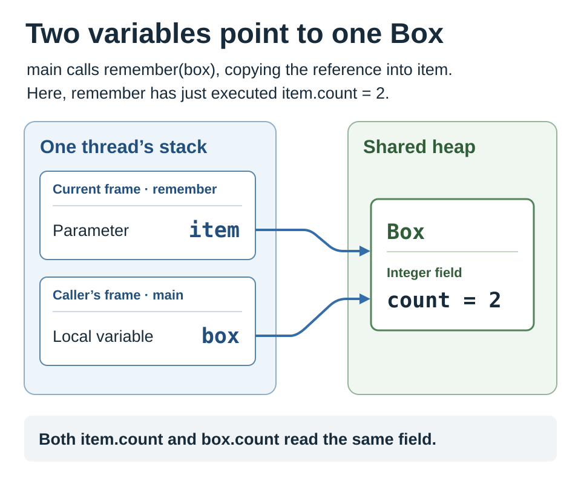
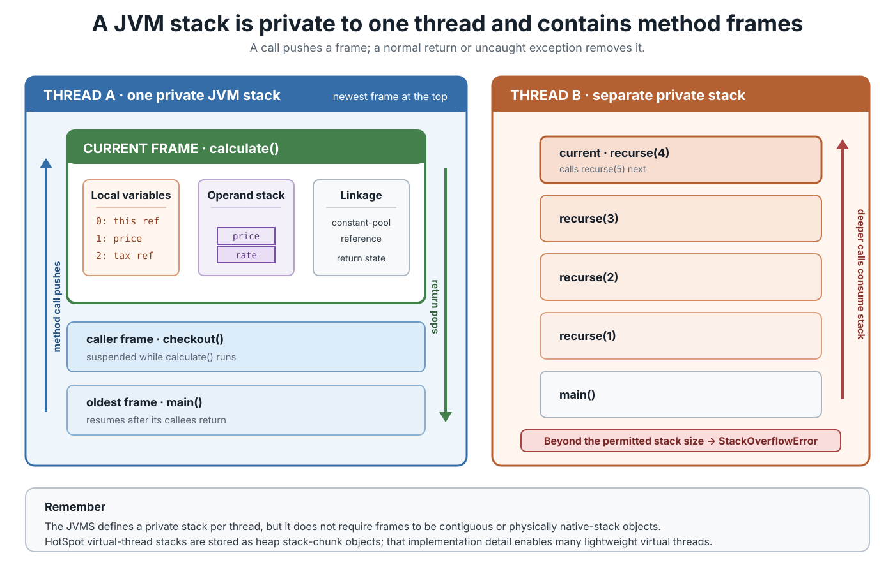
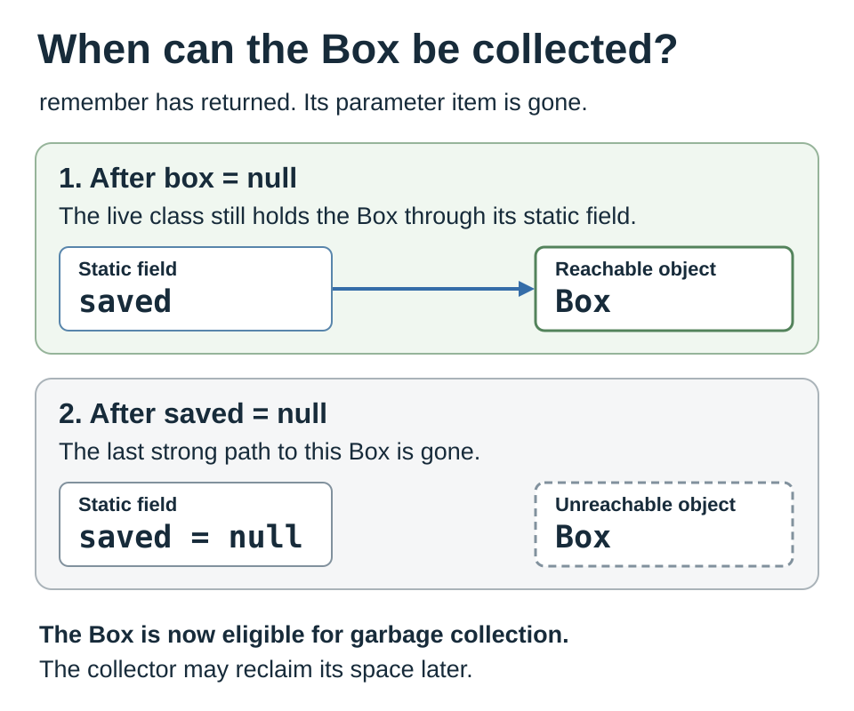
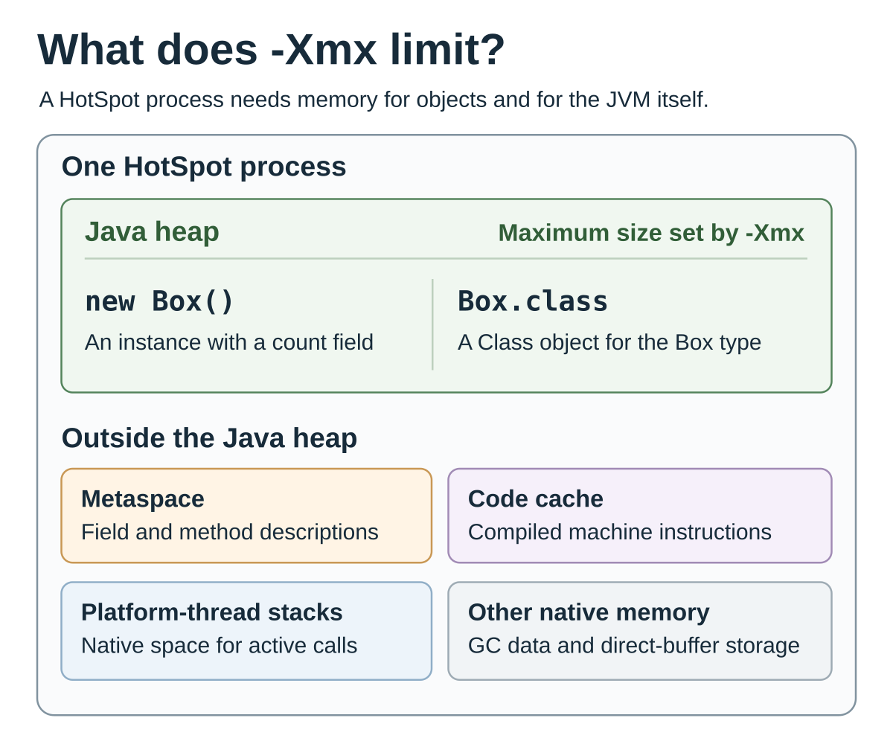
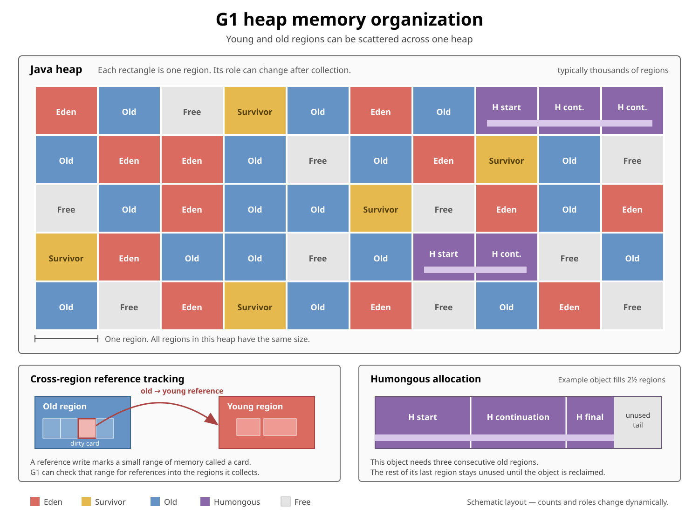
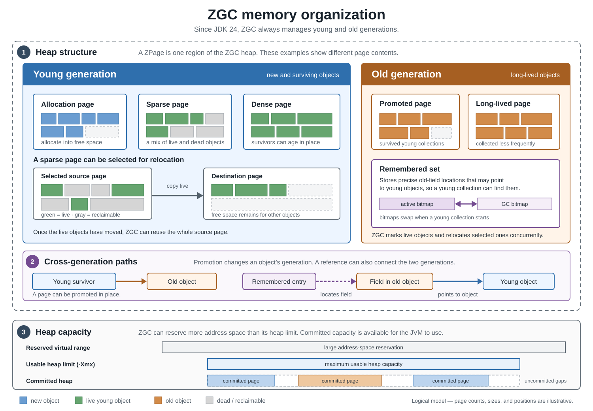

# JVM. Memory organization

<sub>[Back to Java](../Readme.md#content)</sub>

The Java Virtual Machine (JVM) gives each thread a private **stack** for its active method calls. All threads share a **heap** for objects and arrays. A method can finish while an object it used stays alive, because another part of the program still has a reference to it. The JVM process also uses memory outside the heap.

Follow one object through a method call and garbage collection. For a quick interview rehearsal, start with [Check your understanding](#check-your-understanding).

1. [What happens during a method call?](#1-what-happens-during-a-method-call)
2. [What keeps an object alive?](#2-what-keeps-an-object-alive)
3. [Where does HotSpot store a class?](#3-where-does-hotspot-store-a-class)
4. [How do G1 and ZGC use the heap?](#4-how-do-g1-and-zgc-use-the-heap)
5. [Which part of memory ran out?](#5-which-part-of-memory-ran-out)

## 1. What happens during a method call?

A **thread** is one sequence of execution. Each time it calls a method, the JVM gives that call a **frame** on the thread’s stack. The frame holds the call’s parameters and local variables. A variable can hold a primitive value such as the integer `2`, or a **reference**, a value that lets the program reach an object.

A `Box` has one integer field, `count`. `MemoryExample` has a static field, `saved`, that both methods can use. Assigning `null` to a variable means it no longer refers to any object. What will the program print after `box = null` clears the local reference?

```java
public class MemoryExample {
    static Box saved;

    static void remember(Box item) {
        item.count = 2;
        saved = item;
    }

    public static void main(String[] args) {
        Box box = new Box();
        remember(box);
        box = null;
        System.out.println(saved.count);
        saved = null;
    }
}

class Box {
    int count;
}
```

It prints **`2`**. `new Box()` creates one object. Java passes arguments **by value**, so calling `remember(box)` copies the reference into the parameter `item`. Follow the two arrows just after `item.count = 2`. Both end at one `Box`, so a change to its `count` through either reference affects what the other reads.



The integer `count` lives inside the heap object because it is an instance field. An `int` declared inside a method would be a local in its frame. The same distinction applies to arrays. In a local declaration such as `int[] scores = new int[3]`, the frame holds the reference and the heap array holds the three integers.

<details>
<summary>Inside a frame</summary>

A frame also has an **operand stack**, where JVM instructions keep temporary values during a calculation, and a link to the class’s runtime constant pool, which helps resolve field and method names. In the diagram, the operand stack belongs to one call to `calculate`. On the right, each recursive call adds a whole frame to a different thread’s stack.



Each thread also has a **program counter** that identifies its current instruction while it executes Java bytecode. The JVM specification allows native method stacks for calls to code written in languages such as C. These are logical descriptions. An optimizing JVM can even eliminate an object allocation if the program behaves the same way.

</details>

## 2. What keeps an object alive?

When `remember` returns, the JVM pops its frame, including `item`. A method that exits by throwing an exception also loses its frame. This cleanup happens at method exit, independently of garbage collection. The box survives the call because `saved = item` has copied its reference into the static field.

The **garbage collector (GC)** traces references from starting points called **roots**, such as references a running thread still needs. A live class can also provide a path through its static fields. In this program the references are ordinary **strong references**. In the first snapshot, follow the arrow from the static field. In the second, that path has disappeared.



After `box = null`, the class still reaches the object through `saved`, so `saved.count` works. After `saved = null`, no path in this program reaches the box. Its space is **eligible for reclamation**. The collector chooses when to reuse it.

The same rule explains both cycles and leaks. Two objects may point to each other and still be collected if no root reaches either one. Conversely, an application can leak memory by keeping obsolete entries in a reachable cache. The collector can follow the path from the cache to each entry even after the application has stopped using them.

## 3. Where does HotSpot store a class?

**HotSpot**, the JVM used in OpenJDK, stores most class metadata in native memory called **Metaspace**. Java code also has a heap object that represents each loaded class. An interviewer asking “Where is the class?” might mean either one.

| What are you looking for? | Where is it in HotSpot? |
| --- | --- |
| The box whose `count` is `2` | `new Box()` creates an instance on the Java heap. |
| The value of `Box.class` | A separate heap object of type `Class<Box>` that represents the loaded class. |
| The description of the field `count` | Metaspace holds metadata such as field names and types. |
| Machine instructions for `remember` | If the just-in-time (JIT) compiler compiles the method, the generated instructions go in the **code cache**. |

On the map, the outer border encloses the whole process. The heap limit, `-Xmx`, covers only the area labeled **Java heap**.



The JVM specification groups class information into a shared **method area**. It includes method bytecode and each class’s **runtime constant pool**, a table of constants and symbolic references. The specification treats the method area as logically part of the heap and leaves its physical location open. HotSpot can therefore use native Metaspace for metadata.

A **class loader** defines classes for the JVM. HotSpot groups metadata by loader. For example, if an application retains an old plugin’s defining loader, the plugin’s ordinary classes stay loaded. Once the loader can be reclaimed, those classes can unload and HotSpot can reuse their metadata space.

Thread stacks also illustrate why logical ownership and physical storage are separate questions. A **platform thread** is backed by an operating-system thread with a native stack. HotSpot can keep a suspended **virtual thread’s** frames in heap objects called *stack chunks*. Many virtual threads can take turns running on one platform thread. Their stack chunks still occupy heap space, and the garbage collector must trace live references in those chunks. More suspended threads or deeper stacks can increase that work.

## 4. How do G1 and ZGC use the heap?

The JVM specification lets the collector choose how to organize the heap. A **generational** collector groups objects by age so it can collect recently allocated objects more often. A collector can pack surviving objects together by copying them out of a region. Once that region is empty, the entire region is available for new allocations.

G1 aims to meet a pause-time target while keeping **throughput** high, so the application can do more work per second. ZGC prioritizes very short pauses even when that costs some throughput.

| HotSpot collector | Where objects go | When live objects move |
| --- | --- | --- |
| **Garbage-First (G1)** | Equal-sized regions can have different roles. Most new objects enter young regions called Eden. Survivors may move to survivor or old regions. In OpenJDK 26 HotSpot, an object larger than half a region is *humongous*. G1 allocates it directly in one or more consecutive old regions. | G1 usually copies live objects out of selected regions during a pause in application execution. It can mark live objects while the application runs. |
| **Z Garbage Collector (ZGC)** | Young and old generations use heap pages. A dense page can age in place, and its survivors can become old without a copy. ZGC has used only its generational mode since JDK 24. | ZGC can relocate live objects while application threads run. A page can be reused once its live objects have moved elsewhere. |

<details>
<summary>Explore the two heap layouts</summary>

Oracle’s G1 guide describes the humongous cutoff as half a region or larger. At the exact boundary, OpenJDK 26 tests for **greater than** half. With 4 MiB regions, an object whose total size is exactly 2 MiB follows the ordinary allocation path.

In the G1 grid, Eden and old regions can be scattered. The humongous object at the bottom spans three adjacent regions. A *remembered set* records locations to inspect for incoming references, so G1 can collect selected regions without scanning every object elsewhere.



In the ZGC diagram, compare a sparse page whose live objects are moved with a dense page whose objects can stay put. When ZGC collects the young generation, its remembered set helps it find references from old objects to young ones.



</details>

## 5. Which part of memory ran out?

**Before raising `-Xmx`, read the exact error message to see which allocation failed.** HotSpot’s `-Xms` sets the initial heap size and `-Xmx` sets its maximum. A process started with `-Xmx1g` can still use more than 1 GiB overall. It also needs space for native stacks, class metadata, compiled code, collector bookkeeping and direct buffers. Under a fixed process or container memory limit, a heap that grows into the extra space leaves less room for native allocations and can make the failure worse.

| Symptom | What could explain it? | First evidence to inspect |
| --- | --- | --- |
| `StackOverflowError` | One thread needed more stack space than permitted, often because of deep recursion. | Read the failing thread’s stack trace. Look for repeated calls. A smaller `-Xss` can leave room for more platform threads, but each has less stack space for nested calls. |
| `OutOfMemoryError: Java heap space` | A heap allocation could not fit. One large request, a large live data set or unintended retention can each cause this. | Check heap usage after collections. In a heap dump, follow the references keeping suspect objects alive. |
| `OutOfMemoryError: Metaspace` | Class metadata exhausted the available space. | Check class and loader counts with `VM.classloader_stats`, and the configured `-XX:MaxMetaspaceSize`, if any. |
| `OutOfMemoryError: unable to create native thread` | A new platform thread could not get the operating-system resources it needed. | Use `jcmd <pid> Thread.print` to inspect platform threads and their stacks. Compare the platform-thread count with operating-system limits and check available native memory. |

<details>
<summary>Inspect a running service with jcmd</summary>

The Java Development Kit (JDK) includes `jcmd`, a tool that sends diagnostic commands to a running JVM. Replace `<pid>` with its process ID. For example, `jcmd 12345 GC.heap_info` reports heap information for process 12345. GC logs (`-Xlog:gc*`) show how occupancy changes across collections. A class histogram (`GC.class_histogram`) counts instances by type. A heap dump (`GC.heap_dump`) also records their references. Java Flight Recorder (JFR) can show allocation and collection activity over time.

Some clues point straight to a smaller pool. `Compressed class space` identifies a class-metadata allocation failure. A direct-buffer allocation failure points to the memory backing direct buffers. A full code cache can limit further JIT compilation.

If heap usage stays steady while the process grows, compare operating-system measurements with **Native Memory Tracking (NMT)**. Oracle estimates a **5–10% performance overhead** for enabling NMT. To use it, start the service with `-XX:NativeMemoryTracking=summary`. Take a baseline, then run the second command after memory has grown. Replace `12345` with the service’s process ID.

```bash
jcmd 12345 VM.native_memory baseline
jcmd 12345 VM.native_memory summary.diff
```

In an NMT report, **reserved** means virtual address space set aside and **committed** means memory made available to the JVM. **Used heap** is the portion currently occupied by objects, including garbage the collector has yet to reclaim. The operating system measures how much of the process is currently resident in RAM. NMT tracks HotSpot’s allocations. Growth in a third-party native library can require operating-system tools to explain.

</details>

## Check your understanding

1. Suppose `remember` adds `item = null` immediately after `saved = item`. What will the program print, and why?

   <details>
   <summary>Answer</summary>

   It still prints `2`. The assignment changes the parameter in one frame. The static field already holds its own copy of the reference to the modified box.

   </details>

2. Two threads each have a local variable pointing to the same `int[]`. How many arrays are there, and what is private to each thread?

   <details>
   <summary>Answer</summary>

   There is one heap array containing the integers. Each thread has its own frame and local reference. Both references identify the same array.

   </details>

3. Two objects refer to each other. A static list contains the first. Can the collector reclaim them if the program clears all its local references?

   <details>
   <summary>Answer</summary>

   Both stay alive while a live class reaches the list and the list reaches the first object. If the list drops that entry and there are no other paths from roots, both become eligible even though the cycle still exists.

   </details>

4. A plugin creates no more instances, yet repeated reloads grow Metaspace. What would you look for?

   <details>
   <summary>Answer</summary>

   Look for references retaining old defining class loaders. Even with no instances of a plugin class left, a reachable loader can keep the class and its metadata alive. Compare class-loader statistics across reloads.

   </details>

5. Ten thousand virtual threads are sleeping. How does HotSpot store their stacks, and what does that cost?

   <details>
   <summary>Answer</summary>

   Many virtual threads share fewer platform threads. Suspended frames occupy chunks on the heap. A live local in one of those frames can keep a request object reachable, so the collector still has to account for that object.

   </details>

6. If a surviving object becomes old, must it have been copied during an application pause?

   <details>
   <summary>Answer</summary>

   The collector matters. G1 usually evacuates survivors during pauses. Generational ZGC can promote a dense page in place and can move other live objects concurrently.

   </details>

7. A service with `-Xmx1g` uses 1.4 GiB of process memory. Does that alone establish a heap leak? What would you measure?

   <details>
   <summary>Answer</summary>

   No. The heap cap covers only one area. Compare heap occupancy after collections with NMT category changes and operating-system measurements. If the heap keeps growing under comparable load, a heap dump can show what retains the objects.

   </details>

# Sources

- [Java Virtual Machine Specification, §§2.4–2.7 — references, runtime areas and frames](https://docs.oracle.com/javase/specs/jvms/se26/html/jvms-2.html#jvms-2.4)
- [Java Language Specification, §4.12 — variables, fields, parameters and array components](https://docs.oracle.com/javase/specs/jls/se26/html/jls-4.html#jls-4.12)
- [Java Language Specification, §15.12.4.5 — passing argument values to a method](https://docs.oracle.com/javase/specs/jls/se26/html/jls-15.html#jls-15.12.4.5)
- [Java API — strong reachability and reference types](https://docs.oracle.com/en/java/javase/26/docs/api/java.base/java/lang/ref/package-summary.html#reachability)
- [Java Language Specification, §12.7 — class unloading](https://docs.oracle.com/javase/specs/jls/se26/html/jls-12.html#jls-12.7)
- [Oracle HotSpot GC guide — class metadata](https://docs.oracle.com/en/java/javase/26/gctuning/other-considerations.html)
- [Oracle HotSpot VM guide — code cache and escape analysis](https://docs.oracle.com/en/java/javase/26/vm/java-hotspot-virtual-machine-performance-enhancements.html)
- [OpenJDK JEP 444 — virtual-thread stacks and carriers](https://openjdk.org/jeps/444)
- [Java API — platform-thread stack size, recursion depth and thread count](https://docs.oracle.com/en/java/javase/26/docs/api/java.base/java/lang/Thread.html#%3Cinit%3E(java.lang.ThreadGroup,java.lang.Runnable,java.lang.String,long))
- [Oracle HotSpot GC guide — collector goals and trade-offs](https://docs.oracle.com/en/java/javase/26/gctuning/available-collectors.html)
- [Oracle HotSpot GC guide — G1 heap layout and evacuation](https://docs.oracle.com/en/java/javase/26/gctuning/garbage-first-g1-garbage-collector1.html)
- [OpenJDK 26 HotSpot — exact G1 size test and half-region threshold](https://github.com/openjdk/jdk/blob/jdk-26-ga/src/hotspot/share/gc/g1/g1CollectedHeap.hpp#L1214-L1227)
- [OpenJDK JEP 439 — generational ZGC, relocation and promotion](https://openjdk.org/jeps/439)
- [OpenJDK JEP 490 — removal of non-generational ZGC in JDK 24](https://openjdk.org/jeps/490)
- [Oracle troubleshooting guide — memory failures and retention](https://docs.oracle.com/en/java/javase/26/troubleshoot/troubleshooting-memory-leaks.html)
- [Oracle troubleshooting guide — Flight Recorder and diagnostic tools](https://docs.oracle.com/en/java/javase/26/troubleshoot/diagnostic-tools.html)
- [Oracle HotSpot VM guide — Native Memory Tracking](https://docs.oracle.com/en/java/javase/26/vm/native-memory-tracking.html)
- [Java API — direct buffers and their backing memory](https://docs.oracle.com/en/java/javase/26/docs/api/java.base/java/nio/ByteBuffer.html#direct-vs-non-direct-buffers-heading)
- [Java API — used, committed and maximum memory](https://docs.oracle.com/en/java/javase/26/docs/api/java.management/java/lang/management/MemoryUsage.html)
- [JDK tool reference — java launcher options](https://docs.oracle.com/en/java/javase/26/docs/specs/man/java.html)
- [JDK tool reference — jcmd diagnostic commands](https://docs.oracle.com/en/java/javase/26/docs/specs/man/jcmd.html)
