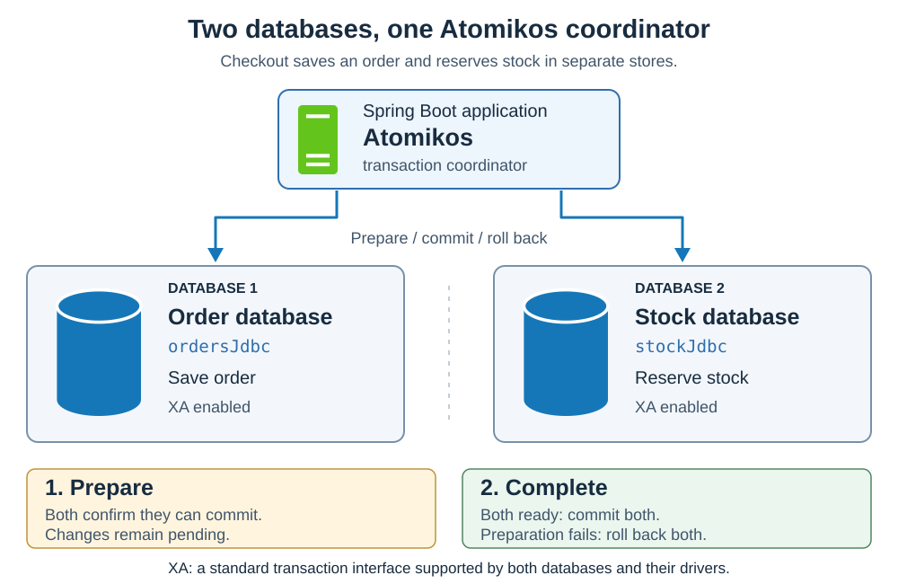

# Transactions. Atomikos

<sub>[Back to Java](../Readme.md#content)</sub>

**Atomikos is a Java transaction manager that runs inside your application.** With Atomikos, saving an order in one database and reserving the item in another can be one transaction. A **commit** makes both changes permanent. A **rollback** discards the pending changes.

## Why does checkout need a coordinator?

If a shop commits a book order before checking stock, it can accept an order it cannot fill. In one database, a **local transaction** can cover both writes. Across two databases, Atomikos coordinates a **global transaction** so the order stays pending while checkout reserves the book.

## What happens when the book is sold out?

This example uses **Spring Boot 4.2.0** with `com.atomikos:transactions-spring-boot4-starter:6.0.1`. The starter connects Spring’s transaction manager to Atomikos through the **Java Transaction API (JTA)**, now called Jakarta Transactions. Here, `ordersJdbc` and `stockJdbc` are Spring `JdbcTemplate` objects, one per database. Each runs SQL through an Atomikos-managed **XA** (eXtended Architecture) connection so its database can join the transaction.

By default, Spring wraps the service in a **proxy**. When another component calls `checkout` through that wrapper, Spring sees `@Transactional` and starts or joins one transaction for both writes.

```java
@Transactional
public void checkout(long orderId, long productId) {
    ordersJdbc.update("INSERT INTO orders(id, product_id) VALUES (?, ?)",
            orderId, productId);

    int reserved = stockJdbc.update("""
            UPDATE inventory SET available = available - 1
            WHERE product_id = ? AND available > 0
            """, productId);
    if (reserved != 1) {
        throw new IllegalStateException("Stock unavailable");
    }
}
```

For a sold-out book, the stock update changes zero rows and `checkout` throws a runtime exception. By default, Spring rolls back when that exception leaves the method. **The order insert is undone, and stock stays at zero.**

A call to `this.checkout(...)` inside the same service bypasses the proxy, so Spring starts no transaction for that call. If no transaction is already active and auto-commit is on, the order stays saved when the stock check fails.

Rollback covers only participants in the transaction. A charge made through an ordinary payment API still stands, and a sent confirmation email stays sent.

## How do both databases commit?

When both writes succeed, Spring asks Atomikos to commit. The arrows show which databases participate. The boxes below them show **two-phase commit (2PC)**.



1. **Prepare.** Atomikos asks each database whether it can commit its pending change. A “yes” is a promise to carry out the final decision. The change is still pending.
2. **Complete.** If both are ready, Atomikos tells both to commit. The order is saved and one fewer book is available. If either database cannot prepare, Atomikos calls for rollback.

### What if the application crashes during commit?

Suppose Atomikos records the commit decision, but the application crashes before the stock database receives it. When the application restarts, Atomikos reads its transaction log and can resend the decision once it can reach the stock database.

The log directory (`com.atomikos.icatch.log_base_dir`) defaults to the working directory. In a container, keep the log on a persistent volume so a replacement container can read it.

# Sources

- [Atomikos TransactionsEssentials — running a transaction manager inside a Java application](https://www.atomikos.com/Main/TransactionsEssentials)
- [Atomikos — XA and two-phase commit](https://www.atomikos.com/Documentation/WhatIsXa)
- [Jakarta Transactions — resource participation and crash recovery](https://jakarta.ee/specifications/transactions/2.0/jakarta-transactions-spec-2.0.html)
- [Atomikos — configuring database connections for XA](https://www.atomikos.com/Documentation/ConfiguringJdbc)
- [Spring Boot 4.2.0 — managed dependency versions](https://repo.maven.apache.org/maven2/org/springframework/boot/spring-boot-dependencies/4.2.0/spring-boot-dependencies-4.2.0.pom)
- [Atomikos 6.0.1 — Spring Boot 4 starter on Maven Central](https://central.sonatype.com/artifact/com.atomikos/transactions-spring-boot4-starter/6.0.1)
- [Spring Framework 7.1 — transactional method calls and default rollback rules](https://docs.spring.io/spring-framework/reference/7.1/data-access/transaction/declarative/annotations.html)
- [Spring Framework 7.1 — the row count returned by JdbcTemplate.update](https://docs.spring.io/spring-framework/docs/7.1.0/javadoc-api/org/springframework/jdbc/core/JdbcTemplate.html#update(java.lang.String,java.lang.Object...))
- [Atomikos — transaction log directory and durable storage](https://www.atomikos.com/Documentation/JtaProperties)
- [Atomikos — how the coordinator records the decision before sending commit requests](https://github.com/atomikos/transactions-essentials/blob/84806035261eacd31968a3009ff08c5a60c79726/public/transactions/src/main/java/com/atomikos/icatch/imp/CoordinatorStateHandler.java#L340-L385)
