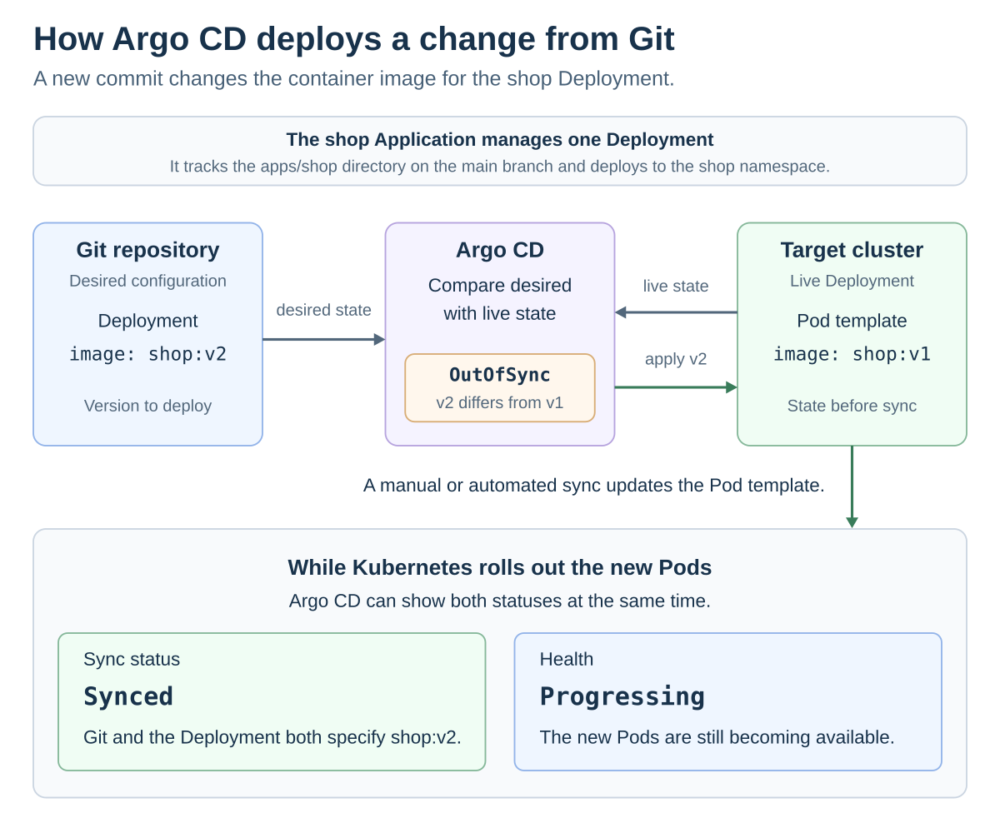

# Argo CD

[Back to Kubernetes](../Readme.md#content)

**Argo CD is a continuous delivery tool for Kubernetes.** It follows a **GitOps** workflow. You record the configuration you want in Git. Argo CD compares it with the resources in the cluster and can apply changes to bring those resources into line with Git.

## From Git to the cluster

An **`Application`** is a Kubernetes resource type added by Argo CD. For a Git-backed application, it connects a source to a destination.

- The **source** identifies the repository, revision (such as a branch or commit), and path. At that path, Argo CD reads Kubernetes **manifests** (resource definitions) or generates them from inputs such as Helm charts or Kustomize configuration.
- The **destination** identifies the target cluster. It can also supply a default namespace for resources that need one and omit it from their manifests.

In the diagram, the Application manages one Deployment. A new commit on the tracked branch changes its container image from `shop:v1` to `shop:v2`. The live Deployment still specifies `shop:v1`, so Argo CD reports **`OutOfSync`**. A **sync**, started manually or by policy, applies the new image to the Deployment's Pod template.

**Sync status and health answer different questions.** Once the live Deployment matches Git, Argo CD can report **`Synced`**. Kubernetes rolls out the new Pods, and health can still show **`Progressing`** while they start. When the rollout completes and the replicas are available, this Application can show **`Healthy`**.

## Choose what happens automatically

- **Automated sync** can apply a new tracked revision when its desired configuration differs from the cluster.
- **Self-healing** (`selfHeal`) lets a live change alone trigger an automated sync. For example, if someone changes the live image back to `shop:v1`, Argo CD can restore `shop:v2` without another commit.
- **Automatic pruning** (`prune`) lets an automated sync delete managed resources removed from the desired configuration.

Self-healing and automatic pruning are both off by default, even with automated sync enabled. A later sync can still overwrite a manual cluster edit when self-healing is disabled.

## Where the build pipeline fits

A **continuous integration (CI)** pipeline can build and publish a container image, then push a commit with the new image reference to the tracked Git branch. With automated sync enabled, Argo CD can pick up that change and deploy it.

# Sources

- [Argo CD — Overview and GitOps workflow](https://argo-cd.readthedocs.io/en/stable/)
- [Argo CD — Core concepts: desired state, live state, sync, and health](https://argo-cd.readthedocs.io/en/stable/core_concepts/)
- [Argo CD — Application source and destination fields](https://argo-cd.readthedocs.io/en/stable/user-guide/application-specification/)
- [Argo CD — Automated sync, self-healing, and pruning](https://argo-cd.readthedocs.io/en/stable/user-guide/auto_sync/)
- [Argo CD — Resource health](https://argo-cd.readthedocs.io/en/stable/operator-manual/health/)
- [Kubernetes — Updating a Deployment](https://kubernetes.io/docs/concepts/workloads/controllers/deployment/#updating-a-deployment)
- [Argo CD — Automation from CI pipelines](https://argo-cd.readthedocs.io/en/stable/user-guide/ci_automation/)
