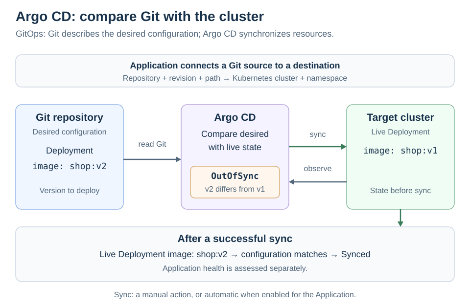

# Argo CD

[Back to Kubernetes](../Readme.md#content)

# Front

How does Argo CD deploy Kubernetes applications using GitOps?

# Back

**Argo CD is a continuous delivery tool for Kubernetes that uses Git to describe the desired application state.** This approach is called **GitOps**: configuration changes are committed to Git, and Argo CD compares that configuration with the live cluster and can synchronize the two.

## From Git to the cluster

An **`Application`** is a custom resource: a Kubernetes object of a type added by Argo CD. For a Git-backed application, it specifies:

- **Source:** a Git repository, revision (such as a branch or commit), and path. These contain Kubernetes **manifests** (resource definitions), or inputs such as Helm charts or Kustomize configuration that generate them.
- **Destination:** the Kubernetes cluster and namespace to deploy into.

Read the diagram from left to right. Argo CD reads the desired configuration and observes live resources. A **sync** applies changes to move the application toward the desired state.

For example, Git requests image `shop:v2`, but the live Deployment still declares `shop:v1`. Argo CD detects the difference and reports **`OutOfSync`**. A manual sync, or an enabled automatic sync, updates the Deployment's configuration.

**`Synced` and `Healthy` answer different questions.** Sync status compares configuration; health assesses the state of the application's resources. Configuration can match Git while the application is still starting or has a problem.

## Choose what happens automatically

- **Automated sync:** apply desired changes when differences are detected, according to the application's sync policy.
- **Self-healing (`selfHeal`):** also trigger automatic sync when live resources drift from the desired state, for example after a manual cluster edit.
- **Pruning (`prune`):** delete resources managed by the application that are no longer present in its desired configuration.

Enabling automated sync alone does **not** enable self-healing or automatic pruning; both are off by default. A later sync can still overwrite a manual cluster edit even when self-healing is disabled.

## Where the build pipeline fits

A **continuous integration (CI)** pipeline can build and publish a container image, then commit its new image reference to the configuration repository. Argo CD handles delivery of that configuration. With automated sync enabled, the pipeline can stop after updating Git; it does not need to call Argo CD to start deployment.

# Sources

- [Argo CD — Overview and GitOps workflow](https://argo-cd.readthedocs.io/en/stable/)
- [Argo CD — Core concepts: desired state, live state, sync, and health](https://argo-cd.readthedocs.io/en/stable/core_concepts/)
- [Argo CD — Declarative setup and Application source/destination](https://argo-cd.readthedocs.io/en/stable/operator-manual/declarative-setup/#applications)
- [Argo CD — Automated sync, self-healing, and pruning](https://argo-cd.readthedocs.io/en/stable/user-guide/auto_sync/)
- [Argo CD — Resource health](https://argo-cd.readthedocs.io/en/stable/operator-manual/health/)
- [Argo CD — Automation from CI pipelines](https://argo-cd.readthedocs.io/en/stable/user-guide/ci_automation/)
