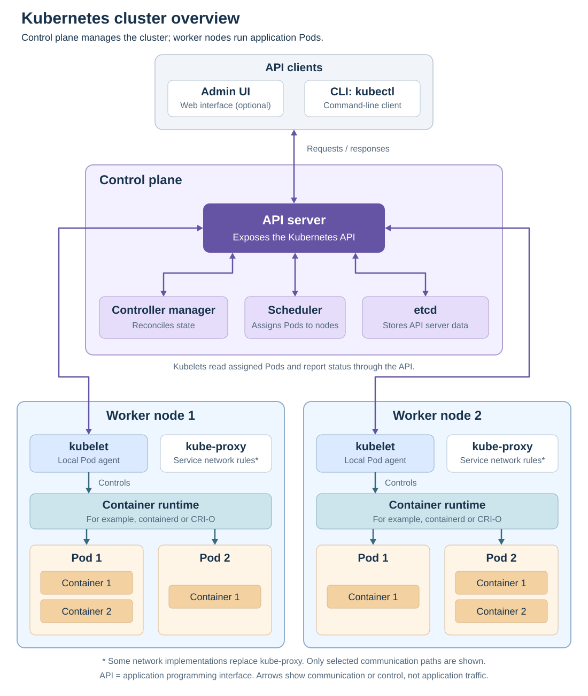
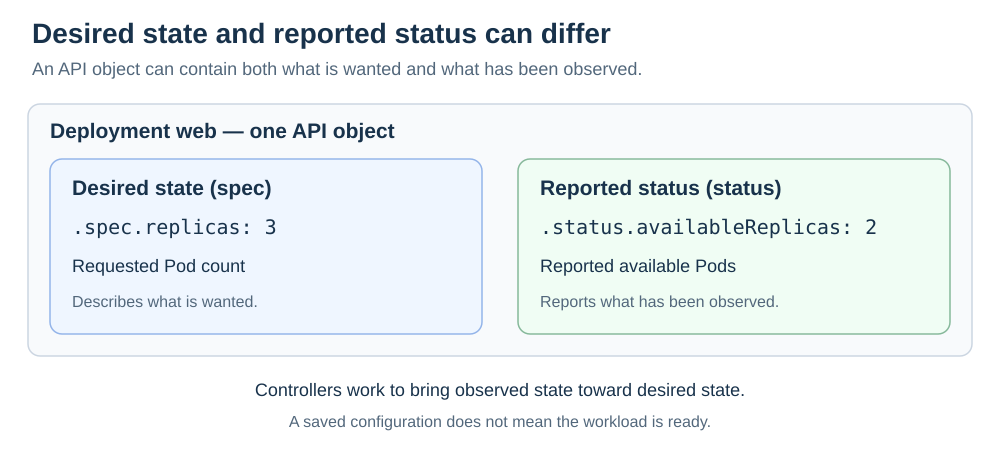
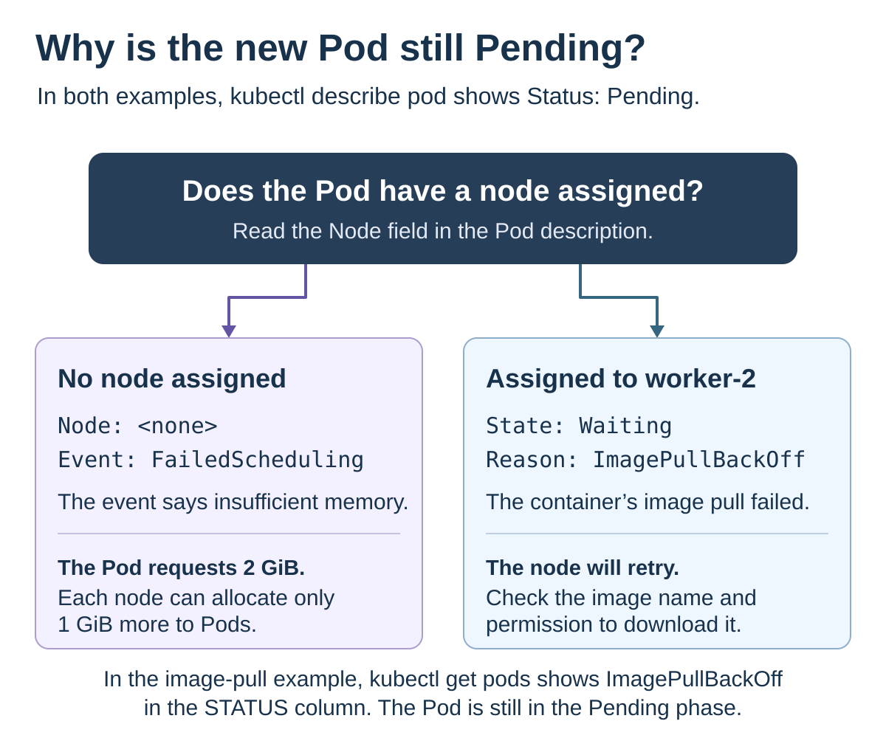

# Kubernetes cluster components

[Back to Kubernetes](../Readme.md#content)

**You tell Kubernetes what you want to run. The control plane keeps track of that request and chooses where each copy should go. Worker nodes run the application and report how it is doing.** Imagine a website with two copies running. What happens when you ask for a third?

1. [What would you draw on the whiteboard?](#1-what-would-you-draw-on-the-whiteboard)
2. [Who makes the third copy?](#2-who-makes-the-third-copy)
3. [Why are only two copies available?](#3-why-are-only-two-copies-available)
4. [How does another application reach the website?](#4-how-does-another-application-reach-the-website)

## 1. What would you draw on the whiteboard?

“I’d draw the control plane and a worker node. A **node** is a physical or virtual machine. On the worker I’d draw a **Pod**, the unit Kubernetes places on a node. A Pod holds one or more **containers**, each of which runs a program with the files it needs. For example, one container could serve the website while a second keeps its files up to date. Both run on the same node.”

Find the API server at the center of the control plane in the diagram. It serves the Kubernetes **application programming interface (API)**, the shared way to read and change cluster records, called **objects**. Follow its connection to a worker’s **kubelet**, the agent that manages Pods assigned to that machine.

**Does that require separate machines?** A small cluster can run both roles on one machine, so a control-plane node can have a kubelet too. Production clusters can spread the control plane across machines for availability. “Master node” is an older term for a machine hosting control-plane components.

## 2. Who makes the third copy?

“I use the command-line client, **kubectl**, to ask for three replicas of the website. Here, each **replica** is one Pod running the website. The request changes a **Deployment**, a stored description of the website’s Pods and how many I want. The API server (`kube-apiserver`) records the change in **etcd**, the database for cluster state. I can close my terminal once that change is saved.”

“The **controller manager** (`kube-controller-manager`) runs programs called **controllers**. They watch the API and act on changes. The Deployment controller updates a **ReplicaSet**, which tracks how many matching Pods to keep. The ReplicaSet controller sees two Pods where it needs three and creates the third Pod’s record through the API. The **scheduler** (`kube-scheduler`) watches for Pods without a node, chooses a machine that meets the new Pod’s requirements, and records its choice through the API.”

**What actually starts the website?** You run `kubectl` in your terminal. The kubelet runs on the chosen node, sees the assignment, and asks the **container runtime**, such as containerd, to start the containers. The kubelet reports Pod and node status to the API server. It talks to the runtime through the **Container Runtime Interface (CRI)**.

**What if someone deletes that Pod tomorrow?** The ReplicaSet controller sees the shortfall and creates a replacement. Repeatedly bringing the cluster closer to what was requested is called **reconciliation**.

## 3. Why are only two copies available?

“I’d check what the two counts mean. On most Kubernetes objects, `spec` describes the **desired state** you request, and `status` reports what Kubernetes has observed. In this Deployment, `spec.replicas` asks for three copies, and `status.availableReplicas` says two are available. The third Pod could already exist and still be starting.”

**What does `Pending` mean?** It’s a Pod phase. Kubernetes has accepted the Pod, but at least one container is still being set up. The Pod can be waiting for a node or already on a node that is downloading a container image, the package that holds the program and its files.

**What would you check first?** “I’d run `kubectl describe pod <pod-name>` and read the **Node** field and **Events**. Both examples below show `Status: Pending` in the Pod description.”

- **No node assigned.** If you see `Node: <none>` and a `FailedScheduling` event says `Insufficient memory`, check the Pod’s **memory request**, the amount the scheduler must allow for when placing it. Can any node accommodate that request after accounting for Pods already assigned there?
- **Node assigned.** If a container is in the `Waiting` state with reason `ImagePullBackOff`, the node is retrying a failed image download. Check the image name and permission to download it. For this same Pod, the `STATUS` column in `kubectl get pods` can show `ImagePullBackOff` because it displays the container’s waiting reason.

## 4. How does another application reach the website?

“I’d give the website a **Service**. Each Pod gets its own IP address, and a replacement Pod can get a different one. A typical Service gives clients a stable address inside the cluster even as those Pods change. On clusters that use **kube-proxy**, it maintains node networking rules that direct connections to the backing Pods. Some network plugins provide that forwarding themselves.”

**What role does the API server play here?** You submit the Service definition to the API server, just as you would submit a Deployment manifest, a file describing what you want to run. Application requests to the Service follow the network rules to the website. An optional **cloud-controller-manager** can work with a cloud provider to provision a load balancer for a Service that requests one.

## Check your understanding

1. The web server and the file updater share a Pod. Could Kubernetes place them on different workers? What would you draw?

   

   
Answer

   No. Draw both containers inside one Pod on one worker. The scheduler places the whole Pod on a single node.

   

2. You close your terminal after increasing the requested count. In 30 seconds, explain who creates the new Pod, chooses its node, and starts its containers.

   

   
Answer

   “I use `kubectl` to send the new count to the API server, which saves it in etcd. The Deployment controller updates the ReplicaSet, whose controller creates the Pod. The scheduler records a node assignment through the API. That node’s kubelet asks its runtime to start the containers and reports their status.”

   

3. Someone deletes one of the three website Pods. Who creates a replacement, and why does that happen without another command?

   

   
Answer

   The ReplicaSet controller still has a target of three. It sees two Pods and creates a replacement to close the gap. That’s reconciliation.

   

4. The replacement Pod shows `Node: <none>` and a `FailedScheduling` event says `Insufficient memory`. What would you check?

   

   
Answer

   Compare the Pod’s memory request with what each eligible node can still offer after existing requests. In this case, the scheduler has yet to find a node that can fit the Pod.

   

5. For the same Pod, `kubectl get pods` shows `ImagePullBackOff` and `kubectl describe pod` shows `Status: Pending`. How can both be true, and what would you check?

   

   
Answer

   `Pending` is the Pod’s phase. `ImagePullBackOff` explains why its container is waiting. A node has already been assigned. Read the pull error in the Pod’s events, then check the image name and whether the node has access to it.

   

6. A client in the cluster needs to reach the website after one of its Pods is replaced. Which address should it use, and why?

   

   
Answer

   Use the Service’s stable address. The replacement Pod can have a different IP address, and Service networking directs new connections to the current backing Pods.

   

# Sources

- [Kubernetes components](https://kubernetes.io/docs/concepts/overview/components/)
- [Cluster architecture and alternatives to kube-proxy](https://kubernetes.io/docs/concepts/architecture/#kube-proxy)
- [Pods and their containers](https://kubernetes.io/docs/concepts/workloads/pods/)
- [Production cluster layouts](https://kubernetes.io/docs/setup/production-environment/)
- [Kubernetes glossary](https://kubernetes.io/docs/reference/glossary/)
- [Kubernetes objects, manifests, spec, and status](https://kubernetes.io/docs/concepts/overview/working-with-objects/)
- [Deployments](https://kubernetes.io/docs/concepts/workloads/controllers/deployment/)
- [How a ReplicaSet works](https://kubernetes.io/docs/concepts/workloads/controllers/replicaset/)
- [Kubernetes scheduler](https://kubernetes.io/docs/concepts/scheduling-eviction/kube-scheduler/)
- [Container Runtime Interface](https://kubernetes.io/docs/concepts/containers/cri/)
- [Nodes and status reporting](https://kubernetes.io/docs/concepts/architecture/nodes/#node-status)
- [Pod lifecycle and phases](https://kubernetes.io/docs/concepts/workloads/pods/pod-lifecycle/)
- [Resource management for Pods and containers](https://kubernetes.io/docs/concepts/configuration/manage-resources-containers/)
- [How Kubernetes v1.37.3 formats a waiting container in the Pod list](https://github.com/kubernetes/kubernetes/blob/v1.37.3/pkg/printers/internalversion/printers.go#L1073-L1074)
- [How kubectl v1.37.3 describes a Pod’s node and phase](https://github.com/kubernetes/kubernetes/blob/v1.37.3/staging/src/k8s.io/kubectl/pkg/describe/describe.go#L790-L805)
- [Debugging Pods](https://kubernetes.io/docs/tasks/debug/debug-application/debug-pods/)
- [Container images and image pull errors](https://kubernetes.io/docs/concepts/containers/images/)
- [Services](https://kubernetes.io/docs/concepts/services-networking/service/)
- [Cloud controller manager](https://kubernetes.io/docs/concepts/architecture/cloud-controller/)
