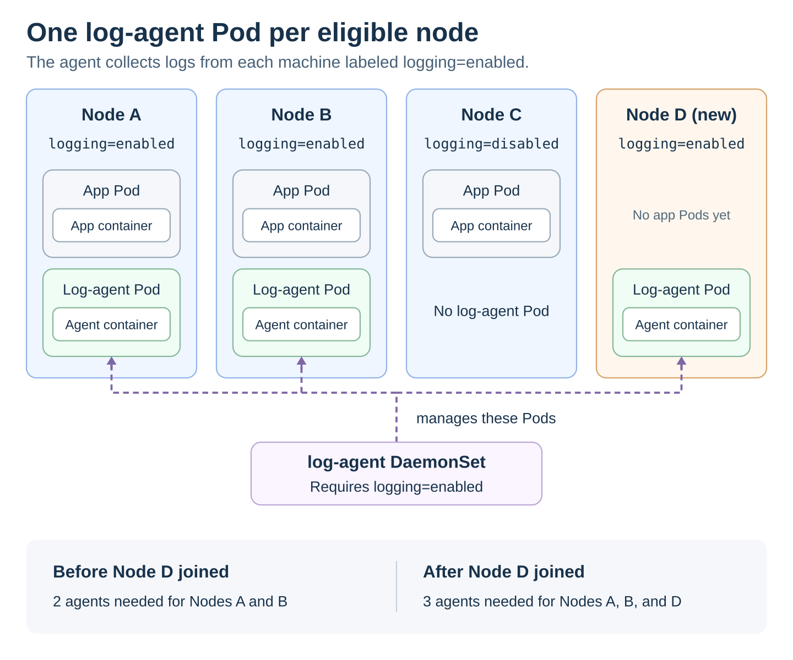

# DaemonSets

[Back to Kubernetes](../Readme.md#content)

**The DaemonSet API became generally available in Kubernetes 1.9 as part of `apps/v1`.**

A **DaemonSet** aims to run one copy of its Pod on each eligible node. A node is a machine in the cluster, and a Pod is a group of one or more containers that run together. A log collector is a typical example because it needs access to logs on each machine it monitors. Other uses include node monitoring and network helpers.

## Coverage follows the nodes

Suppose the log collector requires the node label `logging=enabled`. Nodes A and B match. Node C has `logging=disabled`, so it runs its application Pod without a log agent. When Node D joins with `logging=enabled`, the desired number of agents rises from two to three. Follow the dashed arrows from the DaemonSet to the Pods it manages directly.

- If an agent Pod is deleted while its node is still eligible, the DaemonSet controller creates a replacement for that node.
- If Node C's label changes to `logging=enabled`, the controller adds an agent there. Changing it back to `logging=disabled` causes the controller to remove that agent.
- When a node is removed from the cluster, Kubernetes cleans up its agent Pod.

A [ReplicaSet](../ReplicaSets/Readme.md) targets a chosen total, such as three application Pods. A DaemonSet derives its desired count from the eligible nodes and has no `.spec.replicas` field.

## What makes a node eligible?

The **Pod template** describes the Pods the DaemonSet creates. Its `nodeSelector` can require a node label, as in the logging example. Required node affinity can express more complex placement rules. The DaemonSet's own `.spec.selector` matches labels on its **Pods**.

A node can also carry a **taint**. For example, a `NoSchedule` taint blocks a new Pod unless the Pod has a matching **toleration**. Kubernetes adds some tolerations to DaemonSet Pods automatically. You can add others in the Pod template.

## When the running count can differ

An eligible node can lack the resources to start its agent immediately. During a rolling update, a node can briefly have no available agent. If the update allows extra Pods (`maxSurge`), the old and new agents can run on the same node until the replacement is ready.

# Sources

- [Kubernetes — DaemonSet use cases, node selection, and Pod lifecycle](https://kubernetes.io/docs/concepts/workloads/controllers/daemonset/)
- [Kubernetes — Assigning Pods to Nodes](https://kubernetes.io/docs/concepts/scheduling-eviction/assign-pod-node/)
- [Kubernetes — DaemonSet API fields and rolling-update limits](https://kubernetes.io/docs/reference/kubernetes-api/apps/daemon-set-v1/)
- [Kubernetes — Taints and tolerations](https://kubernetes.io/docs/concepts/scheduling-eviction/taint-and-toleration/)
- [Kubernetes — ReplicaSet replica count](https://kubernetes.io/docs/concepts/workloads/controllers/replicaset/)
- [Kubernetes — Pods](https://kubernetes.io/docs/concepts/workloads/pods/)
- [Kubernetes 1.9 — Workloads API general availability](https://kubernetes.io/blog/2017/12/kubernetes-19-workloads-expanded-ecosystem/#workloads-api-ga)
