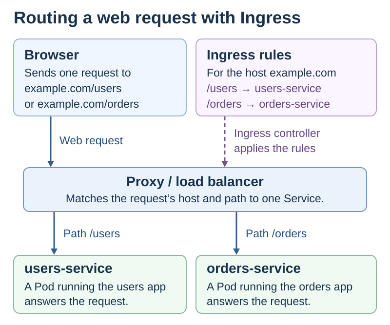
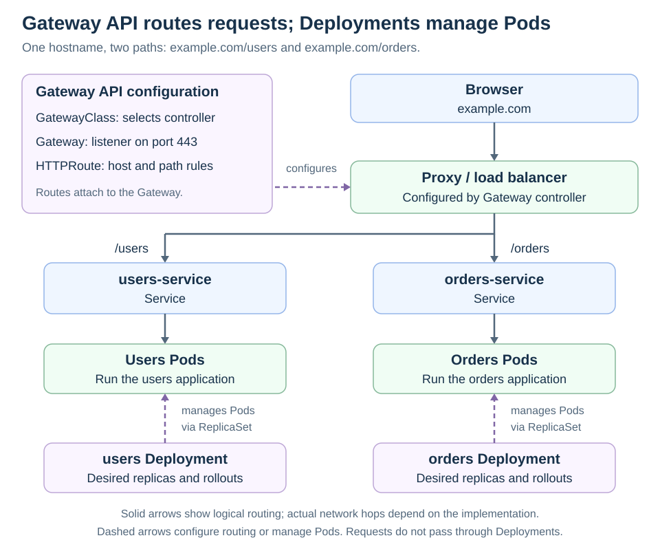

# Ingress

[Back to Kubernetes](../Readme.md#content)

**An Ingress is a Kubernetes object that maps incoming web requests to applications by hostname and path (generally available since Kubernetes 1.19, KEP-1453).**

Kubernetes retired the community **Ingress NGINX** controller on March 24, 2026. The Ingress application programming interface (API) remains supported, and other compatible controllers can apply the same standard rules.

For new web routes, Kubernetes recommends **Gateway API** instead of Ingress.

## Overview

A shop runs two applications in its Kubernetes cluster, one for accounts and one for orders. Both run in **Pods**, the units Kubernetes uses to run containers. Each application has a **Service** with a stable network name. Kubernetes tracks which Pods belong to each Service, so the Ingress rule can keep using the same name when a Pod is replaced.

## One hostname, two paths

Customers outside the cluster use the same website for both applications. In `https://example.com/orders`, the **host** is `example.com` and the **path** is `/orders`. The Ingress rule for this host lists two paths.

| Path on `example.com` | Destination Service and port |
| --- | --- |
| `/users` | `users-service` on port 80 |
| `/orders` | `orders-service` on port 80 |

A compatible **Ingress controller** reads the rules and configures a **proxy or load balancer** to receive and forward web requests. In a cloud cluster, this can be the provider's load balancer. Without a controller to apply the rules, saving the Ingress has no effect on traffic.

Suppose `example.com` points to the proxy or load balancer. Follow the solid arrows for `/orders` to the Pod that handles the request. The dashed arrow shows the controller applying the rules.

If the orders rule uses the `Prefix` path type, it matches whole path segments. Both `/orders` and `/orders/42` reach the orders application. The path `/orders-old` has a different first segment, so this rule doesn't match it.

Standard Ingress rules handle Hypertext Transfer Protocol (HTTP) and its encrypted form (HTTPS). For HTTPS, the proxy or load balancer can end the browser's Transport Layer Security (TLS) connection and read the path before forwarding the request.

Ingress and Service are separate kinds of Kubernetes objects. To expose other traffic, such as a direct database connection, use a Service of type `LoadBalancer` or `NodePort`.

## The same routes with Gateway API

The Ingress API is frozen, meaning it will receive no new features. Kubernetes has no plans to remove it. A `Gateway` defines where traffic arrives, and an attached `HTTPRoute` holds the host and path rules, so different teams can manage the entry point and application routes independently.

Follow the same order request with Gateway API

Here the `Gateway` accepts HTTPS on port 443. For `example.com`, the `HTTPRoute` maps `/users` to `users-service` and `/orders` to `orders-service`. The `GatewayClass` identifies the controller that manages the Gateway. This setup requires the Gateway API Custom Resource Definitions (CRDs), which add these resource types to the cluster, and a compatible controller.

Follow the solid arrows to an orders Pod. The dashed arrows below the Pods show a separate job. Each Deployment uses a ReplicaSet to keep the requested number of application copies running.

# Sources

- [Kubernetes — Ingress rules, path types, TLS, and API status](https://kubernetes.io/docs/concepts/services-networking/ingress/)
- [Kubernetes — Ingress controllers](https://kubernetes.io/docs/concepts/services-networking/ingress-controllers/)
- [Kubernetes — Ingress NGINX retirement announcement](https://kubernetes.io/blog/2025/11/11/ingress-nginx-retirement/) and [confirmation of the March 2026 retirement](https://kubernetes.io/blog/2026/03/30/kubernetes-v1-36-sneak-peek/#ingress-nginx-retirement)
- [Kubernetes — Services](https://kubernetes.io/docs/concepts/services-networking/service/) and [Pods](https://kubernetes.io/docs/concepts/workloads/pods/)
- [Kubernetes — Gateway API](https://kubernetes.io/docs/concepts/services-networking/gateway/)
- [Kubernetes — Deployments and their ReplicaSets](https://kubernetes.io/docs/concepts/workloads/controllers/deployment/)
- [Kubernetes Enhancement Proposal 1453 — Ingress API graduation](https://github.com/kubernetes/enhancements/tree/master/keps/sig-network/1453-ingress-api)
