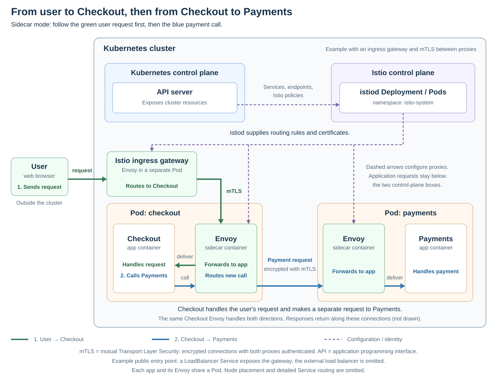
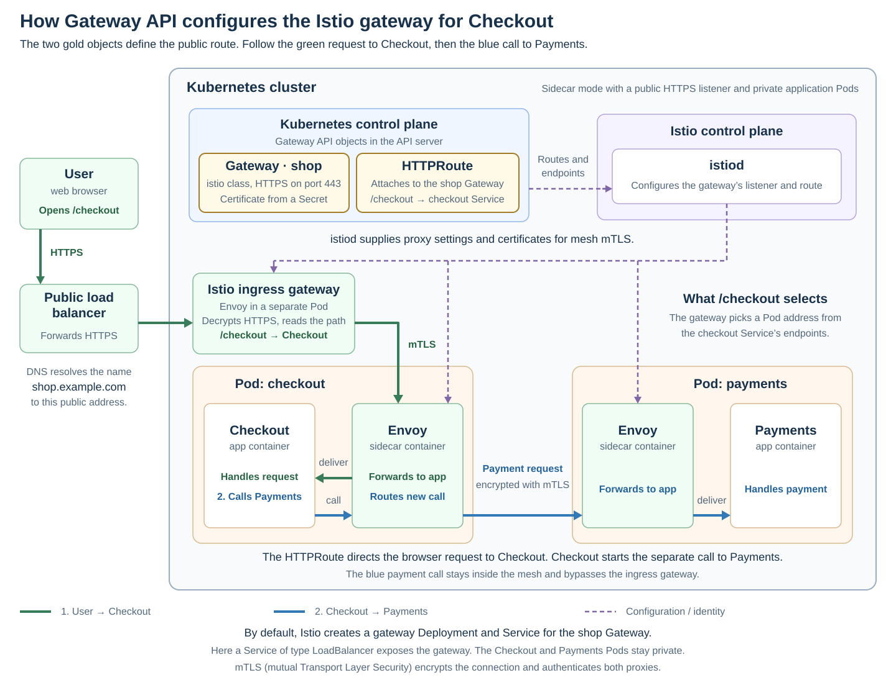

# Istio

[Back to Kubernetes](../Readme.md#content)

**Use Istio when several services need shared rules for how they call each other.** Istio is a **service mesh**. Its proxies (programs that forward traffic) secure, route, and measure calls without each team writing its own networking code.

## Why put a mesh between Checkout and Payments?

When a shopper places an order, an **ingress gateway** routes the browser's request to Checkout. Checkout then calls Payments inside the cluster, bypassing the gateway. How can Payments tell who is calling?

With **mutual Transport Layer Security (mTLS)**, the proxies encrypt their connection and each presents a certificate proving its service's identity. An **authorization policy** at Payments can then allow only Checkout. Istio renews the certificates.

The proxies can send 10% of calls to a new Payments version. If it is slower or returns more errors, the team can shift traffic back. Proxies take work to run and upgrade, and each hop can add delay.

## Where Istio runs in Kubernetes

In **sidecar mode**, each participating Pod runs an Envoy proxy alongside the app. Follow the green arrows to Checkout, then the blue arrows through the same proxy to Payments.

The **data plane** proxies carry requests and measure response times. Dashed arrows show the **control plane**. Istio's `istiod` reads rules and endpoints from Kubernetes, configures the proxies, and manages their mesh certificates.

In **ambient mode**, a shared `ztunnel` proxy on each node secures connections outside the app Pods. Add a **waypoint** proxy for request-level rules such as the 10% split.

## Why are both called ingress?

**Ingress means incoming traffic.** A Kubernetes [`Ingress`](../Ingress/Readme.md) is an API object that declares rules for web requests entering the cluster. An **Istio ingress gateway** is the running Envoy proxy that receives and forwards those requests. When Istio is the Ingress controller, it reads the rules and configures the proxy.

The shopper opens `https://shop.example.com/checkout`. In this example, the Domain Name System (DNS) resolves the shop name to a public load balancer, which forwards the connection to Envoy. Exposing the gateway lets Checkout stay private.

**Istio also supports Kubernetes Gateway API.** The `Gateway` selects the `istio` class. Its HTTPS listener references a Secret holding the site certificate and private key. Envoy decrypts the request and uses the attached `HTTPRoute` to route `/checkout` to the Checkout Service without an `Ingress` object.

## When to use an alternative

**HTTP/2 and HTTP/3 work without Istio or Envoy.** Services can use HTTP/2 over TCP or HTTP/3 over QUIC over UDP if both ends and the network support it. A gateway can accept HTTP/3 and forward over HTTP/2.

| What do you need? | What fits? |
| --- | --- |
| A stable name as Payments Pods change | A Kubernetes **Service** distributes connections to available Pods. |
| Only public routing for `/checkout` | An ingress gateway alone can handle this route. |
| Limit access to the Payments port by Pod label | Use **NetworkPolicy** with a network plugin that enforces it. |
| A timeout on one call | Set it in the client library, or use [standalone Envoy](../Standalone%20Envoy/Readme.md) to enforce it outside the app. |
| Automatic mTLS and traffic metrics with per-Pod proxies | **Linkerd** provides both through its sidecars. |

# Sources

- [RFC 9113 — HTTP/2 over TCP](https://www.rfc-editor.org/rfc/rfc9113.html#section-2)
- [RFC 9114 — Establishing an HTTP/3 connection](https://www.rfc-editor.org/rfc/rfc9114.html#section-3)
- [Google Cloud — HTTP versions on client and backend connections](https://docs.cloud.google.com/load-balancing/docs/https)
- [Istio — Architecture: Envoy and istiod](https://istio.io/latest/docs/ops/deployment/architecture/)
- [Istio — Shifting traffic between versions](https://istio.io/latest/docs/tasks/traffic-management/traffic-shifting/)
- [Istio — Traffic metrics and observability](https://istio.io/latest/docs/concepts/observability/)
- [Istio — Security and the mutual TLS request path](https://istio.io/latest/docs/concepts/security/)
- [Istio — Sidecar and ambient modes](https://istio.io/latest/docs/overview/dataplane-modes/)
- [Istio — Proxy resource use and latency](https://istio.io/latest/docs/ops/deployment/performance-and-scalability/)
- [Kubernetes — Services](https://kubernetes.io/docs/concepts/services-networking/service/)
- [Kubernetes — Ingress resources and controllers](https://kubernetes.io/docs/concepts/services-networking/ingress/)
- [Istio — Configuring a gateway with Kubernetes Ingress](https://istio.io/latest/docs/tasks/traffic-management/ingress/kubernetes-ingress/)
- [Istio — Gateway API and automatic gateway deployment](https://istio.io/latest/docs/tasks/traffic-management/ingress/gateway-api/)
- [Istio — Terminating HTTPS with a certificate from a Kubernetes Secret](https://istio.io/latest/docs/tasks/traffic-management/ingress/secure-ingress/)
- [Istio — Public gateway addresses, DNS, and browser requests](https://istio.io/latest/docs/tasks/traffic-management/ingress/ingress-control/)
- [Kubernetes Gateway API — Routing web requests by host and path](https://gateway-api.sigs.k8s.io/guides/user-guides/http-routing/)
- [Kubernetes — Network policies](https://kubernetes.io/docs/concepts/services-networking/network-policies/)
- [Python Requests — Setting a client timeout](https://requests.readthedocs.io/en/latest/user/quickstart/#timeouts)
- [Envoy — Request routing and timeouts](https://www.envoyproxy.io/docs/envoy/latest/intro/arch_overview/http/http_routing)
- [Linkerd — Sidecar architecture, mTLS, and metrics](https://linkerd.io/docs/reference/architecture/)
