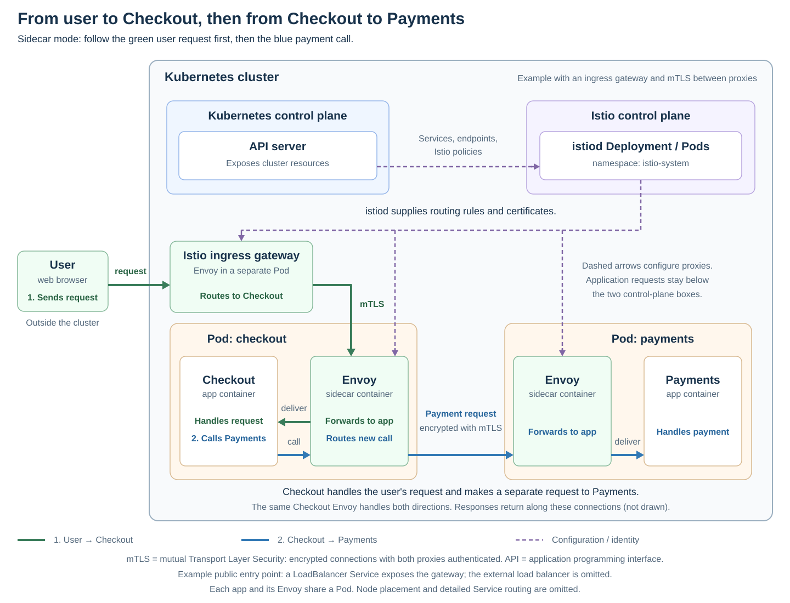

# Istio

[Back to Kubernetes](../Readme.md#content)

# Front

Where does Istio fit inside a Kubernetes cluster, and how does it manage service traffic?

# Back

**Istio is a service mesh: an infrastructure layer that controls, secures, and observes communication between services.** In Kubernetes, it adds management components and traffic proxies alongside your application workloads.

## Two roles inside the cluster

- **Istio control plane (`istiod`):** normally runs as a Deployment, commonly in the `istio-system` namespace. It discovers services, translates routing and security policies into proxy configuration, and manages workload certificates.
- **Istio data plane:** the proxies that handle application traffic. In **sidecar mode**, an Envoy proxy runs as an additional container in each participating application Pod. A **proxy** receives traffic and forwards it to its destination.

The **Kubernetes control plane** still manages cluster resources and schedules Pods. `istiod` uses information from the Kubernetes **application programming interface (API)**, including service endpoints and Istio configuration.

An optional **ingress gateway** is a separate Envoy workload that handles traffic entering the mesh. It is a data-plane component configured by `istiod`.

The diagram shows a **sidecar-mode** installation with an ingress gateway. Follow green arrows for the user's request to Checkout, then blue arrows for Checkout's call to Payments. Dashed arrows carry configuration and identity information. A Kubernetes Service of type `LoadBalancer` provides the gateway's external entry point. The external load balancer, node placement, and detailed Service routing are omitted.

- **User request:** user → ingress gateway → Checkout Envoy → Checkout application.
- **Separate payment call:** Checkout application → the **same Checkout Envoy** → Payments Envoy → Payments application. The sidecar handles both incoming and outgoing traffic.

Responses return along these connections. **Application requests do not pass through `istiod` or the Kubernetes API server:** those components supply information and configuration; Envoy forwards the requests.

## What Istio adds

- **Traffic management:** load balancing, timeouts, retries, and routing rules, such as sending 90% of requests to version 1 and 10% to version 2.
- **Security:** workload identity, access policies, and **mutual Transport Layer Security (mTLS)**. In the illustrated connections, the proxies authenticate both sides and encrypt traffic between them.
- **Observability:** traffic metrics and access logs that help explain service behavior.

## Ambient mode changes the layout

Istio also supports **ambient mode**: a `ztunnel` proxy on each node handles secure connections, and optional Envoy **waypoint** proxies provide request-level features such as web request routing. Participating application Pods do not need Envoy sidecars in this mode. `istiod` remains the control plane.

# Sources

- [Istio — Architecture: Envoy and istiod](https://istio.io/latest/docs/ops/deployment/architecture/)
- [Istio — Installation: istiod Deployment and optional ingress gateway](https://istio.io/latest/docs/setup/install/helm/)
- [Istio — Ingress gateways and external access](https://istio.io/latest/docs/tasks/traffic-management/ingress/ingress-control/)
- [Istio — How proxies route requests to service endpoints](https://istio.io/latest/docs/ops/configuration/traffic-management/traffic-routing/)
- [Istio — Deployment models and Kubernetes service discovery](https://istio.io/latest/docs/ops/deployment/deployment-models/)
- [Istio — Traffic management](https://istio.io/latest/docs/concepts/traffic-management/)
- [Istio — Security and the mutual TLS request path](https://istio.io/latest/docs/concepts/security/)
- [Istio — Sidecar and ambient modes](https://istio.io/latest/docs/overview/dataplane-modes/)
- [Istio — Ambient data plane and ztunnel](https://istio.io/latest/docs/ambient/architecture/data-plane/)
- [Kubernetes — Cluster components](https://kubernetes.io/docs/concepts/overview/components/)
