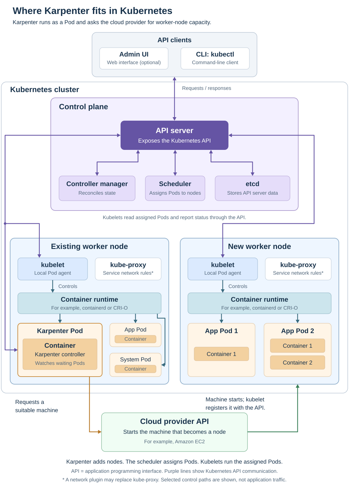
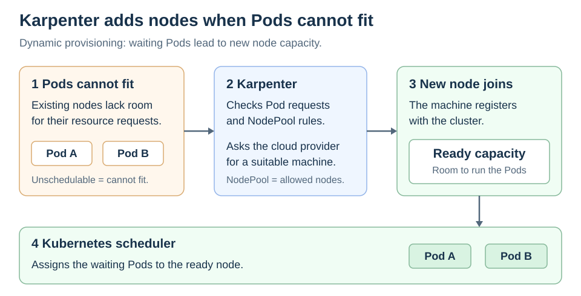

# Karpenter

[Back to Kubernetes](../Readme.md#content)

# Front

How does Karpenter adjust Kubernetes node capacity to fit application demand?

# Back

**Karpenter is an open-source Kubernetes node autoscaler and lifecycle manager.** It provisions suitable nodes when Pods cannot be scheduled, and can remove or replace nodes to reduce cost. A **node** is a machine that runs **Pods**, the units Kubernetes uses to run application containers.

## Where Karpenter fits

Karpenter runs as an installed controller Pod on an existing node, outside the core **control plane** that manages the cluster. In the overview, follow its connection to the Kubernetes **API (application programming interface)** to observe waiting Pods, then its request to the cloud provider for a new machine. The new node's **kubelet**, its local Pod agent, registers with the API server. The scheduler assigns Pods to ready nodes; kubelets run them through a container runtime.

## How dynamic provisioning works

A Pod is **unschedulable** when the Kubernetes scheduler cannot assign it to an existing node. For example, no node may have enough available capacity for its declared processor (CPU) and memory **requests**.

Read left to right, then down: Karpenter supplies capacity; the Kubernetes scheduler places Pods on it.

1. Karpenter watches for unschedulable Pods.
2. It combines their resource requests and placement rules with the allowed node configuration.
3. It asks a supported cloud provider to launch suitable machines, which join the cluster as nodes.
4. The Kubernetes scheduler assigns Pods to ready nodes.

Karpenter sizes capacity from **declared requests**, not directly from live CPU usage. Accurate requests matter.

## The three main resources

These are custom Kubernetes objects used to configure and track capacity:

| Resource | Purpose |
| --- | --- |
| **NodePool** | Rules for allowed nodes, such as zones and machine types, plus resource limits and disruption policy. |
| **NodeClass** | Provider-specific launch settings. On Amazon Web Services (AWS), `EC2NodeClass` specifies settings such as machine images, subnets, and security groups. A NodePool references it. |
| **NodeClaim** | Karpenter's request and lifecycle record for one node; tracks launch, registration, and readiness. |

## Example: more Pods need more room

A **Horizontal Pod Autoscaler (HPA)** changes an application's desired replica count based on metrics. Suppose it increases a workload from 3 to 8 Pods. If some new Pods cannot fit, Karpenter can provision nodes for them. **HPA adjusts Pod count; Karpenter adjusts node capacity.**

Cluster Autoscaler grows preconfigured node groups. Karpenter instead provisions individual cloud machines within NodePool constraints, allowing it to choose suitable capacity for the waiting Pods.

## Reducing cost and respecting constraints

**Consolidation** removes nodes whose workloads can fit elsewhere, or replaces nodes with cheaper capacity. It follows the configured consolidation policy and disruption controls; node removal can require evicting and recreating Pods.

Adding nodes cannot solve incompatible rules. If a Pod requires a zone excluded by every NodePool, Karpenter cannot provision a matching node. A pending Pod alone does not guarantee that scaling will fix it.

# Sources

- [Karpenter — Controller placement and cloud-provider integration](https://karpenter.sh/docs/concepts/)
- [Kubernetes — Cluster components](https://kubernetes.io/docs/concepts/overview/components/)
- [Kubernetes — Node registration](https://kubernetes.io/docs/concepts/architecture/nodes/#self-registration-of-nodes)
- [Karpenter — Overview and provisioning flow](https://karpenter.sh/docs/)
- [Karpenter — NodePools](https://karpenter.sh/docs/concepts/nodepools/)
- [Karpenter — NodeClasses and AWS launch settings](https://karpenter.sh/docs/concepts/nodeclasses/)
- [Karpenter — NodeClaims](https://karpenter.sh/docs/concepts/nodeclaims/)
- [Karpenter — Scheduler responsibilities](https://karpenter.sh/docs/faq/#when-using-preferred-scheduling-constraints-karpenter-launches-the-correct-number-of-nodes-at-first-why-do-they-then-sometimes-get-consolidated-immediately)
- [Karpenter — Consolidation and disruption](https://karpenter.sh/docs/concepts/disruption/)
- [Kubernetes — Node autoscaling, resource requests, and workload autoscaling](https://kubernetes.io/docs/concepts/cluster-administration/node-autoscaling/)
