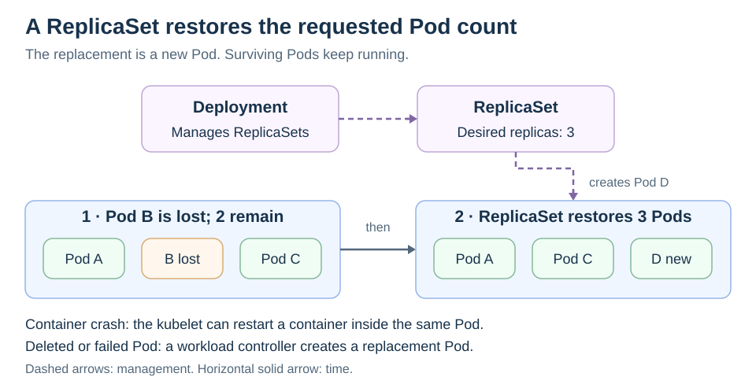
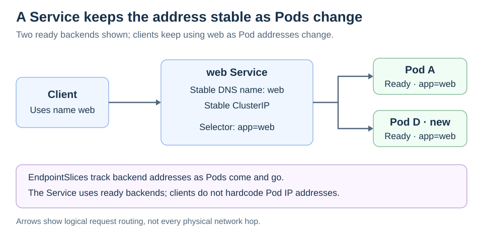
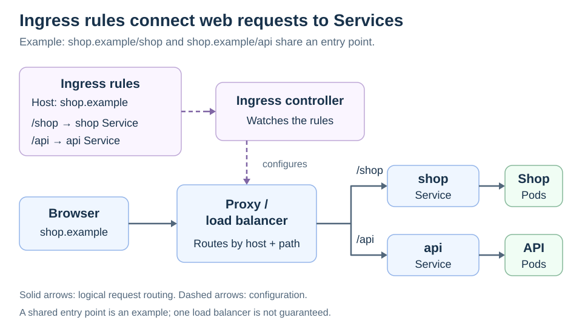
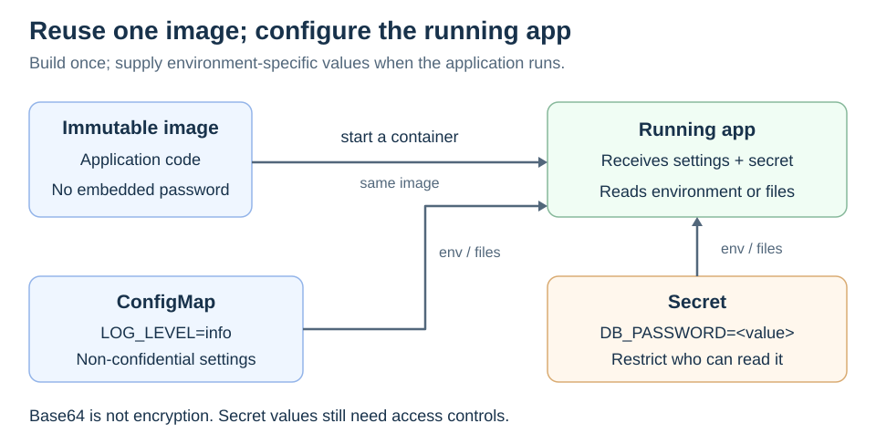
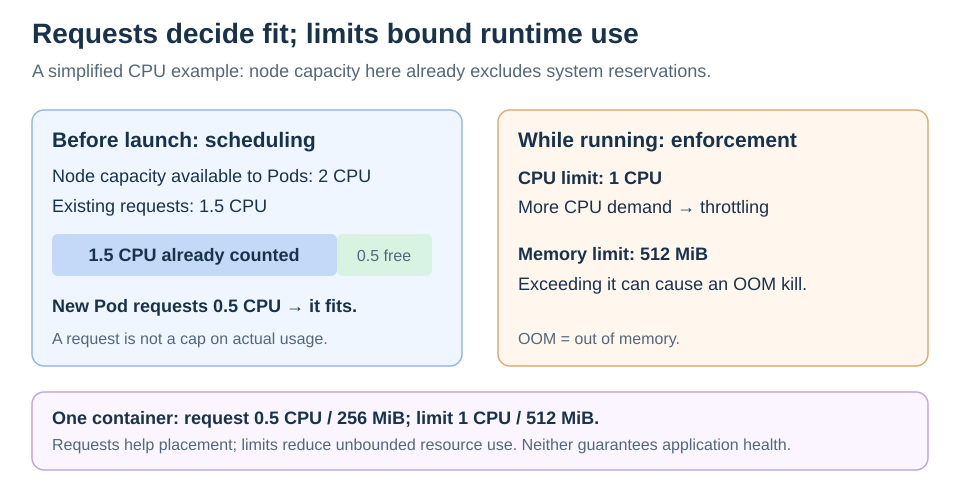
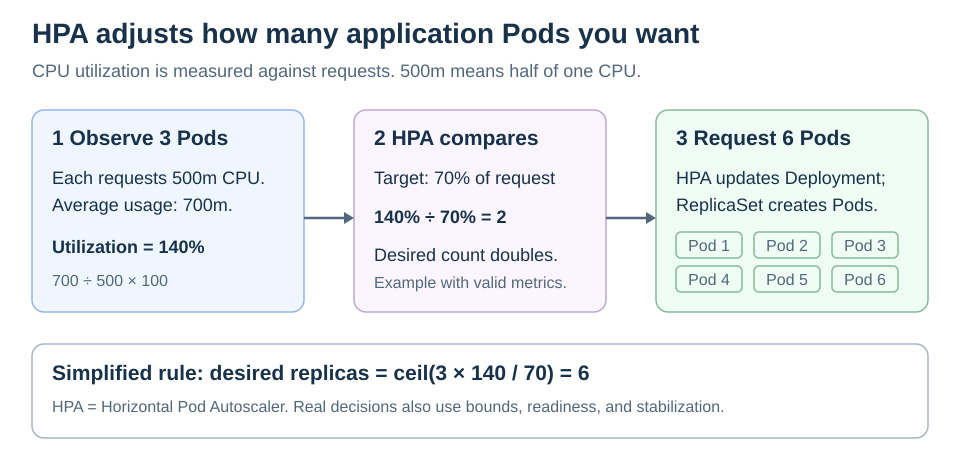
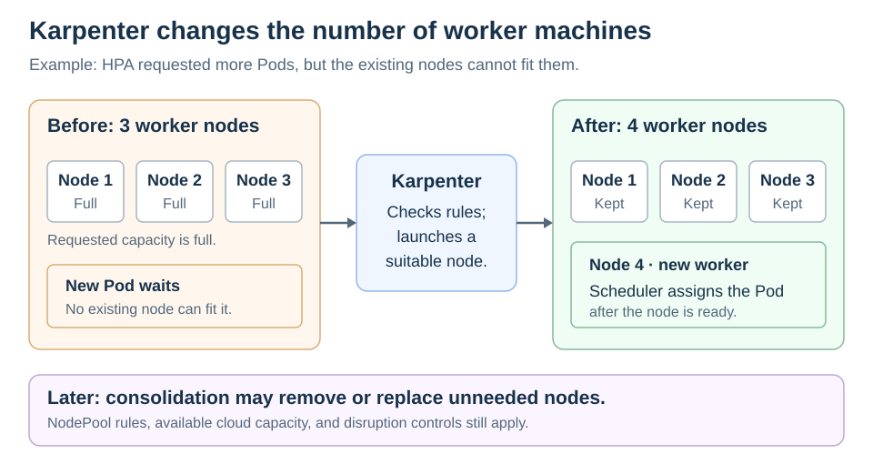
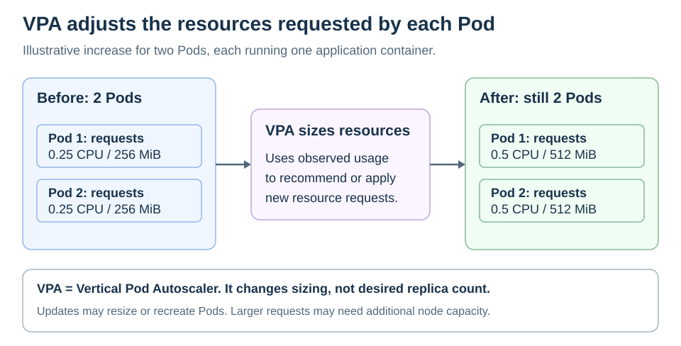

# Kubernetes, One Problem at a Time

<sub>[Back to Kubernetes](../Readme.md#content)</sub>

**Kubernetes concepts solve connected problems around the same application: keeping it running, making it reachable, supplying configuration, and matching resources to demand.** Follow a small web shop as each new problem gives the next concept a purpose.

A [container](../Container%20fundamentals/Readme.md) runs an application process. A [Pod](../Pods/Readme.md) groups one or more containers that run together. A **worker node** is a machine that runs Pods. The [scheduler](../Cluster%20components/Readme.md) chooses a node for a Pod; **controllers** repeatedly work to make the observed state match the desired state you declared.

## Step 1 — Deployment



You launch your shop in a standalone Pod. It works, so you leave it running. Then a failure forces you to intervene. Whether Kubernetes can recover without you depends on what failed:

- **A container crashes inside an existing Pod.** The node's **kubelet**, its local Kubernetes agent, can restart the container according to its restart policy. A crash does not automatically mean the entire Pod disappears.
- **The Pod itself is deleted or cannot recover.** A standalone Pod has no workload controller maintaining a replacement for it. The shop can remain unavailable until you notice and create another Pod.

So you use a [Deployment](../Deployments/Readme.md). It manages [ReplicaSets](../ReplicaSets/Readme.md), which maintain the desired number of Pods. With `replicas: 3`, losing one Pod causes the ReplicaSet to create a replacement. The diagram shows Pod B being replaced by Pod D while A and C remain.

You have declared **“keep three replicas”**, rather than manually creating three independent Pods. Recovery still takes time and requires available capacity; three desired replicas do not guarantee three healthy replicas at every instant.

The application can now replace lost replicas. Its callers still need a way to find those replacements.

## Step 2 — Service



Your checkout application calls the shop at a hardcoded Internet Protocol (**IP**) address. The Deployment replaces that Pod, and the replacement gets a different address. The shop is running again, but checkout still calls the old address and fails. Maintaining a list of Pod IPs just gives you a longer list to repair after replacements and scaling.

The problem is the changing identity of replacement Pods. Restarting a container inside the same Pod is not the same operation as replacing that Pod.

So you create a [Service](../Services/Readme.md). A normal `ClusterIP` Service provides a stable internal virtual IP and a Domain Name System (**DNS**) name. Callers use the Service name instead of a list of Pod IPs.

Give the shop's Pods a [label](../Labels%20and%20Selectors/Readme.md), such as `app: web`, and give the Service a matching **selector**. Kubernetes tracks the matching backends in **EndpointSlices**, objects containing endpoint addresses and readiness information. As Pods change, the backend list changes while the Service remains.

The label chooses which Pods belong behind the Service; actual traffic still reaches their network addresses. This story uses a regular Service with a selector; a **headless Service** deliberately has no cluster IP.

Internal callers now have a stable name. Customers outside the cluster still need a public entrance, and exposing each application separately introduces another cost.

## Step 3 — Ingress or GatewayAPI



You expose the shop through a `LoadBalancer` Service, then do the same for the catalog, orders, and other applications. Suppose your cloud setup provisions a separate load balancer for each: **10 public Services become 10 cloud load balancers.**

Six applications receive almost no traffic, but their load balancers still run. For example, Amazon Web Services (AWS) charges for running Application and Network Load Balancers by the hour, in addition to usage charges. A quiet application therefore does not eliminate its load balancer's running charge. The cloud bill now includes many separately billed entrances to a cluster that could share an entrance for web traffic.

This cost comes from how you exposed the applications. Internal `ClusterIP` Services do not each require a cloud load balancer.

So you use [Ingress](../Ingress/Readme.md) to declare routing for Hypertext Transfer Protocol (**HTTP**) and its secure form (**HTTPS**): `/shop` goes to one Service, `/api` to another. Multiple applications can share an external entry point, reducing the need for a separate public load balancer for every application in this design.

You create those rules in a cluster with no Ingress controller, but the expected routing never appears. Kubernetes has stored your **Ingress object as configuration**; something still has to implement it.

So you install a compatible **Ingress controller**. It reads the rules and programs a proxy or load balancer to implement them. In the diagram, the controller configures the traffic path; application requests do not pass through the Ingress configuration object.

“One load balancer for all Services” is a possible architecture, not an Ingress guarantee. The implementation and configuration determine the actual topology.

The Ingress API is frozen. Kubernetes recommends **Gateway API** for new capabilities; it also needs a compatible implementation. The existing [Ingress card](../Ingress/Readme.md#gateway-api-version) shows how Gateway resources express the same routing story.

Customers can now reach the right application. Next, you deploy that application in staging and discover that reaching it is not enough: it must also use the right environment's settings.

## Step 4 — ConfigMap and Secret



You reuse the production image in staging, but a database address baked into the image still points at production. Correcting the address requires rebuilding and releasing the image, even though the application code has not changed. You repeat that work for development settings, log levels, and every later configuration change.

So you use a [ConfigMap](../ConfigMaps%20and%20Secrets/Readme.md) for **non-confidential configuration**, such as `LOG_LEVEL=info`. A Pod can supply its values to the application through environment variables or mounted files. The same image can run with different settings.

Moving settings out of the image solves the rebuild problem. Then you put `DB_PASSWORD` beside `LOG_LEVEL` in the ConfigMap. Anyone or anything allowed to read that ConfigMap can now retrieve the database credential too. Access intended for ordinary settings has become access to a password.

So you put passwords and private API keys in a [Secret](../ConfigMaps%20and%20Secrets/Readme.md). A Secret is a separate Kubernetes object for sensitive values, allowing different access rules from ordinary configuration. Protect it with least-privilege [role-based access control (RBAC)](../RBAC/Readme.md) and encryption at rest; also restrict who can create Pods that consume it.

**A Secret is not automatically encrypted.** Base64 in its `data` field is reversible encoding, and upstream Kubernetes stores Secrets unencrypted in its backing store, etcd, by default. A managed cluster may configure encryption for you; verify that configuration.

The credential stays out of the built image, but the **running application receives it** when configured to consume it. Updating a ConfigMap or Secret does not refresh an existing container's environment variables. Normal mounted files update eventually and need application reload support; `subPath` mounts do not receive those updates.

The shop now starts with the right settings. Those settings do not tell Kubernetes how much processor capacity or memory the application needs, or how much it may consume alongside its neighbors.

## Step 5 — Requests and Limits



The configured application works in testing. In production, a catalog import makes one container grow to several gigabytes of memory. With no effective memory limit, its growth can exhaust spare memory on a shared worker. Other Pods may be evicted or processes killed as the node runs short. Recreating application Pods does not remove the underlying resource pressure.

There is also a placement problem: without useful resource requests, the scheduler cannot accurately account for the capacity each replica needs. You need both a planning input and a runtime boundary before scaling this workload.

So you set **requests and limits**. A **request** is the amount used for scheduling and resource allocation. A **limit** constrains runtime consumption. Requests are declarations, not measurements of current usage, and a container can use more than its request when resources and limits permit.

For example, this fragment belongs inside one application container's specification:

```yaml
resources:
  requests:
    cpu: "500m"
    memory: "256Mi"
  limits:
    cpu: "1"
    memory: "512Mi"
```

`500m` means half of one central processing unit (**CPU**); `Mi` means mebibytes. The scheduler accounts for the requests when choosing a node. The diagram simplifies this to CPU capacity that is already available to Pods after system reservations.

**CPU limits cause throttling. Memory limits can cause out-of-memory (OOM) termination when exceeded.** Memory enforcement is reactive: excessive allocation can end in a killed process rather than graceful slowing.

These settings reduce uncontrolled contention, but do not make an undersized cluster or a leaking application reliable by themselves.

You have defined the resource budget for each replica. You still have to decide how many replicas should exist as customer demand changes.

## Step 6 — HPA



Some days the shop has 100 users; other days it has 10,000. Three replicas cope with normal traffic, but a promotion overwhelms them. You manually scale to eight, then forget to reduce the count overnight. Their resource requests continue to occupy scheduling capacity while much of that capacity goes unused.

Requests and limits control individual replicas; they do not change the desired replica count. You now have to watch demand and keep editing that count, or leave enough replicas running for the busiest period all day.

So you use the [Horizontal Pod Autoscaler (HPA)](../Horizontal%20Pod%20Autoscaling/Readme.md). It reads metrics and updates the Deployment's desired replica count. The Deployment and ReplicaSet then reconcile that count.

For a **CPU utilization target of 70%**, the denominator is the CPU **request**, not the CPU limit or the node's total capacity. With a `500m` request, `350m` usage is 70% utilization.

The diagram uses a busier example: average usage across three Pods is `700m` per Pod, or 140% of their requests. The simplified calculation suggests six replicas:

```text
desired replicas = ceil(3 × 140 / 70) = 6
```

`ceil` rounds upward. HPA also considers configured bounds, readiness, tolerance, and stabilization. It needs a metrics source, commonly Metrics Server for CPU and memory. Missing CPU requests can leave utilization undefined and prevent scaling for that metric. HPA reacts over time; it cannot promise instant capacity or eliminate every overnight incident.

HPA has answered **“how many replicas?”** But requesting six Pods does not give customers six running replicas if only three can fit on the available machines.

## Step 7 — Karpenter



HPA requests more Pods, but your three worker nodes have no room for their resource requests. The scheduler marks the extra Pods **unschedulable**: no existing node satisfies their needs. The running replicas remain overloaded while the extra ones wait. You could add a worker manually, but then automatic Pod scaling still depends on you supplying machines during a spike.

So you use [Karpenter](../Karpenter/Readme.md). It evaluates those Pods and provisions suitable nodes through a supported cloud provider. **Yes: it can increase the worker-node, or server, count.** In the diagram, three workers become four; the scheduler then places the waiting Pod on the new ready node.

A **NodePool** defines the allowed capacity and provisioning rules. Karpenter must satisfy both those rules and the Pod's requirements. An impossible constraint, an exhausted quota, or unavailable cloud capacity can still prevent scale-up.

The reverse problem appears after the promotion. HPA removes extra replicas, but removing Pods does not by itself terminate the workers you added. Keeping those machines means keeping idle capacity and its running cost.

Karpenter's **consolidation** can remove unneeded nodes or replace them with cheaper capacity, subject to policy and disruption controls. This can reduce idle capacity; it does not mean you pay only for application work or that every quiet node disappears immediately.

Also, **`Pending` is broader than “needs another node.”** A Pod waiting for image setup or other prerequisites may not benefit from an extra server.

Replica count and worker capacity can now follow demand. Both still depend on the resource estimates you put into each Pod's specification. Bad estimates can make an automatic system consistently choose the wrong amount of capacity.

## Step 8 — VPA



Suppose two replicas are enough, but the resource requests you guessed during testing no longer match their usage. If requests are too large, the scheduler accounts for unused capacity and node autoscaling may provision more machines than the workload needs. If requests are too small, actual resource demand can exceed what the scheduler planned for.

Adding copies or machines does not correct those declarations. You could inspect usage and retune every workload after each release, but that becomes another recurring manual task.

So you use the [Vertical Pod Autoscaler (VPA)](../VPA/Readme.md), a separate add-on that uses observed usage to recommend or apply resource settings. The diagram keeps two desired Pods and increases the requests for each. VPA can recommend decreases too.

Applying a recommendation may resize or recreate Pods, depending on versions and update policy. Larger requests still need somewhere to fit, so VPA can create a need for additional node capacity that Karpenter may supply.

Coordinate VPA and HPA carefully: if VPA changes a CPU request used by HPA's utilization target, it changes HPA's denominator even when CPU usage stays constant. Their settings and metrics need to work together.

## Put the decisions together

| Question | Concept responsible |
| --- | --- |
| What runs the application containers? | [Pod](../Pods/Readme.md) |
| What maintains the desired replicas and manages updates? | [Deployment](../Deployments/Readme.md) and [ReplicaSet](../ReplicaSets/Readme.md) |
| How do callers find changing backend Pods? | [Service](../Services/Readme.md), labels, and EndpointSlices |
| How do external web requests select a backend? | [Ingress and its controller](../Ingress/Readme.md), or Gateway API and its implementation |
| Where do runtime settings and credentials come from? | [ConfigMap and Secret](../ConfigMaps%20and%20Secrets/Readme.md) |
| What capacity is counted, and what runtime bounds apply? | Requests and limits |
| How many application replicas should exist? | [HPA](../Horizontal%20Pod%20Autoscaling/Readme.md) |
| How large should each replica's resource requests be? | [VPA](../VPA/Readme.md) |
| How many suitable worker machines are needed? | [Karpenter](../Karpenter/Readme.md) |

During a traffic spike, HPA may request more replicas, a ReplicaSet creates Pods, and Karpenter may supply nodes if they cannot fit. Once scheduled and ready, those Pods join the Service's usable backends. Clients keep using the same entry point while several independent controllers adjust the application underneath it.

# Sources

- [Kubernetes — Pods and container grouping](https://kubernetes.io/docs/concepts/workloads/pods/)
- [Kubernetes — Pod lifecycle, container restarts, and replacement](https://kubernetes.io/docs/concepts/workloads/pods/pod-lifecycle/)
- [Kubernetes — Deployments and ReplicaSets](https://kubernetes.io/docs/concepts/workloads/controllers/deployment/)
- [Kubernetes — Services, selectors, and Service types](https://kubernetes.io/docs/concepts/services-networking/service/)
- [Kubernetes — EndpointSlices and readiness](https://kubernetes.io/docs/concepts/services-networking/endpoint-slices/)
- [Kubernetes — Ingress routing and API status](https://kubernetes.io/docs/concepts/services-networking/ingress/)
- [Kubernetes — Ingress controllers](https://kubernetes.io/docs/concepts/services-networking/ingress-controllers/)
- [AWS — Load balancer running-hour and usage charges](https://aws.amazon.com/elasticloadbalancing/pricing/)
- [Kubernetes — ConfigMaps and configuration updates](https://kubernetes.io/docs/concepts/configuration/configmap/)
- [Kubernetes — Secrets, encoding, and storage](https://kubernetes.io/docs/concepts/configuration/secret/)
- [Kubernetes — Good practices for Secrets](https://kubernetes.io/docs/concepts/security/secrets-good-practices/)
- [Kubernetes — Scheduler responsibilities and resource fit](https://kubernetes.io/docs/concepts/scheduling-eviction/kube-scheduler/)
- [Kubernetes — Resource requests, limits, and enforcement](https://kubernetes.io/docs/concepts/configuration/manage-resources-containers/)
- [Kubernetes — Node memory pressure and Pod eviction](https://kubernetes.io/docs/concepts/scheduling-eviction/node-pressure-eviction/)
- [Kubernetes — Horizontal Pod Autoscaling](https://kubernetes.io/docs/concepts/workloads/autoscaling/horizontal-pod-autoscale/)
- [Kubernetes — Node autoscaling and its relationship to workload autoscaling](https://kubernetes.io/docs/concepts/cluster-administration/node-autoscaling/)
- [Karpenter — Provisioning overview](https://karpenter.sh/docs/)
- [Karpenter — NodePool constraints](https://karpenter.sh/docs/concepts/nodepools/)
- [Karpenter — Consolidation and disruption](https://karpenter.sh/docs/concepts/disruption/)
- [Kubernetes — Vertical Pod Autoscaling](https://kubernetes.io/docs/concepts/workloads/autoscaling/vertical-pod-autoscale/)
- [Kubernetes Autoscaler — VPA limitations and combining it with HPA](https://github.com/kubernetes/autoscaler/blob/master/vertical-pod-autoscaler/docs/known-limitations.md)
