# Kubernetes, One Problem at a Time

<sub>[Back to Kubernetes](../Readme.md#content)</sub>

Kubernetes runs applications on a group of machines called a **cluster**. You tell it what you want, such as “keep three copies of my web shop running.” Kubernetes keeps checking what exists and acts when the two differ. Each section takes a problem the shop faces and shows how the Kubernetes concept in its heading helps solve it.

1. [Deployment](#1-deployment)
2. [Service](#2-service)
3. [Ingress](#3-ingress)
4. [ConfigMap](#4-configmap)
5. [Secret](#5-secret)
6. [Requests](#6-requests)
7. [Limits](#7-limits)
8. [HPA](#8-hpa)
9. [Karpenter](#9-karpenter)
10. [VPA](#10-vpa)

## 1. Deployment

An **image** packages the shop's program and the files it needs. A [container](../Container%20fundamentals/Readme.md) runs the program from that image. Kubernetes runs containers in [Pods](../Pods/Readme.md). A Pod can hold several containers that belong together. Our shop uses one container per Pod, so one Pod is one copy, or **replica**, of the shop.

Each Pod runs on a machine called a **worker node**. If the shop program crashes, an agent on that node, the **kubelet**, can restart its container inside the same Pod. If someone deletes the entire Pod, a standalone Pod has no one asking for another.

A [Deployment](../Deployments/Readme.md) describes the Pod you want and how many copies to keep. It manages a [ReplicaSet](../ReplicaSets/Readme.md) that records the desired count. A **controller** is a program that watches what exists and acts when it differs from what you asked for. In the picture, Pod B disappears. The ReplicaSet controller counts two Pods where you asked for three and creates D. A **scheduler** picks a worker that can run D. Until D starts and is ready to serve, customers have only A and C.

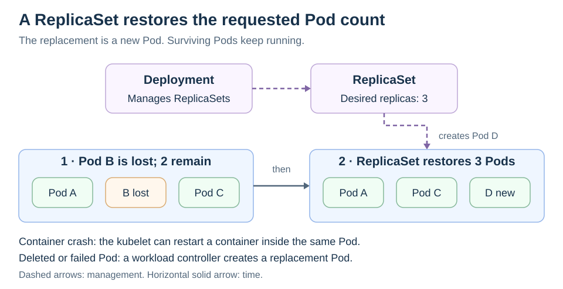

## 2. Service

Checkout is another app inside the cluster. Someone gave it Pod B's network address. Pod D can have a different address. Give checkout a stable name to call by creating a [Service](../Services/Readme.md) called `web`. With the usual internal Service, called a `ClusterIP` Service, the cluster's Domain Name System (DNS) looks up `web` and returns the Service's address.

How does Kubernetes know D belongs behind `web`? A [label](../Labels%20and%20Selectors/Readme.md) is a tag on a Pod. A **selector** on the Service says which tags to match. In the picture the selector matches Pods tagged `app=web`. Kubernetes keeps records called **EndpointSlices** with their addresses and whether they are ready to serve. Once D is ready and the list updates, new connections to `web` can reach it. Checkout keeps using the same name.

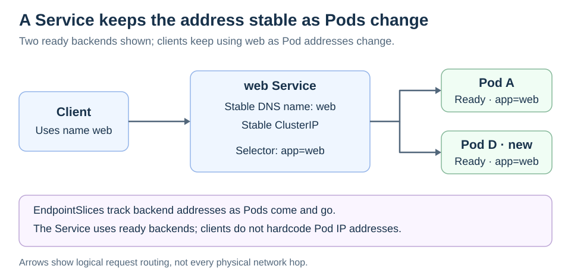

## 3. Ingress

Checkout can reach the shop through its internal Service. A customer's browser still needs a public way in. You could give each app a public load balancer, a component that accepts traffic and sends it on. If your cloud provider bills for each one, even a quiet app can cost money to expose this way.

An [Ingress](../Ingress/Readme.md) holds rules for sharing a web address. In the next picture the storefront Service is named `shop`. It does the same job as `web` above. The two rules send `shop.example/shop` to the storefront and `shop.example/api` to a different Service.

Without a compatible **Ingress controller**, Kubernetes stores the rule, but saving it changes nothing for the browser trying to reach `/shop`. If your cluster doesn't already run a controller for that rule, install one. The controller reads the rule and configures a **proxy**, the program that forwards incoming requests. Trace the solid arrows from the browser through the proxy toward one shop Pod. The dashed arrows show how the proxy learned the rule.

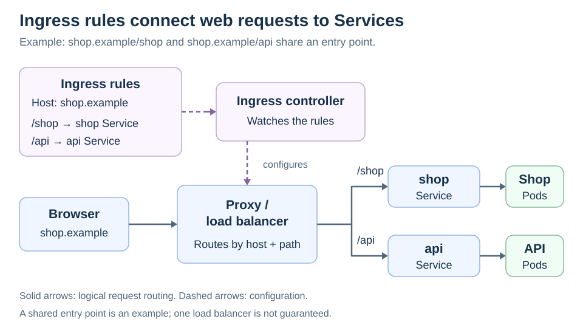

The Ingress application programming interface (API) is **frozen**. Kubernetes still supports it and has no plans to remove it. New routing features go into [Gateway API](../Ingress/Readme.md#gateway-api-version), which Kubernetes recommends for new designs. With a compatible controller, a `Gateway` describes where traffic arrives and an `HTTPRoute` matches web requests to Services.

<details>
<summary>See how the Deployment and the browser reach the same Pods</summary>

This overview uses a separate example. Here **checkout is the public app**. On the left, its Deployment asks for four replicas labeled `app=checkout`. The cluster's **control plane**, the software that coordinates the workers, places and maintains those Pods. On the right, follow a browser request through the public entrance to one ready checkout Pod. The customer keeps the same address while Kubernetes replaces copies behind it.

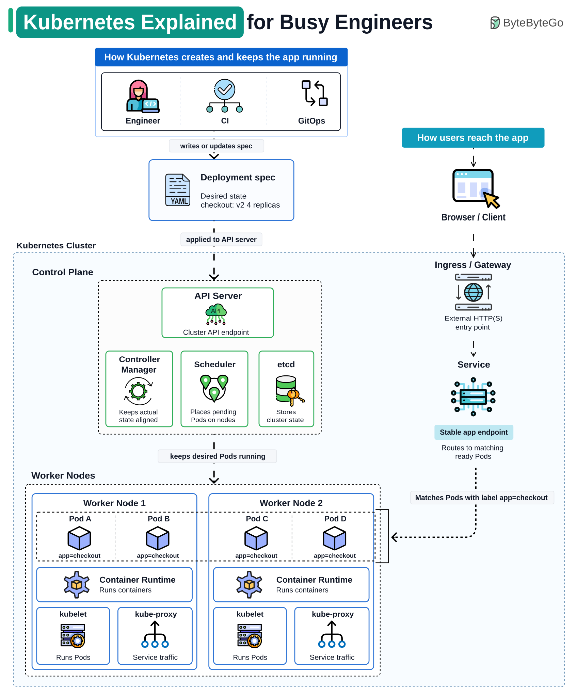

</details>

## 4. ConfigMap

The team copied the live shop's image into its test environment. The program runs, but it still has the live database address built into it. Keep one image and supply the right settings when each shop starts.

The test shop's [ConfigMap](../ConfigMaps%20and%20Secrets/Readme.md) holds ordinary settings. Set `DB_HOST=test-db` to direct the app to the test database and `LOG_LEVEL=info` to choose how much it logs. The Pod can pass these settings to the app as files or as **environment variables**, named values passed to the program at startup.

In the picture, the Pod uses `envFrom` to take both entries from the ConfigMap. Follow the `DB_HOST` row into the container to see what the shop reads at startup.

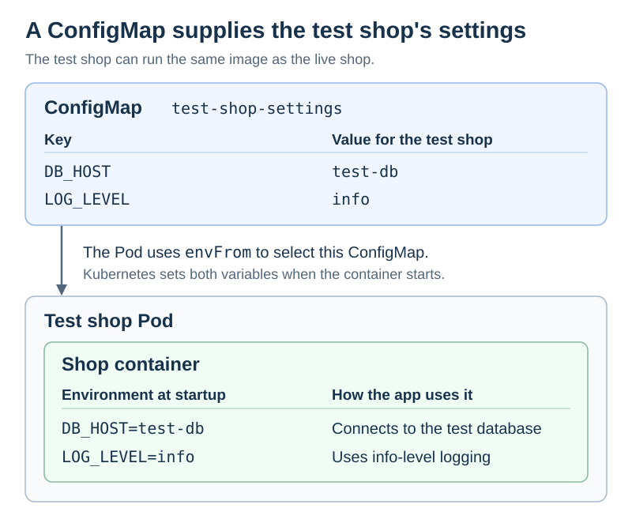

## 5. Secret

The test shop also needs a password to connect. Put `DB_PASSWORD` in a **Secret** so you can grant access to the password separately from the ordinary settings. Follow the two arrows from the ConfigMap and the Secret into the running app. Both kinds of settings reach the app without rebuilding its image.

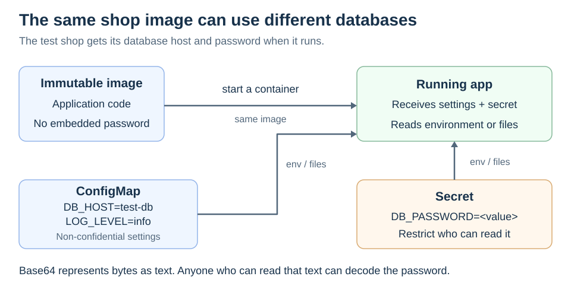

A running container keeps the environment variables it started with. Replace the Pod to pick up a changed value. If you mount a ConfigMap or Secret as a directory, the files update after a delay and the app must reread them. If you mount just one file using `subPath`, that file keeps its original value until you replace the Pod.

**Base64** is a way to represent bytes as text. Anyone who can read a Secret's `data` field can decode the password without a key. Use [role-based access control (RBAC)](../RBAC/Readme.md) to restrict who can read Secrets and who can create Pods that use them. Enable encryption in the cluster's data store, where Kubernetes stores Secrets unencrypted by default.

## 6. Requests

Before a shop Pod can import its product catalog, the scheduler needs to find a worker with room for it. A resource **request** tells the scheduler how much processor time and memory to count for the container. The shop requests half a central processing unit (CPU), written as `500m` (500 millicpu), and 256 mebibytes of memory, written as `256Mi`.

Suppose a worker has two CPUs available to Pods. Existing requests add up to 1.5 CPUs. Compare the worker before and after the scheduler places the shop Pod. Its `500m` request fills the remaining half CPU, provided the worker also meets its memory and other requirements.

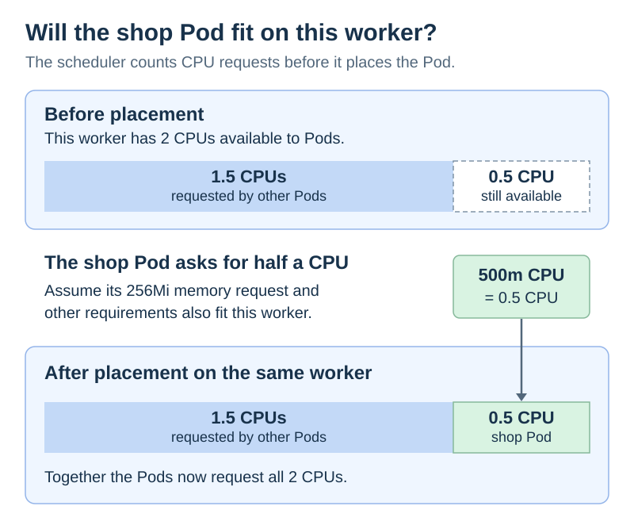

The left panel in [Limits](#7-limits) shows this same worker. The right panel follows the shop container once it starts running.

## 7. Limits

Once the catalog import starts, the shop can use more memory than it requested. Other apps share the worker, so you set a **limit** on how much the shop container may use.

| Setting on the shop container | What Kubernetes does with it |
| --- | --- |
| **Request** half a CPU and 256 mebibytes of memory | The scheduler counts those amounts when choosing a worker. The container can use more when capacity and its limits allow. |
| **Limit** the container to one CPU and 512 mebibytes of memory | At its CPU limit the container waits for more processor time (**throttling**). If it exceeds its memory limit, the system can kill its process. Kubernetes reports that termination as `OOMKilled` (out of memory). |

In the picture, **Before launch: scheduling** shows where the Pod's half-CPU request fits. **While running: enforcement** shows what happens when the import needs more CPU or memory than its limit allows.

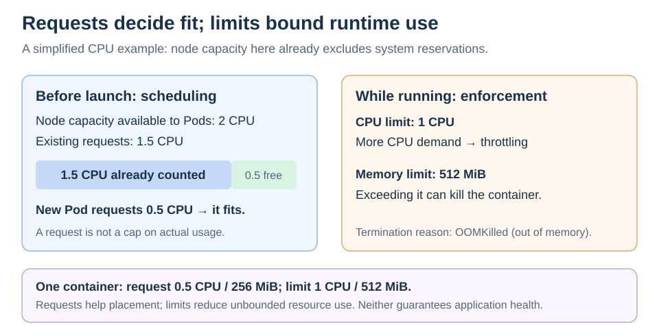

<details>
<summary>See the settings for this shop container</summary>

```yaml
resources:
  requests:
    cpu: "500m"
    memory: "256Mi"
  limits:
    cpu: "1"
    memory: "512Mi"
```

</details>

## 8. HPA

Three Pods usually handle the shop's traffic. A sale fills all three with work. The [Horizontal Pod Autoscaler (HPA)](../Horizontal%20Pod%20Autoscaling/Readme.md) watches measurements and changes the number of copies requested in the Deployment. The ReplicaSet then creates or removes Pods to match.

Each Pod requests `500m` of CPU. Suppose the HPA aims for 70% of that request, or `350m` per Pod. During the sale the Pods average `700m` each. That explains the two percentages in the picture. Usage is **140% of the request**, twice the **70% target**, so the simple estimate doubles the desired count from three to six.

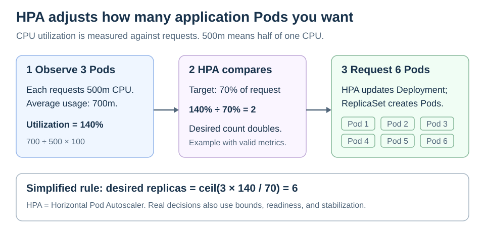

The HPA gets CPU measurements from a source such as Metrics Server. If a shop container has no CPU request, its Pod's utilization percentage is undefined and the HPA cannot scale on that metric. With measurements and requests in place, it checks periodically and keeps the desired count within the minimum and maximum you set.

## 9. Karpenter

Six copies are wanted, but none of the three workers has room for another Pod's memory request. Use the Kubernetes command-line tool, [kubectl](../Kubectl/Readme.md), to list the Pods with `kubectl get pods`. The three new shop Pods show `Pending`.

To see why, run `kubectl describe pod POD_NAME`, replacing `POD_NAME` with a name from that list. Under **Events**, look for `FailedScheduling`. A message such as `Insufficient memory` tells you the scheduler couldn't find a worker with enough room for the Pod's request.

The `STATUS` column in `kubectl get pods` can show more detail than the Pod's **phase**, the broad stage Kubernetes records. After a worker is assigned, the phase can still be `Pending` while the image downloads. During setup the column usually shows `ContainerCreating`. If an image pull fails, it can show `ImagePullBackOff` while the worker waits to retry.

When no worker fits, a node autoscaler such as [Karpenter](../Karpenter/Readme.md) can ask a supported cloud provider for a suitable machine. Its **NodePool** sets rules about which machines it may add, and the provider needs capacity to supply one. In the picture, a fourth worker lets the scheduler place a waiting Pod. Once ready, the Pod can receive traffic through the existing Service.

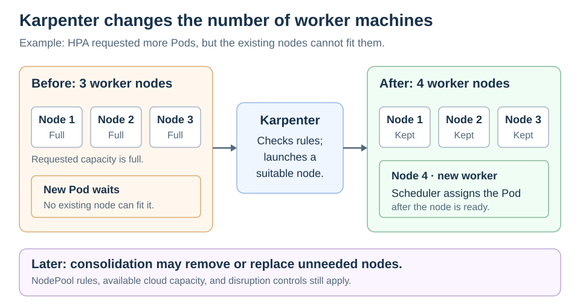

After the sale, HPA can ask for fewer replicas. Karpenter checks whether the remaining Pods fit on fewer or cheaper workers. It counts each Pod's full **resource requests** even when its measured CPU use is low. If the requests fit and placement and disruption rules allow the move, Karpenter can remove a worker or replace it with a cheaper one. This is called **consolidation**.

## 10. VPA

Suppose two Pods can handle the traffic. After a software update, each shop container regularly uses nearly `512Mi` of memory. Halfway through a catalog import, one tries to grow beyond its `512Mi` limit. This time the system kills the shop process and the kubelet restarts the container. In `kubectl describe pod POD_NAME`, the container's **Last State** shows the reason `OOMKilled`.

The [Vertical Pod Autoscaler (VPA)](../VPA/Readme.md) is an add-on that uses past usage to recommend resource requests for each container. For this shop it recommends raising the memory request from `256Mi` to `512Mi`. Recent imports have also kept CPU use above the original `500m` request, so in this example VPA recommends one CPU per container. Count the Pods on both sides of the picture. There are still two.

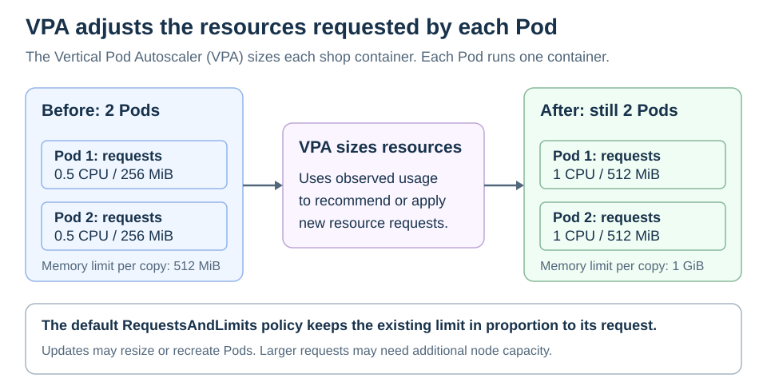

You can read the recommendation or let VPA apply it. With the default `RequestsAndLimits` policy, VPA scales each existing limit in proportion to its request. Here doubling the memory request also doubles the limit, from `512Mi` to `1Gi` (1,024 mebibytes). With `RequestsOnly`, the limit would stay at `512Mi` and the same import could still trigger a restart. Applying new values may resize a running Pod or require a replacement, depending on the cluster and update policy. The new requests must still fit on a worker.

The CPU part of that recommendation affects the HPA you set up for the sale. Applying it doubles the CPU request that HPA uses to calculate utilization. At the same CPU usage, HPA now sees half the previous percentage and might ask for fewer copies. To give the import more memory while keeping the HPA's CPU calculation unchanged, you can configure VPA to adjust memory only.

When the shop slows down, ask which quantity needs to change. HPA adjusts **how many copies** to run. VPA adjusts **how much each copy requests**. Karpenter adjusts **which machines are available** to run those copies.

## Check your understanding

1. You create three standalone Pods and delete one. Why would three Pods created through a Deployment behave differently?

   <details>
   <summary>Answer</summary>

   A Deployment with three replicas has a ReplicaSet controller that sees the missing copy and creates another. The standalone Pods have no controller maintaining their count.

   </details>

2. Pod D replaces B and has a different network address. Why can checkout keep using the name `web`?

   <details>
   <summary>Answer</summary>

   `web` names the Service. Its selector matches D's shop label. Once D is ready and Kubernetes updates the Service's destinations, new connections to `web` can reach D.

   </details>

3. Checkout can call `web` after a Pod replacement. The public `/shop` route still fails. Which two parts have different jobs here?

   <details>
   <summary>Answer</summary>

   The internal Service lets checkout reach ready shop Pods by name. For the public path, check the Ingress rule and the controller that sets up the proxy to forward requests.

   </details>

4. The test database has a new address and password. Where should each go, and how does a shop that uses environment variables pick them up?

   <details>
   <summary>Answer</summary>

   Put the address in the test shop's ConfigMap and the password in its Secret. Start replacement Pods to read the new environment variables.

   </details>

5. A teammate can read the Secret's base64-encoded `DB_PASSWORD`. Can they recover the password without an encryption key?

   <details>
   <summary>Answer</summary>

   Yes. Base64 represents the password as text that anyone can decode. Use RBAC to control who can read the Secret and who can create Pods that use it.

   </details>

6. A worker has `600m` of CPU left after counting requests. Can the scheduler place a Pod that requests `500m` and has a limit of one CPU?

   <details>
   <summary>Answer</summary>

   Yes, if the other requirements also fit. The scheduler counts the `500m` request. The one-CPU limit caps use after the container starts.

   </details>

7. An import tries to use more than its one-CPU limit. What happens, and how would exceeding its memory limit differ?

   <details>
   <summary>Answer</summary>

   The container waits for processor time (throttling). Exceeding the memory limit can cause the system to kill the shop process, with `OOMKilled` as the termination reason.

   </details>

8. Three Pods average twice their CPU utilization target. HPA asks for six replicas, but the three new Pods cannot find a worker with enough memory. Why did the count double, and what would help now?

   <details>
   <summary>Answer</summary>

   HPA multiplied three copies by the ratio of observed utilization to the target, which was two. The waiting Pods now need worker capacity. Karpenter can supply a suitable machine if the provider and NodePool allow it.

   </details>

9. A new shop Pod shows `Pending` in `kubectl get pods`. How would you find out whether adding a worker could help?

   <details>
   <summary>Answer</summary>

   Run `kubectl describe pod POD_NAME` using that Pod's name. Under **Events**, look for the scheduler's reason. If `FailedScheduling` reports `Insufficient memory`, the Pod's memory request didn't fit on any eligible worker. Adding a suitable worker with enough available memory could let the Pod start.

   </details>

10. A shop container with a `256Mi` memory request and a `512Mi` limit restarts during an import that needs `600Mi`. Which termination reason would you look for, and would that peak fit after VPA doubles the request under its default policy?

    <details>
    <summary>Answer</summary>

    Look for `OOMKilled` in the container's **Last State**. The import needed more than the old `512Mi` limit. When VPA applies the `512Mi` request, its default `RequestsAndLimits` policy also doubles the limit to `1Gi`. The `600Mi` peak fits within that limit.

    </details>

11. VPA raises a CPU request from `500m` to one CPU. Usage holds steady at `350m`. What would HPA see?

    <details>
    <summary>Answer</summary>

    CPU utilization falls from 70% to 35% because the request doubled. HPA can respond to that change even though customers are sending just as much traffic.

    </details>

# Sources

- [Kubernetes — Cluster components](https://kubernetes.io/docs/concepts/overview/components/)
- [Kubernetes — Container images](https://kubernetes.io/docs/concepts/containers/images/)
- [Kubernetes — Pods and their containers](https://kubernetes.io/docs/concepts/workloads/pods/)
- [Kubernetes — Pod lifecycle and container restarts](https://kubernetes.io/docs/concepts/workloads/pods/pod-lifecycle/)
- [Kubernetes — Diagnose Pending Pods and read scheduler events](https://kubernetes.io/docs/tasks/debug/debug-application/debug-pods/#my-pod-stays-pending)
- [Kubernetes source — How the Pod table displays a container's waiting reason](https://github.com/kubernetes/kubernetes/blob/v1.36.0/pkg/printers/internalversion/printers.go#L1031)
- [Kubernetes — Deployments and ReplicaSets](https://kubernetes.io/docs/concepts/workloads/controllers/deployment/)
- [Kubernetes — Services and name discovery](https://kubernetes.io/docs/concepts/services-networking/service/)
- [Kubernetes — EndpointSlices and readiness](https://kubernetes.io/docs/concepts/services-networking/endpoint-slices/)
- [Kubernetes — Ingress rules](https://kubernetes.io/docs/concepts/services-networking/ingress/)
- [Kubernetes — Ingress controllers](https://kubernetes.io/docs/concepts/services-networking/ingress-controllers/)
- [Kubernetes — Gateway API and HTTPRoute](https://kubernetes.io/docs/concepts/services-networking/gateway/)
- [Amazon Web Services — Load balancer pricing](https://aws.amazon.com/elasticloadbalancing/pricing/)
- [Kubernetes — ConfigMaps](https://kubernetes.io/docs/concepts/configuration/configmap/)
- [Red Hat Developer — ConfigMap entries as environment variables, figure 5](https://developers.redhat.com/blog/2021/04/28/kubernetes-configuration-patterns-part-1-patterns-for-kubernetes-primitives)
- [Kubernetes — Secrets](https://kubernetes.io/docs/concepts/configuration/secret/)
- [Kubernetes — Access control and encryption for Secrets](https://kubernetes.io/docs/concepts/security/secrets-good-practices/)
- [Kubernetes — Resource requests and limits](https://kubernetes.io/docs/concepts/configuration/manage-resources-containers/)
- [Michael Gasch, KubeCon Europe — Pod requests and allocatable node capacity, slide 29](https://static.sched.com/hosted_files/kccnceu18/33/Inside%20Kubernetes%20QoS%20M.%20Gasch%20KubeCon%20EU%20FINAL.pdf#page=29)
- [Kubernetes — Diagnose memory-limit restarts and Pods waiting for memory](https://kubernetes.io/docs/tasks/configure-pod-container/assign-memory-resource/)
- [Kubernetes — Horizontal Pod Autoscaling](https://kubernetes.io/docs/concepts/workloads/autoscaling/horizontal-pod-autoscale/)
- [Kubernetes — Node autoscaling](https://kubernetes.io/docs/concepts/cluster-administration/node-autoscaling/)
- [Karpenter — NodePools](https://karpenter.sh/docs/concepts/nodepools/)
- [Karpenter — Consolidation and disruption](https://karpenter.sh/docs/concepts/disruption/)
- [Kubernetes — Vertical Pod Autoscaling](https://kubernetes.io/docs/concepts/workloads/autoscaling/vertical-pod-autoscale/)
- [Kubernetes Autoscaler — VPA policies for requests and limits](https://github.com/kubernetes/autoscaler/blob/master/vertical-pod-autoscaler/docs/api.md#containercontrolledvalues)
- [Kubernetes Autoscaler — Combining VPA with HPA](https://github.com/kubernetes/autoscaler/blob/master/vertical-pod-autoscaler/docs/known-limitations.md)
