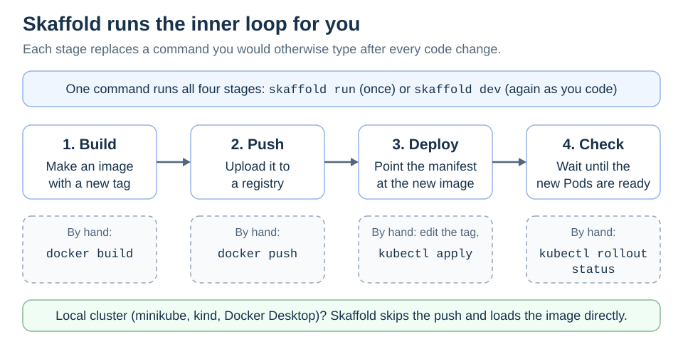
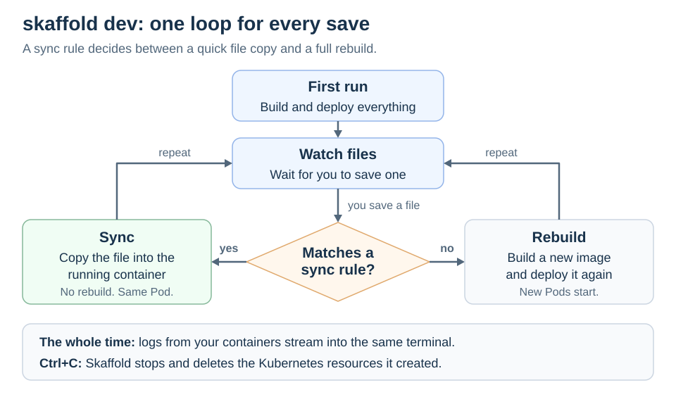

# Skaffold

<sub>[Back to Kubernetes](../Readme.md#content)</sub>

**Skaffold is a command-line tool that updates your app in Kubernetes every time you save a file.** It automates the slow routine of building an image, pushing it, updating the Kubernetes YAML, and checking the result. This article covers that routine, the config file, the `skaffold dev` loop, and what to pick for a new project.

## The problem: a slow inner loop

The **inner loop** is the cycle a developer repeats all day: change the code, run it, look at the result. For an app on Kubernetes, one turn by hand looks like this:

1. Build an image with a new tag (`docker build`).
2. Push it to a registry the cluster can pull from (`docker push`).
3. Put the new tag into the **manifest**, the YAML file that describes your app, and apply it (`kubectl apply`).
4. Wait until the new Pods are ready (`kubectl rollout status`).

That takes minutes, and it is easy to skip a step, such as changing the tag. Skaffold runs the same four stages for you. In the diagram, the top row is what Skaffold does, and the dashed box under each stage is the command it replaces.



Skaffold runs only on your machine, installs nothing in the cluster, and works with local and remote clusters.

## One config file: `skaffold.yaml`

Skaffold reads `skaffold.yaml` from the project folder. `skaffold init` can write a first version by looking at your Dockerfiles and manifests. A minimal file says which image to build and which manifests use it:

```yaml
apiVersion: skaffold/v4beta14
kind: Config
build:
  artifacts:
    - image: hello-app        # built from ./Dockerfile
manifests:
  rawYaml:
    - k8s/deployment.yaml     # uses "image: hello-app"
```

With nothing else configured, Skaffold builds with your local Docker and deploys with `kubectl`. Before it deploys, it rewrites `image: hello-app` in the manifest to point at the exact image it just built, so you never edit tags by hand.

## What `skaffold dev` does

`skaffold dev` is the main command. It builds and deploys everything once, then watches your source files. Follow the diagram from the top:



- If a changed file matches a **sync rule** in `skaffold.yaml`, such as "copy `*.html` files to `/app/static`", Skaffold copies the file straight into the running container. Nothing is rebuilt, and the Pod keeps running. Your app has to notice the new file by itself, so this suits static files or a server with hot reload.
- Any other change goes through the pipeline again: Skaffold rebuilds the image and redeploys it.
- Container logs stream into the same terminal.
- `Ctrl+C` stops the loop and deletes the Kubernetes resources that Skaffold created.

## Other commands

`skaffold run` builds and deploys once, which suits CI. `skaffold build` and `skaffold deploy` run each half alone. `skaffold delete` removes what was deployed.

## Good to know

- **A local cluster gets no push.** If kubectl points at a local cluster (minikube, kind, k3d, or Docker Desktop), Skaffold loads the image straight into it. A Pod with `imagePullPolicy: Always` can then fail, because no registry has the image.
- **File sync has limits.** The container needs the `tar` command, and only your source files sync, not files the build creates.

## For a new project: Tilt or DevSpace

Skaffold's GitHub repository will be archived (made read-only) on January 29, 2027. Old releases keep working, but no new fixes will come. For a new project, pick an active tool that does the same job:

- **Tilt**: `tilt up` works like `skaffold dev`. Its config, the `Tiltfile`, is code in Starlark (a Python dialect), not YAML.
- **DevSpace**: the closest match. One `devspace.yaml`, nothing installed in the cluster, and two-way file sync.

# Sources

- [Skaffold — Overview and archive notice](https://skaffold.dev/docs/)
- [Skaffold — Quickstart](https://skaffold.dev/docs/quickstart/)
- [Skaffold — `skaffold.yaml` reference](https://skaffold.dev/docs/references/yaml/)
- [Skaffold v2.25.0 — Defaults (source)](https://github.com/GoogleContainerTools/skaffold/blob/v2.25.0/pkg/skaffold/schema/defaults/defaults.go)
- [Skaffold — `skaffold dev`](https://skaffold.dev/docs/workflows/dev/)
- [Skaffold — Status check](https://skaffold.dev/docs/status-check/)
- [Skaffold — File sync](https://skaffold.dev/docs/filesync/)
- [Skaffold — Log tailing](https://skaffold.dev/docs/log-tailing/)
- [Skaffold — CLI reference](https://skaffold.dev/docs/references/cli/)
- [Skaffold — Local clusters](https://skaffold.dev/docs/environment/local-cluster/)
- [GitHub — Archiving repositories](https://docs.github.com/en/repositories/archiving-a-github-repository/archiving-repositories)
- [Tilt — Getting started](https://docs.tilt.dev/)
- [Tilt — Tiltfile concepts](https://docs.tilt.dev/tiltfile_concepts.html)
- [DevSpace — What is DevSpace?](https://www.devspace.sh/docs/getting-started/introduction)
