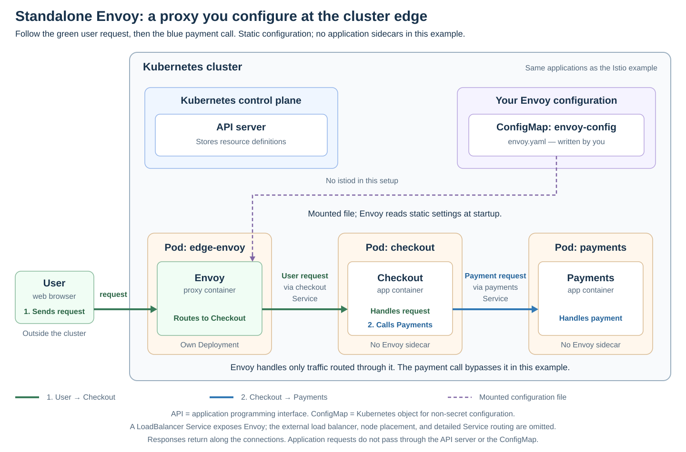

# Standalone Envoy

[Back to Kubernetes](../Readme.md#content)

# Front

What is standalone Envoy, and where does it fit inside a Kubernetes cluster compared with Istio?

# Back

**Standalone Envoy means running and configuring Envoy Proxy directly, without a service-mesh control plane such as Istio's `istiod`.**

A proxy receives requests and forwards them to a destination. Envoy can route traffic, balance load, retry requests, check backend health, and collect traffic metrics.

## Where it fits in Kubernetes

One option is an **edge reverse proxy**: Envoy runs in its own Deployment and receives requests on behalf of application servers. A Kubernetes Service of type `LoadBalancer` provides its external entry point. Internal Services give applications stable network endpoints while their Pods can change.

The diagram uses the same User, Checkout, and Payments example as the [Istio card](../Istio/Readme.md). Follow green arrows for the user request and blue arrows for Checkout's separate payment call. This example has one Envoy at the edge and no application sidecars. The external load balancer and detailed Service routing are omitted.

- **User request:** user → Envoy → Checkout Service → Checkout application.
- **Payment call:** Checkout application → Payments Service → Payments application. This call bypasses the edge Envoy, so its rules and metrics do not cover this traffic.
- **Configuration:** a ConfigMap, a Kubernetes object for non-secret configuration, supplies `envoy.yaml` as a mounted file. Envoy reads its static settings at startup.

Responses return along the corresponding connections.

**Application requests do not pass through the Kubernetes API (application programming interface) server or the ConfigMap.**

## What you configure

- **Listener:** the address and port where Envoy accepts connections.
- **Route:** a rule that selects a destination, for example sending `/checkout` requests to Checkout.
- **Upstream cluster:** Envoy's name for a group of destination servers. It is different from a Kubernetes cluster. In this example, the destination is reached using the Checkout Service's name.

For this static setup, apply changed settings by restarting or redeploying Envoy, or using its hot-restart mechanism. Updating the mounted file alone does not reload static resources.

Envoy can also receive dynamic updates through **xDS** (the family of “discovery service” APIs) from a configuration provider you supply. That provider need not be Istio.

## Difference from Istio

You choose where to deploy Envoy and how to maintain routing, discovery, and certificates. Envoy supports **Transport Layer Security (TLS)**, including mutual TLS, but running an edge proxy does not automatically secure every service-to-service connection.

Envoy can also run as a **sidecar**, an extra container beside an application; “standalone” does not require the edge-only layout shown here. Istio adds coordinated proxy configuration and mesh management.

**Envoy Gateway** is a separate project that manages Envoy proxies from Kubernetes Gateway API resources. This diagram shows directly configured Envoy Proxy.

# Sources

- [Envoy — What is Envoy?](https://www.envoyproxy.io/docs/envoy/latest/intro/what_is_envoy)
- [Envoy — Request flow and deployment topologies](https://www.envoyproxy.io/docs/envoy/latest/intro/life_of_a_request)
- [Envoy — Listeners, upstreams, and clusters](https://www.envoyproxy.io/docs/envoy/latest/intro/arch_overview/intro/terminology)
- [Envoy — Static configuration](https://www.envoyproxy.io/docs/envoy/latest/start/quick-start/configuration-static)
- [Envoy — Static reloads and dynamic xDS configuration](https://www.envoyproxy.io/docs/envoy/latest/intro/arch_overview/operations/dynamic_configuration)
- [Kubernetes — ConfigMaps and mounted configuration files](https://kubernetes.io/docs/concepts/configuration/configmap/)
- [Kubernetes — Services and LoadBalancer exposure](https://kubernetes.io/docs/concepts/services-networking/service/)
- [Istio — Proxy configuration and control-plane responsibilities](https://istio.io/latest/docs/ops/deployment/architecture/)
- [Envoy Gateway — Controller and proxy responsibilities](https://gateway.envoyproxy.io/docs/concepts/)
