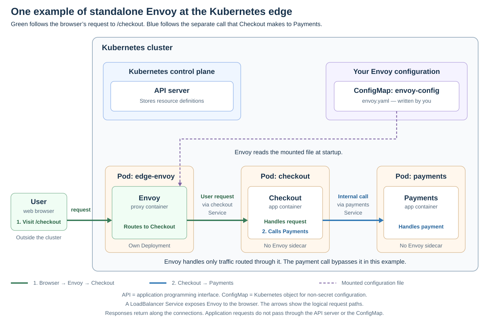

# Standalone Envoy

[Back to Kubernetes](../Readme.md#content)

**With standalone Envoy, your team runs the proxy and supplies its configuration.** You can place it at the cluster edge to receive client requests or beside an application to forward calls that application makes.

A proxy receives requests and forwards them to a destination. Envoy can route traffic, balance load, retry requests, check backend health, and collect traffic metrics.

## Where it fits in Kubernetes

One option is an **edge reverse proxy**: Envoy runs in its own Deployment and receives requests on behalf of application servers. A Kubernetes Service of type `LoadBalancer` provides its external entry point. Internal Services give applications stable network endpoints while their Pods can change.

As in the [Istio example](../Istio/Readme.md), green arrows trace the user's request to `/checkout`. Blue arrows trace a separate call that Checkout makes to Payments inside the cluster.

- **User request:** user → Envoy → Checkout Service → Checkout application.
- **Payment call:** Checkout application → Payments Service → Payments application. This call bypasses the edge Envoy, so its rules and metrics do not cover this traffic.
- **Configuration:** a ConfigMap, a Kubernetes object for non-secret configuration, supplies `envoy.yaml` as a mounted file. Envoy reads its static settings at startup.

Responses return along the same connections. The Kubernetes API server and the ConfigMap are outside the request path.

## What you configure

- **Listener:** the address and port where Envoy accepts connections.
- **Route:** a rule that selects a destination, for example sending `/checkout` requests to Checkout.
- **Upstream cluster:** Envoy's name for a group of destination servers. It is different from a Kubernetes cluster. In this example, the destination is reached using the Checkout Service's name.

For this static setup, apply changed settings by restarting or redeploying Envoy, or using its hot-restart mechanism. Updating the mounted file alone does not reload static resources.

Envoy can also receive dynamic updates through **xDS** (the family of “discovery service” APIs) from a configuration provider you supply. That provider need not be Istio.

## Comparing standalone Envoy, Kubernetes Gateway API, and Istio

**Use standalone Envoy to manage outgoing calls.** Point Checkout at Envoy's local listening port. Envoy forwards each call to Payments and can enforce a timeout or measure how long it took. You gain those controls outside the application, at the cost of an extra hop and a proxy to configure and upgrade.

**Use Gateway API to describe how clients reach Checkout.** A controller configures the gateway from a `Gateway` and an `HTTPRoute` for `/checkout`. In the diagram, only Checkout has a public route. Checkout calls Payments by its Kubernetes Service name, bypassing the edge gateway. If Service discovery and load balancing are enough, this call needs no extra proxy.

**Use an Istio mesh when you want shared security rules on calls between services.** You can keep the gateway route above and enroll Checkout and Payments in the mesh. On their internal connection, mutual TLS (Transport Layer Security) lets each service verify the other's identity. An authorization policy at Payments can then allow only Checkout to call it. Istio distributes the policy and rotates workload certificates.

# Sources

- [Envoy — What is Envoy?](https://www.envoyproxy.io/docs/envoy/latest/intro/what_is_envoy)
- [Envoy — Request flow and deployment topologies](https://www.envoyproxy.io/docs/envoy/latest/intro/life_of_a_request)
- [Envoy — How applications send requests through a local proxy](https://www.envoyproxy.io/docs/envoy/latest/intro/deployment_types/service_to_service)
- [Envoy — HTTP routing and request timeouts](https://www.envoyproxy.io/docs/envoy/latest/intro/arch_overview/http/http_routing)
- [Envoy — Listeners, upstreams, and clusters](https://www.envoyproxy.io/docs/envoy/latest/intro/arch_overview/intro/terminology)
- [Envoy — Static configuration](https://www.envoyproxy.io/docs/envoy/latest/start/quick-start/configuration-static)
- [Envoy — Static reloads and dynamic xDS configuration](https://www.envoyproxy.io/docs/envoy/latest/intro/arch_overview/operations/dynamic_configuration)
- [Kubernetes — ConfigMaps and mounted configuration files](https://kubernetes.io/docs/concepts/configuration/configmap/)
- [Kubernetes — Services and LoadBalancer exposure](https://kubernetes.io/docs/concepts/services-networking/service/)
- [Istio — Proxy configuration and control-plane responsibilities](https://istio.io/latest/docs/ops/deployment/architecture/)
- [Kubernetes Gateway API — Gateways, HTTPRoutes, and request flow](https://gateway-api.sigs.k8s.io/docs/concepts/api-overview/)
- [Istio — Workload identity, certificate rotation, and authorization](https://istio.io/latest/docs/concepts/security/)
