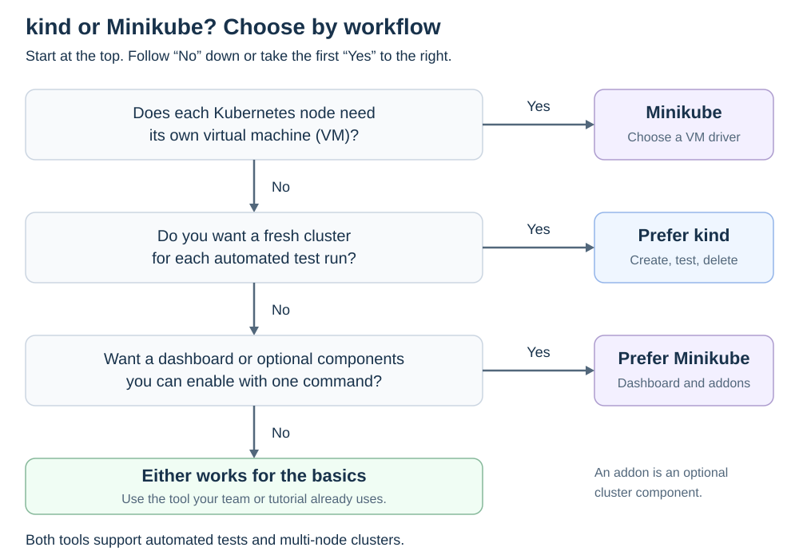

# kind vs Minikube

[Back to Kubernetes](../Readme.md#content)

**Choose kind when each test run needs a fresh Kubernetes cluster. Choose Minikube when you want a dashboard for local practice or need each node to run in its own virtual machine (VM).** Either tool works for learning Kubernetes and for continuous integration (CI), where tests run automatically as code changes.

A **node** is a machine in the cluster. kind runs each node as a container, even when the container software itself runs inside a VM. In Minikube, the **driver** determines how the node runs.

## What changes in practice?

A Kubernetes **Service** gives an app a stable network address. A Service of type `LoadBalancer` asks for a load balancer that can accept traffic from outside the cluster.

| Task | kind | Minikube |
| --- | --- | --- |
| Run the nodes | Uses Docker, Podman, or nerdctl to create node containers. A configuration file can define several nodes. | Offers container and VM drivers. Available drivers depend on your operating system. Linux also has an advanced `none` driver that runs Kubernetes directly on the host. |
| Repeat a test or resume a lab | Run `kind create cluster`, run the tests, then use `kind delete cluster`. The next run can start clean with the same configuration. | `minikube stop` keeps cluster data. Use `minikube start` to resume the lab and `minikube dashboard` to explore its resources in a browser. |
| Reach a local app | Port mappings can send traffic from your computer to a node. Cloud Provider KIND is a separate tool for Services of type `LoadBalancer`. | For a Service of type `LoadBalancer`, keep `minikube tunnel` running so your computer can reach the Service at its external address. |

## How to choose

Start with any requirement for how the nodes run. Then follow the branch for the work you do most often. For a basic tutorial, following its choice lets you use its setup commands as written.

Both tools can run a multi-node cluster on one computer. That lets you practice how Kubernetes distributes work across nodes, while the nodes still share the computer’s CPU and memory.

# Sources

- [kind — Purpose and features](https://kind.sigs.k8s.io/)
- [kind — Node configuration and host access](https://kind.sigs.k8s.io/docs/user/configuration/)
- [kind — Local LoadBalancer support](https://kind.sigs.k8s.io/docs/user/loadbalancer/)
- [Minikube — Drivers by operating system](https://minikube.sigs.k8s.io/docs/drivers/)
- [Minikube — Getting started and developer tools](https://minikube.sigs.k8s.io/docs/start/)
- [Minikube — Accessing applications](https://minikube.sigs.k8s.io/docs/handbook/accessing/)
- [Minikube — Stop and resume](https://minikube.sigs.k8s.io/docs/commands/stop/)
- [Minikube — Multiple nodes](https://minikube.sigs.k8s.io/docs/tutorials/multi_node/)
- [Minikube — Continuous integration](https://minikube.sigs.k8s.io/docs/tutorials/continuous_integration/)
