# Chapter 1: Scale from Zero to Millions of Users
[Back to System Design](../Readme.md#content)

## Introduction

Scaling a system to support millions of users is a complex, iterative journey requiring refinement and optimization. This chapter outlines how to begin with a single-server setup and scale the architecture step by step to handle millions of users.

## Section 1: Single Server Setup

Initially, all components (web app, database, cache) run on a single server.

   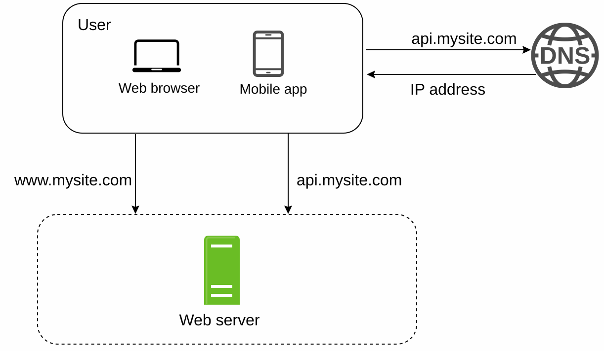

### Request Flow

1. Users access the application via domain names (e.g., `api.mysite.com`), resolved to IP addresses using DNS.
2. The Internet Protocol (IP) address of the web server is returned to the browser or mobile app.
3. Once the IP address is obtained, Hypertext Transfer Protocol (HTTP) [[1]](#ref-1) requests are sent directly to your web server.
4. The web server returns HTML pages or JSON responses for rendering.

### Traffic Sources

1. **Web Applications:** Use server-side languages (e.g., Python, Java) for business logic and client-side languages (e.g., JavaScript, HTML) for presentation.
2. **Mobile Applications:** Communicate with the web server using HTTP and JSON for lightweight data exchange.

## Section 2: Database Separation

As the user base grows, the database is moved to a dedicated server to allow independent scaling of web and database tiers.

   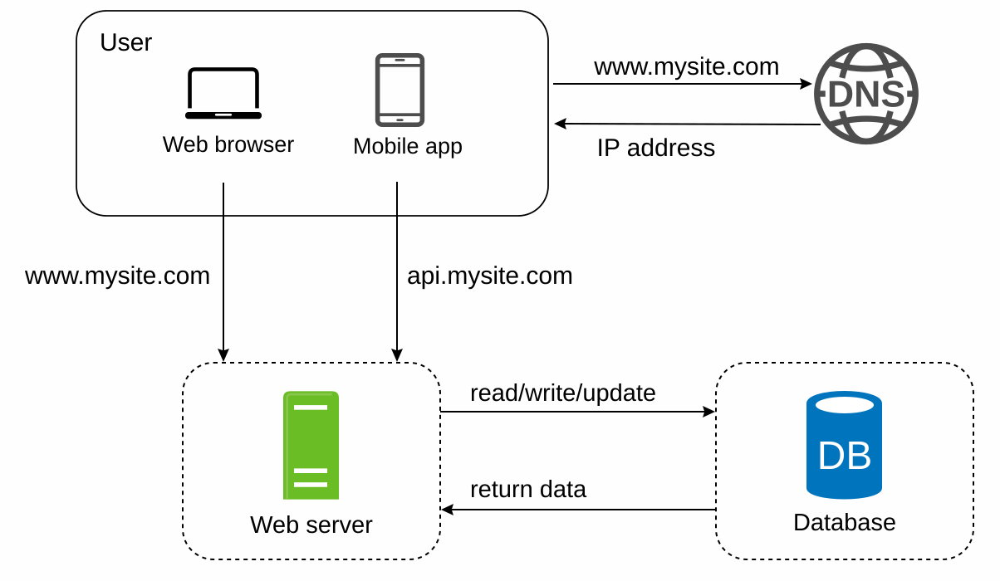

### Database Choices

1. **Relational Databases (SQL):** Structured data stored in tables. Examples: MySQL, PostgreSQL.
2. **Non-Relational Databases (NoSQL):** Suitable for unstructured data or low-latency requirements. Categories include:
   - Key-Value Stores
   - Graph Databases
   - Column Stores
   - Document Stores

- Non-relational databases might be the right choice if:
   - The application requires extremely low latency.
   - The data is unstructured, or there is no relational data.
   - The application only needs to serialize and deserialize data (JSON, XML, YAML, etc.).
   - The application needs to store a massive amount of data.

## Section 3: Vertical vs Horizontal Scaling

### Vertical Scaling

- Adds more resources (CPU, RAM) to existing servers.
- Limited by hardware constraints and lacks redundancy.

### Horizontal Scaling

- Adds more servers to the pool, making it more suitable for large-scale systems.
- A load balancer is used to handle request routing between the servers.

## Section 4: Load Balancer

   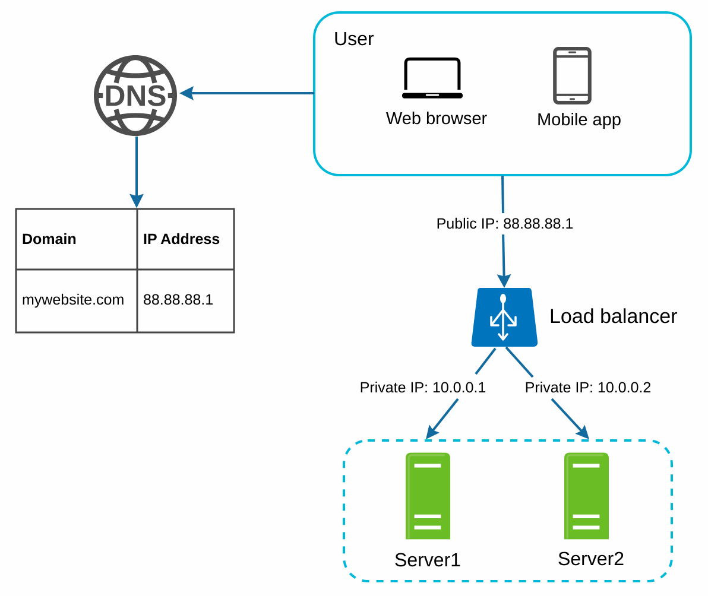

A **load balancer** distributes traffic among multiple servers. Benefits include:
1. Redundancy: If a server goes offline, traffic is rerouted.
   - If server 1 goes offline, all the traffic will be routed to server 2.
2. Scalability: Easily add servers to handle traffic spikes.
   - If the website traffic grows rapidly, subsequent servers can be added to handle the additional traffic.

## Section 5: Database Replication

Database replication can be used in many database management systems, usually with a master/slave relationship between the original (master) and the copies (slaves). [[3]](#ref-3)

### Master-Slave Model

   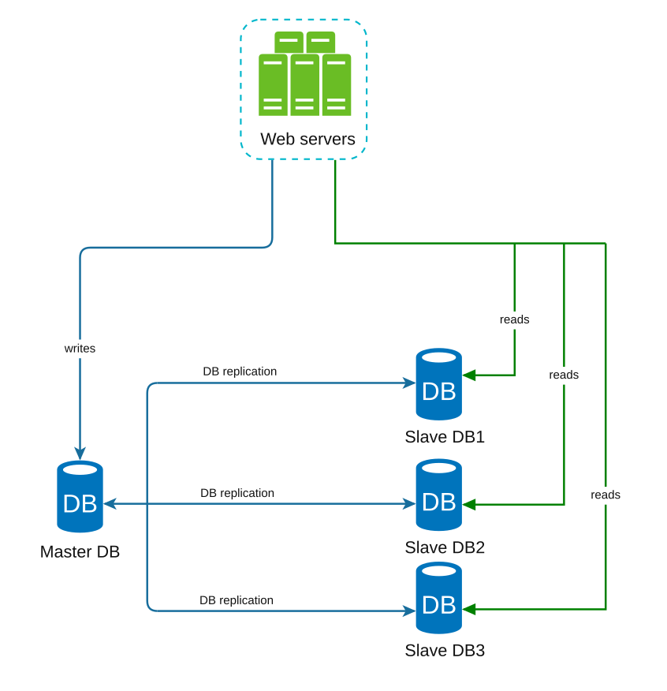

- **Master Database:**
   - Handles write operations.
   - All the data-modifying commands like insert, delete, or update must be sent to the master database.
- **Slave Databases:**
   - Handle read operations, improving performance and reliability.
   - Since the ratio of reads to writes is high in most applications, the number of slave databases in a system is usually larger than the number of master databases.

### Advantages of database replication

1. Improved performance through parallel read operations.
2. High availability and data reliability through redundancy.

### Failure Handling

- If only one slave database is available and it goes offline, read operations will be directed to the master database temporarily.
- If multiple slave databases are available, read operations are
redirected to other healthy slave databases, and a new server will replace the old one.
- If the master database goes offline, a slave database will be promoted to be the new master.
- In a production system, the chosen slave database might not be up to date; hence, its data needs to be updated by running data
recovery scripts (methods like multi-master replication and circular replication could help).

### Final design for database replication

   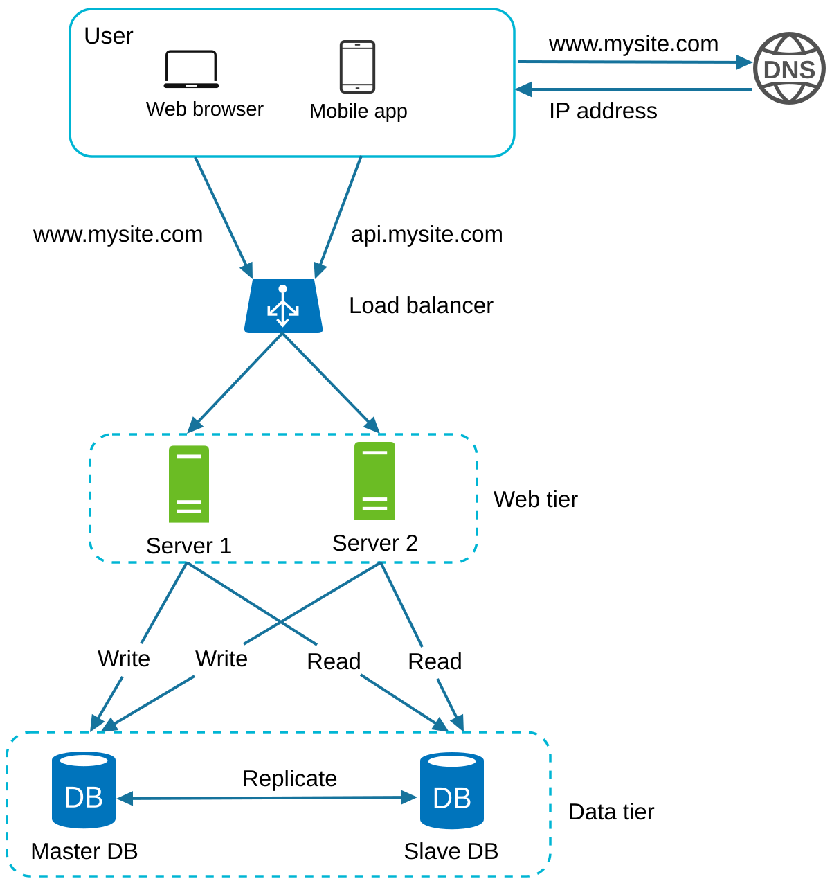

Let us take a look at the design:
* A user gets the IP address of the load balancer from DNS.
* A user connects to the load balancer using this IP address.
* The HTTP request is routed to either Server 1 or Server 2.
* A web server reads user data from a slave database.
* A web server routes any data-modifying operations to the master database. This includes write, update, and delete operations.

## Section 6: Caching

A **cache** stores frequently accessed data in memory to reduce database load. The cache tier is a temporary data store layer, much faster than the database.

   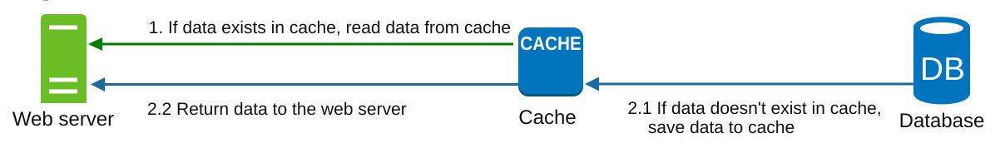

### Caching considerations

1. **Use case**: Consider using a cache when data is read frequently but modified infrequently.
2. **Expiration Policies:** Once cached data expires, it is removed from the cache. When there is no expiration policy, cached
data will be stored in memory permanently.
3. **Consistency:** This means keeping the data store and the cache in sync. Inconsistency
can happen because data-modifying operations on the data store and cache are not in a single transaction.
4. **Mitigating failures**: Because a single cache server represents a potential single point of failure, multiple
cache servers across different data centers are recommended to avoid a single point of failure (SPOF).
5. **Eviction Policies:** Once the cache is full, items need to be evicted to free up memory. LRU is the most popular cache eviction policy.

## Section 7: Content Delivery Network (CDN)

A **CDN** improves load times by caching static content (images, CSS, JavaScript) on geographically distributed servers.

   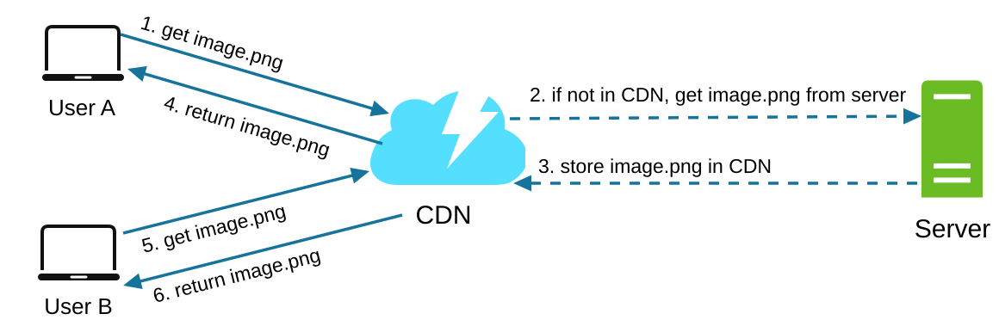

### Workflow

1. User A requests content from the nearest CDN server.
2. If the CDN server does not have image.png in the cache, the CDN server requests the file from the origin, which can be a web server or online storage like Amazon S3.
3. The origin returns image.png to the CDN server with an optional HTTP header, Time-to-live (TTL), which describes how long the image is cached.
4. The CDN caches the image and returns it to User A. The image remains cached in the CDN until the TTL expires.
5. User B sends a request to get the same image.
6. The image is returned from the cache as long as the TTL has not expired.

### CDN considerations

1. **Cost:** CDNs are run by third-party providers that charge for data transfers in and out of the CDN.
2. **Cache Expiry:** The cache expiry time should neither be too long nor too short.
3. **CDN fallback:** If there is a temporary CDN outage, clients should be able to detect the problem
and request resources from the origin.
4. **Invalidating files:** If files are updated, the cache should be invalidated to point to the updated files.

## Section 8: Web Tier

### Stateful architecture

   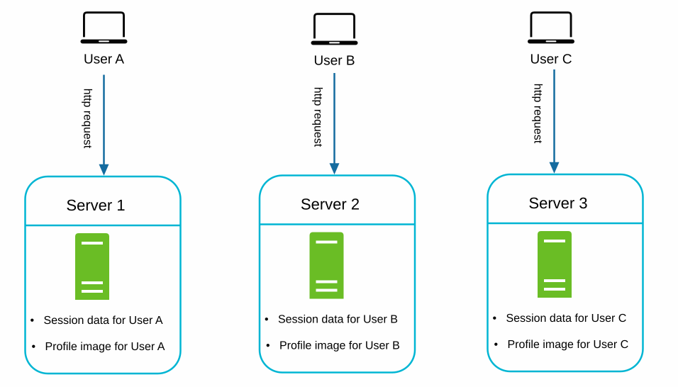

In the above image, User A's session data and profile image are stored on Server 1. To keep the user's session uninterrupted, sticky sessions are usually implemented in most load balancers [[10]](#ref-10), but this complicates adding or removing servers.

### Stateless architecture

By moving session data to a shared datastore, web servers become stateless. This allows:
1. Easier horizontal scaling.
2. Auto-scaling based on traffic.

   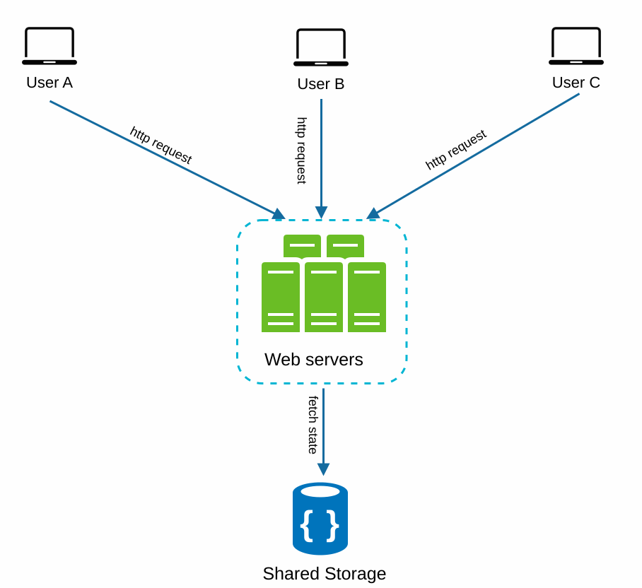

The image below shows the updated design with a stateless web tier.

   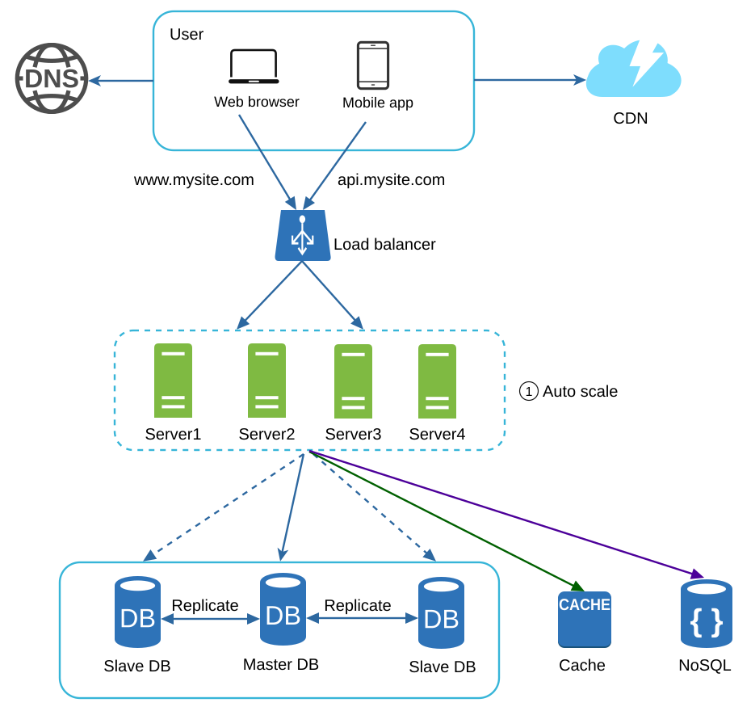

## Section 9: Multi-Data Center Setup

Deploying across multiple data centers improves availability and reduces latency. Usually, users are redirected to the nearest data center (**geoDNS-routed**, aka **geo-routed**).

   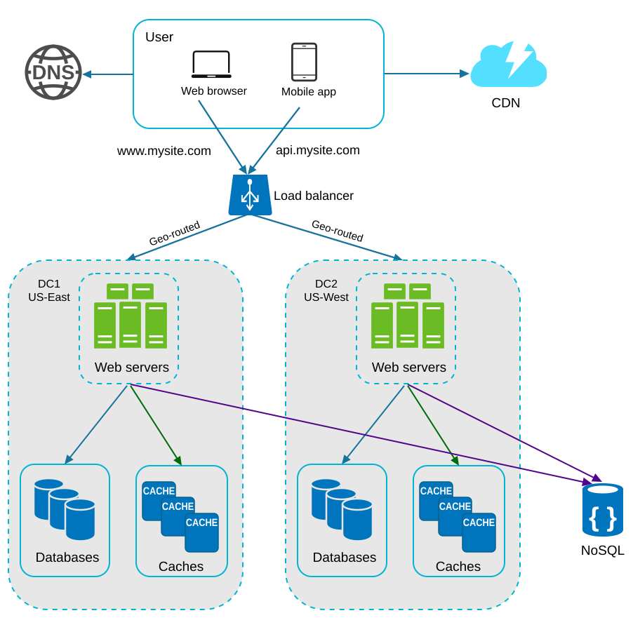

Data between data centers should be synchronized to prevent inconsistencies. In the image below, data center 2 (US-West) is offline, and 100% of the traffic is routed to data center 1 (US-East).

   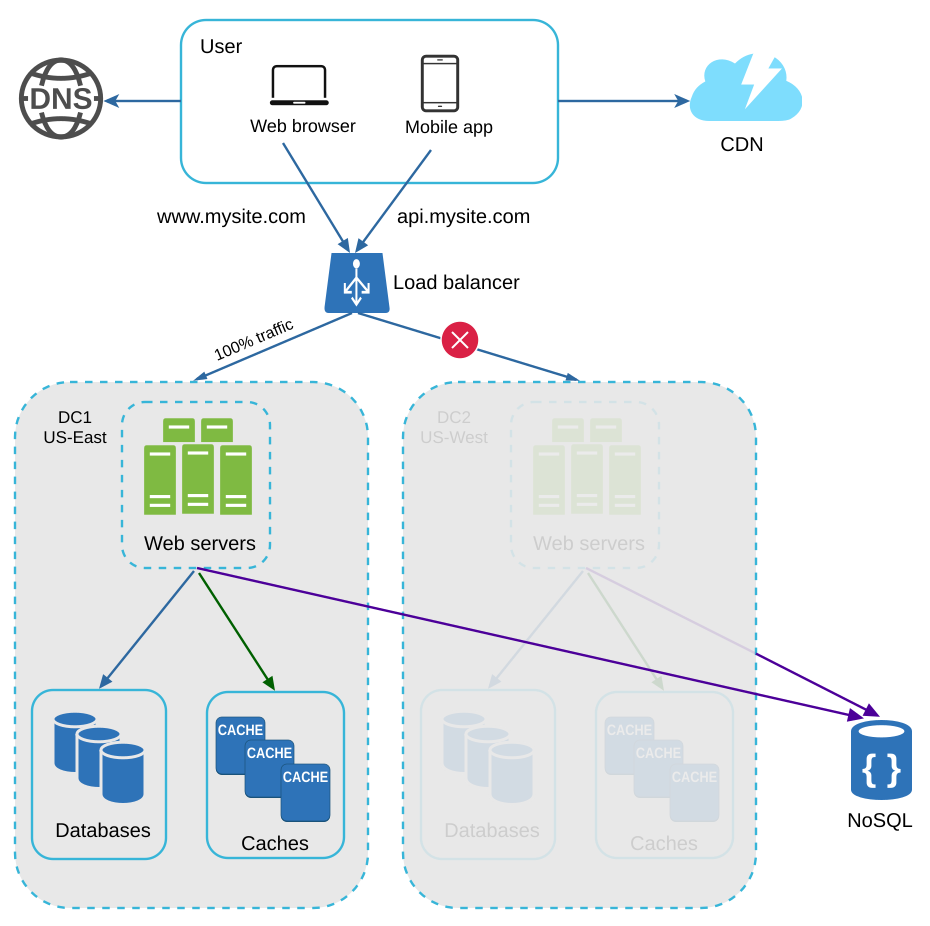

### Multi-data center setup

- **Traffic redirection:** Effective tools are needed to direct traffic to the correct data center.
- **Data synchronization:** A common strategy is to replicate data across multiple data centers.
- **Testing and deployment:** Automated deployment tools are vital to keep services consistent across all the data centers.

## Section 10: Message Queue

A **message queue** is a durable component, stored in memory, that supports asynchronous communication. It serves as a buffer and distributes asynchronous requests.

   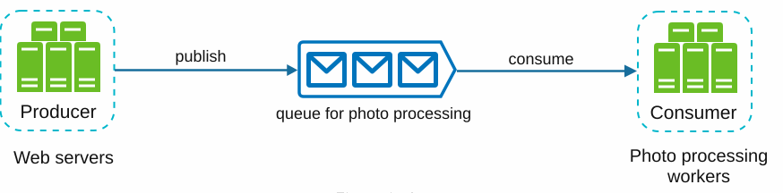

- Input services, called producers/publishers, create messages and publish them to a message queue.
- Other services, called consumers/subscribers, connect to the queue and perform actions defined by the messages.

## Section 11: Logging, Metrics, and Automation

   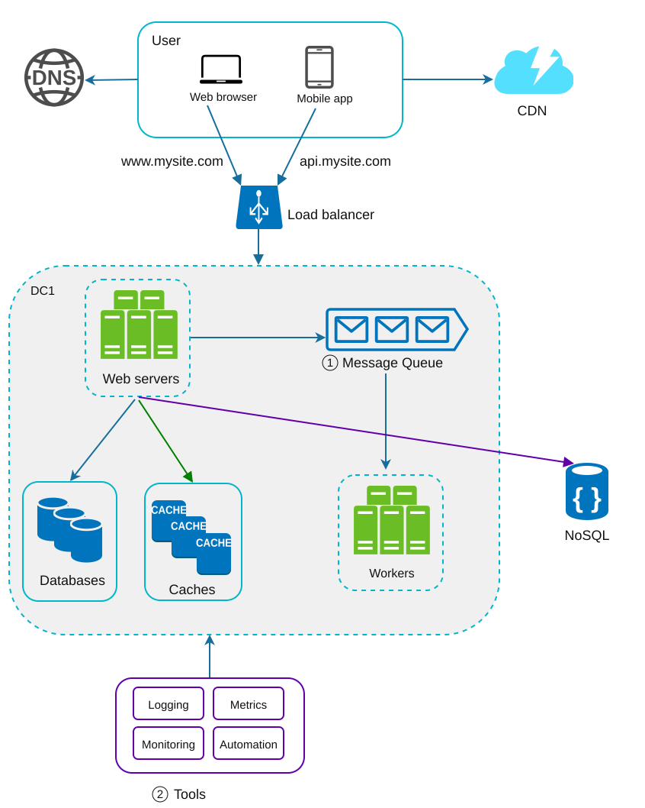

### Importance

1. **Logging:** Tracks errors and system health.
2. **Metrics:** Provide insights into performance and user activity.
3. **Automation:** Streamlines testing, deployment, and scaling.

## Section 12: Database Scaling

### Vertical Scaling

- Adds hardware resources but has physical and cost limitations.
- Has multiple drawbacks:
   - Greater risk of single points of failure.
   - The overall cost of vertical scaling is high.

### Horizontal Scaling

Horizontal scaling, aka sharding, is the practice of adding more servers.

   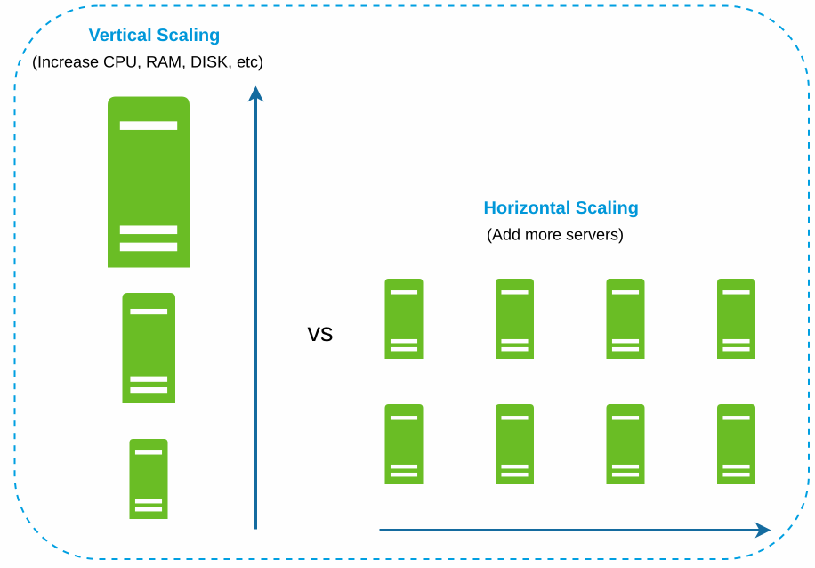

- Divides data across multiple shards using keys (e.g., `user_id`).
   - Sharding separates large databases into smaller, more easily managed parts called shards.
   - Each shard shares the same schema, though the actual data on each shard is unique to the shard.
- A sharding key is critical when implementing a sharding strategy. When choosing a sharding key, it is important to choose one that can evenly distribute data.

The image below shows an example of sharded databases.

   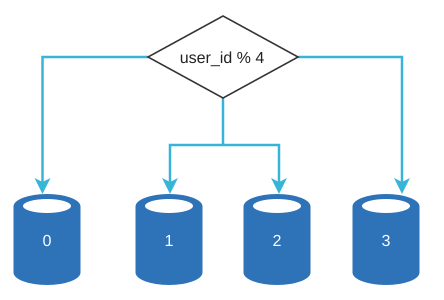

The image below shows the user table in sharded databases.

   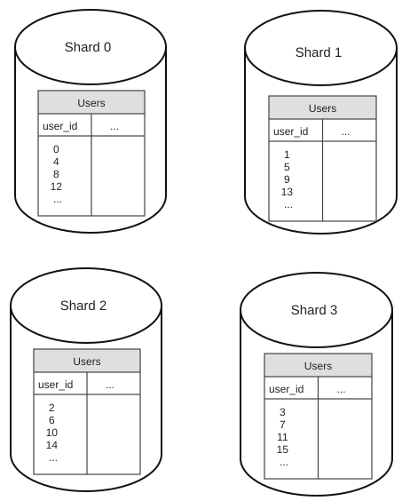

#### Challenges

1. **Resharding data:** Resharding data is needed when:
   - A single shard can no longer hold more data due to rapid growth.
   - Certain shards might experience shard exhaustion faster than others due to uneven data distribution.
   - Consistent hashing is used to overcome these problems.

2. **Celebrity problem:** Excessive access to a specific shard could cause server overload.
   - To solve this problem, we may need to allocate a shard for each celebrity.

3. **Joins and denormalization:** Once a database has been sharded across multiple servers, it is hard to perform join operations across database shards.
   - A common workaround is to denormalize the database so that queries can be performed in a single table.

## Millions of users and beyond

1. Keep the web tier stateless.
2. Build redundancy at every tier.
3. Use caching and CDNs to optimize performance.
4. Scale the data tier with sharding.
5. Decouple components for flexibility.

This chapter provides a solid foundation for building scalable systems that can handle millions of users.

## Reference materials

1. [Hypertext Transfer Protocol](https://en.wikipedia.org/wiki/Hypertext_Transfer_Protocol)
2. [Should You Go Beyond Relational Databases?](https://blog.teamtreehouse.com/should-you-go-beyond-relational-databases)
3. [Replication](https://en.wikipedia.org/wiki/Replication_(computing))
4. [Multi-master replication](https://en.wikipedia.org/wiki/Multi-master_replication)
5. [NDB Cluster Replication: Multi-Master and Circular Replication](https://dev.mysql.com/doc/refman/5.7/en/mysql-cluster-replication-multi-master.html)
6. [Caching Strategies and How to Choose the Right One](https://codeahoy.com/2017/08/11/caching-strategies-and-how-to-choose-the-right-one/)
7. [Nishtala et al. (2013), Scaling Memcache at Facebook (NSDI '13)](https://www.usenix.org/conference/nsdi13/technical-sessions/presentation/nishtala)
8. [Single point of failure](https://en.wikipedia.org/wiki/Single_point_of_failure)
9. [Amazon CloudFront Dynamic Content Delivery](https://aws.amazon.com/cloudfront/dynamic-content/)
10. [Configure Sticky Sessions for Your Classic Load Balancer](https://docs.aws.amazon.com/elasticloadbalancing/latest/classic/elb-sticky-sessions.html)
11. [Active-Active for Multi-Regional Resiliency](https://netflixtechblog.com/active-active-for-multi-regional-resiliency-c47719f6685b)
12. [Amazon EC2 High Memory Instances](https://aws.amazon.com/ec2/instance-types/high-memory/)
13. [What It Takes to Run Stack Overflow](http://nickcraver.com/blog/2013/11/22/what-it-takes-to-run-stack-overflow)
14. [What the Heck Are You Actually Using NoSQL For?](http://highscalability.com/blog/2010/12/6/what-the-heck-are-you-actually-using-nosql-for.html)
