# Chapter 6: Design a Key-Value Store
[Back to System Design](../Readme.md#content)

## Introduction

A **key-value store**, also referred to as a key-value database, is a non-relational database. Each unique identifier is stored as a key with its associated value. This data pairing is known as a "key-value" pair.

This chapter details how to design a scalable, high-availability distributed key-value store that supports operations like:
- `put(key, value)` for inserting data.
- `get(key)` for retrieving data.

## Understand the problem and establish design scope

- Small key-value pairs (<10 KB).
- Supports big data with high availability and scalability.
- Automatic scaling and tunable consistency.
- Low latency.

## Single-Server Key-Value Store

- Use a **hash table** to store key-value pairs in memory.
- Optimizations:
  - Data compression.
  - Storing less frequently accessed data on disk.
- A single server's memory is limited, requiring a **distributed approach** for scalability.

## Distributed Key-Value Store

A **distributed key-value store** is also called a distributed hash table, which distributes key-value pairs across many servers. Designing distributed systems requires understanding the **CAP theorem**.

### CAP Theorem

1. **Consistency:** All clients see the same data simultaneously.
2. **Availability:** The system responds to every request, even if some nodes are down.
3. **Partition Tolerance:** The system continues to operate despite network partitions.

**Trade-off:** According to the CAP theorem, only two of the three guarantees can be achieved.

    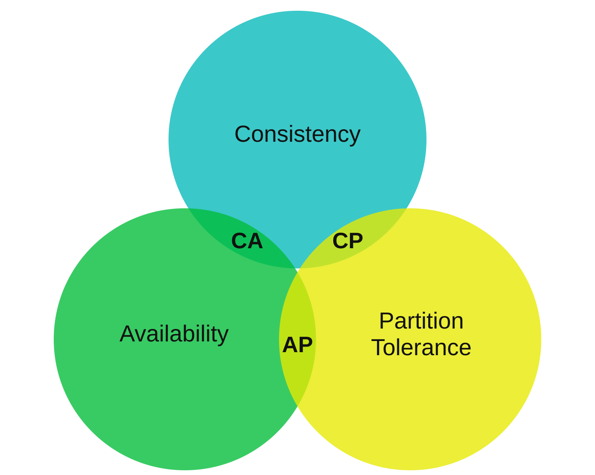

Nowadays, key-value stores are classified based on the two CAP characteristics they support:

**CP (consistency and partition tolerance) systems:** a CP key-value store supports consistency and partition tolerance while sacrificing availability.

**AP (availability and partition tolerance) systems:** an AP key-value store supports availability and partition tolerance while sacrificing consistency.

**CA (consistency and availability) systems:** a CA key-value store supports consistency and availability while sacrificing partition tolerance. Since network failure is unavoidable, a distributed system must tolerate network partitions. Thus, a CA system cannot exist in real-world applications.

#### **Real-world distributed systems**

In a distributed system, partitions are inevitable, and when a partition occurs, we must choose between consistency and availability. For example, if node `n3` goes down, any data written to nodes `n1` or `n2` cannot be propagated to `n3`. Conversely, if data is written to `n3` but not yet propagated to `n1` and `n2`, nodes `n1` and `n2` will have stale data.

    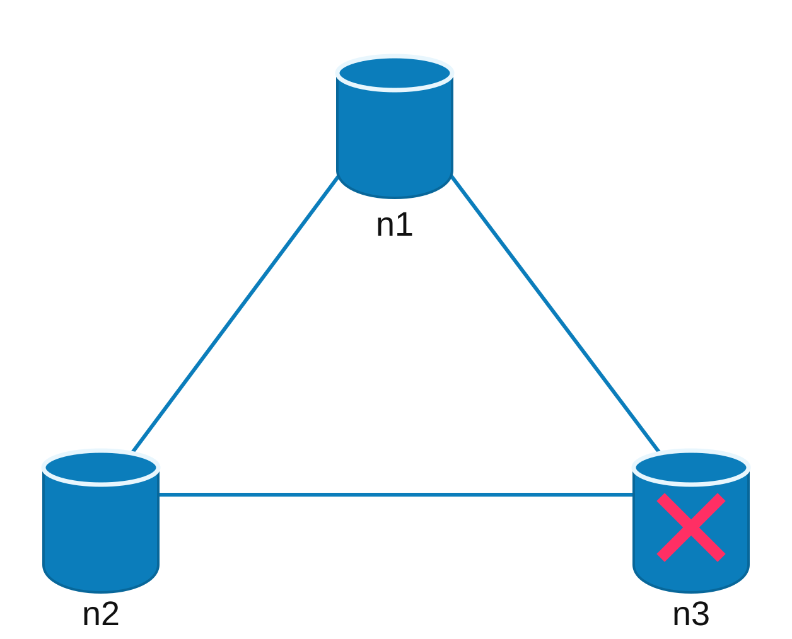

- If we choose a CP system, we must block all write operations to `n1` and `n2` to avoid data inconsistency. For example, banking systems usually have extremely high consistency requirements.
- If we choose an AP system, the system keeps accepting reads, even though it might return stale data. For writes, `n1` and `n2` keep accepting writes, and data will be synced to `n3` when the network partition is resolved.

## System Components

The content below is largely based on three popular key-value store systems: Dynamo [[4]](#ref-4), Cassandra [[5]](#ref-5), and Bigtable [[6]](#ref-6).

### Data Partition

- **Technique:** Consistent hashing is used to distribute data across multiple servers evenly.
- **Advantages:**
  - Automatic scaling with server addition/removal.
  - Heterogeneity through virtual nodes. The number of virtual nodes for a server is proportional to the server’s capacity.

    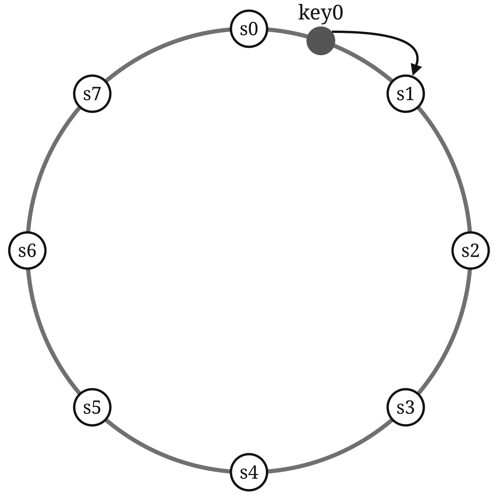

### Data Replication

- Replicate data across `N` servers for high availability.
- The N servers are chosen by walking clockwise from the server position and choosing the first N servers on the ring to store data copies. Place replicas in distinct data centers to improve reliability in case of virtual nodes.

    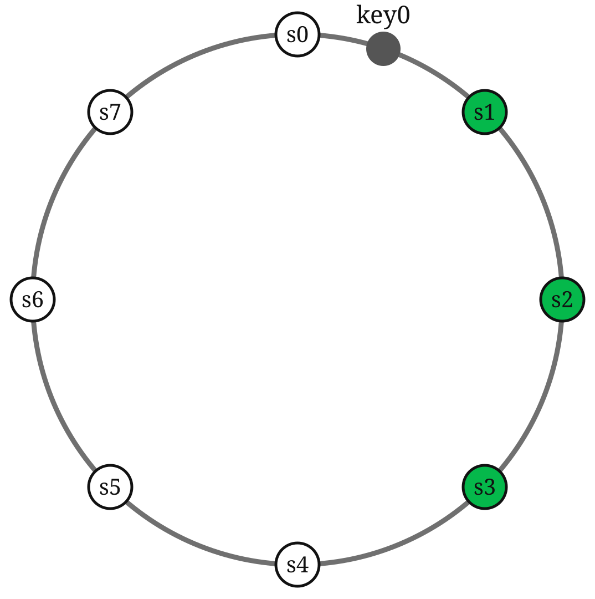

### Consistency

Since data is replicated at multiple nodes, it must be synchronized across replicas. **Quorum Consensus** can guarantee consistency for both read and write operations.
* `N`: Total replicas.
* `W`: Write quorum size. For a write to be considered successful, it must be acknowledged by W replicas.
* `R`: Read quorum size. For a read to be considered successful, it must wait for responses from at least R replicas.

    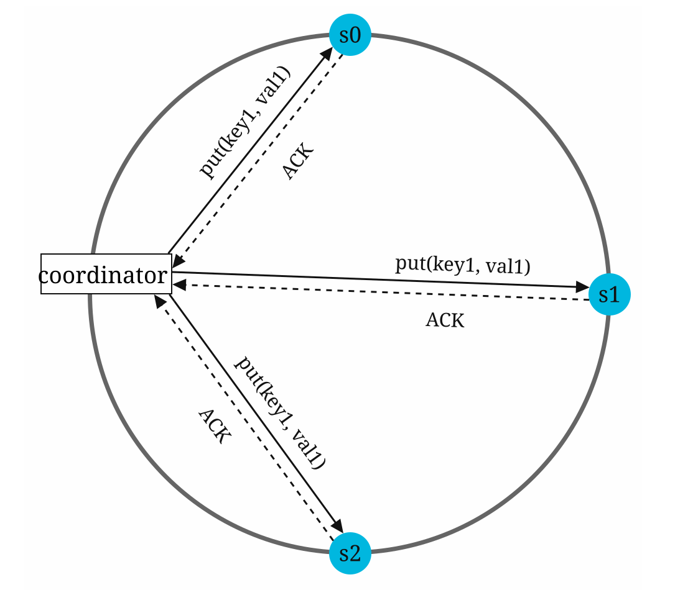

`W = 1` does not mean data is written to one server. For instance, with the configuration in the image above, data is replicated at `s0`, `s1`, and `s2`. `W = 1` means that the coordinator must receive at least one acknowledgment before the write operation is considered successful. For instance, if we get an acknowledgment from `s1`, we no longer need to wait for acknowledgements from `s0` and `s2`. A coordinator acts as a proxy between the client and the nodes.

The configuration of `W`, `R`, and `N` is a typical tradeoff between latency and consistency.

If `W + R > N`, strong consistency is guaranteed because there must be at least one overlapping node that has the latest data to ensure consistency.

Possible setups:
- If `R = 1` and `W = N`, the system is optimized for a fast read.
- If `W = 1` and `R = N`, the system is optimized for a fast write.
- If `W + R > N`, strong consistency is guaranteed (usually `N = 3`, `W = R = 2`).
- If `W + R <= N`, strong consistency is not guaranteed.

#### **Consistency models**

- **Strong Consistency:** A read operation returns a value corresponding to the most recently written data item.
- **Weak Consistency:** Subsequent read operations may not see the most recently updated value.
- **Eventual Consistency:** Given enough time, all updates are propagated, and all replicas are consistent. For example, Dynamo and Cassandra adopt eventual consistency.

### Inconsistency Resolution

Replication gives high availability but causes inconsistencies among replicas. Versioning and vector clocks are used to solve inconsistency problems. Versioning means treating each data modification as a new immutable version of data.

Let us see how inconsistency happens.

As shown in the image below, both replica nodes `n1` and `n2` have the same value. Let us call this value the original `value`. `Server 1` and `server 2` get the same value for the `get(name)` operation.

    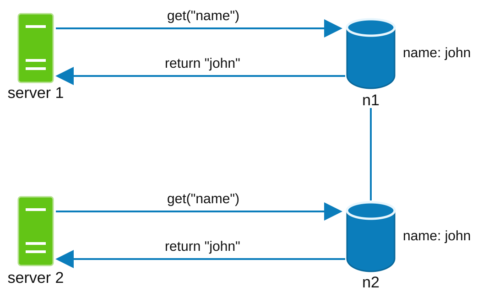

Next, `server 1` changes the name to "johnSanFrancisco", and `server 2` changes the name to "johnNewYork" as shown in the image below. These two changes are performed simultaneously. Now, we have conflicting values, called versions `v1` and `v2`.

    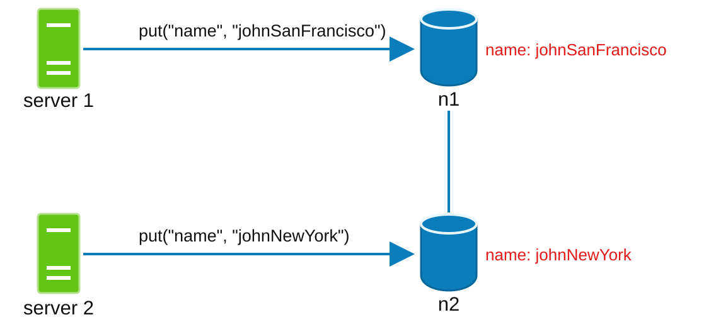

#### **Vector Clock**

To resolve the aforementioned issue, we need a versioning system that can detect conflicts and reconcile conflicts. A **vector clock** is a common technique to solve this problem. Let us examine how vector clocks work.

A vector clock is a `[server, version]` pair associated with a data item. It can be used to check whether one version precedes, succeeds, or conflicts with others.

Assume a vector clock is represented by `D([S1, v1], [S2, v2], …, [Sn, vn])`, where `D` is a data item, `v1` is a version counter, and `S1` is a server number. If data item `D` is written to server `Si`, the system must perform one of the following tasks:
* Increment `vi` if `[Si, vi]` exists.
* Otherwise, create a new entry `[Si, 1]`.

The above abstract logic is explained with a concrete example as shown in the image below.

    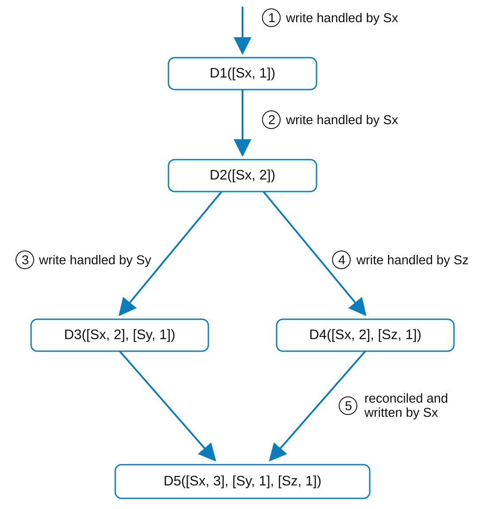

1. A client writes a data item `D1` to the system, and the write is handled by server `Sx`, which now has the vector clock `D1([Sx, 1])`.
2. Another client reads the latest `D1`, updates it to `D2`, and writes it back. `D2` descends from `D1`, so it overwrites `D1`. Assume the write is handled by the same server `Sx`, which now has the vector clock `D2([Sx, 2])`.
3. Another client reads the latest `D2`, updates it to `D3`, and writes it back. Assume the write is handled by server `Sy`, which now has the vector clock `D3([Sx, 2], [Sy, 1])`.
4. Another client reads the latest `D2`, updates it to `D4`, and writes it back. Assume the write is handled by server `Sz`, which now has `D4([Sx, 2], [Sz, 1])`.
5. When another client reads `D3` and `D4`, it discovers a conflict, which is caused by data item `D2` being modified by both `Sy` and `Sz`. The conflict is resolved by the client, and the updated data is sent to the server. Assume the write is handled by `Sx`, which now has `D5([Sx, 3], [Sy, 1], [Sz, 1])`.

**Downsides of vector clocks**:
- Increased complexity for clients.
- Vector clock size may grow with many updates, requiring trimming strategies to limit its size.

## Handling Failures

### **Failure Detection**

It is insufficient to believe that a server is down because another server says so. Usually, it requires at least two independent sources of information to mark a server down.

All-to-all multicasting is a straightforward solution. However, this is inefficient when many servers are in the system.

#### **Gossip Protocol:**

A better solution is to use decentralized failure detection methods like **gossip protocols**. Gossip protocols work as follows:
- Each node maintains a node membership list, which contains member IDs and heartbeat counters.
- Each node periodically increments its heartbeat counter.
- Each node periodically sends heartbeats to a set of random nodes, which in turn propagate them to another set of nodes.
- Once nodes receive heartbeats, their membership lists are updated with the latest info.
- If the heartbeat has not increased for more than a predefined period, the member is considered offline.

    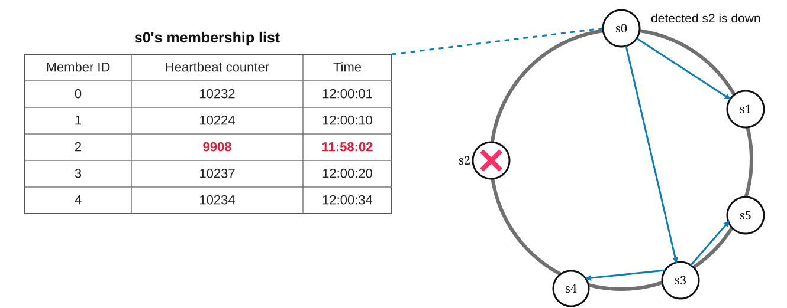

As shown in the image above:
* Node `s0` maintains a node membership list shown on the left side.
* Node `s0` notices that node `s2`'s (member ID = 2) heartbeat counter has not increased for a long time.
* Node `s0` sends heartbeats that include `s2`'s info to a set of random nodes. Once other nodes confirm that `s2`'s heartbeat counter has not been updated for a long time, node `s2` is marked down, and this information is propagated to other nodes.

### **Handling Temporary Failures**

After failures have been detected through the gossip protocol, the system needs to deploy certain mechanisms to ensure availability.

#### **Sloppy Quorum:**

A technique called **sloppy quorum** [[4]](#ref-4) is used to improve availability.

Instead of enforcing the quorum requirement, the system chooses the first `W` healthy servers for writes and the first `R`
healthy servers for reads on the hash ring. Offline servers are ignored.

If a server is unavailable due to network or server failures, another server will process requests temporarily. When the down server is up, changes will be pushed back to achieve data consistency. This process is called **hinted handoff**. Since `s2` is unavailable in the image below, reads and writes will be handled by `s3` temporarily. When `s2` comes back online, `s3` will hand the data back to `s2`.

    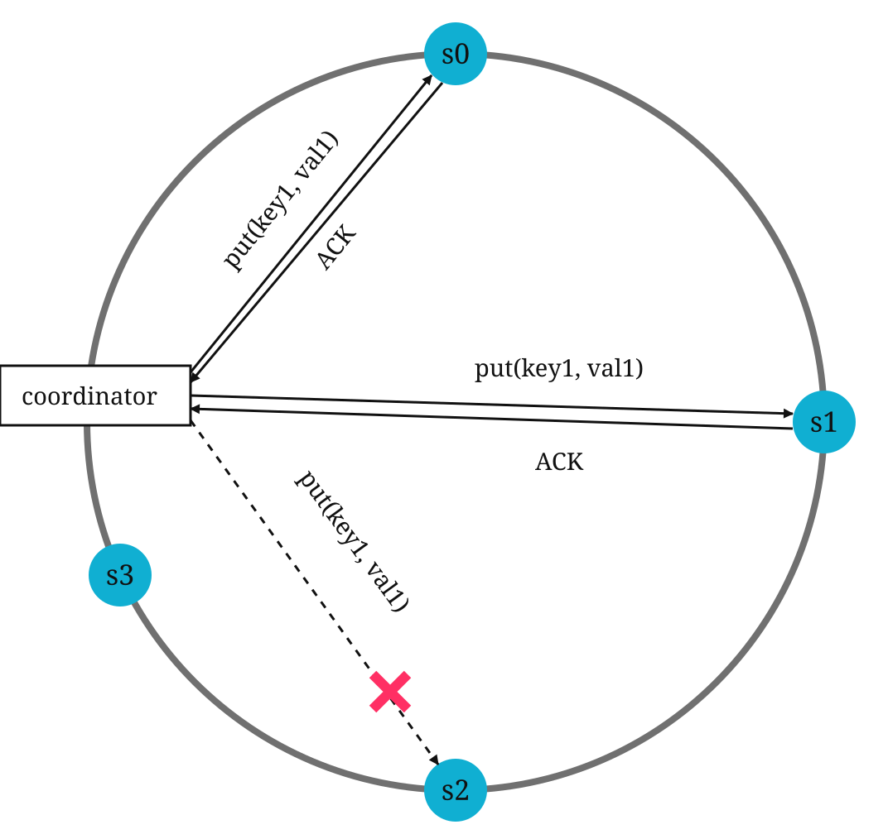

### **Handling Permanent Failures**

#### **Anti-Entropy protocol**

An **anti-entropy protocol** is a background synchronization process used in distributed systems to detect data discrepancies across replicas and bring them into eventual consistency.

This protocol involves comparing each piece of data on replicas and updating each replica to the newest version. A Merkle tree is used for inconsistency detection and minimizing the amount of data transferred.

* A **Merkle Tree** (or hash tree) is a data structure to efficiently detect and resolve inconsistencies between replicas during permanent failures.
* **Leaf Nodes** store the hash of individual data blocks.
* **Non-Leaf Nodes** store the hash of their child nodes.
* The **root hash** represents the combined state of all data in the tree.

Assuming the key space is from 1 to 12, the following steps show how to build a Merkle tree. Highlighted boxes indicate inconsistency.

**Step 1:** Divide the key space into buckets.

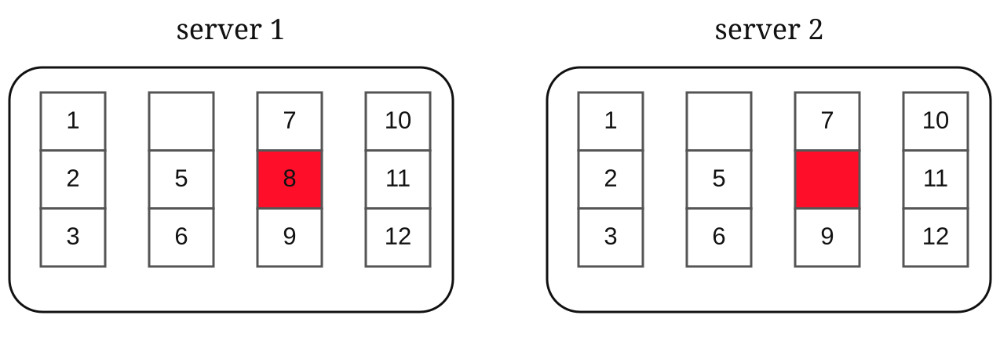

**Step 2:** Once the buckets are created, hash each key in a bucket using a uniform hashing method.

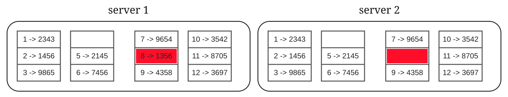

**Step 3:** Create a single hash node per bucket.

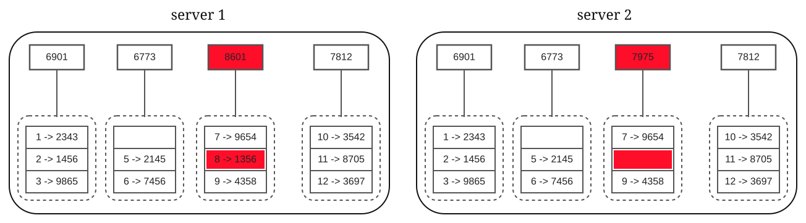

**Step 4:** Build the tree upwards to the root by calculating the hashes of the children.

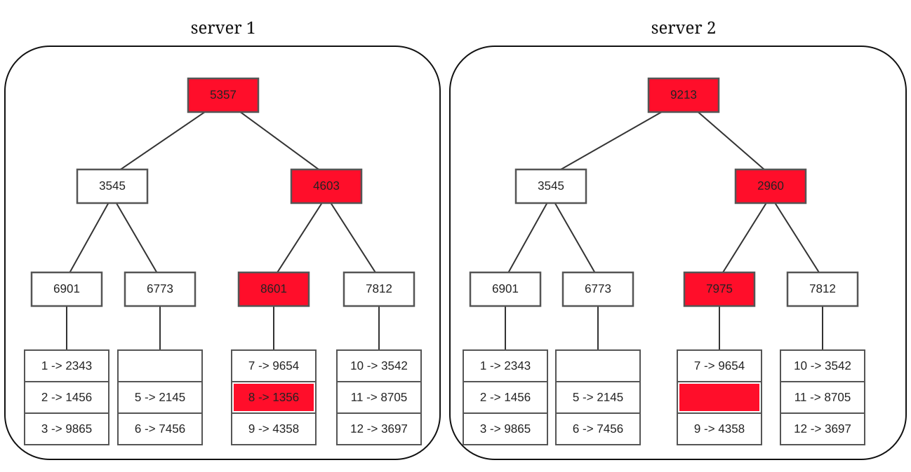

To compare two Merkle trees, start by comparing the root hashes. If the root hashes match, both servers have the same data. If the root hashes disagree, then the left child hashes are compared, followed by the right child hashes. You can traverse the tree to find which buckets are not synchronized and synchronize those buckets only.

**Advantages:**
- **Efficiency:** Only inconsistent data is synchronized, reducing data transfer.
- **Scalability:** Effective for large datasets with minimal synchronization overhead.
- **Reliability:** Ensures data consistency across replicas.

### **Handling Data Center Outages**

Replicate data across multiple data centers to ensure availability during outages.

## System Architecture

    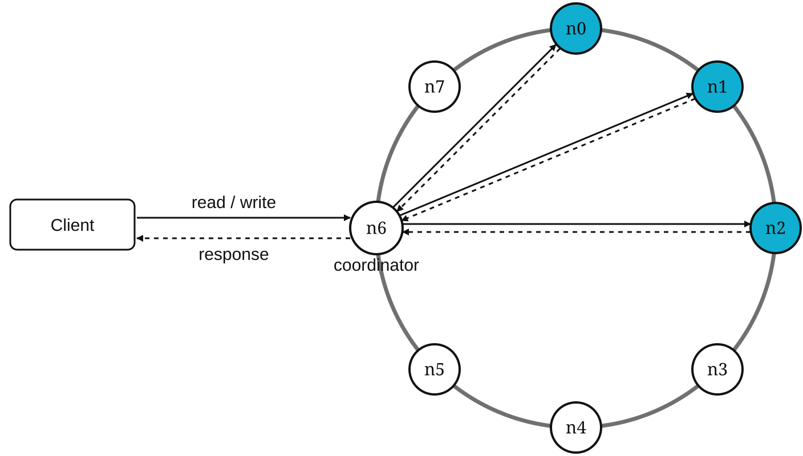

- Clients communicate with the key-value store through simple APIs: `get(key)` and `put(key, value)`.
- A coordinator is a node that acts as a proxy between the client and the key-value store.
- Nodes are distributed on a ring using consistent hashing.
- The system is completely decentralized, so adding and moving nodes can be automatic.
- Data is replicated at multiple nodes.
- There is no single point of failure as every node has the same set of responsibilities.

### Node

As the design is decentralized, each node performs many tasks as presented in the image below.

    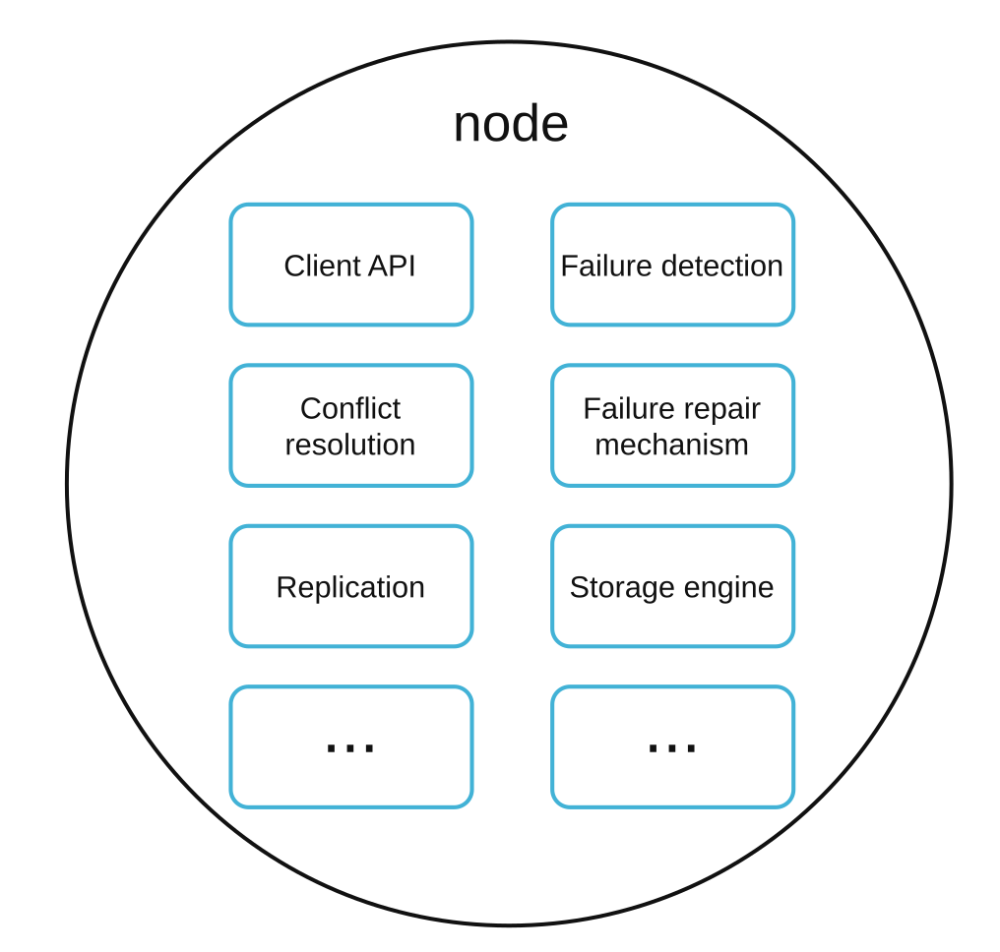

### Write Path

The image below explains what happens after a write request is directed to a specific node.

Please note the proposed designs for write/read paths are primarily based on the architecture of **Cassandra** [[8]](#ref-8).

    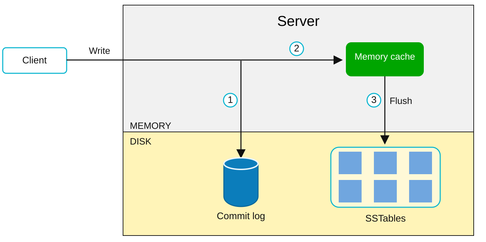

1. The write request is persisted in a **commit log** file.
2. Data is saved in the **memory cache**.
3. When the memory cache is full or reaches a predefined threshold, data is flushed to an **SSTable** [[9]](#ref-9) on disk.

> Note: A **sorted-string table (SSTable)** is a sorted list of `<key, value>` pairs.

### Read Path

After a read request is directed to a specific node, the node first checks if data is in the memory cache. If so, the data is returned to the client as shown in the image below.

    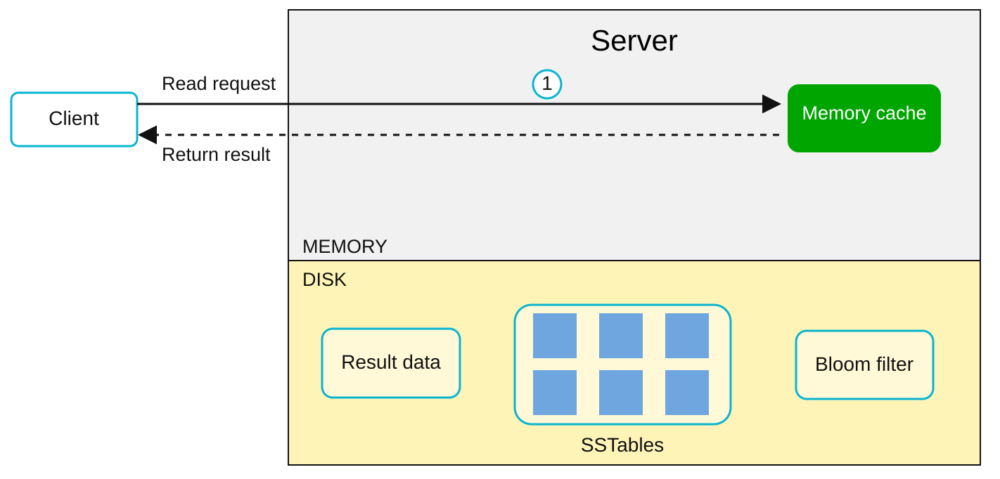

If the data is not in memory, it will be retrieved from the disk instead. We need an efficient way to find out which SSTable contains the key. A Bloom filter [[10]](#ref-10) is commonly used to solve this problem. The read path is shown in the image below when data is not in memory.

    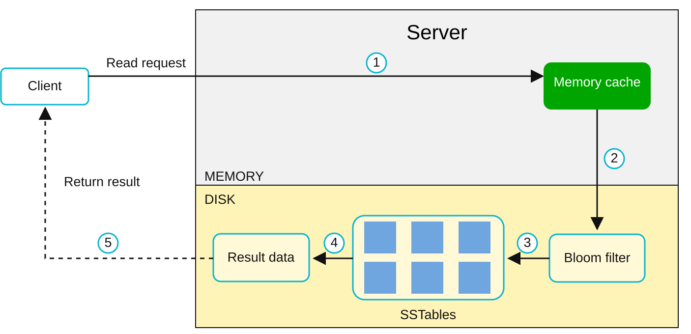

1. The system first checks if data is in the **memory cache**. If not, go to step 2.
2. If data is not in memory, the system checks the **Bloom Filter**.
3. The **Bloom Filter** is used to figure out which SSTables might contain the key.
4. SSTables return the result of the data set.
5. The result of the data set is returned to the client.

## Reference materials

1. [Amazon DynamoDB](https://aws.amazon.com/dynamodb/)
2. [memcached](https://memcached.org/)
3. [Redis](https://redis.io/)
4. [Dynamo: Amazon’s Highly Available Key-value Store](https://www.allthingsdistributed.com/files/amazon-dynamo-sosp2007.pdf)
5. [Cassandra](https://cassandra.apache.org/)
6. [Bigtable: A Distributed Storage System for Structured Data](https://static.googleusercontent.com/media/research.google.com/en//archive/bigtable-osdi06.pdf)
7. [Merkle tree](https://en.wikipedia.org/wiki/Merkle_tree)
8. [Cassandra architecture](https://cassandra.apache.org/doc/latest/architecture/)
9. [SSTable](https://www.igvita.com/2012/02/06/sstable-and-log-structured-storage-leveldb/)
10. [Bloom filter](https://en.wikipedia.org/wiki/Bloom_filter)
